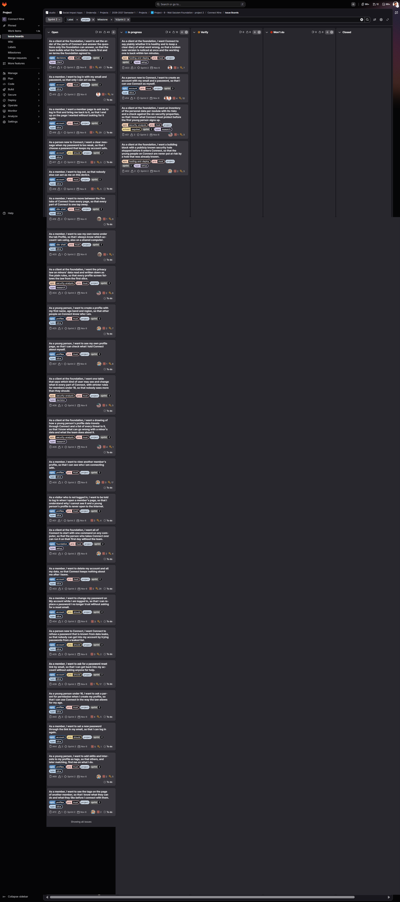
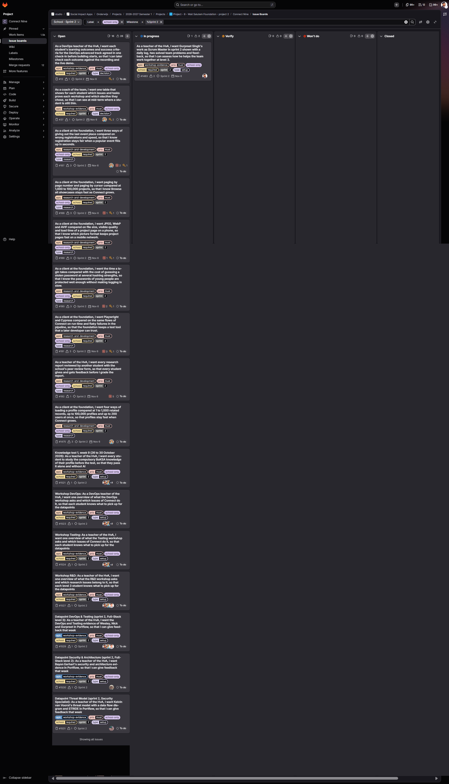

# Board checklist, sprint 2

The same seven questions are used on 19 October and on 2 November, so the two checks can be compared. Each check gets a screenshot of both boards of the milestone Sprint 2, the project board and the school board, in `images/`.

Task: [#1485][1485]. Codes: MS1, MS4.

## The seven questions and the risk each one catches

| # | Question | The risk it catches before it becomes a problem |
|---|---|---|
| 1 | Does every task in the sprint have an owner? | A task without an owner is picked up by nobody, or by two people at once. It shows up only at the end of the sprint, when it is too late to finish. |
| 2 | Does the status on the board match what was said at the stand-up? | When the board and the stand-up differ, the board shows work that is not happening. Planning, the Product Owner and the sprint review then rely on a wrong picture. |
| 3 | Are tasks that depend on each other linked with "blocks" and "is blocked by", both ways? | Without the link, a team member starts a task whose base is not there yet, or nobody sees that one late task holds up three others. |
| 4 | Is a task in Doing for more than two working days without a change? | A task that does not move is the first sign that someone is stuck, the task is too big, or information is missing. Asking on day two costs less than finding out on the last day. |
| 5 | Is a merge request waiting for review for more than one working day? | Review is the bottleneck between done and merged. Work that waits for review blocks the tasks after it and piles up at the end of the sprint. |
| 6 | Is a task too big or unclear to finish in a few days, or does it miss acceptance criteria? | A big or vague task cannot be estimated, reviewed or tested. Splitting it early keeps the work transferable and lets others help. |
| 7 | Does the remaining work fit the time left in the sprint? | When it does not fit, the Product Owner has to choose what moves, early and on purpose, instead of the Sprint Goal failing by accident. |

## Check 1, 19 October 2026

Screenshots, taken on 19 October 2026 after the stand-up:

- Project board Sprint 2, 10:14: 
- School board Sprint 2, 10:15: 

The column What I found was filled from GitLab on 19 October 2026 at 08:51, before the first stand-up: the milestone Sprint 2 with all 242 issues and tasks, their status, owner, weight and links, and the 14 open merge requests with their approvals.

| # | Answer (yes, no, partly) | What I found (issue numbers) | What I did | Changed on the board |
|---|---|---|---|---|
| 1 | No | 11 of the 27 open issues on the project board have no owner: [#11][11], [#16][16], [#17][17], [#18][18], [#31][31], [#33][33], [#34][34], [#35][35], [#39][39], [#40][40], [#44][44]. 147 of the 197 open tasks of the sprint have no owner. [#11][11] has no owner but blocks [#14][14], [#21][21], [#24][24], [#28][28], [#29][29] and [#34][34]. | Not yet. Next step: at the stand-up of 20 October, ask for an owner for [#16][16], [#17][17] and [#18][18] first, because the rest of the sprint waits on them. | [#11][11] got an owner on 19 October: Wesley Oerlemans assigned it to Bayon Eerhart, who takes it in sprint 2. The other 10 issues still have no owner. |
| 2 | Partly | 4 issues stand in In progress, all carried over from sprint 1: [#14][14] (Gurpreet Singh, Nick Hoebe), [#21][21] (Kelvin van Voorst), [#22][22] (Wesley Oerlemans), [#23][23] (Gurpreet Singh). Only one task is In progress: [#311][311] of [#23][23]. [#21][21] and [#22][22] stand in In progress, but none of their tasks does, and both wait on an open issue ([#11][11], and [#14][14] and [#1][1]). To ask at the stand-up: who works on what right now. | Compared the board with the stand-up and moved the items that did not match, see the [daily log of 19 October](dailyLog/2026-10-19.md). | [#19][19] (Bayon Eerhart) to In progress. [#262][262] (Nick Hoebe), [#266][266] and [#12][12] (Wesley Oerlemans) to Verify, because their merge requests wait for review. [#1483][1483] to In progress and [#1484][1484] to Verify. Does not match yet: [#7][7] is closed while [!59][mr59] is still open, and [#22][22] was not named at the stand-up. |
| 3 | Partly | The issues are linked well: 255 links blocks and 75 is blocked by. The tasks have no links at all, also where one task needs another first, for example the table, then the server address, then the page, then the browser test of one issue. Almost the whole sprint waits on [#14][14]: [#14][14] blocks [#15][15], [#15][15] blocks [#16][16], [#18][18], [#19][19], [#25][25] and [#39][39], and [#16][16] blocks [#17][17], [#30][30], [#31][31], [#35][35] and [#44][44]. [#14][14] itself still waits on [#1][1], [#10][10] and [#12][12] of sprint 1, and on [#11][11]. | Asked Wesley Oerlemans what is still needed to close the sprint 1 issues that [#14][14] waits on ([P2 in the problem log](problemLog.md#p2)). | [#1][1] is closed. [#12][12] waits on the review of [!58][mr58]. The links between tasks are not added yet; that follows this week. |
| 4 | Yes | Last change of the issues In progress: [#14][14] and [#21][21] on 10 October, [#23][23] on 12 October, [#22][22] and task [#311][311] on 14 October. The autumn break explains part of it, so ask whether each one is still being worked on. Gurpreet Singh has 3 items In progress ([#14][14], [#23][23], [#311][311]), the limit of 3 per person in docs/team/gitlabSetup.md. | Asked at the stand-up who works on what right now: [#14][14] Nick Hoebe, [#21][21] Kelvin van Voorst, [#23][23] and [#311][311] Gurpreet Singh. | [#311][311] moved to Verify after its merge request [!65][mr65]. [#22][22] is asked about at the next stand-up. |
| 5 | Yes | 14 merge requests into dev are open. 12 of them have no approval yet, waiting since 13 October ([!47][mr47] to [!53][mr53], six of them for task [#262][262], by Nick Hoebe) and 14 October ([!54][mr54], [!57][mr57] to [!60][mr60], by Wesley Oerlemans). [!42][mr42] (since 9 October) and [!45][mr45] (since 10 October) are approved, have a green pipeline and no conflicts, but are not merged. On every merge request all five team members are reviewer, the author too, so nobody in particular is responsible for a review. | Reviewed all 12 merge requests against their task, with a comment on each, and agreed with the team that the open merge requests are reviewed and approved (A3 in the daily log, [P4 in the problem log](problemLog.md#p4)). | [!54][mr54] is approved. The other 11 have requested changes, which Nick Hoebe and Wesley Oerlemans fix. [#262][262], [#266][266] and [#12][12] moved to Verify. |
| 6 | Partly | Every issue has acceptance criteria. [#14][14] has weight 5 and 9 tasks, of which 7 are still open after a whole sprint. [#11][11] has weight 3 and 11 tasks, the questions for the client, and no owner. Task [#262][262] is split over six merge requests, which hints that the task is too big. The tasks have no weight, so the board does not show how big a task is. | | |
| 7 | No | The open issues of Sprint 2 weigh 85: 55 on the project board and 30 on the school board, with 44 issues and 197 tasks. Decision 004 sets the pace at about 60 weight per sprint of three weeks and planned 63 for sprint 2 on 9 October. docs/project/sprintGoals.md now gives sprint 2 an open weight of 85, because issues moved into it on 10 October. Sprint 1 planned 50 and finished no slice. Knowledge test 1 is on 26 October. For the Product Owner: what goes first if not everything fits. | | |

## Check 2, 2 November 2026

Screenshots, taken the same way as on 19 October: `images/board-2026-11-02.png` (project board) and `images/board-school-2026-11-02.png` (school board).

| # | Answer (yes, no, partly) | What I found (issue numbers) | What I did | Changed on the board |
|---|---|---|---|---|
| 1 | | | | |
| 2 | | | | |
| 3 | | | | |
| 4 | | | | |
| 5 | | | | |
| 6 | | | | |
| 7 | | | | |

## Comparison of the two checks

- What the first check found, and what changed on the board because of it:
- Where the board did not show the real work, and how it was fixed:
- Which question found the most, and what that says about how the team works:

[1485]: https://gitlab.fdmci.hva.nl/studio/social-impact-apps/onderwijs/projects/2026-2027-semester-1/projects/project-9-wail-salutem-foundation-project-2/connect-nine/-/work_items/1485
[1]: https://gitlab.fdmci.hva.nl/studio/social-impact-apps/onderwijs/projects/2026-2027-semester-1/projects/project-9-wail-salutem-foundation-project-2/connect-nine/-/work_items/1
[10]: https://gitlab.fdmci.hva.nl/studio/social-impact-apps/onderwijs/projects/2026-2027-semester-1/projects/project-9-wail-salutem-foundation-project-2/connect-nine/-/work_items/10
[11]: https://gitlab.fdmci.hva.nl/studio/social-impact-apps/onderwijs/projects/2026-2027-semester-1/projects/project-9-wail-salutem-foundation-project-2/connect-nine/-/work_items/11
[12]: https://gitlab.fdmci.hva.nl/studio/social-impact-apps/onderwijs/projects/2026-2027-semester-1/projects/project-9-wail-salutem-foundation-project-2/connect-nine/-/work_items/12
[14]: https://gitlab.fdmci.hva.nl/studio/social-impact-apps/onderwijs/projects/2026-2027-semester-1/projects/project-9-wail-salutem-foundation-project-2/connect-nine/-/work_items/14
[15]: https://gitlab.fdmci.hva.nl/studio/social-impact-apps/onderwijs/projects/2026-2027-semester-1/projects/project-9-wail-salutem-foundation-project-2/connect-nine/-/work_items/15
[16]: https://gitlab.fdmci.hva.nl/studio/social-impact-apps/onderwijs/projects/2026-2027-semester-1/projects/project-9-wail-salutem-foundation-project-2/connect-nine/-/work_items/16
[17]: https://gitlab.fdmci.hva.nl/studio/social-impact-apps/onderwijs/projects/2026-2027-semester-1/projects/project-9-wail-salutem-foundation-project-2/connect-nine/-/work_items/17
[18]: https://gitlab.fdmci.hva.nl/studio/social-impact-apps/onderwijs/projects/2026-2027-semester-1/projects/project-9-wail-salutem-foundation-project-2/connect-nine/-/work_items/18
[19]: https://gitlab.fdmci.hva.nl/studio/social-impact-apps/onderwijs/projects/2026-2027-semester-1/projects/project-9-wail-salutem-foundation-project-2/connect-nine/-/work_items/19
[21]: https://gitlab.fdmci.hva.nl/studio/social-impact-apps/onderwijs/projects/2026-2027-semester-1/projects/project-9-wail-salutem-foundation-project-2/connect-nine/-/work_items/21
[22]: https://gitlab.fdmci.hva.nl/studio/social-impact-apps/onderwijs/projects/2026-2027-semester-1/projects/project-9-wail-salutem-foundation-project-2/connect-nine/-/work_items/22
[23]: https://gitlab.fdmci.hva.nl/studio/social-impact-apps/onderwijs/projects/2026-2027-semester-1/projects/project-9-wail-salutem-foundation-project-2/connect-nine/-/work_items/23
[24]: https://gitlab.fdmci.hva.nl/studio/social-impact-apps/onderwijs/projects/2026-2027-semester-1/projects/project-9-wail-salutem-foundation-project-2/connect-nine/-/work_items/24
[25]: https://gitlab.fdmci.hva.nl/studio/social-impact-apps/onderwijs/projects/2026-2027-semester-1/projects/project-9-wail-salutem-foundation-project-2/connect-nine/-/work_items/25
[28]: https://gitlab.fdmci.hva.nl/studio/social-impact-apps/onderwijs/projects/2026-2027-semester-1/projects/project-9-wail-salutem-foundation-project-2/connect-nine/-/work_items/28
[29]: https://gitlab.fdmci.hva.nl/studio/social-impact-apps/onderwijs/projects/2026-2027-semester-1/projects/project-9-wail-salutem-foundation-project-2/connect-nine/-/work_items/29
[30]: https://gitlab.fdmci.hva.nl/studio/social-impact-apps/onderwijs/projects/2026-2027-semester-1/projects/project-9-wail-salutem-foundation-project-2/connect-nine/-/work_items/30
[31]: https://gitlab.fdmci.hva.nl/studio/social-impact-apps/onderwijs/projects/2026-2027-semester-1/projects/project-9-wail-salutem-foundation-project-2/connect-nine/-/work_items/31
[33]: https://gitlab.fdmci.hva.nl/studio/social-impact-apps/onderwijs/projects/2026-2027-semester-1/projects/project-9-wail-salutem-foundation-project-2/connect-nine/-/work_items/33
[34]: https://gitlab.fdmci.hva.nl/studio/social-impact-apps/onderwijs/projects/2026-2027-semester-1/projects/project-9-wail-salutem-foundation-project-2/connect-nine/-/work_items/34
[35]: https://gitlab.fdmci.hva.nl/studio/social-impact-apps/onderwijs/projects/2026-2027-semester-1/projects/project-9-wail-salutem-foundation-project-2/connect-nine/-/work_items/35
[39]: https://gitlab.fdmci.hva.nl/studio/social-impact-apps/onderwijs/projects/2026-2027-semester-1/projects/project-9-wail-salutem-foundation-project-2/connect-nine/-/work_items/39
[40]: https://gitlab.fdmci.hva.nl/studio/social-impact-apps/onderwijs/projects/2026-2027-semester-1/projects/project-9-wail-salutem-foundation-project-2/connect-nine/-/work_items/40
[44]: https://gitlab.fdmci.hva.nl/studio/social-impact-apps/onderwijs/projects/2026-2027-semester-1/projects/project-9-wail-salutem-foundation-project-2/connect-nine/-/work_items/44
[262]: https://gitlab.fdmci.hva.nl/studio/social-impact-apps/onderwijs/projects/2026-2027-semester-1/projects/project-9-wail-salutem-foundation-project-2/connect-nine/-/work_items/262
[311]: https://gitlab.fdmci.hva.nl/studio/social-impact-apps/onderwijs/projects/2026-2027-semester-1/projects/project-9-wail-salutem-foundation-project-2/connect-nine/-/work_items/311
[mr42]: https://gitlab.fdmci.hva.nl/studio/social-impact-apps/onderwijs/projects/2026-2027-semester-1/projects/project-9-wail-salutem-foundation-project-2/connect-nine/-/merge_requests/42
[mr45]: https://gitlab.fdmci.hva.nl/studio/social-impact-apps/onderwijs/projects/2026-2027-semester-1/projects/project-9-wail-salutem-foundation-project-2/connect-nine/-/merge_requests/45
[mr47]: https://gitlab.fdmci.hva.nl/studio/social-impact-apps/onderwijs/projects/2026-2027-semester-1/projects/project-9-wail-salutem-foundation-project-2/connect-nine/-/merge_requests/47
[mr53]: https://gitlab.fdmci.hva.nl/studio/social-impact-apps/onderwijs/projects/2026-2027-semester-1/projects/project-9-wail-salutem-foundation-project-2/connect-nine/-/merge_requests/53
[mr54]: https://gitlab.fdmci.hva.nl/studio/social-impact-apps/onderwijs/projects/2026-2027-semester-1/projects/project-9-wail-salutem-foundation-project-2/connect-nine/-/merge_requests/54
[mr57]: https://gitlab.fdmci.hva.nl/studio/social-impact-apps/onderwijs/projects/2026-2027-semester-1/projects/project-9-wail-salutem-foundation-project-2/connect-nine/-/merge_requests/57
[mr60]: https://gitlab.fdmci.hva.nl/studio/social-impact-apps/onderwijs/projects/2026-2027-semester-1/projects/project-9-wail-salutem-foundation-project-2/connect-nine/-/merge_requests/60
[7]: https://gitlab.fdmci.hva.nl/studio/social-impact-apps/onderwijs/projects/2026-2027-semester-1/projects/project-9-wail-salutem-foundation-project-2/connect-nine/-/work_items/7
[266]: https://gitlab.fdmci.hva.nl/studio/social-impact-apps/onderwijs/projects/2026-2027-semester-1/projects/project-9-wail-salutem-foundation-project-2/connect-nine/-/work_items/266
[1483]: https://gitlab.fdmci.hva.nl/studio/social-impact-apps/onderwijs/projects/2026-2027-semester-1/projects/project-9-wail-salutem-foundation-project-2/connect-nine/-/work_items/1483
[1484]: https://gitlab.fdmci.hva.nl/studio/social-impact-apps/onderwijs/projects/2026-2027-semester-1/projects/project-9-wail-salutem-foundation-project-2/connect-nine/-/work_items/1484
[mr58]: https://gitlab.fdmci.hva.nl/studio/social-impact-apps/onderwijs/projects/2026-2027-semester-1/projects/project-9-wail-salutem-foundation-project-2/connect-nine/-/merge_requests/58
[mr59]: https://gitlab.fdmci.hva.nl/studio/social-impact-apps/onderwijs/projects/2026-2027-semester-1/projects/project-9-wail-salutem-foundation-project-2/connect-nine/-/merge_requests/59
[mr65]: https://gitlab.fdmci.hva.nl/studio/social-impact-apps/onderwijs/projects/2026-2027-semester-1/projects/project-9-wail-salutem-foundation-project-2/connect-nine/-/merge_requests/65
