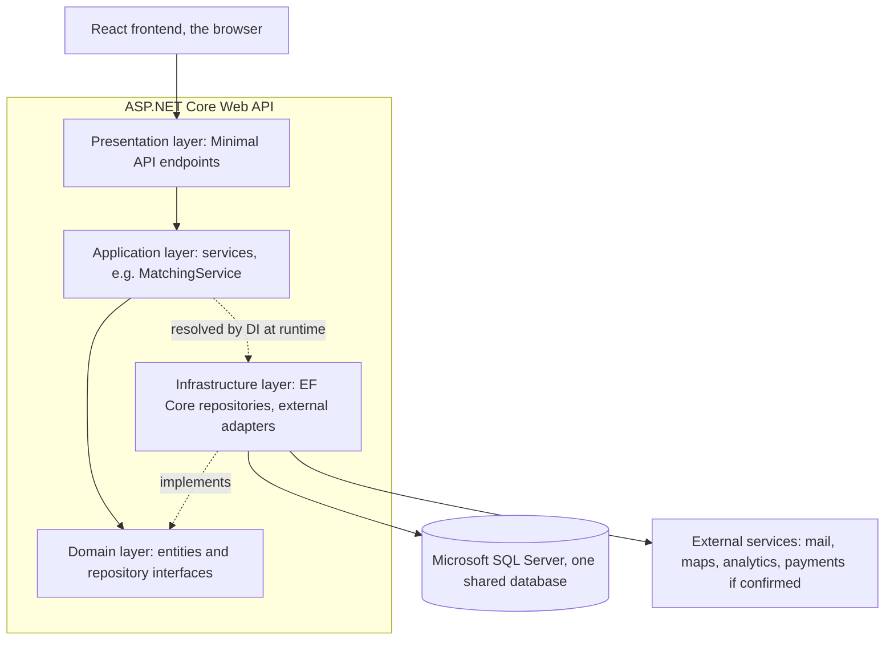

# Architecture, Young Amstelland Connect

This document serves the HvA level 3 criteria Analysis & Advice (AA) and Design & Realisation
(OR). It is a proposal, not a decision, grounded in the Architecture & Patterns workshop
material, including "Who needs an architect?" (Fowler, 2003), and in `techStack.md`,
`requirements.md`, and `codeConventions.md`, and in live sources fetched and read on 23
September 2026, listed in References.

## Why this document exists

`workshopCoverage.md`'s Architecture & Patterns section found the gap real: `techStack.md`
draws a three-layer shape but names no architectural style for the ASP.NET Core backend, and
no design pattern is chosen for any module. The workshop asks for two concrete things: "Propose
and document a clear architecture (e.g. layered, MVC, hexagonal/clean)" with "at least one
architecture diagram," and "Apply at least 3 meaningful patterns," each one documented with
where it is used and why it is appropriate. This document proposes both, closing gap 2 of
`workshopCoverage.md`, for the team to confirm or redirect at sprint 1 planning, week of 21
September 2026.

## What style fits five students new to the stack

`techStack.md`'s skills inventory is the constraint this section reads against. Of five team
members, only Nick Hoebe already knows .NET, and DevOps and hosting experience is TBD for
everyone. The workshop names five architectural styles: layered, MVC, microservices,
event-driven, and hexagonal/clean. Each is weighed against that constraint, not against which
one is theoretically best.

**Microservices, rejected.** The workshop names Kubernetes-style orchestration as the natural
partner for microservices, and `infrastructure.md` already found that none of the three hosting
options on a student budget run a cluster. Splitting Connect into several deployed services
would add an operational burden the team's own DevOps and hosting inventory does not support,
for a platform whose modules (profiles, matching, events) share one database, not a database
per module, matching the single cylinder the client's own concept diagram draws. Wesley
Oerlemans decided this on 24 September 2026, for the team to confirm at sprint 1 planning,
week of 21 September 2026.

**Event-driven, rejected.** This style decouples components through a message broker. Nothing
in `requirements.md` asks for that kind of decoupling, and adding a broker would be one more
unfamiliar piece of infrastructure with no named requirement behind it.

**MVC on its own, rejected as the whole answer.** MVC is a pattern for organizing a single
presentation layer's request handling, controller, model, view, not a description of how a
whole system with a separate React frontend divides into layers. It also names controllers as
the presentation layer's concrete shape, which is not the shape Connect's presentation layer
takes, decided below. So MVC does not replace the choice between the other styles, and the
decided presentation layer shape is not the reason it is set aside.

**Hexagonal or full Clean Architecture, weighed and set aside for this team.** Microsoft's own
architecture guidance describes Clean Architecture as putting "the business logic and
application model at the center," with infrastructure and UI both depending inward on an
Application Core that depends on neither, organized as several separate projects, Application
Core, Infrastructure, UI, each with its own compile-time boundary (Microsoft, n.d.-a). That
buys real testability: because the Application Core has no dependency on Infrastructure, "it's
very easy to write automated unit tests for this layer" (Microsoft, n.d.-a), which matters for
the Definition of Done's unit test requirement and for testing the authorization rules NFR1
names. The cost is the discipline it demands across every project boundary, all the time, from
a team where four of five members have never built an ASP.NET Core app before. Reserving the
full multi-project split for later, once the team has a working vertical slice and more of
the stack under its feet, is a real option worth revisiting once techStack.md's DevOps TBDs
close. It is not proposed for sprint 1.

**Layered architecture, with the dependency inversion principle applied to the persistence
layer, proposed.** Microsoft's own guidance sets up exactly this middle ground before it
introduces Clean Architecture: a traditional layered application has a real weakness, its
"compile-time dependencies run from the top to the bottom," so the business logic layer "is
dependent on data access implementation details," which makes testing that logic hard without
a real database. "The dependency inversion principle can be used to address this issue"
(Microsoft, n.d.-a), and that one inversion, business logic depending on a repository
interface rather than on EF Core directly, is the one piece of Clean Architecture's discipline
this document proposes the team adopt now, without the full multi-project split. Four layers,
each with one job: the presentation layer, built as ASP.NET Core Minimal API endpoints rather
than controller classes, handles HTTP requests. Application services hold the business
logic, matching rules, event capacity rules, and depend on interfaces rather than concrete
data access. Domain holds the entities and the interfaces the services depend on. Infrastructure
implements those interfaces against EF Core and SQL Server, and holds the adapters for the four
external services in `techStack.md`'s diagram. This is realistic for the team's current skill
level because it is one project, or a small number of folders inside one project, not four
separate class libraries with their own project files, and it still gives the Application
services layer something to be tested against other than a live database, since a test can
inject a fake repository behind the same interface Infrastructure implements. Wesley Oerlemans
decided on 24 September 2026 that the presentation layer is ASP.NET Core Minimal APIs, not
controllers, with endpoint handlers thin and calling into the Application layer directly, so
the choice changes only the concrete shape the top layer takes. The team confirms at sprint 1
planning, week of 21 September 2026.

*Figure: the proposed component diagram, four layers with dependencies pointing inward toward
the domain interfaces, the one piece of dependency inversion this proposal borrows from Clean
Architecture.*

## Three design patterns proposed

The workshop asks for at least three "meaningful patterns," each documented with where it is
used and why. All three are grounded in a real design problem in Connect, not chosen for their
own sake, per the workshop's own warning against that.

**Repository, in the Infrastructure layer.** One repository per aggregate, `IProfileRepository`,
`IEventRepository`, and so on, defined as interfaces in Domain and implemented against EF Core
in Infrastructure. This is the pattern the layered-plus-DIP proposal above already depends on.
Microsoft's own description of the pattern: a repository "performs the tasks of an intermediary
between the domain model layers and data mapping," and EF Core's own `DbContext` already
"implements both the Repository and the Unit of Work patterns" internally (Microsoft, n.d.-d),
which means the team's own repository classes sit as a thin, testable interface in front of
`DbContext` rather than reimplementing what it already does.

CQRS, Command Query Responsibility Segregation, is a real alternative to the repository
pattern above, not a layer on top of it. Where the repository pattern keeps one model per
aggregate for both reads and writes, CQRS splits the two apart, treating commands that write
data and queries that read it as separate models that can each be optimized on their own terms
(Microsoft, n.d.-b). At Connect's size the fit is only partial. Microsoft's own guidance names
collaborative environments with real merge conflicts, task-based user interfaces backed by a
full command-processing stack, and a read side that needs to scale horizontally far beyond the
write side as the situations CQRS is built for (Microsoft, n.d.-b). None of Connect's modules,
profiles, matching, events, the admin dashboard, are read at a volume or written to
concurrently at a scale that makes those benefits concrete yet, though the matching module
(FR2) is the one place a genuinely separate, denormalized read model could pay for itself once
the Strategy pattern below is producing results worth querying differently than they are
written.

The cost is real ceremony, and Microsoft's own guidance leads with it: even the simplest form
of CQRS, one shared data store with separate read and write models, "can introduce significant
complexity into the application design" (Microsoft, n.d.-b). Two models instead of one to
maintain for every aggregate, a query side that if split into its own data store trades in
eventual consistency the repository pattern above does not have to think about, and a command
side that Microsoft's own guidance says works best when commands represent business tasks like
"Book hotel room" rather than a plain field update (Microsoft, n.d.-b), all of which is more
design surface for four team members who are already learning ASP.NET Core, EF Core, and
Minimal APIs at the same time this decision gets made.

What makes CQRS a real alternative for this team rather than a theoretical one is Nick Hoebe.
His own inventory in `techStack.md` names CQRS among his particular interests in backend
architecture, and he has applied CQRS before (fact from Wesley Oerlemans, 2026-09-24), which
gives the team someone who could lead it rather than the whole team learning it from the
documentation at once, the way React and .NET themselves are being learned. The choice between
the repository pattern proposed above and CQRS is open for sprint 1 planning, raised by Wesley
Oerlemans on 24 September 2026.

**Dependency injection, wiring every layer together.** ASP.NET Core's built-in DI container
resolves `IProfileRepository` to its EF Core implementation, and resolves each Application
service into the Minimal API endpoint handler that needs it, through the same parameter
injection Minimal APIs support directly. Microsoft's own framing of the problem this solves:
a class that creates its own dependency directly "is difficult to unit test... because it
directly creates [the dependency], making it difficult to substitute a custom service for
testing" (Microsoft, n.d.-c). This is not a pattern the team chooses to apply so much as one
ASP.NET Core already offers built in, and using it deliberately, constructor injection into
Application services rather than `new`-ing them up inside an endpoint handler, is what makes
the repository interfaces above actually swappable in tests.

**Strategy, in the community interaction and matching module (FR2).** FR2 is the requirement
with the least settled shape yet: how a young person gets matched to an opportunity,
organization, or another user is not designed. The workshop's own list names Strategy as one of
the example patterns, and matching is a natural fit for it, since more than one matching
approach is plausible, skill or interest overlap between two profiles, or location proximity
once the Maps external service is wired in, and the team is likely to want to try more than
one without rewriting the module each time. An `IMatchStrategy` interface, injected into a
`MatchingService`, with an `InterestOverlapStrategy` as the first concrete implementation, keeps
that choice open. This is the Open-Closed Principle the workshop's own SOLID slides teach:
adding a second strategy later means adding a class, not modifying `MatchingService`.

## What stays open

Whether the team confirms this style, whether Strategy is the right third pattern or the team
picks a different one against a different module, and how closely the diagram above tracks the
actual code once it exists, all sprint 1 planning questions, owned by the whole team and due
at that planning session, week of 21 September 2026, with the diagram kept roughly in sync
with the code once it exists, per the workshop's own requirement. `codeConventions.md`'s
stack-specific section (naming conventions, project layout) is the natural place the chosen
layer names land once this is confirmed, so that document's own TBD and this one close
together.

## References

Fowler, M. (2003). Who needs an architect? *IEEE Software, 20*(4), 2–4.

Hogeschool van Amsterdam. (n.d.). *Architecture & design patterns workshop* [Course document].

Microsoft. (n.d.-a). *Common web application architectures*. Microsoft Learn. Retrieved
September 23, 2026, from
https://learn.microsoft.com/en-us/dotnet/architecture/modern-web-apps-azure/common-web-application-architectures

Microsoft. (n.d.-b). *CQRS pattern*. Azure Architecture Center, Microsoft Learn. Retrieved
September 24, 2026, from https://learn.microsoft.com/en-us/azure/architecture/patterns/cqrs

Microsoft. (n.d.-c). *Dependency injection in ASP.NET Core*. Microsoft Learn. Retrieved
September 23, 2026, from https://learn.microsoft.com/en-us/aspnet/core/fundamentals/dependency-injection

Microsoft. (n.d.-d). *Design the infrastructure persistence layer*. Microsoft Learn. Retrieved
September 23, 2026, from
https://learn.microsoft.com/en-us/dotnet/architecture/microservices/microservice-ddd-cqrs-patterns/infrastructure-persistence-layer-design

## AI use declaration

AI was used as a writing support tool while working on this document. We used AI to draft
the formulation of sentences, the structure of wording, readability, and clarity from
content that we had provided, and to generate the diagrams. The content itself, including
our experiences, reflections, learning goals, decisions, self-assessments, and
conclusions, is our own. We reviewed the drafts and decided as a team which text to
include.
