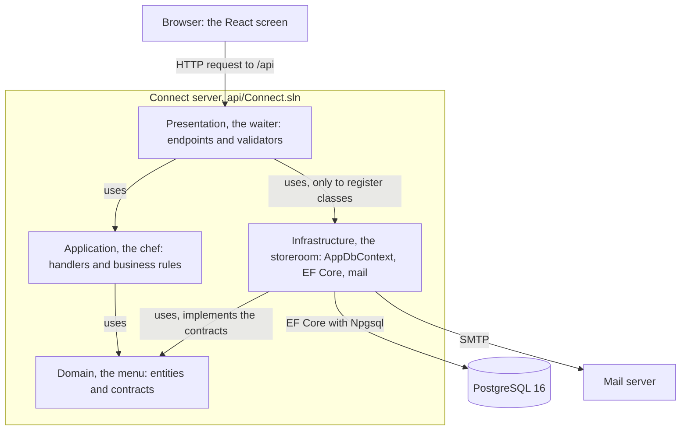
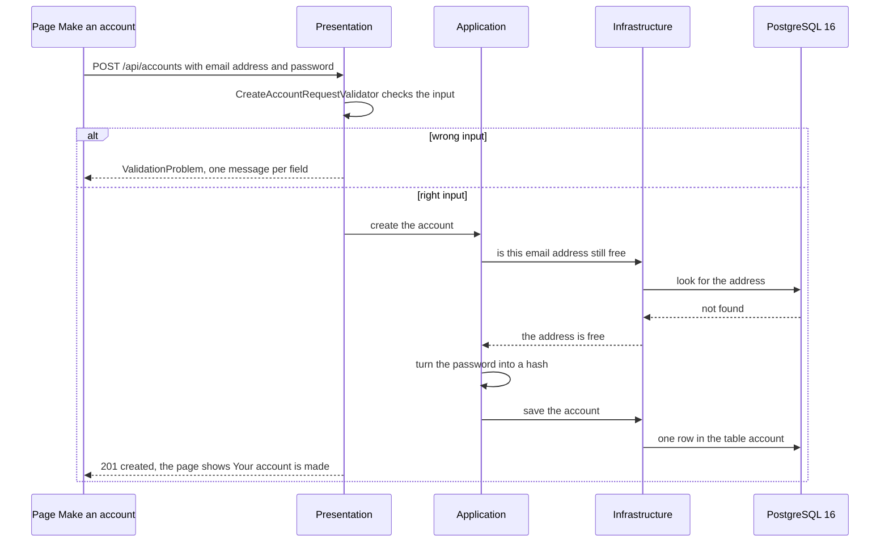
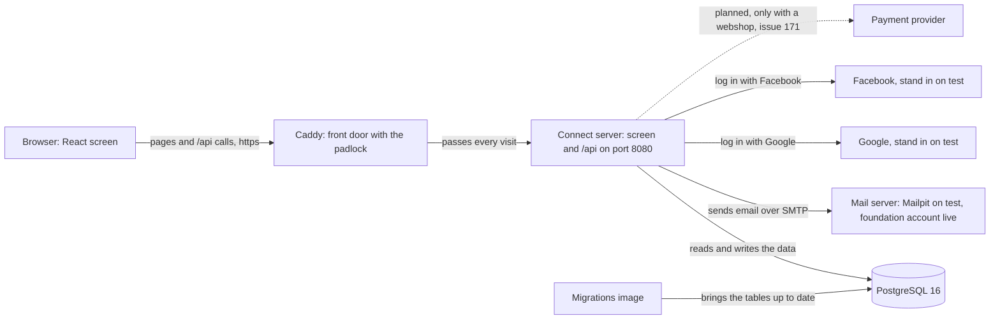
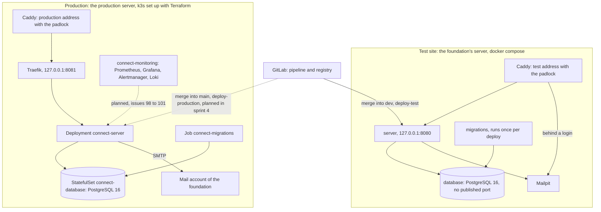

# Architecture, Young Amstelland Connect

This document serves the HvA level 3 criteria Analysis & Advice (AA) and Design & Realisation
(OR). It describes how Connect is built: the four layers of the server, the parts of Connect
and the outside services it talks to, the tables of the database, the rules for every answer
of the server, where Connect runs, how the team watches it, how it is kept safe, and the
design patterns it uses.

The board is the source of truth. This file follows the issues that decide or build each part,
and it names every issue by its board number and title. The GitLab number of every board
number is in `docs/team/boardNumbers.md`.

Three issues shape this file:

- Issue 11 The team agrees on the layered architecture (epic Decisions, sprint 1) decides the
  four layers and .NET 10.
- Issue 03 Create an account (epic Account, sprint 1) builds the four projects in task 3.1 and
  describes the first table here in task 3.3.
- Issue 102 The architecture drawn in layers, parts and places (epic Decisions, sprint 4) adds
  the three drawings Layers, Components and Deployment, each with the quality it protects, and
  a teammate checks them against the code in task 102.3.

The first version of this document was a proposal of 23 and 24 September 2026, written before
the board was finished. Where that proposal and the board differ, the board wins, and the
history is kept below where it explains a choice.

## Words used in this file

Issue 102 asks for this list at the top, so a reader who is new to the tools can follow the
drawings. A word a reader did not know is added here (issue 102, acceptance criterion on
understanding).

- **Layer**: one part of the server with one job. Connect has four.
- **Project**: a folder with its own project file that .NET builds on its own. Each layer is
  one project, so the compiler can refuse a layer that uses a layer it may not use.
- **Endpoint**: a web address on the server that the screen calls, for example
  `POST /api/accounts`.
- **Minimal API**: the way ASP.NET Core defines endpoints in a few lines, without controller
  classes.
- **Command**: a request to change data, one class per use case, for example
  `CreateAccountCommand`.
- **Query**: a request to read data, one class per use case, for example
  `GetPublicProfileQuery`.
- **Handler**: the one class that carries out one command or one query, in
  `api/Application/Features`.
- **CQRS**: short for command and query responsibility segregation: a separate piece of code
  for every read and every write, the structure the team chose on 1 October 2026.
- **Dependency injection**: a class gets what it needs through its constructor, and ASP.NET Core
  hands it in while the program runs.
- **Migration**: a script that EF Core writes to change the tables one step at a time.
- **ProblemDetails**: the web standard (RFC 9457) for an error answer.
- **Container**: a packed program with everything it needs to run. The images `server` and
  `migrations` are the two containers of Connect.
- **docker compose**: the tool that starts several containers from one file. The laptops and the
  test site use it.
- **k3s**: a small version of Kubernetes, a platform that starts containers, restarts them when
  they break and swaps in a new version without the site going down. Production uses it.
- **Terraform**: a tool that describes production in files and shows a plan of every change
  before it is applied.
- **Caddy**: the web server at the front door. It makes the padlock (https) and passes each visit
  on.

## Why this document exists

The Architecture & Patterns workshop of the HvA asks the team to "propose and document a clear
architecture (e.g. layered, MVC, hexagonal/clean)" with at least one architecture diagram kept in
sync with the code, and to apply at least three meaningful patterns, each documented with where
it is used and why. Gap 2 of `docs/school/workshopCoverage.md` found that the first stack
documents drew a three-layer shape but named no architectural style and no pattern. The board
now closes that gap with issue 11 (the style), issue 102 (the drawings) and issue 103 The design
patterns Connect uses, where and why (the patterns).

## Which style fits five students new to the stack

`docs/architecture/techStack.md` holds the skills inventory. Of the five team members only Nick
Hoebe already knew .NET, and four of the five are new to the tools they build with (issue 11).
The workshop names five styles: layered, MVC, microservices, event-driven, and hexagonal or clean.
Each was weighed against that fact, not against which one is best in theory.

**Microservices, rejected.** Connect is one product with one database. Its modules (profiles,
matching, events and the rest) share that database, matching the single database the client's own
concept diagram draws. Splitting Connect into several services would add work the team cannot
carry. Wesley Oerlemans decided this on 24 September 2026. The production platform k3s (issue 92
k3s and Terraform for production, compose for test) does not change this: production runs one
copy of one server and one database, because the DevOps workshop asks for the platform, not
because Connect needs more services.

**Event-driven, rejected.** This style links parts through a message broker. No requirement in
`docs/project/requirements.md` asks for it. The one place where work runs in the background, the
mail queue of issue 21 Ask for a password reset link by email, uses a queue inside the server
(`MailQueue`, a `Channel<EmailMessage>`, read by the `MailSendingWorker`), not a broker.

**MVC on its own, rejected as the whole answer.** MVC organises the request handling of one
presentation layer. It does not describe how a system with a separate React screen splits into
layers, and Connect uses Minimal APIs instead of controllers.

**Hexagonal or full Clean Architecture, weighed.** Microsoft describes Clean Architecture as
putting "the business logic and application model at the center", with separate projects for the
Application Core, Infrastructure and UI (Microsoft, n.d.-a). The proposal of 24 September kept the
layers inside one project with folders, because four separate projects seemed too much discipline
for a team new to .NET, and it set the multi-project split aside for later.

**Layered architecture in four projects, chosen on the board.** The board turned that around.
Issue 11 compares, with the same example request, four separate projects against one project
with four folders (task 11.1), and proposes four separate projects Presentation, Application,
Domain and Infrastructure that may only use each other in one direction (task 11.2). The reason
is the same fact that made the first proposal careful: a team new to .NET mixes up folders by
accident, and separate projects let the compiler refuse that. Task 11.2 proves it on a throwaway
solution: a project without the reference refuses a line that uses the other project, and a
project with the reference builds the same line. The rule is also in
`docs/team/codeConventions.md`, backend rules 7 and 8.

The dependency rule that the proposal of 24 September took from Clean Architecture stays: the
business rules depend on a contract, not on EF Core directly, so a handler is unit tested with an
in-memory SQLite database (Microsoft, n.d.-a). Wesley Oerlemans decided on 24 September 2026 that the
top layer uses ASP.NET Core Minimal APIs, not controllers. That choice is now part of the code
conventions (backend rule 9).

The team takes the decision in a team moment of the first week of sprint 1 and writes it in
`docs/decisions/<number>-layeredArchitecture.md` (issue 11, tasks 11.1 and 11.2). The version of
.NET gets its own file, `docs/decisions/<number>-dotnet10.md` (task 11.3): .NET 10, the long term
support version, supported until November 2028, because .NET 8 stops getting security fixes on
10 November 2026, in the middle of this project.

## Layers

The server has four layers, each one project in `backend`, plus the test project
`api/Connect.Tests`. The solution file is `api/Connect.sln`. The cards explain the layers
with a restaurant.

| Layer | On the cards | What it holds | Folders |
| --- | --- | --- | --- |
| Presentation | the waiter | The endpoints, the validators of what comes in, the session guard, the rate limit, the health address. It reads a request, calls a handler and returns the answer. | `Program.cs`, `Features/<Feature>/<Feature>Endpoints.cs`, `Validators/<Name>RequestValidator.cs`, `Authentication/`, `RateLimiting/` |
| Application | the chef | The commands, queries and handlers with the business rules, for example that an email address must still be free. | `DependencyInjection.cs`, `Abstractions/ICommandHandler.cs`, `IQueryHandler.cs`, `IAppDbContext.cs`, `Features/<Feature>/<UseCase>/<UseCase>Command.cs` or `Query.cs` with `<UseCase>Handler.cs` |
| Domain | the menu | The entities and the contracts that are not about data access, for example `IMailSender`. It uses nothing. | `Entities/<Entity>.cs`, `Accounts/PasswordRules.cs` |
| Infrastructure | the storeroom | Holds the database connection, the table settings, the migrations and the mail sender. The chef reaches the data through the hatch IAppDbContext. | `Persistence/AppDbContext.cs`, `Persistence/Configurations/`, `Migrations/`, `Mail/` |

Which project may use which (the `ProjectReference` lines, issue 03 task 3.1):

- Presentation uses Application and Infrastructure. It needs Infrastructure only to register its
  classes at the start (`AddInfrastructure()`).
- Application uses Domain.
- Infrastructure uses Domain.
- Domain uses nothing.

The diagram below shows the four layers and the direction in which each may use another.

*Figure: the four layers and the direction in which each may use another. An arrow is a
project reference, so the compiler refuses any other direction.*

**Quality it protects.** Changeability: a change of database still touches one layer, because only
Infrastructure holds the connection, the mappings and the migrations. That already happened once
on paper, when SQL Server became PostgreSQL on 26 September 2026 before any code existed.
Testability: the chef depends on the contract `IAppDbContext`, so a handler is unit tested with an
in-memory SQLite database instead of the real one. Safety for beginners: a wrong reference does
not build.

### The road of one request

Issue 03 Create an account walks the first real request through every layer, and every later
slice copies it:

1. The page Make an account (`/create-account`) sends the email address and password through
   `web/src/api/client.ts` to `POST /api/accounts`.
2. Presentation: `CreateAccountRequestValidator` (FluentValidation) checks the input and answers
   wrong input with one message per field.
3. Application: the handler checks that the email address is still free and turns the password
   into a hash.
4. Infrastructure: `AppDbContext` saves one row in the table `account`.
5. The answer goes back the same way and the page shows "Your account is made".

The diagram below shows the same request as messages between the screen, the layers and the database.

## Components

The parts of Connect and every outside service it talks to. Issue 102 task 102.1 draws them from
the settings in `api/Presentation/appsettings.json` and `appsettings.Development.json`, and
marks what is not built yet as planned.

- **The screen.** React with TypeScript in strict mode, built with Vite, pages chosen by React
  Router, styled with CSS Modules and the Young Amstelland tokens in `web/src/styles/tokens.css`.
  Only `web/src/api` talks to the server. On a laptop the Vite dev proxy sends `/api` to the
  server on `http://localhost:5000`, so the screen and the server share one origin, just as on the
  test site.
- **The server.** One image `server` serves the built screen and every address under `/api` from
  one port, 8080 (issue 20 Dockerfiles for the server and the frontend). A second image
  `migrations` brings the tables up to date and stops.
- **The database.** PostgreSQL 16, one per environment.
- **The mail server.** Every email goes through `IMailSender`. The request only queues the email,
  and `MailSendingWorker` hands it over SMTP with `SmtpMailSender` (MailKit) (issue 21). On a
  laptop and on the test site the mail server is the test mailbox Mailpit, which catches every
  email. On the live site it is the mail account of the foundation (issue 173 Connect sends email
  through the foundation's mail account on the live site, question 116 in
  `docs/client/clientQuestions.md`).
- **Google and Facebook.** Log in with an outside account (issue 23 Register or log in with
  Google, issue 24 Register or log in with Facebook). On a laptop and on the test site the server
  talks to a stand in, the pinned image `ghcr.io/soluto/oidc-server-mock`, so the tests never need
  a real account. The real Facebook log in is checked in issue 119 The real Facebook log in
  checked after Meta approves the app. What the foundation must set up for both is question 7.
- **The payment provider, not decided.** Only when the webshop (FR10, not confirmed by the client)
  is built. The client chooses it in issue 171 The payment provider chosen with the client, and
  whether there is a webshop at all is question 2.

The client's concept diagram also names maps and analytics as outside services. No issue on the
board uses either one. The usage numbers the foundation sees come from Connect itself (issue 47
See this month's usage numbers), so this file draws no maps or analytics service.

The diagram below shows the parts of Connect and every outside service it talks to.

*Figure: the parts of Connect and the outside services. The dashed line is planned and depends
on a client answer.*

**Quality it protects.** Changeability: every outside service sits behind one contract in the
storeroom, so the mail server or the log in provider can change without touching the chef.
Security: the browser only ever talks to Caddy with https, and the screen and the server share one
origin, so the session cookie never has to cross to another site. Testability: the stand ins and
Mailpit let every test run without a real person's account or mailbox.

## Data

The database is PostgreSQL 16, reached only through EF Core with the provider Npgsql, from the
Infrastructure layer. On 22 September 2026 the team chose Microsoft SQL Server. On 26 September
2026 Wesley Oerlemans changed that to PostgreSQL 16 with EF Core and Npgsql. The reasons the stack
documents weighed before the change are in `docs/architecture/stackResearch.md`: no license cost
for production (NFR3 Hosting at no license cost), a plain container image on the foundation's
server, and familiarity for part of the team. Because EF Core was already the data layer and no
code existed yet, the change touched no code.

The rules for the database are in `docs/team/codeConventions.md`, part Database. In short: names in
snake_case and tables in the singular, a link table carries both names, ids are uuid, time columns
end in `_at` and are timestamptz in UTC, email addresses are citext, text is text unless the length
is a real rule, enums are stored as their name in PascalCase in a text column, tables only change
through migrations, and a list is always fetched in pages.

The tables on the board, with the issue that makes each one:

| Epic | Tables |
| --- | --- |
| Account | `account` (03), `session` (04 Log in with email and password), `password_reset` (21), `external_login` (23), `pending_external_login` (23b Link Google to my existing account after I type my password), `email_change` (115 Change my email address) |
| Account security | `email_confirmation` (27 Confirm my email address), `login_failure` (30 Wait a minute after five wrong passwords), `login_lock` (31 Account locked after fifteen wrong passwords), `audit_entry` (32 See who did what on the platform, made unchangeable by a database trigger), `log_in_puzzle_use` (123 A puzzle that proves I am a person before I log in), `log_in_attempt` (125 See every log in try on my account), `suspicious_activity_alert` (128 A warning to the admin about suspicious activity) |
| Profiles | `member_profile` (07 Create a profile), `organisation_profile` (34 Create an organisation profile), `tag` and `member_profile_tag` (36 Add skills and interests as tags), `organisation_profile_tag` (129 An organisation adds tags to its profile), `parent_consent` (130 A young person under 16 asks a parent for permission) |
| Matching | `connection_request` (39 Send a connection request), `saved_item` (43 Save a suggestion) |
| Admin | `site_page` and `site_page_version` (50 Edit a site page without a deploy), `removal_review_request` (146 Ask the foundation to look at a removal again), `member_report` (151 Report a member to the foundation) |
| Opportunities | `opportunity` (54 Post an opportunity), `opportunity_tag` (54c Add tags to my opportunity), `opportunity_member` (57 Press Interested on an opportunity) |
| Showcases | `project` (60 Add a project) |
| Events | `event` (65 Publish an event), `event_member` (68 Register for an event) |
| News | `news_item` (71 Publish a news item with a title and a text) |
| Challenges | `challenge` (74 Post a challenge), `challenge_member` (77 Join a challenge) |
| Badges | `member_profile_badge` (80 Earn a badge for my first project). There is no table badge: the badge codes live in the code until question 102 asks for more. |
| Webshop | `product` (81 See the merchandise), `basket` and `basket_item` (82 Put an item in my basket), `shop_order` and `shop_order_item` (83 Pay for my basket). Only built when the client confirms the webshop (question 2). |

One tag model serves the whole board: the table `tag` (id, name citext unique, at most 30
characters) with the link tables `member_profile_tag`, `organisation_profile_tag` and
`opportunity_tag`, at most 10 tags per profile or opportunity, and one screen component
`TagInput.tsx`.

Pictures are not stored in the database. A picture of a project (issue 61b Add an image to my
project) or a news item is a file in the storage folder `/var/connect/uploads`, the volume
`connect-uploads`, and the table only holds its file name.

The database rules that no bug in the code may get around live in the database itself, for example
one account per email address also when the capitals differ, and never an empty password hash
(issue 03 task 3.3). Each issue that makes a table describes it in this section. Where a card names
its columns, `names.md` of the board holds them.

## Answers of the server

Every endpoint follows the same rules, from `docs/team/codeConventions.md`, part Added after the
audit of 27 September 2026. The endpoints themselves are listed in `docs/architecture/api.md`.

1. A successful answer with content is always `{"data": ..., "meta": {...}}`. For a list, `data`
   is the array and `meta` holds `page`, `pageSize` and `total`. For one item, `meta` is `{}`.
2. One named exception: `GET /api/health` answers 200 with `{"status":"healthy"}` and 503 with
   ProblemDetails, because deploy jobs and monitors read that body.
3. An error is always ProblemDetails (RFC 9457), through `Results.Problem(...)`, and for a wrong
   form `Results.ValidationProblem(...)` with one message per field. Never a bare text and never
   `{"error": ...}`.
4. Paging is always by page number: `?page=1&pageSize=20`. The page starts at 1 and `pageSize` is
   at most 50. The button under a list on the screen is always "Load more".
5. An id or a page number in the address is bound as text and parsed in the validator, so a wrong
   value gets a ProblemDetails with a message, not a bare 400 or 404. So a route never has
   `{id:guid}` or `{page:int}` constraints.
6. Enums travel and are stored as their name in PascalCase, for example `Pending` or `Accepted`.
7. Status codes: 200 OK, 201 created, 204 done without content, 400 wrong input, 401 not logged in,
   403 not allowed, 404 not found, 409 conflict, 429 too many tries, 503 not available.
8. Addresses start with `/api`, are lower case, use plural nouns and join words with a dash:
   `/api/member-profiles/{id}`. What goes in and out are records named `...Request` and
   `...Response`, and a database entity is never sent straight to the browser.

Research issue 108 Two ways of paging the showcases, measured compares paging by page number with
paging by cursor. Connect keeps page numbers unless that result shows a real problem, and then only
through a new issue.

## Settings and secrets

- `dotnet run` does not read `.env`. On a laptop a secret goes in dotnet user-secrets, and a setting
  that is not secret goes in `appsettings.Development.json`.
- On a server every setting comes from environment variables. The names use sections with two
  _ signs: `Mail__Host`, `Mail__Password`, `App__BaseUrl`, `Seeding__TestData`,
  `GoogleLogin__ClientId`. The same name in appsettings is `Mail:Host`.
- The file `.env` in the root only feeds docker compose. It is never committed, and `.env.example`
  shows each setting with a placeholder.
- No secret is ever in Git, in a log or in the Terraform state. In production the secrets are
  GitLab variables that `infra/k3s/applySecrets.sh` turns into Kubernetes Secrets (issue 95
  Connect and its database described in Terraform).

## Security in the architecture

The users include young people from 15 years old, so security is part of the design, not an extra.
The analysis is in `docs/security`, made by the epic Security analysis:

- `docs/security/personalDataInventory.md`, issue 12 Inventory of the personal data per module:
  what each part keeps, the risks and the check against six security properties.
- `docs/security/roleTable.md`, issue 13 The role table per module: who may see and change what,
  with stricter rules for members under 18. The decision is in
  `docs/decisions/<number>-roleTablePerModule.md`.
- `docs/security/gdprNotes.md` and `docs/security/dataRules.md`, issue 19 GDPR notes on minors'
  data: the five data rules.
- `docs/security/threatModelProfile.md` (issue 18 Data flow diagram of profile creation) and
  `docs/security/threatModelImage.md` (issue 104 A threat model of adding an image to a project).
- `docs/security/securityExceptions.md`: every known hole the client accepted, with a reason and
  an end date (issues 16 and 90).

How the parts above carry it:

- **Sessions.** After a log in the server stores a row in `session` and sets the cookie
  `connect_session` with the flags Secure, HttpOnly and SameSite=Lax, for one day. The table keeps
  only a hash of the token (issue 04).
- **Passwords.** At least 15 characters, the rules in one place `api/Domain/Accounts/PasswordRules.cs`
  (issue 03b A clear message when my password is too weak), a password known from data leaks is
  refused (issue 116 A password that is known from data leaks is refused), and the password is
  stored as a hash. Issue 110 The cost of password hashing, measured checks the strength of that
  hash.
- **Who may do what.** Every endpoint says who may use it, and anyone else is refused (Definition
  of Done, part Security). The admin addresses sit in one route group `/api/admin` behind the
  policy `AdminOnly`.
- **Limits.** One rate limit per IP address on all of `/api`, 600 requests per minute by default,
  with `/api/health` not counted (issue 105 Connect keeps working under too many requests). A
  request larger than 1 MB is refused, with 6 MB only for the picture upload (issue 105b A request
  that is far too large is refused). The server trusts the forwarded address only from the proxies
  in `ForwardedHeaders__KnownNetworks`.
- **Error answers and logs.** An error answer never shows a database error or an internal name.
  A log line never holds a password, a token, a full email address or a message text (issue 17 A
  health check and structured logs).
- **The pipeline.** A package with a known serious hole is stopped (issue 16 A security scan in the
  pipeline), an image with a serious known hole is stopped (issue 90 An image with a serious known
  hole is stopped), and a change that lowers code quality is stopped (issue 88 The team picks the
  code quality tool, issue 89 A change that lowers code quality is stopped).

## Deployment

Where Connect runs. The details, the steps and the reasons are in
`docs/architecture/infrastructure.md`. The choice for k3s and Terraform is recorded in
`docs/decisions/<number>-productionOnK3s.md` (issue 92 k3s and Terraform for production, compose
for test), which Wesley Oerlemans made on 27 September 2026 because the HvA DevOps workshop requires
orchestration and infrastructure as code. The foundation did not ask for it.

- **A laptop.** docker compose starts the database, Mailpit and the log in stand in. The server
  runs with `dotnet run` and the screen with the Vite dev server, or everything runs as containers
  with `docker compose --profile app up -d --build` on `http://localhost:8080` (issue 20).
- **The test site.** The foundation's server that it lends to the team (issue 09 Every team member
  on the client's server). Caddy with the padlock passes visits to the server on `127.0.0.1:8080`.
  docker compose starts `server`, `migrations`, `database` and Mailpit from
  `deploy/docker-compose.test.yml` in `/srv/connect-test`. Every merge into dev puts the images of
  that commit there (job `deploy-test`).
- **Production.** k3s on one computer, the production server. Issue 91 The director agrees where
  production runs decides whether that is the same server as the test site or a second one
  (question 112). Caddy stays the front door and passes visits to Traefik inside k3s on
  `127.0.0.1:8081`. The namespace `connect-production` holds the Deployment `connect-server`, the
  StatefulSet `connect-database` with its own volume, and the migrations Job. The namespace
  `connect-monitoring` holds Prometheus, Grafana, Alertmanager, Loki and the log shipper. Terraform
  files in `infra/terraform` describe all of it. Every merge into main goes to production (job
  `deploy-production`, issue 96 A merge into main goes to production). Production is built in
  sprint 4.

The diagram below shows what runs on the test site and in production, and how the pipeline reaches each.

*Figure: the test site and production. A dashed line is planned. Production runs on a spare
computer of the team for school only when the client says no in issue 91 (question 111).*

**Quality it protects.** NFR5 Available when it matters: in production k3s starts a crashed part
again by itself and swaps in a new version only when it answers healthy (issue 95, readiness on
`GET /api/health`, rolling update that keeps the old pod until the new one is ready). Security:
Caddy is the only door from the internet, the database and the Kubernetes API on port 6443 are
never reachable from outside, and the pipeline reaches k3s only through an ssh tunnel (issue 93 k3s
on the production server). Changeability: the test site stays as simple as it is, and production is
described in files, so it can be rebuilt from the repository (issue 94 Every production change
shown as a plan first).

## Observability

How the team sees what Connect does. The steps are in `docs/architecture/infrastructure.md` and in
`docs/team/onboarding.md`.

- **Health.** `GET /api/health` also asks the database and answers 503 with the failing check when
  it cannot reach it (issue 17 task 17.1). Deploy jobs, the readiness probe and the monitors read
  it.
- **Logs.** One JSON line per event, with the request id of the visit on every line (issue 17 task
  17.2). In production all log lines are collected in Loki (issue 101 All log lines of Connect in
  one place).
- **Metrics.** The server counts requests, errors and waiting times on its own port 9464, which
  only programs inside k3s can reach, and Prometheus keeps them for two weeks (issue 98 The server
  counts its requests and errors). No number holds an email address, a name or an account id.
- **Dashboard.** One Grafana dashboard Connect health, stored as a file, with a read only login for
  the client (issue 99 One dashboard with the health of Connect).
- **Alerts.** Six alert rules send an email within five minutes through the mail account of the
  foundation (issue 100 An email before young people notice a problem).

## Design patterns

The workshop asks for at least three meaningful design patterns in the product, each with where it
is used and why, or the pattern exercises shown to a teacher. It also warns never to add a pattern
for its own sake. Issue 103 The design patterns Connect uses, where and why (sprint 4) checks the
real code and writes one page per pattern, each with two sources, the alternative that lost and its
place in the Layers drawing above. That page is the source for the patterns. The issue names it
`docs/designPatterns.md`.

The candidates the board already names (issue 103 task 103.1):

1. **CQRS.** CQRS splits the model that writes from the model that reads (Microsoft, n.d.-b):
   `CreateAccountCommand` with `CreateAccountHandler` in
   `api/Application/Features/Account/CreateAccount` (issues 03 and 11), reaching the data
   through `IAppDbContext` in `api/Application/Abstractions`. `AppDbContext` in
   `api/Infrastructure/Persistence` implements it. EF Core's own `DbContext` already
   "implements both the Repository and the Unit of Work patterns" (Microsoft, n.d.-d), so
   `IAppDbContext` is a thin, testable contract in front of it, one handler per use case instead
   of one repository per kind of data.
2. **A contract for sending mail.** `IMailSender` in Domain and `SmtpMailSender` in
   `api/Infrastructure/Mail` (issue 21). Issue 103 decides with sources whether this is an
   Adapter, a Strategy or both.
3. **Two log in providers behind one flow.** `GoogleLoginSetup` and `FacebookLoginSetup` in
   `api/Presentation/Authentication` with `SocialLoginService` in `api/Application/Accounts`
   (issues 23 and 24). Only what the team designed counts, not what ASP.NET Core already does.
4. **A rule with an injected clock.** `OpportunityOpenRule` in `api/Domain/Opportunities` with
   `TimeProvider`, once issue 54 is built. Issue 103 names the pattern or writes that it has none.

**Dependency injection** wires the layers together and is what makes `IAppDbContext` and the
handlers swappable in tests. Microsoft's framing of the problem: a class that creates its own
dependency "is difficult to unit test" (Microsoft, n.d.-c). Each layer registers its classes in
one method, `AddApplication()` and `AddInfrastructure()`, and every class gets what it needs
through its constructor (code conventions, backend rule 14). ASP.NET Core offers it built in, so
the team uses it on purpose rather than choosing it.

**The Strategy proposal of 24 September.** The first version of this document proposed an
`IMatchStrategy` for matching (FR2). The board settled matching differently: issue 37 See suggested
matches with the reason shows members and organisations that share at least one tag, the most shared
tags first. No card uses a matching strategy, so it is not a candidate. Issue 103 names only what
the code really does.

When fewer than three real patterns are found, the page says so, and every student finishes the
four pattern exercises of the workshop (Observer, Strategy, Factory and State) in the teacher's
GitLab project instead, never in Connect (issue 103 task 103.3). Every student explains one pattern
to a teacher (task 103.4).

## What stays open

The structure is settled: CQRS by functionality, decided by the team on 1 October 2026 (issue 11
task 11.2), over the repository pattern and over one project with four folders, because the code
splits by feature instead of by one class per kind of data.

| Open point | Decided by |
| --- | --- |
| Same server as the test site or a second production server | Issue 91, question 112 |
| Whether there is a live version on the foundation's server at all | Issue 91, question 111 |
| The production address | Issue 91, question 113 |
| Terraform or OpenTofu, and where the Terraform state lives | Issue 92 task 92.1 |
| The metrics library, prometheus-net or the OpenTelemetry exporter | Issue 98 task 98.1, `docs/decisions/<number>-metricsLibrary.md` |
| The log shipper, Grafana Alloy or Promtail | Issue 101 task 101.2, `docs/decisions/<number>-logShipper.md` |
| The code quality tool | Issue 88, `docs/decisions/<number>-codeQualityGate.md` |
| Whether there is a webshop, and the payment provider | Question 2, issue 171 |
| Which design patterns are real | Issue 103 task 103.1 |
| Whether the drawings match the code | Issue 102 task 102.3, checked by a teammate who drew nothing |

## References

Fowler, M. (2003). Who needs an architect? *IEEE Software, 20*(4), 2-4.

Hogeschool van Amsterdam. (n.d.). *Architecture & design patterns workshop* [Course document].

Microsoft. (n.d.-a). *Common web application architectures*. Microsoft Learn. Retrieved
September 23, 2026, from
https://learn.microsoft.com/en-us/dotnet/architecture/modern-web-apps-azure/common-web-application-architectures

Microsoft. (n.d.-b). *CQRS pattern*. Azure Architecture Center, Microsoft Learn. Retrieved
September 24, 2026, from https://learn.microsoft.com/en-us/azure/architecture/patterns/cqrs

Microsoft. (n.d.-c). *Dependency injection in ASP.NET Core*. Microsoft Learn. Retrieved
September 23, 2026, from https://learn.microsoft.com/en-us/aspnet/core/fundamentals/dependency-injection

Microsoft. (n.d.-d). *Design the infrastructure persistence layer*. Microsoft Learn. Retrieved
September 23, 2026, from
https://learn.microsoft.com/en-us/dotnet/architecture/microservices/microservice-ddd-cqrs-patterns/infrastructure-persistence-layer-design

## AI use declaration

AI was used as a writing support tool while working on this document. We used AI to draft
the formulation of sentences, the structure of wording, readability, and clarity from
content that we had provided, and to generate the diagrams. The content itself, including
our experiences, reflections, learning goals, decisions, self-assessments, and
conclusions, is our own. We reviewed the drafts and decided as a team which text to
include.
