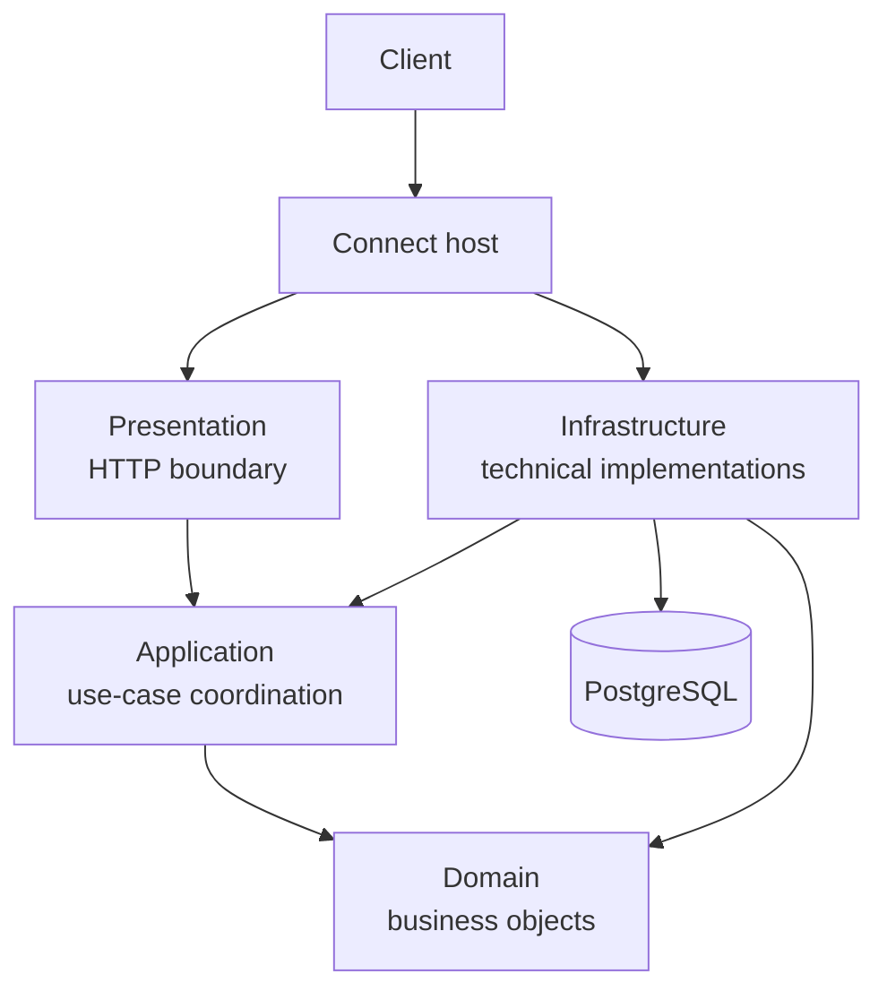
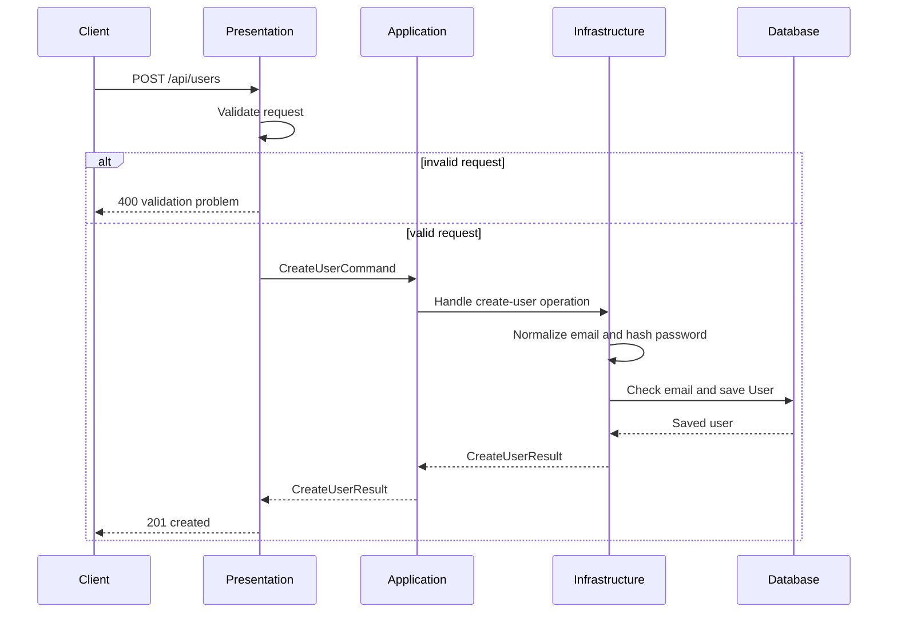

# Backend Architecture

> **Scope:** The current backend in `api/`  
> **Purpose:** Explain why the backend is structured this way and how a request moves
> through it. This document focuses on the main ideas instead of listing every
> implementation detail.

## 1. The main idea

The backend is a .NET web application split into separate projects. Each project has a
different responsibility:

- **Presentation** communicates with the outside world through HTTP.
- **Application** coordinates what the system should do.
- **Domain** contains the important business objects.
- **Infrastructure** handles technical details such as the database and password hashing.

The `Connect` project is the host. It starts the application and connects the other
projects together.

This separation makes the backend easier to understand and change. For example, changing
the database should mainly affect Infrastructure, while changing the format of an HTTP
request should mainly affect Presentation. The user-related behavior itself can remain
the same.

The arrows describe how the current projects are connected. The host registers the
services, Presentation receives requests, Application coordinates the operation, and
Infrastructure provides concrete implementations for things such as persistence.

## 2. Why use separate layers?

The backend is separated because each type of code changes for a different reason.

### Presentation: communicating with the client

Presentation knows about HTTP. It defines routes, receives request data, validates that
data, and turns the result into an HTTP response.

It should not be responsible for database queries or password hashing. Keeping those
details out of the endpoint makes the endpoint easier to read and keeps HTTP concerns at
the boundary of the application.

### Application: coordinating a use case

Application describes an operation from the perspective of the system, such as creating a
user. It passes the required information between the endpoint and the components that
perform the operation.

This gives the operation a place of its own instead of putting all behavior directly
inside an endpoint.

### Domain: representing important concepts

Domain contains concepts that matter to Connect itself. The current example is the
`User` entity.

The domain should not need to know whether the application uses PostgreSQL, HTTP, or a
particular hashing library. This keeps the core concepts independent from technical
choices.

### Infrastructure: implementing technical details

Infrastructure connects the application to external technology. In the current backend it
contains the EF Core database context, PostgreSQL configuration, migrations, and the
concrete password hasher and user handler.

This means the rest of the backend can ask for a password to be hashed or a user to be
stored without needing to know the details of the library or database connection.

## 3. How the layers work together

A request generally moves from the outside toward the inside:

1. Presentation receives and validates the request.
2. Application represents and coordinates the requested operation.
3. Domain provides the business object being created or changed.
4. Infrastructure performs technical work such as saving data.
5. The result travels back to Presentation.
6. Presentation returns the appropriate HTTP response.

The layers do not all have the same role. Presentation translates between HTTP and the
application, Application coordinates a use case, Domain represents the data and rules
that matter to the business, and Infrastructure performs technical operations.

## 4. Example: creating a user

The current backend has one complete example of this flow: `POST /api/users`.

### Step 1: the request enters through Presentation

`UserEndpoints` exposes `POST /api/users`. It receives a `CreateUserRequest`, which
represents the shape of the incoming HTTP request.

Before a user is created, `CreateUserRequestValidator` checks the input. For example, it
checks that the email is valid, the password is long enough, and a display name was
provided.

If validation fails, the request stops at the Presentation layer and the client receives
a validation response. The database is not contacted.

### Step 2: the request becomes an application operation

When the request is valid, the endpoint converts it into a `CreateUserCommand`.

This conversion is useful because the application does not need to work directly with
HTTP-specific request types. The application receives a description of the operation it
needs to perform: create a user with these values.

`UserService` coordinates this operation by calling the registered
`ICreateUserHandler`.

### Step 3: Infrastructure performs the technical work

The current handler is implemented in Infrastructure. It:

- normalizes the email address,
- checks whether the email is already in use,
- creates a `User` domain entity,
- hashes the password,
- saves the user through `ConnectDbContext`,
- and returns a `CreateUserResult`.

The password itself is not stored. Only the generated password hash is saved.

The database also has a unique constraint for the email address. The code checks for an
existing email before inserting, but the database remains the final protection against
duplicate users if two requests arrive at nearly the same time.

### Step 4: the result returns through the layers

After the user is saved, the handler returns a result to `UserService`, which returns it
to the endpoint.

Presentation converts the result into the public response shape and returns `201 Created`.
If the email already exists, the endpoint returns `409 Conflict` instead.

The client therefore does not see the domain entity or the database model directly. It
receives an HTTP response designed for the API.

## 5. Dependency injection: how the parts are connected

The backend uses dependency injection to connect abstractions to implementations.
`Program.cs` is the composition root where the application is assembled:

- `AddApplication()` registers `UserService`.
- `AddInfrastructure()` registers the database context, password hasher, and user handler.
- `AddPresentation()` registers the request validators.
- `MapUserEndpoints()` exposes the user endpoint.

For example, `UserService` asks for an `ICreateUserHandler` instead of constructing a
`CreateUserCommandHandler` itself. Infrastructure registers which concrete class should
fulfil that contract.

This keeps classes focused on their own responsibilities and makes it possible to replace
an implementation without changing the code that uses it.

## 6. What this structure protects

The current structure mainly protects three qualities:

- **Clarity:** each project has a recognizable responsibility.
- **Changeability:** technical decisions such as PostgreSQL and the hashing library are
  concentrated in Infrastructure.
- **Testability:** application code can work with contracts instead of constructing every
  technical dependency itself.

The separation is not intended to add layers for their own sake. It gives the team a
consistent path for adding features: accept the request at the boundary,
coordinate the use case, use the domain concepts, and keep technical details in
Infrastructure.

## 7. Current scope and extending the backend

This explanation describes what is currently implemented, especially the user-creation
flow. The broader `architecture.md` document describes the complete Connect architecture,
including authentication, profiles, email, security controls, deployment, and monitoring.
Those features follow the same general structure in the backend.

The user-creation example demonstrates the backend pattern: requests enter through
Presentation, use cases are coordinated by Application, business concepts are represented
by Domain, and technical operations are implemented by Infrastructure.

## 8. AI use declaration

AI was used as a writing support tool while working on this document. We used AI to draft
the formulation of sentences, the structure of wording, readability, and clarity from
content that we had provided, and to generate the diagrams. The content itself, including
our experiences, reflections, learning goals, decisions, self-assessments, and
conclusions, is our own. We reviewed the drafts and decided as a team which text to
include.
