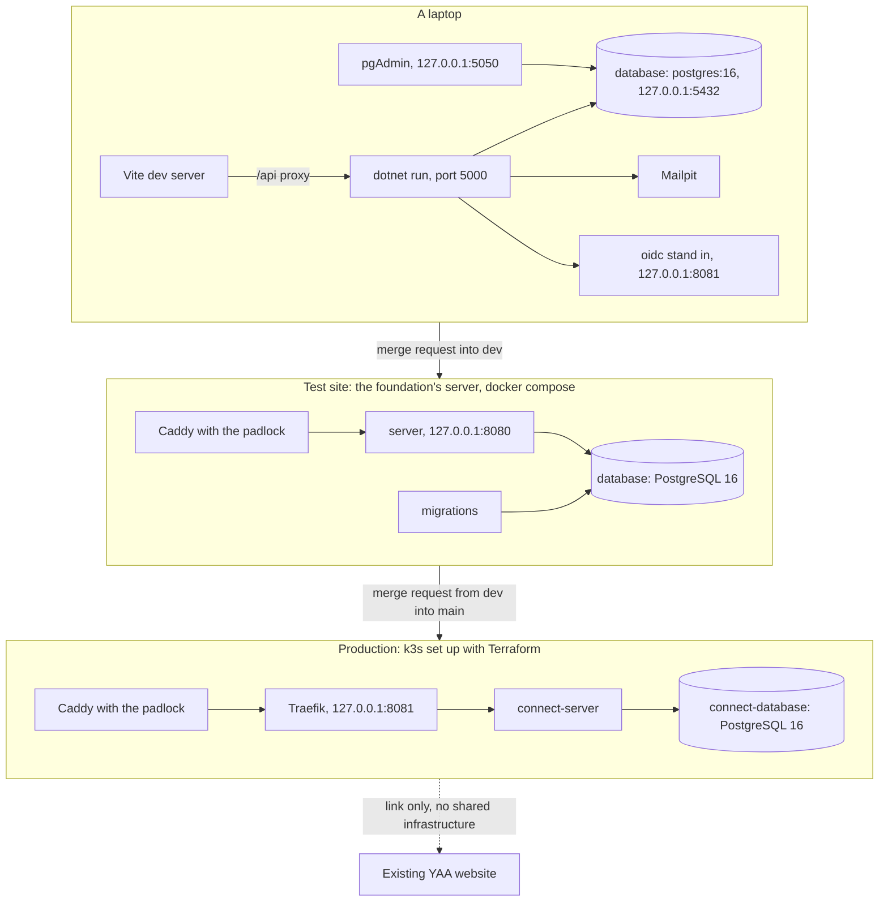
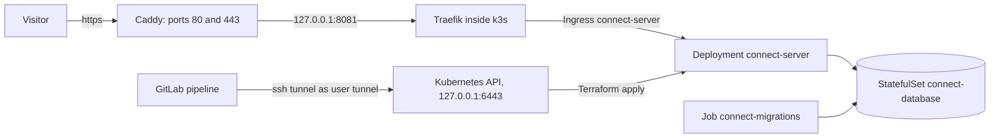
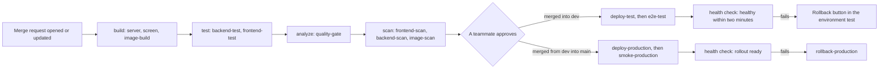
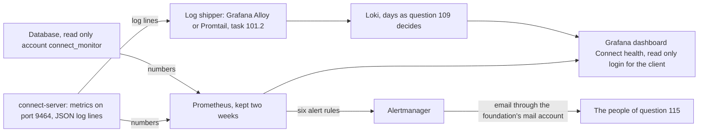

# Infrastructure, Young Amstelland Connect

This document serves the HvA level 3 criteria Analysis & Advice (AA) and Design & Realisation
(OR). It says where Connect runs, how a change travels from a laptop to the test site and to
production, how the team watches it, and how data, secrets and backups are kept. It is grounded in
`docs/client/clientBrief.md` and `docs/client/clientBriefConcept.jpeg`,
`docs/project/requirements.md`, `docs/architecture/techStack.md`,
`docs/architecture/stackResearch.md`, `docs/team/codeConventions.md`, and
`docs/project/productVision.md`.

The board is the source of truth. Every part below names the issue that builds it, by its board
number and title. The GitLab number of each board number is in `docs/team/boardNumbers.md`. The
steps to do each thing live in `docs/team/onboarding.md`, which the issues fill section by section.
This document says what and why, the guide says how.

The first version of this document (23 and 24 September 2026) compared hosting options on a student
budget and called container orchestration optional. The board settled both: the foundation lends
its own server, and production runs on k3s set up with Terraform because the school requires it.
That history is kept below where it explains a choice.

## What the client's requests imply for infrastructure

Read item by item from the brief's text and from `docs/client/clientBriefConcept.jpeg`, the concept
diagram the client sent. Each point names the exact wording or drawn element it comes from.

- **Standalone, away from the YAA production site.** The brief's text is explicit: "Young Amstelland
  Connect wordt ontwikkeld als **standalone applicatie**, met een eigen technische omgeving. Er
  mogen geen wijzigingen nodig zijn aan de productieomgeving, database of stemfunctionaliteit van
  YAA" (`docs/client/clientBrief.md`). The diagram draws the same split twice: once as two separate
  boxes, "Awards-platform" on the left and "YAA CONNECT" in the center, joined only by an arrow
  labeled "Link / verwijzing" and "Los van elkaar (wel verbonden)", and once again at the bottom,
  where a cloud labeled "YAA Connect Hosting (standalone)" feeds a cylinder labeled "YAA Connect
  Database", with no line back to the Awards-platform box. Connect therefore has its own server,
  its own database per environment, and its own credentials, and nothing here touches YAA's
  environment. The link between the two stays a plain hyperlink for this semester.

- **Public visibility, since the client wants the platform seen.** `docs/project/productVision.md`
  names visibility as the client's own reasoning, quoting the collaboration agreement: "The client
  wants the project visible, to motivate young people and to show the foundation works with the
  HvA." The concept diagram's "Gebruikers" column names eight stakeholder groups outside the
  foundation itself: Jongeren (15-30), Genomineerden & Winnaars, Juryleden, Ambassadeurs, Gemeenten,
  Scholen & Onderwijs, Bedrijven & Partners, and Maatschappelijke organisaties. A platform meant to
  be found by that many groups needs a public web address with the padlock, covered under
  Operational needs below. Member pages stay out of search engines (issue 15b Search engines do not
  list member pages).

- **Media storage.** The concept diagram draws no camera, image, or file icon, and the first
  version of this document did not claim a media need from it. The board now has one: a young
  person adds a picture to a project (issue 61b Add an image to my project), and a news item gets a
  picture too. Pictures are files in the volume `connect-uploads`, mounted on `/var/connect/uploads`,
  not rows in the database. A request is at most 6 MB for the picture upload and 1 MB for every other
  address (issue 105b A request that is far too large is refused). The pictures often show minors,
  so they get a nightly copy on both environments (issues 172 and 174, under Backups below).

- **The webshop and payment handling, conditional on the open scope question.** The webshop is the
  one module the diagram draws that the client's text never mentions: a shopping-cart tile labeled
  "Webshop" with the caption "T-shirts, petjes, agenda's en meer." The same diagram's
  external-services cloud, "Externe diensten (bijv. e-mail, betalingen, maps, analytics)", names
  "betalingen" (payments). On the board the webshop is FR10 Webshop (not confirmed by the client).
  Question 2 asks whether it comes this semester, and issue 171 The payment provider chosen with the
  client compares at least two providers on cost, a free test mode and whether the data stays inside
  the European Union. Keeping the provider's own hosted checkout page in the flow keeps card data
  off Connect's servers. No key of the payment provider is ever written in a document of the team.
  If the webshop is out of scope, this line drops.

- **The other three external services.** The same cloud names mail, maps, and analytics. Mail is on
  the board: Mailpit on laptops and the test site, and the mail account of the foundation on the
  live site (issue 173 Connect sends email through the foundation's mail account on the live site).
  No issue on the board uses maps or an outside analytics service, so neither needs infrastructure.
  The board adds log in with Google and Facebook (issues 23 and 24), which needs a client id and a
  secret per environment, never in the repository (question 7).

- **One database behind every module.** The diagram draws a single cylinder, "YAA Connect
  Database", with arrows to the full module grid, the hosting cloud and the external-services
  cloud. Wesley Oerlemans decided on 24 September 2026 that Connect keeps one shared database across
  every module rather than a database per module, matching the client's diagram. The board keeps
  that per environment: each environment has its own PostgreSQL 16 database, and the live version
  never shares its database with the test site (issue 95 Connect and its database described in
  Terraform, question 114).

## The environments

Three places run Connect: a laptop, the shared test site, and production. The test site plays the
role a separate staging environment would, and no fourth environment is added, since every extra
environment is one more thing to patch, back up and keep credentials for.

- **A laptop.** `docker-compose.yml` in the root starts the service `database` (the image
  `postgres:16`, `container_name: database`, a named volume, the port only on
  `127.0.0.1:5432`), pgAdmin to look inside the database (`dpage/pgadmin4:9` on `127.0.0.1:5050`,
  no login page), the test mailbox Mailpit (ports `127.0.0.1:1025` and `127.0.0.1:8025`), and the
  log in stand in `oidc` (`ghcr.io/soluto/oidc-server-mock`, pinned, on `127.0.0.1:8081`). The server
  runs with `dotnet run` on `http://localhost:5000` and the screen with the Vite dev server, whose
  proxy sends `/api` to the server. With `docker compose --profile app up -d --build` all of Connect
  runs as containers on `http://localhost:8080` (issue 20 Dockerfiles for the server and the
  frontend). Secrets on a laptop go in dotnet user-secrets, and `.env` only feeds docker compose.

- **The test site.** The foundation rents a computer on the internet and lends it to the team
  (issue 09 Every team member on the client's server, sprint 1). docker compose runs the services
  `server` (on `127.0.0.1:8080`), `migrations` and `database` (PostgreSQL 16, no published port)
  from `deploy/docker-compose.test.yml` in `/srv/connect-test`, plus Mailpit. Caddy is the front
  door. Every merge into `dev` puts the images of that commit there. The test site only holds
  invented accounts until question 3 allows real data.

- **Production.** k3s on one computer, the production server, set up with Terraform (issues 91 to
  97 of the epic Production, sprint 4). Every merge into `main` goes there. It exists because the
  HvA DevOps workshop requires orchestration and infrastructure as code. The foundation did not ask
  for it, so the team keeps it small: one computer, no paid service, and the test site does not
  change (issue 92 k3s and Terraform for production, compose for test). When the client says no to
  a live version on the foundation's server (question 111), production runs on a spare computer of
  the team, for school only.

The diagram below shows the three places Connect runs and how a change moves from one to the next.

*Figure: the three places Connect runs. Each has its own database, and only production is linked
to the existing YAA website, by link only.*

## The test site in detail

Issue 09 Every team member on the client's server prepares the machine. The first login came on
2 October 2026, the server is prepared, and it waits only on the test address (task 9.1).

- **The server as received, 2 October 2026.** The server had been used before, by an earlier
  iteration of this project built by other people. It carried Dokploy as a Docker Swarm stack
  with Traefik, PostgreSQL and Redis, a leftover Strapi volume and container images of that
  earlier work, and ssh keys and root logins that were not the team's. Wesley Oerlemans wiped it
  and rebuilt it clean on the same day. The rebuild is logged on the server.
- **The machine.** Its facts are in the section The client's server of `docs/team/onboarding.md`.
  The data centre is in Germany, inside the European Union, which NFR2 GDPR footing requires
  because data of young people under 18 will be stored there.
- **Logins.** Every team member has a personal user with an ssh key. Password login and root login
  are off, and two members have sudo rights so the team is never locked out (task 9.2).
- **Open doors.** The firewall ufw opens only ports 22, 80 and 443. Every container listens on the
  server itself only, because Docker can open ports past the firewall (task 9.3).
- **The front door.** Caddy, with its settings in `deploy/Caddyfile`, makes the padlock with a
  certificate from Let's Encrypt, renews it by itself, sends http to https, and passes every visit
  to `127.0.0.1:8080` (task 9.4). Mailpit is opened to the team through Caddy behind a login (basic
  auth), with the login in the GitLab variables `MAILPIT_USER` and `MAILPIT_PASSWORD`.
- **The deploy.** A user `deploy` owns `/srv/connect-test`. The pipeline logs in with its own ssh
  key, stored as a masked and protected GitLab variable, and the file `/srv/connect-test/.env` with
  the database password is made on the server itself and readable only by `deploy` (task 9.5).
- **Images.** The job `deploy-test` logs in to the GitLab registry with a deploy token that may only
  read, pulls the images `server` and `migrations` of its own commit, runs `migrations` once, and
  then restarts `server` (issue 20 task 20.4). Because `migrations` runs before the old server
  stops, a failing migration leaves the version before running.
- **Health after a deploy.** `deploy/waitForHealthy.sh` asks `GET /api/health` every ten seconds for
  at most two minutes, and the job is only green on exactly `"status":"healthy"` (issue 17 A health
  check and structured logs, task 17.3). After that the job `e2e-test` runs the Playwright tests
  against the test site.
- **Going back.** The GitLab environment `test` lists every deploy with its version, date and name,
  with a Rollback button next to the older ones. The steps are in the section Going back to the
  previous version of `docs/team/onboarding.md`, practised once by a teammate who did not write
  them, within ten minutes (issue 17 task 17.4).
- **Log size.** The containers `server` and `database` use the logging driver json-file with
  `max-size 10m` and `max-file 5`, so each keeps at most about 50 MB (issue 17 task 17.5).

### The front door and the test address, options compared

**The front door.** Caddy is the choice of task 9.4 and of issue 95 task 95.3, which keeps it as
the one front door for production too because the team knows it and it renews its certificate by
itself.

| Option | What it gives | What it costs the team | Why not now |
| --- | --- | --- | --- |
| Caddy, chosen | One binary, one short Caddyfile, certificates from Let's Encrypt made and renewed by itself, http to https (Caddy, n.d.) | One Caddyfile to write in task 9.4, and the team knows it | Not applicable |
| Nginx with certbot | The most common reverse proxy and what most guides show | The certificate needs a second tool and a timer, more to set up and one more thing that can break quietly | The team already runs Caddy and would gain nothing |
| Traefik | Reads Docker labels and configures itself, already chosen inside k3s for production (issue 93) | More concepts than Caddy for one compose stack | Fewer concepts is better for a single test server |
| A deployment platform such as Dokploy or Coolify | A web interface with deploy buttons and Traefik underneath, the fastest first deploy | Hides the pipeline the DevOps workshop grades | It is what the server arrived with and was removed |
| Cloudflare Tunnel | No open ports and no certificate work | A third party in the path of every visit, which the GDPR notes on minors' data (issue 19) would have to cover (Cloudflare, n.d.) | Adds a party to the data path for no need the team has now |

**A test address before the DNS record.** The server is reachable now and nothing in the deploy
waits on the domain, only the padlock does, because Let's Encrypt gives a certificate to a name
and the client's DNS record for the test address is not there yet (task 9.1).

- **A wildcard DNS name, proposal.** The name `31-70-66-186.sslip.io` resolves to `31.70.66.186`
  with no account and no cost, nip.io is the same service, both in operation for over ten years
  (sslip.io, n.d.). Caddy gets a real certificate for it. When the client's record comes, the
  first line of the Caddyfile changes and nothing else. It depends on a third party staying up,
  and it is never published to users.
- **A free dynamic DNS name such as DuckDNS.** Needs an account, same trade.
- **A domain of the team's own, around ten euros a year.** Money, and a name nobody needs after
  the client's record exists.
- **A certificate for the bare IP address.** Let's Encrypt issues six-day certificates for IP
  addresses, generally available since 15 January 2026 (Let's Encrypt, 2026). New, and whether
  Caddy can request one on this server is not checked yet.

Proposal: Caddy on the sslip.io name until the client's DNS record arrives, so the test site has
a padlock from its first deploy. Decided by the whole team at a stand up, owner the Product Owner
of sprint 1, Nick Hoebe, inside task 9.4.

## Production in detail

The choice is recorded in `docs/decisions/<number>-productionOnK3s.md` (issue 92). Wesley Oerlemans
made it on 27 September 2026, and task 92.1 checks the facts behind it at their own source before
task 92.2 writes it down.

**The client agrees first.** Nothing runs on the foundation's server and nothing carries its name
before the director has said yes. Issue 91 The director agrees where production runs asks six
questions in one meeting, questions 111 to 116 in `docs/client/clientQuestions.md`: whether the
foundation agrees to a live version the school asked for, one server or two, the production
address, real or invented data, who receives the warning emails, and which mail account the live
version sends from. For the question on one or two servers the team measures the memory of the
server (`free -h`, `df -h`, `docker stats`) next to what k3s, Prometheus, Grafana and Loki ask for
in their own documentation (task 91.1).

**The options that were compared.** Task 92.1 compares docker compose (what the test site uses),
k3s and MicroK8s against slide 8 of the DevOps workshop: parts that restart by themselves, a new
version swapped in without downtime, and a setup declared in files. It also compares Terraform with
OpenTofu on their license, checks whether the GitLab managed Terraform state is on at
gitlab.fdmci.hva.nl, and checks that k3s supports the operating system of the production server.
Docker compose stays on the laptops and the test site because it is what the team knows and what
the test site needs.

**k3s on the production server** (issue 93 k3s on the production server):

- `infra/k3s/installK3s.sh` installs one pinned k3s version (`K3S_VERSION` at the top), and a second
  run changes nothing. The version and the date it was chosen are in the section Production server
  of `docs/team/onboarding.md`.
- `infra/k3s/traefikPorts.yaml` moves Traefik, the front door inside k3s, off ports 80 and 443 to
  `127.0.0.1:8081`, so Caddy keeps 80 and 443 and stays the one front door with the padlock.
- The Kubernetes API on port 6443 stays closed in the firewall. A scan from outside shows 6443 and
  8081 as filtered.
- The pipeline reaches k3s only through an ssh tunnel as the Linux user `tunnel`, which may only
  forward to `127.0.0.1:6443` and has no shell. `infra/k3s/clusterAccess.yaml` makes the namespace
  `connect-production` and two logins: `gitlab-planner`, which may only read, and `gitlab-deployer`,
  which may change things and only works in the pipelines of `dev` and `main`. The job `kube-check`
  shows every day that the node is Ready.
- A teammate who did not install it follows the guide on a spare virtual computer made with
  Multipass and gets the same result (task 93.3).

**Every change as a plan first** (issue 94 Every production change shown as a plan first):

- `infra/terraform` describes production, with pinned versions of Terraform and the providers
  kubernetes and helm, and the lock file committed.
- The Terraform state is named `production` and kept by GitLab (Operate, Terraform states), never
  in the repository. When the managed state is off on gitlab.fdmci.hva.nl, the fallback is the
  backend kubernetes, as task 92.1 records.
- The job `terraform-check` lays out and validates the files on every merge request. The job
  `terraform-plan` puts the plan on the merge request with the read only login. Applying first
  starts by hand on `main`, and issue 96 turns it into the job `deploy-production`.

**Connect and its database in Terraform** (issue 95 Connect and its database described in
Terraform):

- The StatefulSet `connect-database` with one pinned PostgreSQL 16 tag, the volume claim
  `database-data`, limits on memory and processor, and a readiness probe. Terraform refuses to
  remove it (`prevent_destroy`).
- A Job `connect-migrations-<image_tag>` brings the tables up to date before the new server starts.
- The Deployment `connect-server` runs the image `server` on port 8080, with a readiness probe on
  `GET /api/health`, a liveness check on the port, limits on memory and processor, a rolling update
  that keeps the old pod until the new one is ready (`max_unavailable` 0, a time limit of five
  minutes from issue 97), and the volume `connect-uploads` for pictures.
- The Ingress `connect-server` tells Traefik which address goes to the Service `connect-server`. A
  block in `deploy/Caddyfile` makes the padlock for the production address and passes visits to
  Traefik. When production has its own server, that server gets Caddy the same way, with
  `deploy/Caddyfile.production`.
- The secrets never enter Git or the Terraform state. They are masked and protected GitLab
  variables, and `infra/k3s/applySecrets.sh` turns them into the Secrets `connect-database-secret`,
  `connect-registry-pull` and `connect-server-secret` right before the apply. A missing variable
  stops the script with its name, and nothing is applied.
- A team check proves the three promises: no secret shows anywhere a developer can look, a removed
  server pod is replaced and the address answers healthy again within two minutes, and the number of
  accounts is the same after the database pod was removed (task 95.4).

**Mail of the live site** (issue 173): `Mail__Host`, `Mail__Port`, `Mail__User`, `Mail__From` and
`App__BaseUrl` go in the ConfigMap `connect-server-config`, and the password in the GitLab variable
`MAIL_PASSWORD_PRODUCTION`. A reset email must arrive within a minute from the foundation's address,
with SPF and DKIM passing. SPF and DKIM are set by the owner of the foundation's domain, so a failure
there goes to the client under question 116.

**From main to production** (issue 96 A merge into main goes to production): the job
`deploy-production` runs by itself on every merge into `main`, only when every stage before it is
green. It fills the Secrets, runs the apply with the commit id as image tag, waits for the rollout,
and asks `https://<production address>/api/health` until it answers healthy. Every run is recorded
in the GitLab environment `production`. The job `smoke-production` then runs
`web/e2e/productionSmoke.spec.ts`, a read only Playwright test that opens the home page and
asks the health address, and changes nothing, because production may hold real data.

**Going back in production** (issue 97 Going back to the previous version is practised): the manual
job `rollback-production` puts an earlier version back through Terraform, with the version typed in
as `ROLLBACK_IMAGE_TAG`, so the files, the Terraform state and k3s keep agreeing on what runs. The
registry keeps the ten newest images, which is how far back the team can go. The rule that a
migration only adds (proposed in issue 17 task 17.4 and linked from `docs/team/codeConventions.md`)
means going back never has to change the data. The drill uses a version broken on purpose (the tag
`drill-97`) and a teammate who did not write the steps, with a goal of ten minutes or less.

The diagram below shows the road of a visit and the road of a change in production.

*Figure: the road of a visit and the road of a change in production. The internet only reaches
Caddy, and the pipeline only reaches k3s through the tunnel.*

## GitLab as the platform

The repository is the project connect-nine on the HvA GitLab, gitlab.fdmci.hva.nl, which runs GitLab
19.4 in the Free tier (`docs/team/gitlabSetup.md`). `dev` is the default branch. `dev` and `main`
are protected: nobody pushes to them, a merge request needs one approval from a teammate who is not
the author, and the pipeline must be green. `main` only changes from `dev`. The branch and commit
rules are in `docs/team/codeConventions.md` and are not repeated here.

**The pipeline.** The stages run in this order, the order of slide 7 of the DevOps workshop:

1. **build**: the server and the screen build, and `image-build` builds the images `server` and
   `migrations` on every merge request without pushing them (issue 20).
2. **test**: `backend-test` with its own PostgreSQL 16 and `frontend-test`, both writing a coverage
   report (issue 03 task 3.8, issue 89 task 89.1).
3. **analyze**: `quality-gate` hands the code and the coverage to the tool of issue 88 and blocks
   the merge when a gate rule fails (issue 89 A change that lowers code quality is stopped).
4. **scan**: `frontend-scan` runs npm audit and `backend-scan` lists the vulnerable packages of the
   server, both failing on High or Critical (issue 16 A security scan in the pipeline), and
   `image-scan` opens both images with Trivy (issue 90 An image with a serious known hole is
   stopped). A weekly scheduled pipeline runs the same scans on `dev`. Only the client can accept a
   known hole, with a reason and an end date, in `docs/security/securityExceptions.md`.
5. **deploy**: on a merge into `dev`, `image-push` stores both images in the registry with the short
   commit id, `deploy-test` puts them on the test site and `e2e-test` runs the browser tests there.
   On a merge into `main`, `deploy-production` and `smoke-production` run (issue 96).

Beside them run `env-file-check`, which fails when a `.env` file is in Git (issue 01 The
repository, the pipeline and the team rules), `terraform-check` and `terraform-plan` on every merge
request, and `monitoring-check` on every merge request that touches the monitoring files. The
checks finish within ten minutes (issue 01).

The diagram below shows the stages of the pipeline in order and the two ways out.

*Figure: the stages of the pipeline and the two ways out, to the test site and to production, each
with its health check and its way back.*

## The DevOps advanced track

`docs/school/workshopCoverage.md` found that the first pipeline had no scan gate, no rollback path
and no observability, which the Level 3 DevOps advanced track asks for on top of the foundation
track (Hogeschool van Amsterdam, 2026). The first version of this document proposed a student-sized
answer and called container orchestration optional. It read the workshop's Kubernetes demo against
Connect's shape and concluded that orchestration solves multi-machine problems Connect does not have
(Kubernetes, n.d.). That reading still holds for the product. What changed is the goal: on 27
September 2026 Wesley Oerlemans decided that the school requirement is met in full, so production
runs on k3s with Terraform, and every issue that exists only for school says so in its description.

What the board builds for each item of the track:

| Item | Issues |
| --- | --- |
| A quality gate that blocks | 88 The team picks the code quality tool, 89 A change that lowers code quality is stopped |
| A dependency and image scan that blocks | 16 A security scan in the pipeline, 90 An image with a serious known hole is stopped |
| Orchestration | 92 k3s and Terraform for production, compose for test, 93 k3s on the production server |
| Infrastructure as code, write, plan, review, apply | 94 Every production change shown as a plan first, 95 Connect and its database described in Terraform |
| From commit to production | 96 A merge into main goes to production |
| A rehearsed rollback | 17 A health check and structured logs (test site), 97 Going back to the previous version is practised (production) |
| Metrics, dashboard, alerts, central logs | 98 The server counts its requests and errors, 99 One dashboard with the health of Connect, 100 An email before young people notice a problem, 101 All log lines of Connect in one place |
| Evidence for the teacher | 84 The DevOps learning outcomes agreed with the teacher, 86 A recording of one change from commit to production, 87 The live demo to the teacher |

K3s calls itself "Lightweight Kubernetes. Easy to install, half the memory, all in a binary of less
than 100 MB," and names single machines among what it is built for (K3s, n.d.). That is why the
board chose it for one computer rather than a managed cluster. Compose, on the other hand, "supports
production deployments on single hosts" (Docker, n.d.), which is why the test site keeps it.

## Observability

Watching is kept to what the workshop asks and the foundation can read. Only the live version is
watched by the monitoring tools. The test site has its health check and its logs.

- **Health checks.** ASP.NET Core's health checks middleware exposes the health of the app over an
  HTTP endpoint, so that "a container orchestrator may respond to a failing health check by halting a
  rolling deployment or restarting a container" (Microsoft, n.d.-a). `GET /api/health` asks the
  database and answers 503 with the failing check when it cannot reach it within three seconds
  (issue 17 task 17.1). The deploy jobs and the readiness probe in production read it.
- **Structured logs.** .NET's `ILogger` writes a message template plus key-value pairs rather than a
  plain string (Microsoft, n.d.-b). The server writes one JSON line per event with the request id of
  the visit on every line, and never a password, a token, a full email address or a message text
  (issue 17 task 17.2).
- **Metrics.** The server counts every request by address pattern, method, answer code and duration,
  on its own port 9464, which only programs inside k3s can reach. Prometheus collects them in the
  namespace `connect-monitoring` and keeps them for two weeks, next to the numbers of the server
  machine, the pods and the database (a read only database account `connect_monitor`). No number
  holds an email address, a name or an account id (issue 98).
- **Dashboard.** Grafana on `<production address>/grafana` with one dashboard Connect health, stored
  as the file `infra/grafana/dashboards/connectHealth.json`. The client has his own read only login,
  and sign up and anonymous access are off. The choice of access is written in
  `docs/decisions/<number>-grafanaAccess.md` (issue 99).
- **Alerts.** Six rules in `infra/monitoring/alertRules.yml`, tested with promtool in the pipeline:
  ConnectDown, ConnectErrorShareHigh, ConnectSlowAnswers, ConnectPodRestarting,
  ConnectDiskAlmostFull and ConnectBackupFailed. Alertmanager sends one email when a problem starts
  and one when it ends, through the mail account of the foundation, to the people and at the hours
  the client chose (question 115). Each email links to a short part in the section Alerts of
  `docs/team/onboarding.md` with the first step (issue 100). The error share that sends a warning is
  question 107, with 5 percent as the proposal of the team.
- **Central logs.** Loki keeps every log line of production for the number of days the data rules
  allow, with a saved search per question the team asks most, and one click from the error graph to
  the lines of that moment (issue 101). The retention is question 109, with 14 days as the proposal
  of the team.

The diagram below shows how the numbers and the log lines of production travel to the dashboard and the warning emails.

**The history.** On 23 and 24 September 2026 this document compared four ways to host Connect on a
student budget: one virtual server, Azure for Students credit, a hybrid of a free static host and a
small server, and the Azure grant of Microsoft for Nonprofits that the WailSalutem Foundation could
claim as a nonprofit. The single virtual server was the proposal, because it was the simplest to run
and kept the SQL Server license question closed with the Express edition.

**What the board settled.** The foundation lends its own server to the team (issue 09), so the team
adds no hosting cost and every program on the server is free (NFR3 Hosting at no license cost). The
change to PostgreSQL on 26 September 2026 removed the SQL Server license question altogether. Whether
production shares that server or gets a second one is question 112, with the measured memory and the
monthly price of a second server next to it. Who runs and pays for Connect after January 2027, and
whether the foundation wants the grant of Microsoft for Nonprofits, is question 6.

The facts about the nonprofit grant that the first version read on 24 September 2026 stay useful for
question 6. The grant is claimed by the organisation, not by the team or the HvA: schools and
universities are not eligible (Microsoft, n.d.-d), only the primary contact of the foundation can
activate it, and it must be renewed every year (Microsoft, n.d.-c). So only the foundation can take
that step.

## Operational needs

- **Backups.** Two issues, which never copy the same files and never share a place or a key:
  - Issue 172 A backup of the project pictures: on the test site, `deploy/backup/pictureBackup.sh`
    packs the volume `connect-uploads` every night at three o'clock through a systemd timer and
    removes archives older than the agreed number of days. Where the copies go (a second disk or
    storage of the foundation elsewhere in the European Union) and for how many days is question 28.
  - Issue 174 A backup of the live database: in production, the CronJob `connect-backup` runs
    `pg_dump` and sends the dump and the pictures with restic, locked with a key, to the place of
    question 117, and removes copies older than the chosen number of days. A teammate puts the newest
    copy back into a spare database once and compares the counts.
- **Secrets.** Never in the repository, a log, the Terraform state or a chat. On a laptop they go in
  dotnet user-secrets. On the test site the database password is in `/srv/connect-test/.env`, made on
  the server. In production every secret is a masked and protected GitLab variable that
  `infra/k3s/applySecrets.sh` turns into a Kubernetes Secret. A new secret setting of the server gets
  a variable `<NAME>_PRODUCTION` and one line in that script.
- **Web addresses.** The test address sits under the foundation's own domain and points at its
  server (issue 09 task 9.1). The production address is question 113, chosen by the director.
- **HTTPS.** Caddy makes the padlock on both addresses with a certificate from Let's Encrypt and
  renews it by itself. When the certificate cannot be made, Caddy writes why in its log, most often
  a DNS record that does not point at the server yet.
- **Data inside the European Union.** Some users are minors, which NFR2 GDPR footing names as a GDPR
  obligation. The server's data centre, both backups and the mail provider of the live site must be
  inside the European Union, and `docs/security/personalDataInventory.md` names the country of each
  (issues 09, 172, 173 and 174). The rules themselves are in `docs/security/dataRules.md` (issue 19
  GDPR notes on minors' data).
- **Memory on a shared server.** Every part of production has a memory limit, so the test site and
  the live version cannot push each other off the server when they share it (issue 95). Prometheus
  has a fixed memory limit too (issue 98).

## What stays open

| Open point | Decided by |
| --- | --- |
| The test address | The client, issue 09 task 9.1 |
| A temporary test address with a padlock before the client's DNS record | Whole team, issue 09 task 9.4 |
| A live version on the foundation's server at all | Issue 91, question 111 |
| One server or two | Issue 91, question 112 |
| The production address | Issue 91, question 113 |
| Real data on the test site, and on the live site | Question 3 and question 114 |
| Who receives the warning emails, and when | Question 115 |
| The mail account of the live site and how its password reaches the team | Question 116 |
| Where the backups go and for how long | Question 28 (test pictures) and question 117 (production) |
| How many days the logs of the live version are kept | Question 109 |
| Terraform or OpenTofu, and where the state lives | Issue 92 task 92.1 |
| Whether k3s supports the operating system of the production server | Issue 92 task 92.1 |
| The code quality tool | Issue 88 |
| Whether the HvA runners can build images, and whether the registry is on | Issue 20 task 20.3 |
| Who runs and pays for Connect after January 2027 | Question 6 |

One point for issue 93 to check when question 112 chooses one shared server: on a laptop the log in
stand in `oidc` listens on `127.0.0.1:8081`, the same port the board gives Traefik in production. If
the test site runs that stand in on the same machine on the same port, one of the two must move.

## References

Caddy. (n.d.). *Automatic HTTPS*. Caddy Documentation. Retrieved October 2, 2026, from
https://caddyserver.com/docs/automatic-https

Cloudflare. (n.d.). *Cloudflare Tunnel*. Cloudflare One docs. Retrieved October 2, 2026, from
https://developers.cloudflare.com/cloudflare-one/networks/connectors/cloudflare-tunnel/

Docker. (n.d.). *Why use Compose?* Docker Docs. Retrieved September 23, 2026, from
https://docs.docker.com/compose/intro/features-uses/

Hogeschool van Amsterdam. (2026). *Level 3 DevOps advanced workshop* [Course document].

K3s. (n.d.). *K3s - Lightweight Kubernetes*. Retrieved September 23, 2026, from
https://docs.k3s.io/

Kubernetes. (n.d.). *Overview*. Kubernetes. Retrieved September 23, 2026, from
https://kubernetes.io/docs/concepts/overview/

Let's Encrypt. (2026, January 15). *6-day and IP address certificates are generally available*.
Retrieved October 2, 2026, from
https://letsencrypt.org/2026/01/15/6day-and-ip-general-availability.html

Microsoft. (n.d.-a). *Health checks in ASP.NET Core*. Microsoft Learn. Retrieved September 23,
2026, from https://learn.microsoft.com/en-us/aspnet/core/host-and-deploy/health-checks

Microsoft. (n.d.-b). *Logging in C# and .NET*. Microsoft Learn. Retrieved September 23, 2026,
from https://learn.microsoft.com/en-us/dotnet/core/extensions/logging

Microsoft. (n.d.-c). *Activate your Azure grant*. Microsoft Learn. Retrieved September 24,
2026, from https://learn.microsoft.com/en-us/industry/nonprofit/microsoft-for-nonprofits/claim-activate-nonprofit-azure-grant

Microsoft. (n.d.-d). *Eligibility guidelines*. Microsoft Learn. Retrieved September 24, 2026,
from https://learn.microsoft.com/en-us/industry/nonprofit/microsoft-for-nonprofits/eligibility

sslip.io. (n.d.). *Welcome to nip.io / sslip.io*. Retrieved October 2, 2026, from
https://sslip.io/

Strato. (n.d.). *Sicherheit: Maximaler Schutz mit STRATO Hosting-Produkten*. Retrieved October 2,
2026, from https://www.strato.de/sicherheit/

## AI use declaration

AI was used as a writing support tool while working on this document. We used AI to draft
the formulation of sentences, the structure of wording, readability, and clarity from
content that we had provided, and to generate the diagrams. The content itself, including
our experiences, reflections, learning goals, decisions, self-assessments, and
conclusions, is our own. We reviewed the drafts and decided as a team which text to
include.
