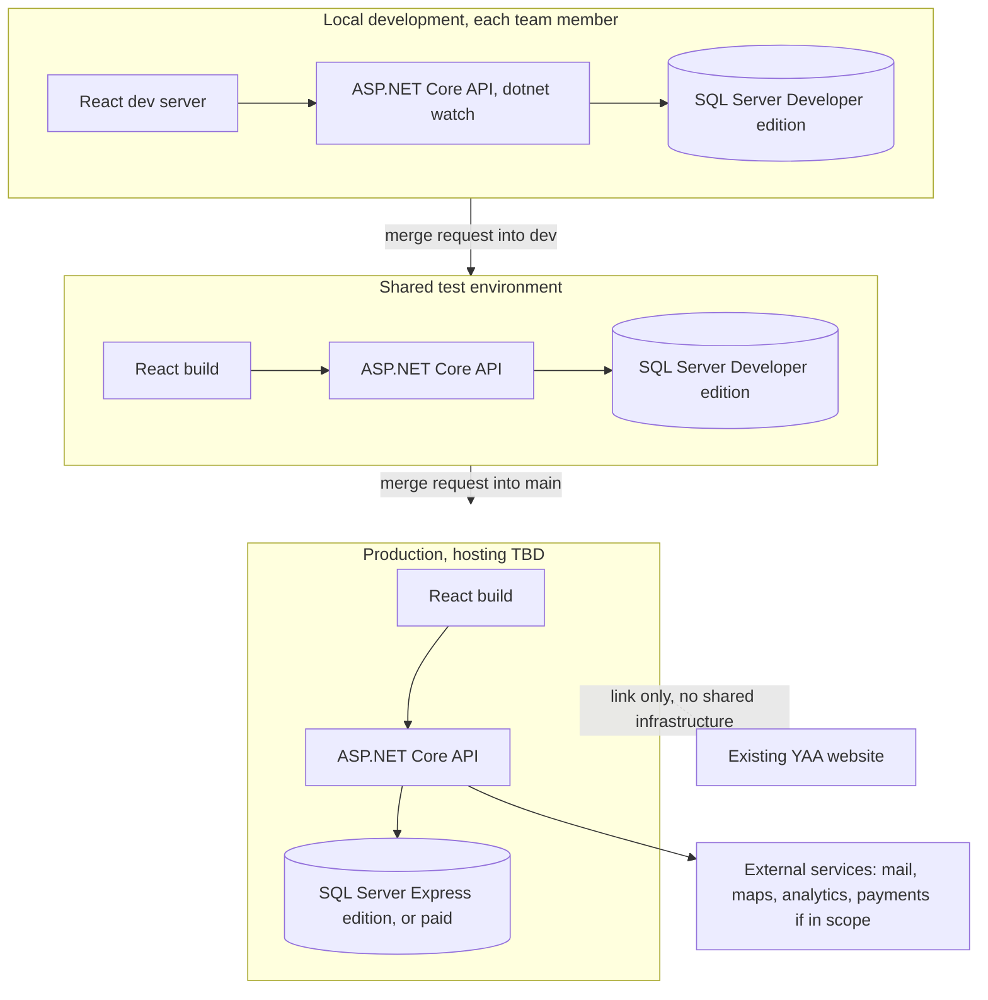
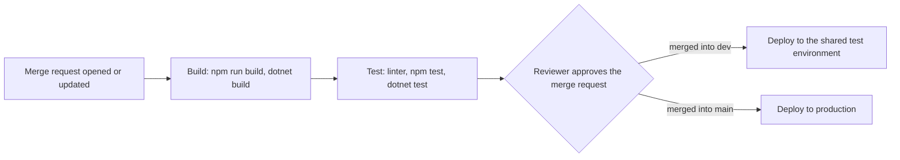
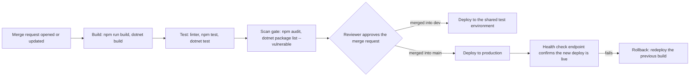
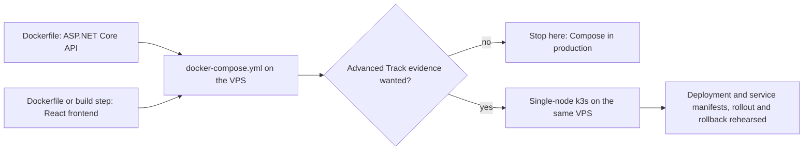

# Infrastructure, Young Amstelland Connect

This document serves the HvA level 3 criteria Analysis & Advice (AA) and Design & Realisation
(OR). It is grounded in `clientBrief.md` and `clientBriefConcept.jpeg`, `requirements.md`,
`techStack.md`, `stackResearch.md`, `codeConventions.md`, and `productVision.md`, and stays open
for the team to edit and restructure as understanding develops. Every open decision below is a
TBD with an owner and a date, and every hosting or operational option that is not yet a team
decision is marked as a proposal.

## What the client's requests imply for infrastructure

Read item by item from the brief's text and from `clientBriefConcept.jpeg`, the concept
diagram the client sent. Each point below names the exact wording or drawn element it comes
from.

- **Standalone, away from the YAA production site.** The brief's text is explicit:
  "Young Amstelland Connect wordt ontwikkeld als **standalone applicatie**, met een eigen
  technische omgeving. Er mogen geen wijzigingen nodig zijn aan de productieomgeving, database
  of stemfunctionaliteit van YAA" (`clientBrief.md`). The diagram draws the same split twice:
  once as two separate boxes, "Awards-platform" on the left and "YAA CONNECT" in the center,
  joined only by an arrow labeled "Link / verwijzing" and "Los van elkaar (wel verbonden)",
  and once again at the bottom, where a cloud labeled "YAA Connect Hosting (standalone)"
  feeds a cylinder labeled "YAA Connect Database", with no line at all back to the
  Awards-platform box. Infrastructure has to honour both drawings: Connect gets its own
  hosting account, its own database instance, and its own credentials, and nothing in this
  document touches YAA's environment. The link between the two stays a plain hyperlink for
  this semester, per the brief, not a shared login or a shared network.

- **Public visibility, since the client wants the platform seen.** `productVision.md`'s
  business case names visibility as the client's own reasoning, quoting the collaboration
  agreement: "The client wants the project visible, to motivate young people and to show the
  foundation works with the HvA." The concept diagram's "Gebruikers" column reinforces this
  with eight stakeholder groups outside the foundation itself: Jongeren (15–30), Genomineerden
  & Winnaars, Juryleden, Ambassadeurs, Gemeenten, Scholen & Onderwijs, Bedrijven & Partners,
  and Maatschappelijke organisaties. A platform meant to be found by that many outside groups
  needs a public domain name and a certificate that does not depend on being on a campus
  network or behind a login page for basic browsing, covered under Operational needs below.

- **Media storage, checked directly against the picture.** The concept diagram does not draw
  a camera, image, or file icon anywhere. Its eight module tiles use a person, a lightbulb, a
  target, a calendar, a group of people, a ribbon, a shopping cart, and a document icon, for
  Profielen, Projecten, Challenges, Events, Community, Badges, Webshop, and Nieuws in turn, and
  none of those is a media icon. The closest the picture comes is the Projecten tile's own
  caption, "Deel je ideeën" (share your ideas), and the client's text names "talent/project
  showcases" among the possible functionalities. So the diagram itself does not demonstrate a
  media storage need, and this document does not claim it does. What can be said is that FR5 in
  `requirements.md` (talent and project showcases) is the kind of feature that, once designed,
  is likely to want photo or video uploads, which would call for object storage separate from
  the relational database. That stays a note for the team to pick up once FR5 is designed, not
  an infrastructure requirement derived from the drawing.

- **The webshop and payment handling, conditional on the open scope question.** The webshop
  is the one module the diagram draws that the client's text never mentions: a shopping-cart
  tile labeled "Webshop" with the caption "T-shirts, petjes, agenda's en meer." The same
  diagram's external-services cloud at the bottom, "Externe diensten (bijv. e-mail,
  betalingen, maps, analytics)", names "betalingen" (payments) as one of four services Connect
  is drawn as depending on. `productVision.md` and `requirements.md` both already record the
  open scope question this raises, owned by Nick Hoebe, due at the latest the sprint 1 review,
  week of 5 October 2026. This document adds only the infrastructure reading of that question:
  if the webshop is confirmed in scope, Connect's standalone environment needs a payment
  provider integration and the secrets that come with it, and keeping the provider's own
  hosted checkout page in the flow keeps card data off Connect's own servers rather than
  adding PCI scope to a five-person student team's infrastructure. If the webshop is out of
  scope, this entire line item drops, and payments comes off the external-services list below
  with it.

- **The other three external services, drawn and named.** The same "Externe diensten" cloud
  names mail, maps, and analytics alongside payments, tied respectively to account
  notifications, the location-based content the client's stakeholder list implies (Amstelland
  municipalities, schools, and organizations), and usage tracking. Each is a third-party
  credential Connect's environments have to hold without putting it in the repository, covered
  under secrets handling below.

- **One database behind every module.** The diagram draws a single cylinder, "YAA Connect
  Database", with a bidirectional arrow down from the full module grid (through the
  "Beheer & Statistieken" bar) and bidirectional arrows out to both the hosting cloud and the
  external-services cloud. Nothing in the picture suggests a database per module. Profiles,
  projects, challenges, events, community, badges, the webshop if it stays in scope, news, and
  the admin dashboard all read and write the same store, which matches `techStack.md`'s
  three-layer architecture (React frontend, ASP.NET Core API, one Microsoft SQL Server
  instance). Wesley Oerlemans decided on 2026-09-24 that this stays one shared database across
  every module rather than a database per module, matching the client's own concept diagram,
  for the team to confirm at sprint 1 planning, week of 21 September 2026.

## The environments story

Kept to what a five-person team can actually run and maintain alongside coursework: local
development, one shared test environment, and production. No separate staging or UAT
environment is proposed, since the team's own DevOps and hosting experience is TBD for every
member (`techStack.md`), and a fourth environment is one more thing to patch, back up, and keep
credentials for without a documented need for it yet.

- **Local development.** Each team member runs the React frontend with its own development
  server, the ASP.NET Core API with `dotnet watch`, and SQL Server Developer edition locally,
  which `stackResearch.md` already confirms is free and carries the full Enterprise feature set
  for building and testing. Nothing here needs a shared credential or a shared server.

- **Shared test environment.** One environment the team deploys to from the `dev` branch,
  mirroring the branch flow in `codeConventions.md`, for integration testing before a change
  reaches `main`. SQL Server Developer edition covers this environment too, since Microsoft's
  own licensing terms restrict Developer edition to "a development and test system, not as a
  production server" (`stackResearch.md`), which a shared test environment is.

- **Production.** Deployed from `main`, which `codeConventions.md` already documents as
  protected, no direct commits, merge request only. Production is the one environment where
  the Developer edition licensing line matters: it cannot run there, so production needs either
  the free Express edition, capped at "the lesser of 1 socket or 4 cores" (`stackResearch.md`),
  or a paid edition. This is the same tension NFR3 in `requirements.md` already names, and it
  is carried into the hosting options below rather than repeated here.

*Figure: local development, the shared test environment, and production, each running the
same three-layer stack, with production the only tier where the SQL Server edition choice
carries a licensing decision and the only tier connected to the existing YAA website, by link
only.*

## GitLab as the platform

The repository lives on GitLab, per Wesley Oerlemans on 23 September 2026 (`codeConventions.md`,
`documentGuide.md`). The branch and merge request flow, feature branch into `dev` with one
reviewer, `dev` into protected `main` with one reviewer, is already set out in
`codeConventions.md`'s own diagram and in `collaborationAgreement.md`'s "Commit Messages" and
"Branches and Merge Requests" sections. It is not repeated here. What follows is new: a
proposed CI pipeline running on GitLab CI against that same flow.

**Proposal.** Three stages, build, test, deploy, triggered on every merge request and again on
merge:

*Figure: a proposed three-stage GitLab CI pipeline, build then test then deploy, with the
deploy target set by which branch the merge request lands on.*

This keeps the Definition of Done, a passing linter, no compile errors, passing unit tests
(`collaborationAgreement.md` sections 6 and 7, restated in `codeConventions.md`), enforced by
the pipeline rather than only by a reviewer reading the merge request. `testingStrategy.md`'s
proposal gives the Test stage its concrete content, NUnit and Vitest unit and integration
suites, with the Playwright end to end suite running after a merge into `dev` rather than on
every merge request. Decision TBD whole team, sprint 1 planning, week of 21 September 2026.

### The DevOps workshop's advanced-track items, as proposals

`workshopCoverage.md`'s DevOps section found this gap real: the three-stage pipeline above has
no scan gate, no documented rollback path, and no observability of any kind, which is what the
Level 3 Advanced Track workshop asks for on top of the Foundation-track "commit, lint, test,
build, deploy" pipeline (Hogeschool van Amsterdam, 2026). This section proposes a
student-sized answer to each, read against a live demo built on Kubernetes, Terraform,
Prometheus, and Loki that a five-person team with no DevOps experience on record is not
proposed to reproduce. `workshopCoverage.md`'s own framing carries over directly: the workshop
showing Kubernetes does not mean Connect needs Kubernetes, it means Connect needs a scan gate,
a rollback plan, and a way to see what a deploy is doing, of some shape.

**Dependency scan gate (proposal).** GitLab's own dependency scanning, matched against
malware and vulnerability advisories from a pipeline-produced SBOM, is an Ultimate-tier
feature (GitLab, n.d.), which a five-student team's own GitLab project is unlikely to carry.
The language toolchains Connect already depends on cover the same ground without it. The .NET
CLI's `dotnet package list --vulnerable` flag checks a project's NuGet packages against known
vulnerabilities directly (Microsoft, n.d.-f), and `npm audit` does the equivalent for the
frontend's packages (npm, n.d.). Both are free, already installed with the SDKs the team is
using, and need no GitLab tier upgrade. Proposed as a Scan stage between Test and the reviewer
approval step, failing the pipeline on a vulnerability above a severity the team sets, rather
than only informing.

**Rollback path (proposal).** The workshop's own rollback path redeploys the previous image,
blue-green, or a feature flag. For a five-person team on a single droplet or app-service
tier, the realistic version of this is the first of those three: keep the previous build
artifact and the previous database migration reachable, and document the exact steps, which
build to redeploy and which command triggers it, so a rollback is a rehearsed procedure rather
than something improvised during an incident, the workshop's own closing point ("Rehearse your
rollback before you need it, not during an incident"). Blue-green and feature flags are not
proposed, since both need infrastructure, a second live environment or a flag service, the
team has not budgeted for.

**Observability (proposal), kept lightweight.** Three pieces, none of them the workshop's own
Prometheus, Grafana, and Loki stack, all free and already close to what the chosen framework
ships with:

- **Health checks.** ASP.NET Core's own health checks middleware exposes app health over an
  HTTP endpoint, built specifically so "a container orchestrator may respond to a failing
  health check by halting a rolling deployment or restarting a container" and so "a load
  balancer might react to an unhealthy app by routing traffic away from the failing instance"
  (Microsoft, n.d.-d). Even without a container orchestrator, the same endpoint is what the
  rollback path above checks after a deploy before calling it successful.
- **Structured logs.** .NET's built-in `ILogger` API supports structured logging out of the
  box, writing a message template plus key-value pairs rather than a plain string (Microsoft,
  n.d.-e). Proposed as the default logging provider for both environments, console output
  locally, written to a file or the hosting platform's own log capture in the shared test
  environment and production, without standing up a separate logging stack such as Loki.
- **Uptime monitoring.** An external check against the health endpoint above, on a schedule,
  alerting the team if it stops responding. UptimeRobot's pricing page names a free tier
  alongside paid tiers that unlock a faster check interval than the free tier's five minutes
  (UptimeRobot, n.d.), which is enough resolution for a student project without a cost.

*Figure: the pipeline above extended with the scan gate and the rollback path the Level 3
Advanced Track asks for, both sized to what a five-person student team can run.*

The scan gate's severity threshold, the exact rollback procedure once a hosting option is
chosen, and whether the three observability pieces above are enough or the team wants more stay
open, owned by the whole team and due at sprint 1 planning, week of 21 September 2026.
Infrastructure as code stays out of scope for the same reason a single VPS gives it nothing to
provision. Container orchestration gets its own applicability check and an optional path below,
rather than the same one-line dismissal.

### Container orchestration, checked against this project's shape

**Applicability check.** The workshop's own live demo runs on Kubernetes, and Kubernetes
documents itself as solving problems that appear once an application spans more than one
machine: "service discovery and load balancing," "storage orchestration," "automated rollouts
and rollbacks" for replicated containers, and "automatic bin packing" of containers onto "a
cluster of nodes" (Kubernetes, n.d.). Every one of those is a multi-node problem. Connect's own
shape, read against `techStack.md`'s skills table and the Hosting section below, is a single
VPS running the React build, the ASP.NET Core API, and SQL Server together, one shared
database, and five students none of whom carry DevOps or hosting experience on record. There is
no second node for Kubernetes to schedule across, no replica set for it to load balance, and no
cluster for infrastructure as code to provision. The honest conclusion is that container
orchestration, in the form the workshop demonstrates it, does not apply to Connect's current
hosting shape, not because the team lacks the skill to run it but because the problem it solves
is not a problem this project has yet. What a single-node version of it would still buy,
covered in the path below, is a documented desired-state deployment and the same
restart-on-failed-health-check behavior the observability proposal above already gets from
ASP.NET Core's own middleware, not the scaling or failover Kubernetes is built for.

**Optional implementation path, for study points (proposal).** The Level 3 DevOps Advanced
Track names container orchestration as one of its own evidence items (Hogeschool van
Amsterdam, 2026), so a team that wants that specific piece of evidence can still build toward
it, on purpose and student-sized, rather than by defaulting into Kubernetes because the
workshop showed it.

1. **Containerize the application.** A Dockerfile for the ASP.NET Core API and a Dockerfile,
   or a static build step, for the React frontend, each built and run locally first.
2. **Docker Compose on the VPS, the practical step.** Compose's own documentation names
   exactly this shape: "Compose supports production deployments on single hosts. You can use
   Compose to deploy applications to remote Docker hosts and manage production-specific
   configurations" (Docker, n.d.). One `docker-compose.yml` wiring the API, the frontend, and
   SQL Server together on the same VPS the Hosting section below already proposes, replacing
   manual deploy steps with a file the whole team can read and rerun.
3. **A single-node lightweight orchestrator, the demonstration step, if the team wants the
   Advanced Track evidence.** K3s calls itself "Lightweight Kubernetes. Easy to install, half
   the memory, all in a binary of less than 100 MB," and names homelabs, single-board
   computers, and development machines among what it is built for, not only multi-node
   production clusters (K3s, n.d.). Installed on the same VPS, it gives the team the pods,
   deployments, and services vocabulary the workshop's own demo uses, and a real rollback to
   rehearse, without provisioning a second machine or paying for a managed cluster.

*Figure: the practical step, Compose, on its own is a complete answer for a single VPS. The
demonstration step, single-node k3s, is additional and only for the team that wants the
Advanced Track's own evidence.*

| Order | Needed | Have | Still to do |
| --- | --- | --- | --- |
| 1 | A Dockerfile for the ASP.NET Core API | The three-layer architecture in `techStack.md`, once the API itself exists | Write and test the Dockerfile against a running API |
| 2 | A Dockerfile or build step for the React frontend | The React scaffold, once it exists | Write and test the Dockerfile or static build step |
| 3 | A `docker-compose.yml` wiring API, frontend, and SQL Server | Nothing yet | Write the file, run it locally, then against the chosen VPS |
| 4 | A VPS with Docker Engine installed | The Hosting section's Option 1 proposal, still TBD | Confirm the hosting option, install Docker Engine |
| 5 | (Advanced Track only) k3s installed single-node on the VPS | Nothing yet | Install k3s once Compose already runs there |
| 6 | (Advanced Track only) deployment and service manifests | Nothing yet | Write manifests, rehearse a rollout and a rollback |

**Benefits.** Evidence for the DevOps datapoint's Advanced Track container orchestration item,
which is currently unaddressed. Reproducible environments, the same container image running
local development, the shared test environment, and production, closing the drift the
environments story above already flags as a risk without a dedicated staging tier. Alignment
with the rollback path already proposed in this section: "redeploy the previous build" becomes
a specific image tag to redeploy rather than a rebuild from source, closer to the workshop's
own "rehearse your rollback before you need it, not during an incident" standard.

**Downsides.** Time against the October 9 minimum set: `deliveryPlan.md`'s minimum credible
set for Sprint Review 1, Friday 9 October 2026, is the signed collaboration agreement, the
confirmed sprint 1 planning decisions, a repository with a working code slice, the sprint
board, and each member's own gathered evidence, none of which needs a container. Hours spent
on Dockerfiles and k3s before that date compete directly with the working slice of code the
sprint 1 review actually asks for. Operational complexity a single VPS does not repay: every
feature Kubernetes's own overview names, load balancing across containers, storage
orchestration, automatic bin packing onto a cluster of nodes (Kubernetes, n.d.), is built for
distributing work across more than one machine, and Connect's proposed hosting has one.
Learning curve: `techStack.md`'s skills table already records DevOps and hosting as TBD for
every one of the five team members, so k3s and Kubernetes manifests would be new to the whole
team at once, layered on a stack, React, .NET, SQL Server, that four of the five members are
already learning from zero.

This path stays optional rather than a plan, because the team has not yet decided whether the
Advanced Track's own container orchestration evidence is worth the time it would take from the
October 9 minimum set, and building toward it changes nothing about whether Connect's own
hosting needs an orchestrator, which the applicability check above already answers on its own
terms. Confirming or declining the optional path above, and if confirmed, which of the two
steps, Compose only or Compose plus single-node k3s, the team commits to and by when, stays
open, owned by the whole team and due at sprint 1 planning, week of 21 September 2026.

## Hosting on a student budget

React frontend, ASP.NET Core API, Microsoft SQL Server database, five students, no client
budget named in `clientBrief.md` or `collaborationAgreement.md`. `stackResearch.md` already
names the licensing tension this sets on the database layer: "the only free edition Microsoft
documents as suitable for actually serving a small application is Express, and it is capped at
one socket or four cores, while every edition without that ceiling costs four figures at
minimum." The three options below were checked against that tension using live pricing pages
read on 23 September 2026, listed in References.

**Option 1, one VPS running everything.** A single Linux virtual machine, for example a
DigitalOcean Droplet, running the React build behind a reverse proxy, the ASP.NET Core API,
and SQL Server 2022 for Linux, all on the same box. DigitalOcean's published droplet tiers run
$6 a month for 1 GiB of memory and one vCPU, $12 for 2 GiB, $18 for 4 GiB and two vCPUs, and
$24 for 8 GiB and two vCPUs (DigitalOcean, n.d.-b). A droplet in the $18 to $24 range gives the
memory and CPU headroom to run React's build tooling, the API, and SQL Server together without
swapping. SQL Server Express is legally usable in production, and its "lesser of 1 socket or 4
cores" ceiling does not actually bind at this price band, since a droplet in this range tops
out at two to four vCPUs anyway. The free edition's technical cap and the student budget's
practical cap land in roughly the same place. Cost character: a fixed monthly VM fee, in the
teens to low twenties of dollars, no separate database charge.

**Option 2, Azure for Students credit.** Azure App Service for the API and the React build,
with either an Azure SQL Database or a SQL Server virtual machine for the data layer. Azure for
Students gives verified full-time university students a $100 credit to use on Azure services
within 12 months, no credit card required at signup (Microsoft, n.d.-b). Cost character: $0 out
of pocket while the credit lasts, then pay-as-you-go. Azure's own App Service and SQL Database
pricing pages, fetched for this document, render their tier prices through an interactive
calculator rather than a static price list, so no fixed post-credit monthly figure could be
sourced here. Whether an Azure SQL Database's own pricing model even falls under the
Standard/Enterprise per-core figures `stackResearch.md` cites, or is licensed differently as a
managed offering, is also something the team would need to check directly against Azure's
pricing calculator before committing to this option. The $100 credit is also personal to
whichever team member's student account it runs under, which the team would have to agree on.

**Option 3, a hybrid.** The React build goes on a free static-site tier, DigitalOcean's App
Platform free tier serves up to three static sites at $0 a month (DigitalOcean, n.d.-a), while
the ASP.NET Core API and SQL Server share one small droplet, now only $6 to $12 a month since
it no longer also has to serve static assets. Worth noting directly: DigitalOcean's managed
database product covers PostgreSQL, MySQL, Redis, MongoDB, Kafka, and OpenSearch, not
Microsoft SQL Server (DigitalOcean, n.d.-c), so a managed database add-on is not an option for
this stack on that platform regardless of price, and SQL Server has to run in a container or
directly on the droplet either way. Cost character: the lowest sourced monthly floor of the
three options, at the cost of one more moving part, two providers instead of one.

**Option 4, the Microsoft nonprofit Azure grant.** The WailSalutem Foundation is a nonprofit
organization (fact from Wesley Oerlemans, 2026-09-24), which opens a fourth path this document
did not check on 23 September 2026. Read directly from Microsoft's own Learn pages, fetched and
read 24 September 2026, both the activation article (Microsoft, n.d.-a) and the eligibility
article (Microsoft, n.d.-c). Once an organization is approved
for Microsoft's nonprofit programs, it can claim an Azure Sponsorship grant of $2,000 USD a
year, meant to help nonprofits “migrate to the cloud, unify data, and build AI-powered
solutions” (Microsoft, n.d.-a). The credit covers first-party Azure services only, not reserved
instances, third-party marketplace offers, or support plans, and it must be activated within 90
days of the offer being issued or it can expire unclaimed (Microsoft, n.d.-a).

Eligibility is organizational, not per project. Microsoft's own eligibility guidelines qualify
“nonprofit or non-governmental organizations with recognized legal status in their respective
countries (equal to 501(c)(3) status under the United States Internal Revenue Code)” (Microsoft,
n.d.-c), a status the WailSalutem Foundation would need to confirm for itself against its own
Dutch legal form, not something this document can determine from here. Schools, colleges, and
universities are named explicitly as not eligible (Microsoft, n.d.-c), which rules out the team
or the HvA claiming the grant on the project's behalf even if the foundation qualifies.

The key operational fact: the grant has to run through the client, not through the team.
Registration and validation, up to three business days, can take longer if Microsoft's
validation partner needs more documentation (Microsoft, n.d.-c), happen under the foundation's
own Microsoft account, and only the primary contact on the resulting offer can activate the
credit (Microsoft, n.d.-a). For Connect that means Rachid Kherrazi, or whoever the foundation
names, registering the WailSalutem Foundation with Microsoft for Nonprofits and activating the
Azure grant himself. The team can propose this option and can build against the resulting
Azure subscription once it exists, but cannot register or activate it on the foundation's
behalf.

Benefits: up to $2,000 a year at no cost to the team or the client, enough to run Option 1's
single-VPS shape as an Azure App Service and an Azure SQL Database instead, or to host the same
three-layer stack on Azure infrastructure the client already owns, standing apart from any one
team member's personal Azure for Students credit, which is the risk Option 2 already flags.
Because the grant is issued to the foundation's own tenant rather than a student account, it
also outlives the semester by default: the subscription belongs to the client from the start,
not handed over at the end.

Downsides: the whole path is blocked until the foundation registers and is validated, which is
work on the client's side the team cannot schedule or speed up, and which has not started as of
this writing. The credit does not roll over between years and has to be renewed annually
(Microsoft, n.d.-a), so after the project ends in January the foundation, not the team, has to
keep renewing it, keep its nonprofit status current with Microsoft, and watch for the usage
notifications Microsoft sends before an account converts to pay-as-you-go pricing. If the
foundation lets the grant lapse after handover, the platform's hosting bill becomes the
foundation's own pay-as-you-go Azure spend with no warning built into this document. Azure's own
App Service and SQL Database pricing already carries the same unsourced-calculator problem
Option 2 names, so what $2,000 a year actually buys in compute still needs checking against
Azure's pricing calculator once an account exists.

| Option | Sourced monthly character | Learning cost for the team |
| --- | --- | --- |
| 1, single VPS | teens to low twenties of dollars, fixed | most, general Linux server administration |
| 2, Azure for Students | $0 during the credit, unsourced after | less server administration, new Azure-specific tooling |
| 3, hybrid | lowest floor, roughly $6 to $12 for the non-static half | same as Option 1, plus a second provider to track |
| 4, nonprofit Azure grant | $0 up to $2,000 a year while the foundation keeps it active, unsourced after | same Azure-specific tooling as Option 2, plus a client-side registration dependency neither Option 1 nor Option 3 carries |

PostgreSQL as the database engine cuts across all four options above rather than adding a
fifth. Because Entity Framework Core is the decided data access layer (`techStack.md`), the
database provider itself can be swapped with limited code impact, and PostgreSQL carries none
of the SQL Server licensing tension this section already documents. A stock `postgres` Docker
image needs no edition decision at all, which makes it lighter to run inside Option 1's single
VPS or Option 3's shared droplet than SQL Server Express or a paid SQL Server edition, and it
stays free regardless of which host the team ends up on. This stays open against the same
tradeoff `techStack.md` and `stackResearch.md` name: the team's own coursework points to SQL
Server, while PostgreSQL is what keeps Docker hosting lighter on this budget. Open decision,
owner: the whole team with the client, due sprint 1 planning, week of 21 September 2026.

**Proposal.** Options 1 and 3 keep the SQL Server licensing question closed with the Express
edition, legally fine for production and not a binding technical constraint at this compute
size, without depending on one member's personal student credit, which is the flagged risk in
Option 2, or on the foundation's own registration and validation, which is the flagged risk in
Option 4. Between 1 and 3, Option 1 is the simpler one to operate with a team whose hosting
experience is TBD across the board. Option 4 is worth raising with the client early regardless
of which option the team ends up running on, since the registration step only the foundation can
take is the long pole if the team wants it available by sprint 1 planning. This is a proposal,
not a decision. Decision TBD whole team, with the client, sprint 1 planning, week of 21
September 2026.

## Operational needs, as proposals

- **Backups (proposal).** Scheduled SQL Server backups on whichever hosting option is chosen,
  with a retention period the team sets at sprint 1 planning, and at least one test restore
  before the January handover, since `requirements.md`'s NFR6 already ties handover to
  continuous Definition of Done work rather than a catch-up pass. TBD whole team, sprint 1
  planning, week of 21 September 2026.

- **Secrets handling (proposal).** Connection strings and the four external-service
  credentials named in the concept diagram, mail, maps, analytics, and payments if the webshop
  stays in scope, never go in the repository. Locally, ASP.NET Core's own user-secrets tooling
  keeps them out of source control per developer machine. In the shared test environment and in
  production, the hosting platform's own environment variable or secret store holds them,
  whichever hosting option is chosen. This follows directly from the "built-in security
  features" `stackResearch.md` already names as one of ASP.NET Core's documented strengths. TBD
  whole team, sprint 1 planning, week of 21 September 2026.

- **Domain name (proposal).** A domain separate from YAA's own, satisfying the standalone
  constraint from the brief and the public visibility goal from `productVision.md` at the same
  time. Either a low-cost registered domain or the hosting platform's own free subdomain is
  workable for a semester-length project, cheapest of the two proposed as the default. TBD
  whole team, sprint 1 planning, week of 21 September 2026.

- **HTTPS.** Not treated as a separate open decision, since both DigitalOcean's App Platform
  and Azure App Service provide managed certificates at no extra cost, so whichever hosting
  option the team picks from the section above brings HTTPS with it. Required regardless of
  the option chosen, since the platform is public-facing and holds profile data for users as
  young as 15.

- **GDPR-relevant data location in the EU (proposal).** The user base spans ages 15 to 30, so
  some users are minors, which `requirements.md`'s NFR2 already names as a GDPR obligation
  independent of what the client asks for. Whichever hosting option the team picks, the
  database and any external service that stores personal data need to sit in an EU region.
  This ties directly to the open question `requirements.md` already records, owned by Nick
  Hoebe: whether development and later production use real personal data or test data only. If
  real personal data is used, the EU-region requirement applies to the shared test environment
  as well as production, not only production, since test data would then also be real personal
  data. If test data only, the same EU-region choice is still good practice, but the legal
  urgency is lower until go-live. TBD (data location, once the option above is fixed): whole
  team, sprint 1 planning, week of 21 September 2026, following Nick Hoebe's real-versus-test
  data answer, due at the latest the sprint 1 review, week of 5 October 2026.

## References

DigitalOcean. (n.d.-a). *App Platform pricing*. Retrieved September 23, 2026, from
https://www.digitalocean.com/pricing/app-platform

DigitalOcean. (n.d.-b). *Droplets pricing*. Retrieved September 23, 2026, from
https://www.digitalocean.com/pricing/droplets

DigitalOcean. (n.d.-c). *Managed databases*. Retrieved September 23, 2026, from
https://www.digitalocean.com/products/managed-databases

Docker. (n.d.). *Why use Compose?* Docker Docs. Retrieved September 23, 2026, from
https://docs.docker.com/compose/intro/features-uses/

GitLab. (n.d.). *Dependency scanning*. GitLab Docs. Retrieved September 23, 2026, from
https://docs.gitlab.com/ee/user/application_security/dependency_scanning/

Hogeschool van Amsterdam. (2026). *Level 3 DevOps advanced workshop* [Course document].

K3s. (n.d.). *K3s - Lightweight Kubernetes*. Retrieved September 23, 2026, from
https://docs.k3s.io/

Kubernetes. (n.d.). *Overview*. Kubernetes. Retrieved September 23, 2026, from
https://kubernetes.io/docs/concepts/overview/

Microsoft. (n.d.-a). *Activate your Azure grant*. Microsoft Learn. Retrieved September 24,
2026, from https://learn.microsoft.com/en-us/industry/nonprofit/microsoft-for-nonprofits/claim-activate-nonprofit-azure-grant

Microsoft. (n.d.-b). *Azure for Students*. Microsoft Azure. Retrieved September 23, 2026, from
https://azure.microsoft.com/en-us/free/students/

Microsoft. (n.d.-c). *Eligibility guidelines*. Microsoft Learn. Retrieved September 24, 2026,
from https://learn.microsoft.com/en-us/industry/nonprofit/microsoft-for-nonprofits/eligibility

Microsoft. (n.d.-d). *Health checks in ASP.NET Core*. Microsoft Learn. Retrieved September 23,
2026, from https://learn.microsoft.com/en-us/aspnet/core/host-and-deploy/health-checks

Microsoft. (n.d.-e). *Logging in C# and .NET*. Microsoft Learn. Retrieved September 23, 2026,
from https://learn.microsoft.com/en-us/dotnet/core/extensions/logging

Microsoft. (n.d.-f). *dotnet package list command*. Microsoft Learn. Retrieved September 23,
2026, from https://learn.microsoft.com/en-us/dotnet/core/tools/dotnet-list-package

npm. (n.d.). *npm-audit*. npm Docs. Retrieved September 23, 2026, from
https://docs.npmjs.com/cli/v10/commands/npm-audit

UptimeRobot. (n.d.). *Pricing*. Retrieved September 23, 2026, from
https://uptimerobot.com/pricing/

## AI use declaration

AI was used as a writing support tool while working on this document. We used AI to draft
the formulation of sentences, the structure of wording, readability, and clarity from
content that we had provided, and to generate the diagrams. The content itself, including
our experiences, reflections, learning goals, decisions, self-assessments, and
conclusions, is our own. We reviewed the drafts and decided as a team which text to
include.
