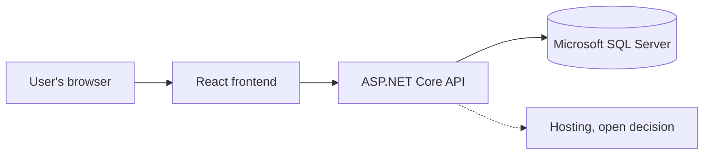

# Tech stack, Young Amstelland Connect

This document serves the HvA level 3 criteria Analysis & Advice (AA) and Design & Realisation
(OR). Nothing here is decided until the team confirms it, per this folder's README.

## What the platform has to support

Derived from `clientBrief.md` and its concept diagram, `clientBriefConcept.jpeg`.

**Deployment shape**

- A standalone web application, "zelfstandig digitaal community- en talentplatform," with its
  own technical environment: own hosting, own database. No change may reach the YAA
  production environment, database, or voting functionality.
- A link to the existing YAA website at first. An API between the two platforms is a possible
  later step, not a semester 1 requirement.

**External services**

The diagram lists four, tied to specific modules:

- Mail, for notifications and account flows.
- Payments, needed if the webshop module (T-shirts, caps, agendas) is in scope. The webshop
  appears only in the diagram, not in the client's text, so it is worth confirming with the
  client whether it is in scope for this semester, since it is the one module that pulls in a
  payment provider the text does not otherwise require.
- Maps, for location-based content (organizations, events, opportunities tied to Amstelland).
- Analytics, for usage tracking on the platform.

**Application modules**

From the client's "Mogelijke functionaliteiten" and the diagram, both lists agreeing:

- Profiles, for users and organizations.
- Projects and talent showcases.
- Challenges.
- Opportunities.
- Events.
- Badges and achievements.
- News and inspiration.
- Community interaction and matching.
- An admin dashboard, "beheer & statistieken" in the diagram.

**User base**

Ages 15 to 30, across multiple groups: young people, nominees, winners, alumni, jury members,
ambassadors, mentors, experts, municipalities, youth work, schools, businesses, and partner
organizations. Some users are minors, which carries into the non-functional section below.

## Constraints from the collaboration agreement

From `collaborationAgreement.md`, section 6 and 7:

- `main` is protected. No direct commits and no pushes, changes only through a merge request
  into `dev`, and every work branch merges into `dev` first.
- Definition of Done requires a passing linter, no compile errors, and unit tests that pass,
  before work counts as finished.
- Documentation lives in the `docs` folder in the repository, covering both code and
  architecture, and significant choices are documented.
- Stack-specific code conventions follow once the stack is fixed. Until then the team works
  to the established best practices of whatever language and framework is in use, plus SOLID,
  DRY where practical, and clean code where practical.

These are process constraints, not stack constraints. They rule out nothing on their own, but
whatever stack is chosen has to have a workable linter and a workable unit test setup, since
both are required for every merge.

## Non-functional weight: security and privacy

The user base includes minors, ages 15 to 30, holding profiles and public-facing content on
an open, visible platform. The team has a dedicated Security Specialist, Kelvin van Voorst,
which is a deliberate part of the studio's team composition per this folder's README.

This weighs the stack decision toward:

- Frameworks and libraries with an active security track record and a maintained patching
  path, since the team is committing to keep dependencies current for two semesters' worth of
  scope.
- Clear, well-documented patterns for authentication, authorization, and input handling,
  since several modules (profiles, community interaction, admin dashboard) handle
  user-submitted content and personal data.
- A stack the whole team, including Kelvin in the Security Specialist role, can review
  competently. A framework nobody but one person can audit is a risk on its own.

The open questions in `collaborationAgreement.md` section 9 about data ownership, whether real
personal data or test data is used during development, and portfolio visibility, are still
with the client (owner Nick Hoebe, due the sprint 1 review, week of 5 October). Those answers
affect how the stack handles data protection in practice and should be checked against
whatever is chosen once they land.

## Team skills and learning goals

The stack is fixed, React, .NET and Microsoft SQL Server. This section is now input for
dividing work across the team and naming what each person needs to learn, not for picking a
stack. Facts below were provided by Wesley Oerlemans on 2026-09-22. Every TBD is owned by the
person it appears under, due sprint 1 planning, week of 21 September 2026. DevOps and hosting
was TBD for everyone until Kelvin van Voorst, Bayon Eerhart, Nick Hoebe and Gurpreet Singh each
supplied their own inventory on 2026-09-24, closing that cell for all four. It stays TBD for
Wesley, since no DevOps facts are on record for him yet. A single table across five members and
seven facts each ran too wide to read, so the inventory is broken out per member instead. It
was updated 2026-09-24 from each member's own supplied inventory, Kelvin van Voorst, Bayon
Eerhart, Nick Hoebe and Gurpreet Singh, for the team to confirm the reading at sprint 1
planning, week of 21 September 2026.

### Wesley Oerlemans

Profile: Full Stack Software Developer, Level 3.

| Frontend (React) | Backend (.NET) | Database (SQL Server) | DevOps / hosting |
| --- | --- | --- | --- |
| No experience | No experience | Has used SQL and PostgreSQL before, so the query language is familiar, but has never used Microsoft SQL Server itself | TBD |

Semester goal: his next internship stage is in React and .NET, so his goal is building with
both ahead of it.

### Nick Hoebe

Profile: Full Stack Software Developer, Level 3.

| Frontend (React) | Backend (.NET) | Database (SQL Server) | DevOps / hosting |
| --- | --- | --- | --- |
| Experienced with React and TypeScript, his preferred frontend language. Also works with Angular, Vue and Blazor, and has limited experience with Next.js. | Experienced with C# and .NET, including Entity Framework Core and NUnit. Also works with Java and Kotlin through Spring Boot, and TypeScript Node backends through NestJS, Express, Prisma and TypeORM. | Has used Microsoft SQL Server directly and through ORMs, along with MySQL and PostgreSQL. | Basic experience with Azure and AWS. Uses Docker, no Kubernetes yet. |

Semester goal: expanding his .NET knowledge.

Fuller inventory, supplied 2026-09-24:

- Particular interest in backend and software architecture: Clean Architecture, CQRS and
  Vertical Slice, plus both REST and GraphQL.
- Other: Git and collaborative workflows.

### Gurpreet Singh

Profile: Full Stack Software Developer, Level 3.

| Frontend (React) | Backend (.NET) | Database (SQL Server) | DevOps / hosting |
| --- | --- | --- | --- |
| Basic knowledge of React and Vue. Says frontend design and creative work are not his strongest area, but can work in React or Vue when needed. | None mentioned. Backend languages are Java, JavaScript, TypeScript, Python, Kotlin and PHP, with Spring Boot and Laravel as frameworks. | None mentioned. Has used MySQL and MariaDB. | Basic Docker, basic AWS, basic CI/CD. |

Semester goal: TBD.

Fuller inventory, supplied 2026-09-24:

- Languages: Java, JavaScript, TypeScript, Python, Kotlin, PHP, HTML, CSS, Sass, XML.
- Tools: Git, GitHub, GitLab, Postman, Vite. IDEs: IntelliJ, Android Studio, VS Code.
- Design: Figma. Android: Kotlin, XML, Android Studio.
- Preference: backend work, APIs, business logic, databases and integrations.

### Bayon Eerhart

Profile: Full Stack Software Developer, Level 2.

| Frontend (React) | Backend (.NET) | Database (SQL Server) | DevOps / hosting |
| --- | --- | --- | --- |
| None mentioned. HTML, CSS and TypeScript are all high. | None mentioned. PHP is high, and Java is low. | SQL in general is high, but Microsoft SQL Server itself is not mentioned. | None mentioned. Linux is high. |

Semester goal: TBD.

Fuller inventory, supplied 2026-09-24: HTML, CSS, TypeScript, PHP and SQL all high. Java low,
Python sufficient, Linux high. One entry in the supplied inventory reads "lid low", which is
not readable as given, for Bayon Eerhart to clarify at sprint 1 planning, week of 21 September
2026.

### Kelvin van Voorst

Profile: Security Specialist, Level 2.

| Frontend (React) | Backend (.NET) | Database (SQL Server) | DevOps / hosting |
| --- | --- | --- | --- |
| None mentioned. HTML, CSS and JavaScript are high, and Angular is sufficient. | C# with .NET, including ASP.NET Identity, is good. | SQL in general is good, but Microsoft SQL Server itself is not mentioned. | Docker is moderate to sufficient. No other DevOps or hosting tool is mentioned. |

Semester goal: the security and privacy side of the platform.

Fuller inventory, supplied 2026-09-24: JavaScript with Express sufficient, TypeScript with
Express high, Python sufficient, making ERDs high, network diagrams sufficient.

## Decision

The frontend is React, the backend is .NET, and the database is Microsoft SQL Server as the
main goal. This is one recorded team decision, confirmed by Wesley Oerlemans on 2026-09-22.

The reasoning: the main goal of choosing React and .NET is learning, not the fastest route to
a working platform. Most of the team does not know React or .NET yet. Wesley's next
internship stage is in React and .NET, so building this platform with them now serves his
personal development directly. Nick Hoebe already knows .NET and wants to expand his
knowledge of it further, which gives the team one person who can unblock the other four on
the backend. That is a real trade-off: an unfamiliar stack costs velocity, weighed against
the learning gain the team is choosing on purpose. The full research behind each technology,
read against this platform's requirements, is in `stackResearch.md`.

Work division also serves each member's own assessment. Three members, Wesley, Nick and
Gurpreet, are assessed against Full Stack Software Developer level 3 criteria, including the
R&D report. Bayon is assessed against Full Stack Software Developer level 2, and Kelvin
against Security Specialist level 2.

The security and privacy work, which the minors among the users make real, maps to Kelvin for
that reason. His ASP.NET Identity experience fits the NFR1 authorization design he already owns
in `requirements.md`, and his skill at making ERDs suits him for database design review too.
Nick's depth in .NET, including Clean Architecture, CQRS and NUnit, gives the backend a second
pair of hands beyond onboarding the rest of the team. Gurpreet's stated preference is backend
work, APIs, business logic, databases and integrations, and he says frontend design and
creative work are not his strongest area, though his basic React and Vue knowledge still gives
the frontend a starting point. Bayon's TypeScript and SQL are both high, which the frontend and
database layers can draw on once he is working in React and SQL Server specifically.

*Figure: the three-layer architecture the decision above sets, with hosting marked by a
dotted line as the one layer still undecided.*

Wesley Oerlemans decided on 2026-09-24 that Entity Framework Core is the data access layer
between the ASP.NET Core API and Microsoft SQL Server, for the team to confirm at sprint 1
planning, week of 21 September 2026.

Because Entity Framework Core is the decided data access layer, the database provider itself
stays swappable: EF Core supports Microsoft SQL Server and PostgreSQL through separate
provider packages behind the same `DbContext` and LINQ query code, so the concrete database
engine can be switched later with limited code impact. That keeps PostgreSQL open as an option
for the case the client prefers it, a tradeoff `stackResearch.md` weighs against the
database's licensing cost and `infrastructure.md` weighs against Docker hosting. The team's
own coursework points to SQL Server, while PostgreSQL is what eases running the database in
Docker on the host the team eventually picks. Open decision, owner: the whole team with the
client, due sprint 1 planning, week of 21 September 2026.

## AI use declaration

AI was used as a writing support tool while working on this document. We used AI to draft
the formulation of sentences, the structure of wording, readability, and clarity from
content that we had provided, and to generate the diagrams. The content itself, including
our experiences, reflections, learning goals, decisions, self-assessments, and
conclusions, is our own. We reviewed the drafts and decided as a team which text to
include.
