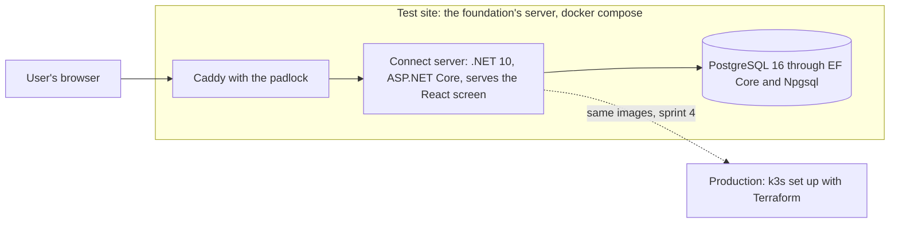

# Tech stack, Young Amstelland Connect

This document serves the HvA level 3 criteria Analysis & Advice (AA) and Design & Realisation
(OR). It says what the platform has to support, which tools Connect is built with, why, and what
each team member brings to them. The research behind each technology is in
`docs/architecture/stackResearch.md`. How the parts fit together is in
`docs/architecture/architecture.md`, and where they run is in `docs/architecture/infrastructure.md`.

The board is the source of truth. Every tool below names the issue that decides or builds it, by
its board number and title. The GitLab number of each board number is in
`docs/team/boardNumbers.md`.

## What the platform has to support

Derived from `docs/client/clientBrief.md` and its concept diagram,
`docs/client/clientBriefConcept.jpeg`.

**Deployment shape**

- A standalone web application, "zelfstandig digitaal community- en talentplatform," with its
  own technical environment: own hosting, own database. No change may reach the YAA production
  environment, database, or voting functionality.
- A link to the existing YAA website at first. An API between the two platforms is a possible
  later step, not a semester 1 requirement.
- The foundation lends its own server to the team for the test site (issue 09 Every team member
  on the client's server). The live version runs on k3s on the same server or on a second one, as
  the client decides in issue 91 The director agrees where production runs (question 112 in
  `docs/client/clientQuestions.md`).

**External services**

The concept diagram lists four, tied to specific modules. The board now says this about each:

- Mail, for notifications and account flows. On the board: every email goes through one sender
  (issue 21 Ask for a password reset link by email). Laptops and the test site use the test
  mailbox Mailpit. The live site uses the mail account of the foundation (issue 173 Connect sends
  email through the foundation's mail account on the live site, question 116).
- Payments, needed only if the webshop (T-shirts, caps, agendas) is in scope. The webshop appears
  only in the diagram, not in the client's text. On the board it is FR10 Webshop (not confirmed by
  the client). Question 2 asks whether it comes this semester, and issue 171 The payment provider
  chosen with the client compares at least two providers.
- Maps, for location-based content. No issue on the board uses maps.
- Analytics, for usage tracking. No issue on the board uses an outside analytics service. The
  foundation sees usage numbers inside Connect (issue 47 See this month's usage numbers).

The board adds one outside service the diagram does not draw: log in with Google and Facebook
(issue 23 Register or log in with Google, issue 24 Register or log in with Facebook). What the
foundation must set up for it is question 7.

**Application modules**

From the client's "Mogelijke functionaliteiten" and the diagram, both lists agreeing. Each is now a
requirement in `docs/project/requirements.md` and an epic on the board:

- Profiles (FR1, epic Profiles).
- Projects and talent showcases (FR5, epic Showcases).
- Challenges (FR8, epic Challenges).
- Opportunities (FR4, epic Opportunities).
- Events (FR6, epic Events).
- Badges and achievements (FR9, epic Badges).
- News and inspiration (FR7, epic News).
- Community interaction and matching (FR2, epic Matching).
- An admin dashboard, "beheer & statistieken" in the diagram (FR3, epic Admin).
- A webshop, only in the diagram (FR10, epic Webshop, not confirmed).

The board holds 227 issues in 21 epics, planned over five sprints: Sprint 1 from 21 September to 9
October 2026, Sprint 2 from 19 October to 6 November, Sprint 3 from 9 to 27 November, Sprint 4 from
30 November to 18 December, and Sprint 5 from 4 to 8 January 2027.

**User base**

Ages 15 to 30, across multiple groups: young people, nominees, winners, alumni, jury members,
ambassadors, mentors, experts, municipalities, youth work, schools, businesses, and partner
organizations. Some users are minors, which carries into the non-functional section below.

## Constraints from the collaboration agreement and the board

From `docs/team/collaborationAgreement.md`, sections 6 and 7, and from `docs/team/gitlabSetup.md`:

- The code lives in the project connect-nine on the HvA GitLab, gitlab.fdmci.hva.nl, which runs
  GitLab 19.4 in the Free tier. Epics are issues named "EPIC: <name>", and there is one board per
  sprint.
- `dev` and `main` are both protected. Nobody pushes to them directly. Every work branch starts
  from `dev` and goes back into `dev` through a merge request that one teammate who is not the
  author approves, with a green pipeline. `main` only changes from `dev`, and an urgent repair of
  the live site is a `hotfix/` branch from `main`.
- The Definition of Done (`docs/team/definitionOfDone.md`) requires a linter with no errors and no
  warnings, a passing build, and tests that pass, before work counts as finished.
- Documentation lives in the `docs` folder in the repository, and one decision goes in one file in
  `docs/decisions`.
- The code conventions are fixed per layer in `docs/team/codeConventions.md`.

Whatever tool is chosen has to have a workable linter and a workable test setup, since both are
required for every merge, and it has to cost the foundation nothing (NFR3 Hosting at no license
cost).

## Non-functional weight: security and privacy

The user base includes minors, ages 15 to 30, holding profiles and public-facing content on an
open, visible platform. The team has a dedicated Security Specialist, Kelvin van Voorst, which is a
deliberate part of the team composition.

This weighs the stack toward:

- Frameworks and libraries with an active security track record and a maintained patching path,
  since the team keeps dependencies current for two semesters. The pipeline checks this on every
  change (issue 16 A security scan in the pipeline, issue 90 An image with a serious known hole is
  stopped).
- Clear, well-documented patterns for authentication, authorization, and input handling, since
  several modules handle user-submitted content and personal data (NFR1 Authentication and
  authorization, NFR2 GDPR footing).
- A stack the whole team, including Kelvin in the Security Specialist role, can review
  competently. A framework nobody but one person can audit is a risk on its own.

Two data questions are still with the client: whether real data of young people may be on the test
site (question 3), and whether the live version may hold real data from its first day (question
114). The answers change how the stack handles data protection in practice. Until question 3 is
answered, the test site holds only invented accounts (issue 03 Create an account).

## Team skills and learning goals

The stack is fixed. This section is input for dividing work across the team and naming what each
person needs to learn, not for picking a stack. The facts below were provided by Wesley Oerlemans
on 22 September 2026 and supplied by Kelvin van Voorst, Bayon Eerhart, Nick Hoebe and Gurpreet Singh
from their own inventories on 24 September 2026. DevOps and hosting stays TBD for Wesley, since no
DevOps facts are on record for him yet.

The inventory was taken when the database was still Microsoft SQL Server. The database column now
reads against PostgreSQL, and the facts per member are unchanged. The production tools k3s and
Terraform are new to the whole team (issue 93 k3s on the production server).

### Wesley Oerlemans

Profile: Full Stack Software Developer, Level 3.

| Frontend (React) | Backend (.NET) | Database | DevOps / hosting |
| --- | --- | --- | --- |
| No experience | No experience | Has used SQL and PostgreSQL before. Has never used Microsoft SQL Server. | TBD |

Semester goal: his next internship stage is in React and .NET, so his goal is building with both
ahead of it.

### Nick Hoebe

Profile: Full Stack Software Developer, Level 3.

| Frontend (React) | Backend (.NET) | Database | DevOps / hosting |
| --- | --- | --- | --- |
| Experienced with React and TypeScript, his preferred frontend language. Also works with Angular, Vue and Blazor, and has limited experience with Next.js. | Experienced with C# and .NET, including Entity Framework Core and NUnit. Also works with Java and Kotlin through Spring Boot, and TypeScript Node backends through NestJS, Express, Prisma and TypeORM. | Has used PostgreSQL, MySQL and Microsoft SQL Server, directly and through ORMs. | Basic experience with Azure and AWS. Uses Docker, no Kubernetes yet. |

Semester goal: expanding his .NET knowledge.

Fuller inventory, supplied 24 September 2026:

- Particular interest in backend and software architecture: Clean Architecture, CQRS and Vertical
  Slice, plus both REST and GraphQL.
- Other: Git and collaborative workflows.

### Gurpreet Singh

Profile: Full Stack Software Developer, Level 3.

| Frontend (React) | Backend (.NET) | Database | DevOps / hosting |
| --- | --- | --- | --- |
| Basic knowledge of React and Vue. Says frontend design and creative work are not his strongest area, but can work in React or Vue when needed. | None mentioned. Backend languages are Java, JavaScript, TypeScript, Python, Kotlin and PHP, with Spring Boot and Laravel as frameworks. | Has used MySQL and MariaDB. PostgreSQL is not mentioned. | Basic Docker, basic AWS, basic CI/CD. |

Semester goal: TBD.

Fuller inventory, supplied 24 September 2026:

- Languages: Java, JavaScript, TypeScript, Python, Kotlin, PHP, HTML, CSS, Sass, XML.
- Tools: Git, GitHub, GitLab, Postman, Vite. IDEs: IntelliJ, Android Studio, VS Code.
- Design: Figma. Android: Kotlin, XML, Android Studio.
- Preference: backend work, APIs, business logic, databases and integrations.

### Bayon Eerhart

Profile: Full Stack Software Developer, Level 2.

| Frontend (React) | Backend (.NET) | Database | DevOps / hosting |
| --- | --- | --- | --- |
| None mentioned. HTML, CSS and TypeScript are all high. | None mentioned. PHP is high, and Java is low. | SQL in general is high. PostgreSQL is not mentioned. | None mentioned. Linux is high. |

Semester goal: TBD.

Fuller inventory, supplied 24 September 2026: HTML, CSS, TypeScript, PHP and SQL all high. Java
low, Python sufficient, Linux high. One entry in the supplied inventory reads "lid low", which is
not readable as given. Bayon Eerhart clarifies it.

### Kelvin van Voorst

Profile: Security Specialist, Level 2.

| Frontend (React) | Backend (.NET) | Database | DevOps / hosting |
| --- | --- | --- | --- |
| None mentioned. HTML, CSS and JavaScript are high, and Angular is sufficient. | C# with .NET, including ASP.NET Identity, is good. | SQL in general is good. PostgreSQL is not mentioned. | Docker is moderate to sufficient. No other DevOps or hosting tool is mentioned. |

Semester goal: the security and privacy side of the platform.

Fuller inventory, supplied 24 September 2026: JavaScript with Express sufficient, TypeScript with
Express high, Python sufficient, making ERDs high, network diagrams sufficient.

## Decision

The frontend is React, the backend is .NET 10 with ASP.NET Core, and the database is PostgreSQL 16
through Entity Framework Core with the provider Npgsql.

How the decision grew, from the documents and the board:

1. **22 September 2026.** Wesley Oerlemans confirmed React, .NET and Microsoft SQL Server as the
   main goal, as one team decision.
2. **24 September 2026.** Wesley Oerlemans decided that Entity Framework Core is the data access
   layer, which kept the database engine swappable, and that the backend uses Minimal APIs without
   SignalR (`docs/architecture/stackResearch.md`).
3. **26 September 2026.** Wesley Oerlemans changed the database to PostgreSQL 16 with EF Core and
   Npgsql. No decision file records the reason yet. The trade-off these documents weighed before the
   change was this: SQL Server pointed to the coursework and to Nick Hoebe's experience, while
   PostgreSQL carries no license cost for production (NFR3 Hosting at no license cost) and runs as a
   plain container image on the foundation's server. No code existed yet, so the change touched no
   code.
4. **Sprint 1.** Issue 11 The team agrees on the layered architecture records the four layers and
   .NET 10 in decision files. .NET 10 is the long term support version, supported until November
   2028, and .NET 8 stops getting security fixes on 10 November 2026, in the middle of this project
   (task 11.3).
5. **27 September 2026.** Wesley Oerlemans decided that production runs on k3s set up with
   Terraform, while laptops and the test site stay on docker compose (issue 92 k3s and Terraform for
   production, compose for test). The HvA DevOps workshop requires it. The foundation did not ask
   for it.

The reasoning behind React and .NET: the main goal is learning, not the fastest route to a working
platform. Most of the team does not know React or .NET yet. Wesley's next internship stage is in
React and .NET, so building this platform with them now serves his personal development directly.
Nick Hoebe already knows .NET and wants to expand his knowledge of it further, which gives the team
one person who can unblock the other four on the backend. That is a real trade-off: an unfamiliar
stack costs velocity, weighed against the learning gain the team is choosing on purpose.

### The tools, per part

| Part | Tools | Issue |
| --- | --- | --- |
| Screen | React, TypeScript in strict mode, Vite, React Router, CSS Modules with `tokens.css` | 03 task 3.5 |
| Screen checks and tests | ESLint with typescript-eslint, eslint-plugin-react-hooks and eslint-plugin-jsx-a11y, Prettier, Vitest with React Testing Library | 03 task 3.5 |
| Tests in a real browser | Playwright | 03 task 3.7. Issue 111 Two end to end test tools compared on one flow compares it with Cypress on a branch that is never merged. |
| Server | .NET 10, ASP.NET Core with Minimal APIs, FluentValidation for input | 03 tasks 3.1 and 3.4, 11 |
| Server checks and tests | The built in .NET analyzers, dotnet format, warnings as errors, NUnit with `WebApplicationFactory` | 03 |
| Mail | MailKit behind `IMailSender`, Mailpit as the test mailbox | 21 |
| Database | PostgreSQL 16, EF Core with Npgsql, EFCore.NamingConventions for snake_case | 03 tasks 3.2 and 3.3 |
| Containers | Docker, docker compose, the images `server` and `migrations`, the GitLab container registry | 20 Dockerfiles for the server and the frontend |
| Test site front door | Caddy with a certificate from Let's Encrypt | 09 |
| Pipeline | GitLab CI with the stages build, test, analyze, scan and deploy | 01, 03 task 3.8, 89 |
| Security scans | npm audit and dotnet list package for packages, Trivy for images | 16, 90 |
| Code quality gate | Not decided: SonarQube Community Build, SonarQube Cloud, or GitLab Code Quality with the .NET analyzers | 88 The team picks the code quality tool |
| Production platform | k3s on one computer, with Traefik behind Caddy | 92, 93 k3s on the production server |
| Infrastructure as code | Terraform with the kubernetes and helm providers, or OpenTofu, as task 92.1 finds | 92, 94 Every production change shown as a plan first |
| Metrics, dashboard, alerts | Prometheus, Grafana, Alertmanager, a metrics library that task 98.1 chooses | 98, 99, 100 |
| Central logs | Loki with Grafana Alloy or Promtail, as task 101.2 chooses | 101 All log lines of Connect in one place |
| Backups | pg_dump and restic in production, a systemd timer for the pictures on the test site | 174 A backup of the live database, 172 A backup of the project pictures |

Work division also serves each member's own assessment. Three members, Wesley, Nick and Gurpreet,
are assessed against Full Stack Software Developer level 3 criteria, including the R&D report.
Bayon is assessed against Full Stack Software Developer level 2, and Kelvin against Security
Specialist level 2.

The security and privacy work, which the minors among the users make real, maps to Kelvin for that
reason. His ASP.NET Identity experience fits the NFR1 authorization design, and his skill at making
ERDs suits him for database design review too. Nick's depth in .NET, including Clean Architecture,
CQRS and NUnit, gives the backend a second pair of hands beyond onboarding the rest of the team.
Gurpreet's stated preference is backend work, APIs, business logic, databases and integrations, and
his basic React and Vue knowledge still gives the frontend a starting point. Bayon's TypeScript and
SQL are both high, which the frontend and database layers can draw on. His high Linux skill and
Nick's and Kelvin's Docker experience are the team's starting point for the test server and
production.

The diagram below shows the three parts of Connect, the test site they run on now, and production later.

*Figure: the three parts of Connect and where they run. The dotted line is planned: production gets
the same images in sprint 4.*

## AI use declaration

AI was used as a writing support tool while working on this document. We used AI to draft
the formulation of sentences, the structure of wording, readability, and clarity from
content that we had provided, and to generate the diagrams. The content itself, including
our experiences, reflections, learning goals, decisions, self-assessments, and
conclusions, is our own. We reviewed the drafts and decided as a team which text to
include.
