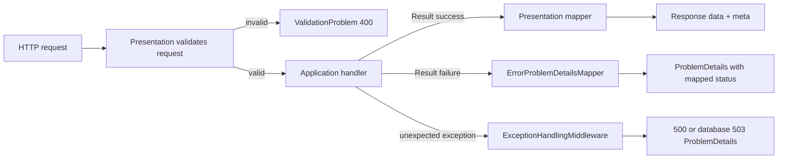

# 005 HTTP response pattern

**Status.** Proposed on 13 October 2026, waiting for the team.
**Issue.** The common pattern for successful API responses and HTTP errors.
**Who decides.** The whole team. Drafted by Nick Hoebe.

## Context

The browser needs a stable JSON contract, while the application should not expose
database entities or framework-specific HTTP results. Connect therefore keeps the
application outcome separate from its HTTP representation. The Application-side result
pattern is documented in `docs/decisions/004-resultPattern.md`.

## Options

### 1. Return data directly and use custom error objects

| | Direct payloads and custom errors | Success envelope plus `ProblemDetails` |
|---|---|---|
| Successful content | Simple at first, but every endpoint can choose a different shape | Consistent `data` and `meta` fields |
| Validation errors | Requires a custom error convention | Uses `ValidationProblem`, with one message per field |
| HTTP clients | Must understand application-specific error formats | Can use the standard problem media type and fields |
| Sensitive failures | Easy to leak internal details | Middleware returns a generic public title and logs the exception server-side |

### 2. Return entities and application records directly to the browser

| | Entities or application records directly | Presentation response records and mappers |
|---|---|---|
| Coupling | Database and application changes can change the public API | Public JSON is deliberately owned by Presentation |
| Data exposure | Fields can be returned accidentally | The mapper selects the fields that are public |
| Naming | Internal names become API names | Request and response DTOs make the API contract clear |

## Decision

### Successful HTTP responses

Presentation maps an application success value into a public response record. The
successful JSON shape is:

```json
{
  "data": {
    "id": "...",
    "email": "member@example.com"
  },
  "meta": {}
}
```

`Response<TData>` supplies an empty `DefaultMeta`. A response that needs metadata uses
`Response<TData, TMeta>` explicitly. For a list, `data` is the array and `meta` contains
`page`, `pageSize` and `total`, as defined in `docs/team/codeConventions.md`.

The endpoint owns the HTTP result and status code. The mapper only converts an
application success value to the public response shape. A database entity is never sent
directly to the browser.

### Errors at the HTTP boundary

Presentation maps an expected `Error` to `ProblemDetails` with this table:

| Application error | HTTP status | Public body rule |
|---|---:|---|
| `Validation` | 400 | Use the error description as the problem title when the error is an application-level validation error |
| `Unauthorized` | 401 | Use the error description as the problem title |
| `NotFound` | 404 | Use the error description as the problem title |
| `Conflict` | 409 | Use the error description as the problem title |
| `Failure` or an unknown code | 500 | Use the generic title `An unexpected error occurred.` |

Request-model validation happens before the handler and uses
`TypedResults.ValidationProblem(...)`. Its response contains one or more messages per
field in the standard `errors` member. The handler must not be called when request
validation fails.

Unexpected exceptions are handled by `ExceptionHandlingMiddleware`:

- An exception whose chain contains a `DbException` returns 503 with the generic title
  `Connect is not reachable right now`.
- Any other unhandled exception returns 500 with the generic title
  `An unexpected error occurred.`.
- The exception is logged server-side. Passwords, connection details and exception
  details are not returned to the client.
- If the response has already started, the middleware rethrows because it cannot safely
  replace a partial response.

All error responses are `ProblemDetails` or `ValidationProblem`; there is no bare text
error and no custom `{"error": ...}` envelope. The health endpoint is the one documented
exception to the normal success envelope because deployment jobs and monitors consume
its `{"status":"healthy"}` body.

### Request-to-response flow



## Consequences

- Every successful feature has a predictable `data` and `meta` envelope.
- Errors have a standard problem contract and status code instead of a second success
  shape.
- Presentation contains the translation points: application error to HTTP problem, and
  application data to public response DTO.
- New error categories require an explicit Presentation mapping and endpoint tests.
- New list endpoints must define their metadata instead of silently returning a second
  list shape.
- The response envelope adds a small amount of JSON and mapping code, but prevents
  persistence and application models from becoming accidental public contracts.
- The health endpoint remains a deliberate exception because monitoring consumes its
  special success body.

## Agreed by

| Name | Date agreed | Objection |
|---|---|---|
| Bayon Eerhart | | |
| Nick Hoebe | | |
| Wesley Oerlemans | | |
| Gurpreet Singh | | |
| Kelvin van Voorst | | |

## References

- `docs/team/codeConventions.md`, Answers of the server 1–3 and Backend rules 11–12.
- `docs/architecture/architecture.md`, Application results and HTTP errors.
- `api/Connect.Presentation/Common/Response/Response.cs`.
- `api/Connect.Presentation/Common/Errors/ErrorProblemDetailsMapper.cs`.
- `api/Connect.Presentation/Common/Errors/ExceptionHandlingMiddleware.cs`.
- `api/Connect.Tests/Accounts/Endpoints/AccountEndpointTests.cs`.
- `docs/decisions/004-resultPattern.md`.

## AI use declaration

AI was used as a writing support tool while working on this document. AI was used to
inspect the existing implementation and tests, and to improve the structure, wording,
readability and clarity of the documentation. The code behavior and decision content
were checked against the repository before inclusion.
