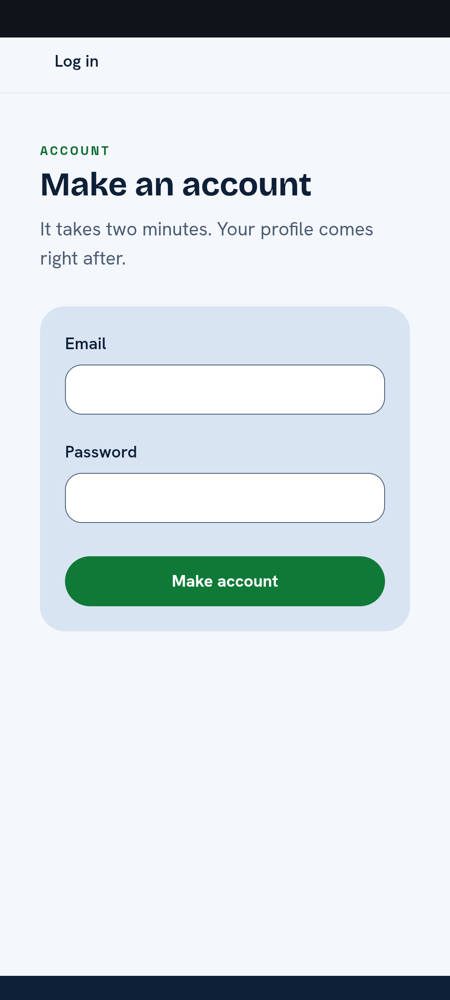
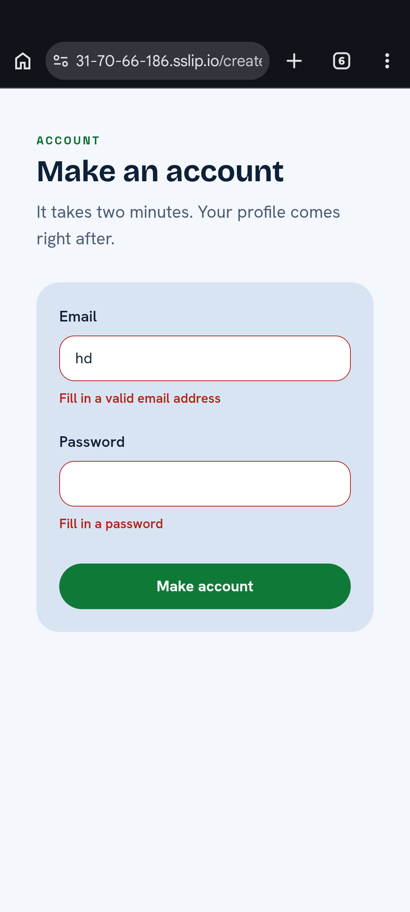
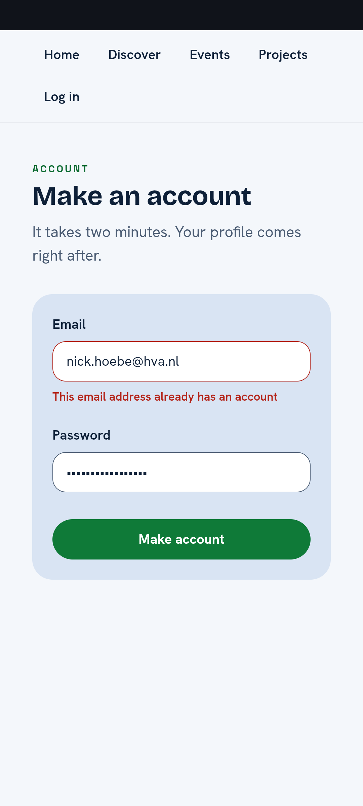
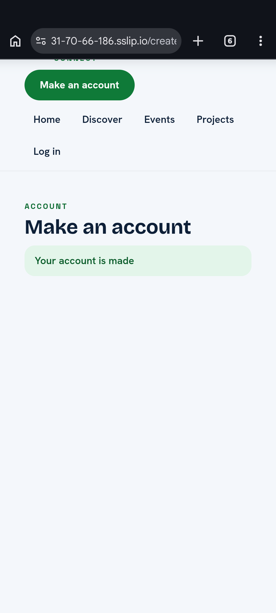

# Proof: create-account form (#264)

Task 3.6, board issue 03, GitLab work item [#264](https://gitlab.fdmci.hva.nl/studio/social-impact-apps/onderwijs/projects/2026-2027-semester-1/projects/project-9-wail-salutem-foundation-project-2/connect-nine/-/work_items/264): create the first account form for Connect. This proof records the frontend plan, implementation boundaries, validation evidence and remaining work.

Merge request [!82](https://gitlab.fdmci.hva.nl/studio/social-impact-apps/onderwijs/projects/2026-2027-semester-1/projects/project-9-wail-salutem-foundation-project-2/connect-nine/-/merge_requests/82).

Profile: [Full Stack Software Developer](https://boksa.hbo-ict-hva.nl/profiles/full-stack-developer/), level 3. Portflow candidates: OR1, OR3, OR4 and OR5.

## Result

The `/create-account` page provides the first browser form that calls `POST /api/accounts`. The implementation keeps the page responsible for presentation, the account API responsible for translating HTTP outcomes, and the shared request function responsible for performing requests.

The implemented scope is deliberately limited to Task 3.6:

- Email and Password fields only.
- Empty, busy, made, invalid, taken and not-reachable states.
- No social login, later password rules or confirmation-email flow.
- `Password again` is visible in the supplied broader design export, but it is not listed in Task 3.6. It is therefore not implemented here and should be discussed during review as a scope question.

The following review suggestions are recorded as future work and are outside the scope of MR !82, task #264 and issue 03:

- Add a Show/Hide password control so the person can check the entered password.
- Add a privacy-policy agreement checkbox.
- Show a Code of Conduct confirmation popup after clicking Create account, before account creation.

## OR1 — plan, scope and design decisions

### Planned states

| State | What the person sees | Implementation evidence |
|---|---|---|
| Empty | Email, Password and Make account | [`CreateAccountForm.tsx`](../../../web/src/components/account/CreateAccountForm.tsx) |
| Busy | `Making your account...`; the button is disabled | [`CreateAccountForm.tsx`](../../../web/src/components/account/CreateAccountForm.tsx) |
| Made | `Your account is made` in a status area | [`CreateAccount.tsx`](../../../web/src/pages/CreateAccount.tsx) |
| Invalid | A message under each invalid field | [`CreateAccountForm.tsx`](../../../web/src/components/account/CreateAccountForm.tsx), [`accounts.ts`](../../../web/src/api/accounts.ts) |
| Taken | `This email address already has an account` next to Email | [`CreateAccountForm.tsx`](../../../web/src/components/account/CreateAccountForm.tsx) |
| Not reachable | `Connect is not reachable right now, try again later` in an alert above the form | [`CreateAccount.tsx`](../../../web/src/pages/CreateAccount.tsx), [`accounts.ts`](../../../web/src/api/accounts.ts) |

### Implementation order

1. Define the one-request boundary in [`client.ts`](../../../web/src/api/client.ts).
2. Translate account outcomes in [`accounts.ts`](../../../web/src/api/accounts.ts).
3. Keep field state and submission state in [`useCreateAccount.ts`](../../../web/src/hooks/useCreateAccount.ts).
4. Build the account-specific form in [`CreateAccountForm.tsx`](../../../web/src/components/account/CreateAccountForm.tsx).
5. Reuse accessible label/input/error wiring through [`FormField.tsx`](../../../web/src/components/FormField.tsx).
6. Register `/create-account` in [`App.tsx`](../../../web/src/App.tsx).
7. Validate the request boundary, page states and accessibility.

### Alternatives and decisions

The form uses native React state instead of a form library. This keeps the first form’s behavior visible and avoids adding a dependency before Connect has repeated form requirements. The API boundary remains separate so the page never calls `fetch` directly and later forms can reuse `request()`.

Field messages are kept beside their fields instead of using one shared message area. This makes it clear which value must be corrected and lets each input reference its own message through `aria-describedby`. The not-reachable message is different: it describes the whole request and therefore appears above the form in a `role="alert"` area.

The reusable boundary is [`FormField`](../../../web/src/components/FormField.tsx), while [`CreateAccountForm`](../../../web/src/components/account/CreateAccountForm.tsx) remains account-specific. A generic Form wrapper was not added because it would only forward a `<form>` element and would not yet provide shared behavior.

## OR3 — stakeholder feedback

The feedback was collected on 23 October 2026 on a Motorola Edge 20 Pro. The client was Rachid and the teammate was Gurpreet. Their comments were short, but together they provide a clear picture: the current form already feels at home in the design, while the next improvements should focus on confidence and consent.

### Client feedback — Rachid

Rachid responded positively to the overall experience:

> “It looks good and fits the design nicely. It is clear how to use. The website is nicely responsive on mobile.”

The one requested improvement was:

> “One thing that could still be added is a password reveal, so I can check the password.”

This confirms that the visual design, usability and mobile layout are working well. The password reveal is recorded as a future requirement. No password reveal control was added to MR !82, task #264 or issue 03.

### Teammate feedback — Gurpreet

Gurpreet focused on making the agreement step more explicit:

> “A checkbox for the privacy policy, and a popup when you click Create account. That is where you agree to the Code of Conduct.”

This is recorded as two future requirements: a privacy-policy checkbox and a Code of Conduct confirmation popup. Neither feature was added to MR !82, task #264 or issue 03, and the policy documents/pages are not built in this task.

### Feedback screenshots

The supplied screenshots are retained as evidence, use descriptive filenames and are shown in a compact grid because they are mobile-format images:

|  |  |
|---|---|
| **Empty form**  | **Validation errors**  |
| **Existing account**  | **Successful account creation**  |

The `Password again` scope question remains separate: it appears in the broader design export but is not part of Task 3.6. No decision to add it was made in this PR, task or issue.

## OR4 — validation and remaining limits

The implementation includes focused tests for the request boundary and page behavior:

- [`client.test.ts`](../../../web/src/api/client.test.ts) covers 201, 400, 409, 500, 502, 503 and a failed fetch.
- [`CreateAccount.test.tsx`](../../../web/src/pages/CreateAccount.test.tsx) covers labels, autocomplete, the hidden password input, the busy button, made, invalid, taken and not-reachable states, password clearing and axe output. It does not cover the suggested future feedback features because they are not implemented in this task.
- [`axe.ts`](../../../web/src/test/axe.ts) provides the accessibility check used by the page test.

`npm run build` passed during implementation. After the accessible form landmark fix, the focused command `npx vitest run src/pages/CreateAccount.test.tsx --pool=forks --maxWorkers=1 --no-file-parallelism` passed all 7 tests. An earlier full run reported 34 passed and 1 failed because that landmark was missing; a later local run was affected by a temporary Vitest `ENOENT` environment error in unrelated suites. The GitLab CI job [1347898](https://gitlab.fdmci.hva.nl/studio/social-impact-apps/onderwijs/projects/2026-2027-semester-1/projects/project-9-wail-salutem-foundation-project-2/connect-nine/-/jobs/1347898) succeeded.

### Removed-rule experiment

The `aria-labelledby="create-account-title"` rule was temporarily removed from `CreateAccountForm`. The focused CreateAccount test then failed 1 of 7 tests: `has accessible fields and keeps the password hidden` could not find a form named `Make an account`. Restoring the attribute made all 7 focused tests pass. This demonstrates that the accessibility assertion protects a real implementation rule.

The tests do not yet cover pressing Enter in the password field while the request is busy. They also do not replace a real 360-pixel and 1280-pixel browser check, although mobile screenshots now provide evidence for the success and taken states.

## OR5 — privacy, security and accessibility

The page protects the person in several concrete ways:

- Password is rendered with `type="password"` and is never placed in a message.
- The password is cleared after a successful account creation.
- No localStorage, sessionStorage or URL persistence is used.
- Account creation does not log the person in.
- Labels are visible and associated with their inputs.
- Field errors use `aria-describedby` and `aria-invalid`.
- Request failures are announced through `role="alert"`.
- Successful creation is announced through `role="status"`.

The required 409 message is useful because it tells the person that they should use the existing account instead. It also reveals whether an email address is registered. If the client later prioritises protection against account enumeration, the message should be changed to a neutral response such as “We could not create this account. Try logging in or use another address.” That would be a deliberate privacy trade-off and is not silently changed in this task because the checklist explicitly requires the current 409 wording.

## Evidence checklist

- [x] Task scope, feedback and six states written down; the requested feedback features are explicitly marked as outside this PR/task/issue.
- [x] Implementation and test files linked.
- [x] Privacy and accessibility choices explained.
- [x] `npm run build` passed.
- [x] Removed-rule experiment captured: removing the form accessible name caused the focused test to fail.
- [x] Frontend GitLab CI job [1347898](https://gitlab.fdmci.hva.nl/studio/social-impact-apps/onderwijs/projects/2026-2027-semester-1/projects/project-9-wail-salutem-foundation-project-2/connect-nine/-/jobs/1347898) succeeded.
- [x] 360px and 1280px browser checks.
- [x] Supplied mobile and account-state screenshots included with descriptive filenames.
- [x] Phone screenshots for success and taken states included.
- [x] Teammate and stakeholder feedback recorded as faithful English translations with future-work boundaries.
- [x] Date of feedback recorded: 23 October 2026.
- [x] Feedback participants recorded: client Rachid and teammate Gurpreet.
- [x] Feedback device/context recorded: Motorola Edge 20 Pro.
- [x] Merge request [!82](https://gitlab.fdmci.hva.nl/studio/social-impact-apps/onderwijs/projects/2026-2027-semester-1/projects/project-9-wail-salutem-foundation-project-2/connect-nine/-/merge_requests/82) linked.
- [ ] Link the proof and merge request in Portflow.

## AI use

AI was used as a writing support tool while working on this document. AI helped draft and organise the wording from decisions and implementation details supplied by the author. The author reviewed the text and remains responsible for the scope, evidence and conclusions.
