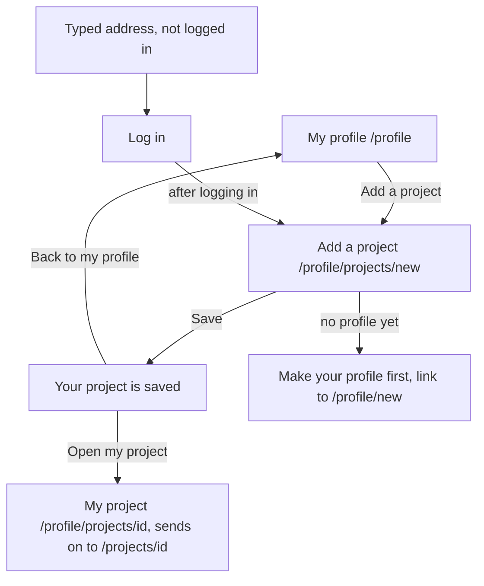

# The page Add a project

Component: `frontend/src/pages/AddProject.tsx`, with `frontend/src/components/ProjectForm.tsx`.
Address in the browser: `/profile/projects/new`.

## What the page is for

A young person made something they are proud of: a school project, a short film, a piece of code, an event they organised. On this page they give it a place on Connect under their own name, beyond the one night of the Young Amstelland Awards. The form has exactly two fields, Title and Description. The project is always saved under their own profile, never under someone else's. The form asks for nothing else: no school, no address, no birth date, because many members are under 18 and Connect keeps as little about them as it can.

## Who can open it

- Young person who is logged in and has a profile (issue 07): yes.
- Logged in account without a profile yet: sees "Make your profile first" below the form, with a link to `/profile/new`.
- Visitor who is not logged in: sees the page Log in, and after logging in lands on the form (`RequireLogin` of issue 04, the way back of issue 04b).
- Another member can never add a project to someone else's showcase. The page of another member has no button Add a project, and the server takes the maker from the session, never from the form.

## How you get there and where you go next

- My profile (`/profile`, issue 08) has a part with the heading Projects and a link element drawn as the button Add a project (task 60.3).
- After saving, the saved message has a link Back to my profile and a link Open my project to the page My project at `/profile/projects/<id>` (issue 61). Issue 64 makes `/projects/<id>` the one page of a project, and the old address sends on to it with replace, so the link keeps working.
- The page Edit project (`/profile/projects/<id>/edit`, issue 157) uses the same form, see Built by.

## Every element of the page, top to bottom

### Field Title

- Label: Title, above the field, with the hint "At most 80 characters" under the label.
- Rules: required, at most 80 characters after trimming the spaces at the start and the end. A title of only spaces counts as empty. A title of exactly 80 characters is saved.
- Messages next to the field: "Give your project a title", "Your title can be at most 80 characters".
- The field gets `aria-describedby` with the id of its hint, and with a message also the id of the message, so a screen reader reads the field name, the hint and the message.
- The field has no `maxLength`, because a browser with `maxLength` cuts off a pasted text without saying so. What was pasted stays in the field, and the server gives the message.
- Built by: issue 60 Add a project, task 60.3 (GitLab #119, sprint 3), and issue 60b A clear message when my project title or text is too long, task 60b.3 (GitLab #120, sprint 3).

### Field Description

- Label: Description, above the field, a textarea, with the hint "At most 1000 characters" under the label.
- Rules: required, at most 1000 characters after trimming. A description of exactly 1000 characters is saved.
- Messages next to the field: "Describe your project", "Your description can be at most 1000 characters".
- The numbers come from the constants `TITLE_MAX_LENGTH = 80` and `DESCRIPTION_MAX_LENGTH = 1000` in `frontend/src/api/projects.ts`, which match `ProjectRules` on the server. The database also refuses a text that is too long with a check constraint (task 60b.1).
- Built by: issue 60, task 60.3, and issue 60b, tasks 60b.1 to 60b.3.

### Button Save

- Label: Save. While Connect saves, the button says "Saving..." and is disabled, so pressing it twice saves the project only once.
- Data: `addProject(title, description)` in `frontend/src/api/projects.ts` sends `POST /api/projects` through `request()` in `frontend/src/api/client.ts`, and the browser adds the cookie connect_session by itself. The guard of issue 04 checks the session, the server trims both fields and checks them, finds the profile of the logged in account, and saves one row in the table project with the time of now. Deleting the account deletes its projects too (task 60.1, task 60.2).
- Code 201: the form is replaced by "Your project is saved", the title, and "Added on" with the date and time in the time zone of the browser, plus a link Back to my profile and a link Open my project.
- Code 400: each message goes next to its field, linked with `aria-describedby` and `aria-invalid`, and the cursor goes to the first wrong field. What was typed stays. Nothing is saved.
- Code 403: "Make your profile first" below the form, with a link to `/profile/new`.
- Code 503 or no answer: "Connect is not reachable right now, try again later" below the form in an area with role alert. What was typed stays.
- Built by: issue 60, tasks 60.2 and 60.3, and issue 61 See my project on its own page, task 61.3 (GitLab #173, sprint 4), which adds the link Open my project.

### The shared form (ProjectForm)

- Issue 157 Change my project moves the two fields and the button Save out of `AddProject.tsx` into `frontend/src/components/ProjectForm.tsx`, so adding and changing use the same fields, limits and messages. Nothing changes for the young person on this page.
- The shared ProjectForm has no `maxLength` on Title or Description either (task 157.3).
- Built by: issue 157, task 157.3 (GitLab #179, sprint 4).

## States

| State | What the person sees |
|---|---|
| Empty form | Title and Description with their hints, and Save. |
| Saving | "Saving..." on the disabled button. |
| Saved | "Your project is saved", the title, "Added on" with the date and time, Back to my profile and Open my project. |
| Wrong fields | The message next to each wrong field, the cursor in the first one, what was typed stays. |
| No profile yet | "Make your profile first" below the form with a link to `/profile/new`. |
| Not reachable | "Connect is not reachable right now, try again later" below the form, what was typed stays. |
| Not logged in | The page Log in, and after logging in the form. |
| Phone and laptop | The team checks adding a project on both (task 60.5). |

## Accessibility and privacy

- Each field has its label above it and its hint linked with `aria-describedby`, so a screen reader hears the limit on entering the field.
- A screen reader hears the message of a wrong field, and the cursor lands in that field.
- The hint has a contrast of at least 4.5 to 1.
- The form asks only for a title and a description. No school, no address and no birth date.
- The server takes the maker from the session, never from the form, also when the form carries another id.

The design: colours, fonts and spacing come only from `frontend/src/styles/tokens.css`, following the Figma frame Add a project on the page Design directions of the Figma board.

## Built by

| Board | Title | GitLab | Sprint | Prio |
|---|---|---|---|---|
| 60 | Add a project | #119 | 3 | should |
| 60b | A clear message when my project title or text is too long | #120 | 3 | should |
| 61 | See my project on its own page (the link Open my project) | #173 | 4 | should |
| 157 | Change my project (the shared ProjectForm) | #179 | 4 | should |
| 64 | Open a project page (the link Open my project ends on /projects/<id>) | #181 | 4 | should |

## Open points

- A counter that shows how many characters are left while typing is not asked by the client, so there is no issue for it.
- Keeping the old texts of a project for the foundation: issue 10, question 66 (issue 157).

## AI use declaration

AI was used as a writing support tool while working on this document. We used AI to draft
the formulation of sentences, the structure of wording, readability, and clarity from
content that we had provided, and to generate the diagrams. The content itself, including
our experiences, reflections, learning goals, decisions, self-assessments, and
conclusions, is our own. We reviewed the drafts and decided as a team which text to
include.
