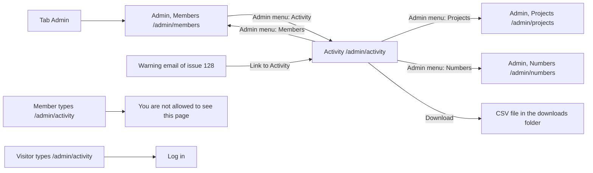

# Activity (admin)

- Component: web/src/pages/AdminActivity.tsx, with AdminActivity.module.css, AdminActivity.test.tsx and AdminActivity.words.test.ts
- Address in the browser: /admin/activity
- Parts it uses: web/src/components/AdminMenu.tsx, web/src/components/adminActivity/ActivityFilters.tsx, web/src/api/auditEntries.ts
- Server addresses: GET /api/admin/audit-entries and GET /api/admin/audit-entries/export

## What the page is for

Connect is a platform where young people from Amstelland, many of them minors, meet organisations. The foundation must be able to show afterwards who did what and when. Activity is the list that shows this to the admins of the foundation: when something happened, who did it, what they did and to whom. Nobody can change or remove a line, not even an admin. An admin can narrow the list to one member and a period, and download it as a file. Old lines go away by themselves after the period the client chooses.

## Who can open it

- Admin of the foundation: sees the whole page. The route sits inside RequireLogin of issue 04 and RequireAdmin of issue 45 in web/src/App.tsx.
- Member (young person) or organisation who is not an admin: sees no tab Admin. Typing /admin/activity shows "You are not allowed to see this page" and no line of the list. The server also answers 403 ("not allowed") without lines.
- Visitor who is not logged in: is sent to Log in. The server answers 401 ("not logged in") without lines.
- Hiding the menu link is never the only protection. The screen guard stops an empty page, and the server rule AdminOnly on /api/admin stops every line (card 32, watch out).

## How you get there and where you go next

An admin presses the tab Admin (it opens /admin/members), then Activity in the admin menu. The admin menu sits at the top of every admin page. It has Members and Activity (issue 32), and later Projects (issue 48), Numbers (issue 47), Pages (issue 50), News (issue 71), Shop (issue 150) and Reports (issue 152). The link of the current page is marked with aria-current page.

The warning email of issue 128 has a link straight to Activity.

From Activity the admin goes on through the admin menu. There is nothing to press on a line, so a line never leads anywhere.

## Every element of the page, top to bottom

1. Admin menu
   - A nav element with the label Admin and the links Members (/admin/members) and Activity (/admin/activity). The current page has aria-current page. Issues 48 (Projects), 47 (Numbers), 50 (Pages), 71 (News), 150 (Shop) and 152 (Reports) each add their own link.
   - Data: none.
   - Built by task 32.4, issue 32 See who did what on the platform, GitLab #92, sprint 3. The link Projects by task 48.4, issue 48 Remove content that breaks the rules, GitLab #121, sprint 3.

2. Retention sentence
   - Text: "Lines on Activity are kept for <n> months. Connect removes older lines by itself." The number comes from meta.retentionMonths of GET /api/admin/audit-entries.
   - It is a paragraph below the admin menu and above the list, not an alert area.
   - When the answer has no retentionMonths, the sentence is left out rather than showing a wrong number.
   - The server reads the number from the setting AuditRetention:Months (AuditRetentionSettings), the same setting the daily cleanup job uses. The team proposes 12 months, the client decides (issue 10, question 34).
   - Built by task 120.4 (screen) and task 120.3 (server), issue 120 Old activity lines are removed after the retention period, GitLab #96, sprint 3.

3. Filter form (ActivityFilters.tsx)
   - Field Member email: input type email, label above it.
   - Field From and field To: input type date, the browser's own date field, each with its label above it. No date library.
   - Button Show: asks page 1 with only the filled in filters. Only the lines where that member did something or had something done to them, between the two days, both days included.
   - Button Clear: empties the three fields, removes the messages and asks page 1 without filters.
   - The form has noValidate, so the message of the server shows next to the field and not a bubble of the browser.
   - A day means a day in Amsterdam. The server turns From into the first moment of that day in Europe/Amsterdam and To into the first moment of the day after, both in UTC.
   - An email address that has no account gives an empty list, not an error.
   - Messages next to the fields, linked with aria-describedby:
     - Member email: "Type a whole email address, for example name@example.org"
     - From or To: "Type a date like 2026-10-01"
     - To: "The date From cannot be after the date To"
   - The typed email address is never written to a log (request log of issue 17 writes only the path).
   - Server: GET /api/admin/audit-entries?memberEmail=&from=&to=&page=1&pageSize=20. Wrong input is 400 in the ValidationProblem format with the message per field.
   - Built by task 32b.3 (screen), 32b.2 (server) and 32b.1 (database indexes and filter), issue 32b Narrow Activity to one member and a period, GitLab #98, sprint 3.

4. Button Download
   - A real button next to Show and Clear. It uses the filters as they stand in the fields, also when Show was not pressed.
   - While it waits it says "Preparing the file..." and cannot be pressed again.
   - It calls downloadAuditEntries(filters) in auditEntries.ts, which asks GET /api/admin/audit-entries/export with the same filters through the shared helper in web/src/api/client.ts. The browser saves the file under the name the server gives, for example connect-activity-2026-10-01-to-2026-10-31.csv (start when From is empty, today when To is empty).
   - After a save: "Your file is ready." next to the button in an area with role status.
   - Wrong dates: the message of the server next to its field, the same place as for Show. No file is saved.
   - Not allowed: "You are not allowed to see this page".
   - Not reachable: "Connect is not reachable right now, try again later" next to the button in an area with role alert. No file is saved.
   - The file: UTF-8 with a byte order mark, heading line When (Amsterdam time),Who,What,To whom,Detail, newest first, the same lines and words as the page for the same filters. A period without lines gives a file with only the heading line. A value that starts with =, +, -, @, a tab or a carriage return gets an apostrophe in front, so it is never run as a formula.
   - The plain words in the file come from api/Application/Audit/auditActionWords.json. The test AdminActivity.words.test.ts turns red when they differ from ACTION_WORDS on the page.
   - Only built when the client says yes (issue 10, question 17).
   - Built by task 127.3 (screen), 127.2 (server) and 127.1 (database query), issue 127 Download the activity list as a file, GitLab #206, sprint 5.

5. The list of lines
   - Data: GET /api/admin/audit-entries?page=<n>&pageSize=20 through listAuditEntries in auditEntries.ts. The answer is { data: [ { id, occurredAt, actorEmail, action, targetKind, targetEmail, detail } ], meta: { page, pageSize, total, retentionMonths } }, newest first. pageSize is at most 50.
   - On a laptop: a real table element with the caption Activity and the headings When, Who, What, To whom and Detail, each th with scope col.
   - Below 600 pixels wide: every line is a small block with the same facts and their names, and no table.
   - When: formatDateTime of web/src/utils/formatTime.ts, in the admin's own time zone.
   - Who: the email address of the actor. "removed member" when that account is gone (for example after issue 113 Delete my account and all my data). "Connect" when there is no actor.
   - What: plain words from the list ACTION_WORDS, exported by AdminActivity.tsx. An unknown action name is shown as it is.

     | Action name | Plain words | Issue |
     |---|---|---|
     | account.created | made an account | 32 |
     | session.started | logged in | 32 |
     | member.deactivated | deactivated a member | 32 |
     | member.reactivated | reactivated a member | 32 |
     | audit.old_lines_removed | removed old lines | 120 |
     | connection.requested | sent a connection request | 121 |
     | connection.accepted | accepted a connection request | 121 |
     | connection.declined | declined a connection request | 121 |
     | project.removed | removed a project | 48 |
     | event.registered | registered for an event | 68 |
     | member.unlocked | unlocked a member | 126 |
     | alert.sent | Warning, then warned the admins: many locked log ins (detail ManyLocks), warned the admins: many removals (detail ManyRemovals), or warned the admins (any other detail) | 128 |
     | project.restored | brought back a project | 141 |
     | member.bio_removed | removed a short line | 142 |
     | sitepage.created | added a site page | 148 |
     | sitepage.deleted | deleted a site page | 148 |

   - The word Warning of alert.sent is a strong text element at the start of What, with a colour of tokens.css with a contrast of at least 4.5 to 1. On a phone it stays at the start of What.
   - To whom: the email address of the target, only when the target kind is account. "removed member" when that account is gone. Empty for every other kind (event, project, site page) and for a line without a target, because What already says what it was done to. It can never show removed member by mistake.
   - Detail: short fixed words or a number, never a name, an email address or a text a person wrote. Examples: the number with the word lines for removed old lines (for example 3 lines), the reason name for a removed project or short line, the web address of a site page for added or deleted a site page.
   - There is no button, link or menu on a line. The database itself refuses every change and removal (trigger on the table audit_entry). Only the daily cleanup of issue 120 may remove lines older than the retention period.
   - Built by task 32.4 (screen), 32.3 (server), 32.2 (the first four actions) and 32.1 (table audit_entry), issue 32, GitLab #92, sprint 3. The later words by task 120.4, 121.3, 48.4, 68.5, 126.3, 128.4, 141.3, 142.4 and 148.5 (see part 8).

6. Button Load more
   - Below the list. It asks the next page with the same filters that were used for page 1, and adds its lines below the ones already shown.
   - It is gone when the number of lines shown equals meta.total. The list then ends with "That is all activity".
   - When it fails, the lines already shown stay and the not reachable message appears below them.
   - Built by task 32.4, issue 32, and task 32b.3 (keeps the filters), issue 32b.

## States

- Loading: "Loading activity..." in an area with role status, while the first page loads.
- Empty, no filter: "No activity yet" in the place of the list.
- Empty, with a filter: "No activity in this range" in the place of the list.
- Filled: the list with twenty lines, Load more below it, or "That is all activity" at the end.
- Wrong input in the form: the message of the server below its field (see element 3).
- Not reachable (no answer or 503): "Connect is not reachable right now, try again later" in an area with role alert. Below the list when Load more fails, with the lines kept. Below the fields when Show fails, with what the admin typed kept. Next to the button when Download fails.
- Not allowed and not logged in: handled by RequireAdmin and RequireLogin before the page asks anything.
- Speed: the page opens within two seconds, also after Load more and after Show.
- Phone (360 pixels wide or close): every line a small block with the same facts, the fields under each other below 600 pixels.
- Laptop: a table with column headings, the form above the list.
- Design: the Figma frame Admin activity on the Figma board of Connect, page Design directions. Colours, fonts and spacing come only from the variables in web/src/styles/tokens.css.

## Accessibility and privacy

- A real table with a caption and th headings with scope col, so a screen reader reads the heading with every cell (card 32).
- Loading and "Your file is ready." sit in role status areas, not reachable messages in role alert areas. The retention sentence is a plain paragraph.
- Form messages are linked to their field with aria-describedby. Each field has a label above it.
- The word Warning is text read first by a screen reader, not only a colour.
- The whole page works with the keyboard alone. axe reports 0 violations.
- A line shows only who, what, when and to whom. Never a password, the text of an email, the text of a profile, a message, a project title or an internet address.
- A member who deleted their account shows as removed member, never with their old email address.
- No lines, filters or file content are kept in local storage.
- The typed member email is never written to a log. The export answer has Cache-Control no-store.
- Only admins can open the page or make a file.

## Built by

| Board | Title | GitLab | Sprint | Prio |
|---|---|---|---|---|
| 32 | See who did what on the platform | #92 | 3 | should |
| 120 | Old activity lines are removed after the retention period | #96 | 3 | should |
| 121 | Connection requests show up on Activity | #97 | 3 | should |
| 32b | Narrow Activity to one member and a period | #98 | 3 | should |
| 48 | Remove content that breaks the rules | #121 | 3 | should |
| 68 | Register for an event | #128 | 3 | should |
| 126 | An admin unlocks a locked account early | #205 | 5 | could |
| 127 | Download the activity list as a file | #206 | 5 | could |
| 128 | A warning to the admin about suspicious activity | #207 | 5 | could |
| 148 | Add or delete a site page | #209 | 5 | could |
| 141 | Bring back a project that was removed | #216 | 5 | could |
| 142 | Remove a profile text that breaks the rules | #217 | 5 | could |

Issue 32 comes first and needs issues 46 and 46b. Issues 32b, 120, 121, 48 and 68 build on 32. Issue 127 also needs 32b. Issues 141 and 142 need 48. The admin area, the tab Admin and RequireAdmin come from issue 45, and RequireLogin from issue 04.

## Open points

- Retention period: the team proposes 12 months, the client decides in issue 10, question 34. Until the answer, no line is removed (card 120).
- Download: built only when the client says yes in issue 10, question 17, which also says where a downloaded file may be kept and when it must be removed (card 127).
- Warning line: built only when the client says yes in issue 10, question 18, which also sets the numbers (card 128).
- Unlock line: issue 126 is built only after issue 10, question 16. Remove a short line (issue 142) waits for question 57, and add or delete a site page (issue 148) for question 37.

## AI use declaration

AI was used as a writing support tool while working on this document. We used AI to draft
the formulation of sentences, the structure of wording, readability, and clarity from
content that we had provided, and to generate the diagrams. The content itself, including
our experiences, reflections, learning goals, decisions, self-assessments, and
conclusions, is our own. We reviewed the drafts and decided as a team which text to
include.
