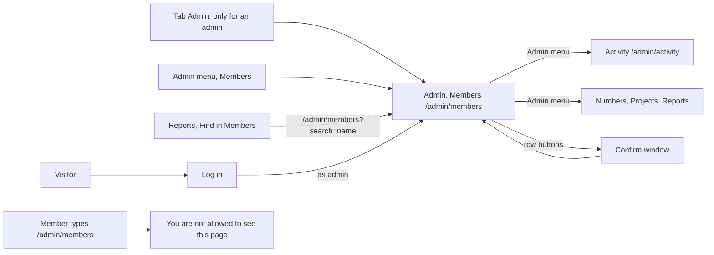

# Admin, Members

- Component: frontend/src/pages/AdminMembers.tsx, with AdminMembers.module.css and AdminMembers.test.tsx
- Shared parts: frontend/src/components/RequireAdmin.tsx and frontend/src/components/AdminMenu.tsx, the window ConfirmDialog of issue 113
- Server helpers: frontend/src/api/admin.ts (getMembers, deactivateMember, reactivateMember, makeAdmin, removeAdmin, markOrganisationChecked, unlockMember, removeBio)
- Address in the browser: /admin/members, behind the tab Admin. With a search already filled in: /admin/members?search=<name>
- Server addresses: GET /api/admin/members?page=1&pageSize=20 (with search=<text> when searching), and the row actions POST /api/admin/members/{id}/deactivate, /reactivate, /make-admin, /remove-admin, /mark-checked, /unlock and /bio-removal

## What the page is for

This is the first page of the admin area of Connect. An admin of the foundation, for example the director, sees every account on the platform: its name, its kind and the date it joined, newest first. From the row of an account the admin can act: switch a member off who breaks the house rules and switch them on again, make a colleague an admin or take that role away, mark an organisation as checked by the foundation, unlock a member who is locked after too many wrong passwords, and remove a short line of a profile that breaks the rules. The list never shows an email address or anything else from a profile.

## Who can open it

- Admin of the foundation: sees the page and every row action. The very first admin account is made by Connect itself when the server starts, from the settings AdminSeed__Email and AdminSeed__Password. Nobody makes it by hand.
- Member (young person) or organisation: never sees the tab Admin. When they type /admin/members they read "You are not allowed to see this page" in place of the page, and no names at all. RequireAdmin decides before the page mounts, so the page never asks the server for them. The server closes every address under /api/admin with the rule AdminOnly anyway.
- Visitor who is not logged in: is sent to Log in, and after logging in as an admin lands on the page Members.
- A colleague whose admin role was taken away: reads "You are not allowed to see this page" at the next click, and has no tab Admin after a reload.

## How you get there and where you go next

Ways in:
- The tab Admin, next to the five tabs, only for an admin. It always opens /admin/members.
- The item Members in the admin menu at the top of every admin page.
- The link Find in Members on a report on the page Reports (/admin/reports), which opens /admin/members?search=<name> with the name already searched.

Ways out:
- The admin menu (AdminMenu.tsx of issue 32): Members, Activity (/admin/activity), and the items that later issues add, such as Numbers (/admin/numbers), Projects (/admin/projects) and Reports (/admin/reports).
- The five tabs of Connect.

## Every element of the page, top to bottom

1. Admin menu
   - A nav element with the links Members (/admin/members) and Activity (/admin/activity), the current page marked with aria-current. Later admin pages add their own item.
   - Built by task 32.4, issue 32 See who did what on the platform, GitLab #92, sprint 3.

2. Heading: Members
   - Built by task 45.5, issue 45 See all members, GitLab #88, sprint 3.

3. Field: Search members
   - A search field with the visible label "Search members", above the total, type search, maxLength 100, full width on a phone.
   - About 300 milliseconds after the last key press the page asks getMembers(search, page) for page 1 of the matches. It sends ?search= only when the text is not empty. An answer of an older search that comes in late is thrown away, so the list always belongs to the text in the field.
   - The server keeps only accounts whose display name contains the text, in any letter case, with % and _ searched as plain signs. It never searches email addresses, so an admin cannot find a member by an address they know. A text of more than 100 characters gets a plain message.
   - Emptying the field brings the full list and its total back.
   - When the page opens with ?search=<name> in the address, the field is filled with it and the page searches at once (issue 152).
   - Built by tasks 45b.1, 45b.2 and 45b.3, issue 45b Search the member list by name, GitLab #89, sprint 3, and task 152.3, issue 152 See the reports about members, GitLab #235, sprint 5.

4. The total
   - "57 members" without a search text, "3 members found" while there is one. With a search, the total is the number of matches.
   - Built by tasks 45.5 and 45b.3.

5. The table of members
   - Data: getMembers(page) in frontend/src/api/admin.ts asks GET /api/admin/members?page=<page>&pageSize=20 through the shared helper frontend/src/api/client.ts. It returns the page with its total, wrong input, not allowed or not reachable. The page never sees a status code and never calls fetch itself.
   - On the server the guard of issue 04 checks the session and reads the role from the table account on every request, so a change of role counts at the next click. AdminOnly lets only an admin through. A validator checks the page number and page size. The answer is {"data": [...], "meta": {"page", "pageSize", "total"}}, newest first.
   - A real HTML table with the caption Members and the column headers Name, Kind and Joined, each a th with scope col. Issue 46 adds the column Status.
   - Name: the display name. Under the name of a young person, the short line of their profile as plain text, never as HTML (issue 142).
   - Kind: Young person, Organisation, Admin or No profile yet.
   - Joined: the date, for example 26 September 2026.
   - Status: Active or Inactive (issue 46).
   - The table renders only the fields it knows, so an email address never reaches the screen, even when the server would send one by mistake.
   - On a laptop the values sit next to each other in one row. On a phone (360 pixels wide) each row stacks into a small block with the values under each other, done with CSS only, so nothing scrolls sideways.
   - Every row action changes only that row, never reloads the whole list, so the admin keeps their place. Each window is ConfirmDialog of issue 113, reused, never a second window.
   - Built by tasks 45.1 to 45.5, issue 45, GitLab #88, sprint 3.

6. Row button: Deactivate (on an active member)
   - Not on the admin's own row (found with accountId of useSession) and not on an inactive row.
   - Window: title "Deactivate <name>?", message "<name> can no longer log in and disappears for other members. Nothing is deleted.", buttons Cancel and Deactivate.
   - Deactivate in the window calls deactivateMember(id), which sends POST /api/admin/members/{id}/deactivate. The server fills deactivated_at and deactivated_by on the account and ends every open session of the member in one transaction. An admin cannot switch off their own account.
   - The switched off member is sent to Log in at the next click, and reads "Your account is not active, contact the foundation" when they log in with a password or with Google. For every other member they are gone at once from Discover, requests, connections and saved items, and their profile address shows the not found page. The admin still sees them as Inactive.
   - Row states: "Saving..." with the button disabled. Done: the status says Inactive and the button is gone. Already inactive: the row takes the status Inactive. Not found: "This member no longer exists". Not reachable: "That did not work, try again" in role alert, and the status stays as it was.
   - The button follows the danger button of ConfirmDialog.
   - Built by tasks 46.1 to 46.5, issue 46 Deactivate a member, GitLab #90, sprint 3.

7. Row button: Reactivate (on an inactive member)
   - Window: title "Reactivate <name>?", message "<name> can log in again and is visible to other members.", buttons Cancel and Reactivate.
   - Reactivate in the window calls reactivateMember(id), which sends POST /api/admin/members/{id}/reactivate. The server empties deactivated_at and deactivated_by. The member gets no session and logs in again themselves, and finds everything as it was.
   - Row states: "Saving..." with the button disabled. Done: Active and the button Deactivate again. Already active: the row takes the status Active. Not found: "This member no longer exists". Not reachable: "That did not work, try again" in role alert, and the status stays Inactive.
   - Uses the same row code as Deactivate.
   - Built by tasks 46b.1, 46b.2 and 46b.3, issue 46b Reactivate a member, GitLab #91, sprint 3.

8. Row button: Make admin (on a row with the kind No profile yet)
   - Not on rows of young people, organisations or admins. Only an account without a profile can become an admin, because a profile belongs to a young person or an organisation.
   - Window: title "Make <name> an admin?", message "<name> can then see every member of Connect and use every admin page. Only do this for an employee of the foundation.", buttons Cancel and Make admin.
   - Make admin in the window calls makeAdmin(id), which sends POST /api/admin/members/{id}/make-admin. The server changes the role from Member to Admin in one atomic update. The colleague sees the tab Admin at the next page load.
   - Row states: "Saving..." with the button disabled. Done or already admin: the kind says Admin and the button is gone. Has a profile: "This account has a profile and cannot become an admin". Not found: "This member no longer exists". Not reachable: "That did not work, try again" in role alert, and the kind stays as it was.
   - Built by tasks 137.1, 137.2 and 137.3, issue 137 Make a member an admin, GitLab #93, sprint 3.

9. Row button: Mark as checked (on an organisation row that is not checked yet)
   - Only on rows with the kind Organisation whose checkedAt is null. A checked row shows "Checked on 27 September 2026" next to the kind, with the date in Europe/Amsterdam, and no button.
   - Window: title "Mark <name> as checked?", message "Young people then read Checked by the foundation on the page of <name>. Only do this after the foundation checked who is behind it.", buttons Cancel and Mark as checked.
   - Mark as checked in the window calls markOrganisationChecked(id), which sends POST /api/admin/members/{id}/mark-checked with the account id of the row. The server fills checked_at and checked_by on organisation_profile in one atomic update. GET /api/admin/members gives checkedAt for every item.
   - Row states: "Saving..." with the button disabled. Done or already checked: Checked with today's date and the button is gone. Not an organisation: "This organisation no longer exists". Not reachable: "That did not work, try again" in role alert, and the button stays.
   - Built by tasks 139.1, 139.2 and 139.4, issue 139 Mark an organisation as checked by the foundation, GitLab #94, sprint 3.

10. Row button: Remove admin (on the row of another admin)
   - On every row with the kind Admin except the admin's own row.
   - Window: title "Remove <name> as admin?", message "<name> can then no longer see the admin pages. Their account stays.", buttons Cancel and Remove admin.
   - Remove admin in the window calls removeAdmin(id), which sends POST /api/admin/members/{id}/remove-admin. The server locks the admin rows in one transaction and changes the role from Admin to Member only when at least two admins are left, so Connect always keeps one admin.
   - Row states: "Saving..." with the button disabled. Done or not an admin: the kind says No profile yet and the button is gone. Last admin: "Connect needs at least one admin". Not found: "This member no longer exists". Not reachable: "That did not work, try again" in role alert, and the kind stays Admin.
   - Built by tasks 138.1, 138.2 and 138.3, issue 138 Take the admin role away, GitLab #95, sprint 3.

11. Locked until and the button Unlock (on a locked member)
   - GET /api/admin/members gives lockedUntil for every member. A row whose lockedUntil lies in the future shows "Locked until 14:30" in Europe/Amsterdam, with the date in front when it is not today, and a button Unlock with aria-label "Unlock <display name>". Nothing about a lock shows on a member who is not locked.
   - Unlock calls unlockMember(id), which sends POST /api/admin/members/{id}/unlock. The server removes the lock and the wrong tries of that email address and writes the Activity line member.unlocked, in one save. The member can log in at once.
   - While it runs the button says "Unlocking..." and cannot be pressed again.
   - Done: "Unlocked. This member can log in now." in role status, and the lock text and the button are gone. Not locked: "This member is not locked anymore." and the list asks page 1 again. Not found: "This member does not exist anymore." Not reachable: "Connect is not reachable right now, try again later" next to the button in role alert, and the lock text stays.
   - Built by tasks 126.1, 126.2 and 126.3, issue 126 An admin unlocks a locked account early, GitLab #205, sprint 5.

12. Row button: Remove text (next to the short line of a young person)
   - Only on rows with a short line. Its accessible name is "Remove text of" followed by the display name. On a phone the short line wraps under the name and the button is at least 44 by 44 pixels.
   - Window: heading "Remove this short line?", the short line in a quote, a radio group with the four reasons from REMOVAL_REASONS of frontend/src/api/adminProjects.ts (the same four as for projects), a button Cancel and a button Remove short line that is disabled until a reason is picked. Escape closes it without removing.
   - Remove short line calls removeBio(id, reason), which sends POST /api/admin/members/{id}/bio-removal. While waiting the button says "Removing..." and is disabled. The server empties the short line, keeps the date, the reason and the admin, and writes the Activity line member.bio_removed. The removed text itself is not kept.
   - A row with a removed short line shows "Short line removed on <date>. Reason: <reason sentence>." and no button.
   - After it worked: the window closes, the row is drawn from the answer, and a status area says "Short line removed". 409: "This member has no short line." and the list is loaded again. 400: the message under the reasons. 404: "This member has no profile." 503 or no answer: "Connect is not reachable right now, try again later" in role alert, and the row stays.
   - The young person reads on My profile "The foundation removed your short line on <date>. Reason: <reason sentence>. You can write a new one with Edit." and never who removed it.
   - Built by tasks 142.1, 142.2 and 142.4, issue 142 Remove a profile text that breaks the rules, GitLab #217, sprint 5.

13. Button: Load more
   - Under the table, only when fewer rows are shown than the total. It asks the next page with pageSize 20, with the same search text when there is one, and adds its rows below the ones already shown. While it waits it says "Loading..." and is disabled. When all rows are shown the button is gone.
   - Built by task 45.5, issue 45, GitLab #88, sprint 3.

Every row action above also shows as a line on the page Activity (issue 32): deactivated a member, reactivated a member, unlocked a member and removed a short line are named on the cards.

## States

- Loading: "Loading members..." in an area with role status while the first page loads. While the session is still loading, RequireAdmin shows "Loading...".
- Empty: "No members found" and no button Load more. The same sentence when a search has no match.
- Filled: the total, the table and Load more when there are more rows.
- Not reachable, first load: "The list is not available right now" in role alert, in place of the list. The search text stays in the field.
- Not reachable, after Load more: the same sentence under the rows already shown, which stay.
- Row errors: each row action shows its own sentence in the row, as listed above. The row keeps its old state on every error.
- Not allowed: "You are not allowed to see this page", for anyone who is not an admin.
- Speed: the list shows within two seconds after pressing the tab Admin.
- Phone (360 pixels wide): one block per member with the values under each other. Laptop (1280 pixels wide): columns. No scrolling sideways.
- Design: colours, fonts and spacing only through frontend/src/styles/tokens.css. See Open points for the Figma frame.

## Accessibility and privacy

- The table has a caption and th headers with scope col.
- The search field has a visible label.
- Loading uses role status, errors use role alert.
- Every window names the member or the organisation in its title, and a screen reader hears the name (and the warning, for Make admin and Mark as checked) when it opens. Focus handling comes from the one ConfirmDialog.
- The buttons Unlock and Remove text carry the name of the member in their accessible name.
- The list shows only the name, the kind, the join date, the status, the lock time, the check date and the short line. Never an email address, an age, a region or anything else from a profile, also not through the search.
- A switched off member never sees why, and their page looks like a page that never existed.
- A young person never reads which employee removed their short line or unlocked them. Young people only see that the foundation checked an organisation, never who.
- Hiding the tab and the buttons is a convenience. The server decides every action through AdminOnly and its own rules.
- axe reports 0 issues.

## Built by

| Board | Title | GitLab | Sprint | Prio |
|---|---|---|---|---|
| 45 | See all members | #88 | 3 | must |
| 45b | Search the member list by name | #89 | 3 | must |
| 46 | Deactivate a member | #90 | 3 | must |
| 46b | Reactivate a member | #91 | 3 | must |
| 32 | See who did what on the platform | #92 | 3 | should |
| 137 | Make a member an admin | #93 | 3 | should |
| 139 | Mark an organisation as checked by the foundation | #94 | 3 | should |
| 138 | Take the admin role away | #95 | 3 | should |
| 126 | An admin unlocks a locked account early | #205 | 5 | could |
| 142 | Remove a profile text that breaks the rules | #217 | 5 | could |
| 152 | See the reports about members | #235 | 5 | could |

## Open points

- Filtering the list on kind or status: issue 10 The client's priorities for the epics, question 72.
- Telling a member by email why they were switched off, or that they can log in again: issue 10, question 76.
- A second admin who must agree before a member under 18 is switched off: issue 10, question 77.
- How many employees should be admin, and whether each gets a personal admin account: issue 10, question 88.
- What the foundation checks before marking an organisation as checked: question 45. Taking the mark away again: question 46, and what happens with what the organisation already published: question 54.
- Issue 126 is only built when the client says yes, and the way the foundation makes sure a caller really is the member must be agreed first: issue 10, question 16.
- Issue 142 is only built when the client says yes: issue 10, question 57. An email about a removed short line: question 95. Removing text from an organisation profile: question 96.
- Issue 152 waits for issue 151, which is only built when the director says yes: issue 10, question 39.
- The cards disagree on the design. Tasks 45.4, 45.5, 46.5, 137.3 and 139.4 say there is no drawing of the admin pages on the Figma page Design directions yet. Task 126.3 points to a Figma frame of the page Members, and tasks 48.4 and 152.3 to Figma frames of the admin pages. The team checks the Figma board and settles this.

## AI use declaration

AI was used as a writing support tool while working on this document. We used AI to draft
the formulation of sentences, the structure of wording, readability, and clarity from
content that we had provided, and to generate the diagrams. The content itself, including
our experiences, reflections, learning goals, decisions, self-assessments, and
conclusions, is our own. We reviewed the drafts and decided as a team which text to
include.
