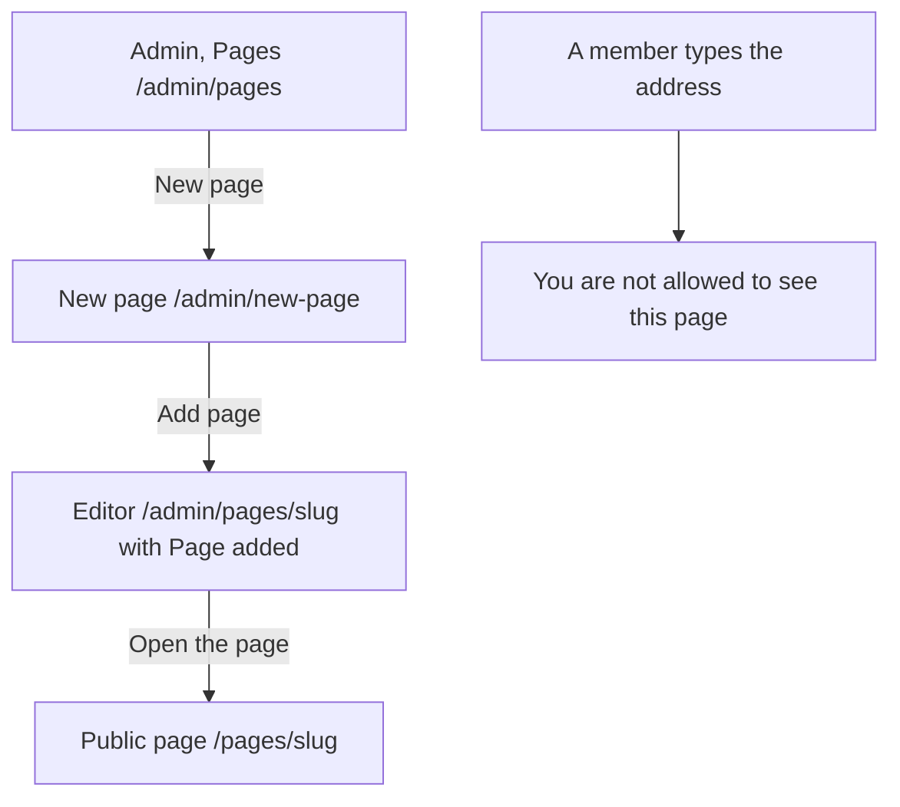

# The page New page (admin)

Component: `frontend/src/pages/AdminNewPage.tsx`.
Address in the browser: `/admin/new-page`.

## What the page is for

The WailSalutem Foundation wants to put information on Connect without waiting for the team, for example a page about the next gala or about how to become a volunteer. On this page an admin of the foundation fills in a web address, a title and a text, and presses Add page. The new page can be read at once by everyone at `/pages/<web address>`. Every added page shows on the page Activity.

## Who can open it

- Admin of the foundation: yes.
- Member who is not an admin: reads "You are not allowed to see this page", also when typing the address (`RequireAdmin` of issue 45).
- Visitor who is not logged in: is sent to Log in (`RequireLogin` of issue 04).
- The server also refuses a member and a visitor at the admin door of issue 45.

## How you get there and where you go next

- The button New page at the top of Admin, Pages (`/admin/pages`, issue 50). It is a link styled as a button.
- After Add page the admin lands on the editor of the new page at `/admin/pages/<slug>` with "Page added" and a link Open the page to `/pages/<slug>`.
- The address is `/admin/new-page` and not `/admin/pages/new`, because new is a valid web address and would clash with the editor at `/admin/pages/:slug`.

## Every element of the page, top to bottom

### Field Web address

- Label: Web address, visible, with the hint "Small letters, digits and -, for example volunteer".
- Rules: required, only small letters, digits and -, at most 50 characters, and not already used.
- Messages next to the field: "Please fill in the web address", "Use only small letters, digits and -, at most 50 characters", "A page with this address already exists".
- Built by: issue 148 Add or delete a site page, task 148.4 (GitLab #209, sprint 5).

### Field Title

- Label: Title, visible.
- Rules: required, at most 120 characters, with the rules of issue 50 (task 50.3), reused by the server of task 148.2.
- Messages next to the field: "Please fill in the title", "The title can have at most 120 characters".
- Built by: issue 148, task 148.4.

### Field Text

- Label: Text, visible. A textarea.
- Rules: required, at most 50000 characters, with the rules of issue 50 (task 50.3). The text is markdown and is shown on the public page through `MarkdownView` of issue 50b, so a script typed in the text shows only as plain text and never runs.
- Messages next to the field: "Please fill in the text", "The text can have at most 50000 characters".
- Built by: issue 148, task 148.4.

### Button Add page

- Label: Add page. While saving: "Adding..." and disabled.
- Before calling the server, empty fields get their message next to them.
- Data: `addSitePage(slug, title, body)` in `frontend/src/api/adminSitePages.ts` sends `POST /api/admin/site-pages` through `request()`. The server checks the fields with the rules of issue 50 plus the rule for a web address, makes the page, and writes the Activity line sitepage.created in the same save. It answers the new page in the same shape as `GET /api/admin/site-pages/{slug}`, and the public address of issue 51 serves it at once (task 148.2).
- Answer 201: go to `/admin/pages/<slug>` with "Page added" in a region with role status, and the link Open the page.
- Answer 400 or 409: each message from the answer next to its field, for example "A page with this address already exists" next to Web address. Nothing is added.
- Answer 503 or no answer: "Connect is not reachable right now, try again later" above the button, and the fields keep what was typed.
- Built by: issue 148, tasks 148.2 and 148.4.

### The public route /pages/<web address>

- Not on this page, but made with it: the route `/pages/:slug` shows `SitePage` of issue 51 for any web address, inside the frame of issue 06. Not found and not reachable stay as `SitePage` handles them. A deleted page shows "This page does not exist".
- Built by: issue 148, task 148.4.

## States

| State | What the person sees |
|---|---|
| Empty form | The three fields with their labels and the button Add page. |
| Wrong fields | The message next to each wrong field. Nothing is added. |
| Saving | "Adding..." on the disabled button. |
| Added | The editor of the new page with "Page added" and Open the page. |
| Not reachable | "Connect is not reachable right now, try again later" above the button, what was typed stays. |
| Not an admin | "You are not allowed to see this page". |

The team check of task 148.7 runs on a phone and on a laptop.

## Accessibility and privacy

- Every field has a visible label, and every message stands next to its field. A screen reader hears the name of each field, each message and "Page added".
- Adding a page works with only the keyboard.
- A script typed in the text never runs for a visitor.

The design: colours, fonts and spacing come only from `frontend/src/styles/tokens.css`, in the style of the editor of issue 50, which follows the Figma frame of the editor on the page Design directions of the Figma board.

## Built by

| Board | Title | GitLab | Sprint | Prio |
|---|---|---|---|---|
| 148 | Add or delete a site page | #209 | 5 | could |

## Open points

- Issue 148 is built only when the client says yes in issue 10, question 37: does the foundation want an admin to add and delete a site page, and which pages besides the privacy statement and the house rules does it expect.
- A link to a new page in the footer or the menu: issue 10, question 97.
- A Dutch version next to a new page with the switch of issue 51b: issue 10, question 42.
- Pictures on a site page: issue 10, question 98.
- The card asks the team whether a second admin should approve a new page before it is public, and to add the choice to question 37.

## AI use declaration

AI was used as a writing support tool while working on this document. We used AI to draft
the formulation of sentences, the structure of wording, readability, and clarity from
content that we had provided, and to generate the diagrams. The content itself, including
our experiences, reflections, learning goals, decisions, self-assessments, and
conclusions, is our own. We reviewed the drafts and decided as a team which text to
include.
