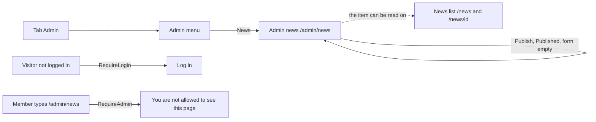

# Admin news (publish a news item)

- Component: web/src/pages/AdminNews.tsx, with AdminNews.module.css and AdminNews.test.tsx
- Address in the browser: /admin/news (registered in web/src/App.tsx inside RequireLogin and RequireAdmin, the same way as /admin/members)

## What the page is for

The foundation wants young people and organisations to have a reason to come back to Connect between the awards. On this page an admin of the foundation writes a news item and publishes it at once. The item has a title, a text and, if the admin wants, one picture with a short description. After Publish the admin reads "Published" and the form is empty again for the next item. Members and visitors read the items on the news list and the page of one item, which other issues build.

## Who can open it

- Admin of the foundation (an account with the role Admin of issue 45): sees and uses the form.
- Member (young person) or organisation who is logged in but not an admin: sees no tab Admin. When they type /admin/news they read "You are not allowed to see this page" in place of the form, through RequireAdmin of issue 45. The server also refuses them with 403.
- Visitor who is not logged in: is sent to Log in by RequireLogin of issue 04 and sees nothing of the form. The server refuses them with 401.

## How you get there and where you go next

The admin presses the tab Admin and then News in the admin menu (web/src/components/AdminMenu.tsx of issue 32). The link News has aria-current page when you are on this page. The admin stays on this page after publishing, with an empty form. The published item can then be read on the news list /news and on its own page /news/<id>.

## Every element of the page, top to bottom

The page sits inside the admin area of issue 45. Colours, fonts and spacing come only from the variables in web/src/styles/tokens.css.

Data for the whole form: pressing Publish calls publishNewsItem({ title, body, picture, pictureDescription }) in web/src/api/newsItems.ts, which sends POST /api/admin/news-items through the shared helper in web/src/api/client.ts. Since task 71b.3 the body is a FormData (a multipart form), and the helper does not set the header Content-Type for it, because the browser adds it. The page never sees a status code, only the results published, wrong fields or not reachable. The page does not call fetch itself.

The server address (tasks 71.2 and 71b.2, PublishNewsItemService, PublishNewsItemRequestValidator) sits in the group /api/admin with the rule AdminOnly. It saves the item with a new id, published_at from the clock and the calling admin as author (from the session, never from the request). A good answer is 201 with {"data": {"id", "title", "publishedAt"}, "meta": {}} and the header Location /api/news-items/<id>. Wrong input is 400 in the ValidationProblem format with one message per field, and nothing is saved. A request over 6 MB gets 413 before it is read. A database that is down gives 503 with "Connect is not reachable right now". The table news_item (task 71.1) keeps no name or email address of the admin, only a link to the account, which becomes empty when that account is deleted.

1. Field: Title
   - One line, with its label above it, maxlength 200.
   - Rules: filled in and at most 200 characters. A title of only spaces counts as empty. Message next to the field: "Fill in a title".
   - Built by tasks 71.1, 71.2 and 71.3, issue 71 Publish a news item with a title and a text, GitLab #133, sprint 3.
2. Field: Text
   - A text area of several lines, with its label above it. Plain text with line breaks, no bold text and no links.
   - Rules: filled in, a text of only spaces counts as empty. Message next to the field: "Fill in a text".
   - Built by tasks 71.1, 71.2 and 71.3, issue 71, GitLab #133, sprint 3.
3. Field: Picture
   - A file field below Text, with accept image/jpeg and image/png and its label above it. One picture per item, and it may be left out.
   - Below it the sentence "Everyone who opens Connect can see this picture. Only choose a picture that everyone in it agreed to. Connect removes the place where the photo was taken."
   - Once a picture is chosen, its file name and a button Remove picture show below the field. Remove picture empties the field and hides Describe the picture again. Publish then publishes the item without a picture.
   - Rules: a JPEG or PNG of at most 5 MB. The page checks the size and the type before sending, and shows "Choose a JPEG or PNG picture of at most 5 MB" next to Picture at once, without calling the server. The server checks again, also on the first bytes of the file, so a text file with the name of a picture is refused with the same message. A 413 answer shows the same message too.
   - On the server the picture is turned upright, made at most 1600 pixels wide, cleaned of every photo detail (Exif, IPTC and XMP, where a phone keeps the place and the time), given a new name Connect makes up, and kept in the folder of the setting Storage:NewsImages, outside the part browsers can open. Only the new file name goes into the column image_file_name. When saving the row fails, the file is removed again.
   - Built by tasks 71b.1, 71b.2 and 71b.3, issue 71b Add a picture to a news item, GitLab #134, sprint 3.
4. Field: Describe the picture
   - Appears only once a picture is chosen, with its label, maxlength 200. A screen reader hears the field when it appears.
   - Rules: filled in and at most 200 characters when there is a picture. Message next to the field: "Describe the picture in a few words", shown before sending and also given by the server. The database refuses a picture with an empty description too (ck_news_item_image_alt_text).
   - This text becomes the alt text that a screen reader reads on the news list and the page of the item.
   - Built by tasks 71b.1, 71b.2 and 71b.3, issue 71b, GitLab #134, sprint 3.
5. Message area above the button: Could not publish, try again
   - Shown in an area with role alert when the server answers 503 or gives no answer. Everything typed stays, the picture and the description too.
   - Built by task 71.3 and extended by task 71b.3.
6. Button: Publish
   - While waiting it says "Publishing..." and is disabled, so pressing it twice does not publish the item twice.
   - Built by task 71.3, issue 71, GitLab #133, sprint 3.
7. Message above the form: Published
   - Shown in an area with role status after the item was saved. All fields are emptied, the picture too, and the focus goes to Title.
   - Built by task 71.3, issue 71, GitLab #133, sprint 3.

## States

- Empty form: the fields Title, Text and Picture with the sentence below it, and the button Publish.
- Picture chosen: the file name, Remove picture and the field Describe the picture.
- Busy: the button says "Publishing..." and is disabled.
- Published: "Published" above the form, all fields empty, focus on Title.
- Wrong input: each message next to its own field, linked with aria-describedby, and the focus on the first wrong field. Everything typed stays.
- Not reachable: "Could not publish, try again" above the button. Everything typed stays. A tester checks this by switching the phone to airplane mode before pressing Publish.
- Not allowed: a member reads "You are not allowed to see this page" in place of the form.
- Not logged in: the visitor lands on Log in.
- Phone (360 pixels wide) and laptop (1280 pixels wide): the page matches the Figma frame Admin news at both widths, or the merge request says why not, with screenshots.
- Design: the Figma frame Admin news on the page Design directions of the Figma board of Connect. When there is no frame yet, the page follows the admin pages of issue 45 (task 71.3).

## Accessibility and privacy

- Every field has a visible label above it.
- A screen reader hears "Published" and every message read aloud as soon as it appears (areas with role status and role alert).
- Field messages are linked to their field with aria-describedby, and the focus goes to the first wrong field.
- A screen reader hears the field Describe the picture when it appears.
- axe reports 0 issues.
- Every picture must have a description, so people who cannot see it know what it shows.
- The sentence below Picture reminds the admin that everyone can see the picture and that only a picture everyone in it agreed to may be chosen.
- Connect removes the place and the time a photo was taken before it keeps the picture. The original file name is never used or logged.
- The log names only ids and the size of the stored file, never an email address, the title or the text.

## Built by

| Board | Title | GitLab | Sprint | Prio |
|---|---|---|---|---|
| 71 | Publish a news item with a title and a text | #133 | 3 | could |
| 71b | Add a picture to a news item | #134 | 3 | could |

Issue 71 needs issues 45 (the admin area, the role Admin, RequireAdmin and the not allowed page) and 29 first, and uses the admin menu of issue 32. Issue 71b needs 71.

## Open points

- Task 71.3 says to follow the admin pages of issue 45 when there is no Figma frame Admin news yet. Whether that frame exists is not on the cards.
- Task 71b.2 picks the image library (SkiaSharp or SixLabors.ImageSharp, free to use for Connect) and writes the choice in docs/decisions. It also records why the address uses .DisableAntiforgery(). Both decisions are made by the builder of that task.
- Changing or removing an item after it is published waits for questions 79 and 80 of issue 10 (issues 164 and 165). Until then, items that the end to end tests publish (titles that start with E2E news) stay on the test site.
- Saving a draft or planning an item for a later date is not planned. Every item is published at once. A wish for it goes to the client through issue 10.

## AI use declaration

AI was used as a writing support tool while working on this document. We used AI to draft
the formulation of sentences, the structure of wording, readability, and clarity from
content that we had provided, and to generate the diagrams. The content itself, including
our experiences, reflections, learning goals, decisions, self-assessments, and
conclusions, is our own. We reviewed the drafts and decided as a team which text to
include.
