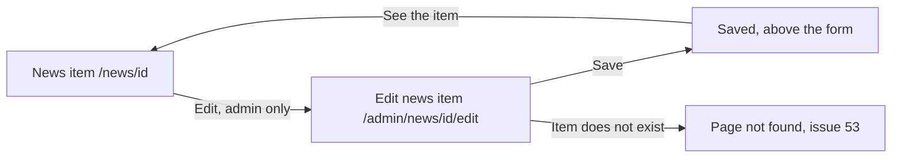

# Edit news item

- Component: web/src/pages/AdminNewsEdit.tsx, with AdminNewsEdit.module.css and AdminNewsEdit.test.tsx
- Address in the browser: /admin/news/:id/edit

## What the page is for

An admin of the foundation published a news item and then sees a typing mistake, or learns that a date in it has changed, for example that the nominations stay open a week longer. On this page the admin changes the title and the text of the item. Everyone who opens the item then sees the new version with the line "Changed on" and the date. The item keeps its place in the news list.

## Who can open it

- Admin of the foundation: opens the page from the button Edit on the page of a news item.
- Member (young person), organisation and visitor: never see the button Edit. The route is inside RequireLogin and RequireAdmin of task 45.4, the same way as /admin/news. A member who types the address reads "You are not allowed to see this page".
- Hiding the button is only for the eye. The server of task 164.2 is the real lock.

## How you get there and where you go next

## Every element of the page, top to bottom

On the page of a news item (NewsItem.tsx of task 73.3), changed by this issue:
- Button Edit, below the date line, only when useSession says the role is Admin (the field role of GET /api/sessions/current, task 45.2). It is a link to /admin/news/<id>/edit, styled as a button.
- Line "Changed on" with the date, for example "Changed on 5 October 2026", below the date line when changedAt is filled, for every visitor. Nothing says who changed it.

On the edit page:
1. Status area above the form, in role status
   - "Saved" after a good save, with a link See the item to /news/<id>.
2. Field: Title
   - Label Title above it. Filled with the title of the item, loaded with getNewsItem(id) of task 73.3.
   - Required. An empty title shows "Fill in a title" next to the field, linked with aria-describedby, the focus on the first wrong field. The item stays as it was. The rule is the message of issue 71.
3. Field: Text
   - Label Text above it. Filled with the text of the item.
   - Required. An empty text shows "Fill in a text" next to the field.
4. Alert area above the button, in role alert
   - "Could not save, try again" when Connect cannot be reached. Everything typed stays in the form.
5. Button: Save
   - Calls changeNewsItem(id, { title, body }) in web/src/api/newsItems.ts, which sends PUT /api/admin/news-items/<id> through the shared helper. It returns saved, wrong fields, not found or not reachable. The page never calls fetch.
   - While waiting the button says "Saving..." and is disabled, so a second press sends nothing.
   - On the server, the guard of issue 04 checks the log in, the rule AdminOnly of issue 45 checks that it is an admin, NewsItemIdValidator checks the id and the validator checks the fields. The server loads the item and writes the new title, the new text and the moment of the change in the new column changed_at of news_item. The date of publishing, the author and the picture stay.
   - Built by tasks 164.1 (the column and the rule), 164.2 (the address) and 164.3 (the page and the button), issue 164 Change a news item, GitLab #227, sprint 5.

## States

- Loading: the page loads the item before it shows the form. When loading fails: "Could not load this item" with Try again.
- Filled: the form with the title and the text of the item and the button Save.
- Saved: "Saved" in role status with the link See the item.
- Error: "Fill in a title" or "Fill in a text" next to its field.
- Not found, when loading or saving: the friendly page NotFound of task 53.3 in the place of the form.
- Not reachable: "Could not save, try again" in role alert above the button, and what was typed stays.
- Empty: not used, the form is always filled from the item.
- Phone (360 pixels wide) and laptop (1280 pixels wide): the team checks the page on both on the test site.
- Design: follows the page News under Admin of task 71.3 on the Figma board of Connect, page Design directions. Colours, fonts and spacing only through web/src/styles/tokens.css.

## Accessibility and privacy

- Every field has its label above it. Every message sits next to its field and is linked with aria-describedby.
- The focus moves to the first wrong field.
- "Saved" sits in role status, "Could not save, try again" in role alert.
- The line "Changed on" says nothing about who changed the item.
- A changed item stays in the same place in the news list, not at the top.

## Built by

| Board | Title | GitLab | Sprint | Prio |
|---|---|---|---|---|
| 164 | Change a news item | #227 | 5 | could |

Issue 164 needs issues 73, 10 and 29 first.

## Open points

- The issue is only built when the client says yes: issue 10 The client's priorities for the epics, question 79. May an admin change an item after it is published, and should the item then show that it was changed.
- Whether the picture may be changed too: issue 10, question 132. This page changes the title and the text only.
- Old versions of an item are not kept, only the date of the last change. A wish for more goes to the client through issue 10.
- Removing a whole item is issue 165.

## AI use declaration

AI was used as a writing support tool while working on this document. We used AI to draft
the formulation of sentences, the structure of wording, readability, and clarity from
content that we had provided, and to generate the diagrams. The content itself, including
our experiences, reflections, learning goals, decisions, self-assessments, and
conclusions, is our own. We reviewed the drafts and decided as a team which text to
include.
