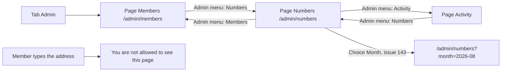

# Numbers (admin usage numbers)

- Component: frontend/src/pages/AdminNumbers.tsx, with AdminNumbers.module.css and AdminNumbers.test.tsx
- Address in the browser: /admin/numbers, and /admin/numbers?month=2026-08 for an earlier month (issue 143)

## What the page is for

The page Numbers tells the WailSalutem Foundation at a glance whether Connect is used. It shows three numbers for one month: how many members Connect has, how many joined that month, and how many connection requests were accepted that month. With issue 144 a fourth tile shows how many events are still to come, so the admin knows whether the organisations offer enough events in the coming weeks. The title of issue 144 calls this page the admin home. The page shows counts only. It never shows the name of a member. When issue 143 is built, an admin can also choose an earlier month and see a small graph of the last twelve months.

## Who can open it

| Who | What they see |
|---|---|
| Admin of the foundation | The whole page: the admin menu, the heading Numbers, the month line and the three tiles. |
| Member (young person) or organisation | "You are not allowed to see this page" and no numbers. This comes from RequireAdmin of issue 45. |
| Visitor who is not logged in | The log in page first, through RequireLogin of issue 04. |

The route in frontend/src/App.tsx is /admin/numbers inside RequireLogin and then RequireAdmin. The server address GET /api/admin/statistics sits in the admin group of issue 45 with the rule AdminOnly, so a member gets not allowed and a visitor must log in, also when they call the server directly.

## How you get there and where you go next

- The admin presses the tab Admin. That still opens the page Members at /admin/members (issue 45).
- In the admin menu at the top of every admin page (AdminMenu.tsx, made in task 32.4 of issue 32) the admin presses the item Numbers. It comes after Members and Activity.
- From the page Numbers the admin menu leads back to Members and Activity.
- With issue 143 the address can hold a month, so an admin can copy the address and a second admin opens the same month.

## Every element of the page, top to bottom

### 1. Admin menu
- Text: the items Members, Activity and Numbers. Later admin pages each add one item to the same menu: Projects (issue 48, task 48.4), Pages (issue 50), News (issue 71), Reports after Projects (issue 152) and Shop (issue 150).
- What it shows: the row of links on every admin page. The item of the open page has aria-current.
- Behaviour: Numbers leads to /admin/numbers. The tab Admin keeps opening Members.
- Built by: issue 47 See this month's usage numbers (GitLab #99, sprint 3), task 47.3. The menu itself is task 32.4 of issue 32 See who did what on the platform (GitLab #92, sprint 3).

### 2. Heading
- Text: Numbers.
- Built by: issue 47, task 47.3.

### 3. Choice Month (issue 143)
- Label: Month.
- What it shows: a select with the twelve months from this month back, written like September 2026, with this month first. The value of each option is year-month, such as 2026-08. The list comes from lastTwelveMonths(today) in frontend/src/utils/lastTwelveMonths.ts.
- Behaviour: choosing a month puts it in the address as ?month=2026-08 and asks GET /api/admin/statistics?month=2026-08. Choosing this month removes month from the address, so the plain address stays the same as in issue 47. A reload or a shared link shows the same month.
- Rules: a month in a wrong form or in the future gets an answer 400 from the server. The choice keeps working and shows this month.
- Built by: issue 143 See the usage numbers of earlier months (GitLab #208, sprint 5), task 143.4. The server part is task 143.2.

### 4. Month line
- Text: "Numbers for September 2026", for the month the numbers are about.
- Data: monthStart from GET /api/admin/statistics, for example "2026-09-01". The page makes the date with Date.UTC(year, month - 1, 1) and writes it with Intl.DateTimeFormat, with month long, year numeric and timeZone "UTC", in the language of the site. A month name is never typed by hand. Without timeZone "UTC" a browser west of UTC would write August.
- Rules: the month follows the clock of the Netherlands (Europe/Amsterdam). A member who joins just after midnight on the first counts for the new month, also around the change to winter time.
- Built by: issue 47, task 47.3, with the server address of task 47.2. Issue 143 task 143.4 uses the same line for an earlier month, such as Numbers for August 2026.

### 5. Three tiles
Each tile is a StatTile (frontend/src/components/StatTile.tsx): a small label and a big number, in a section named by its label through aria-labelledby.

| Tile label | What it counts |
|---|---|
| Members | Accounts with the role Member that are not switched off. Admins and switched off members are not counted. An account that did not confirm its email address is counted, because it is a real sign up. For an earlier month the label is Members (counted today), because it counts the members of then who are not switched off now (issue 143). |
| New members this month | Members whose account was made on or after the start of the month. |
| Connections this month | Connection requests (issue 39) with the status Accepted whose answer moment (answered_at, issue 41b) is on or after the start of the month. |

- Data: GET /api/admin/statistics through getStatistics() in frontend/src/api/admin.ts. The answer holds three numbers and monthStart in the envelope {"data": ..., "meta": {}}, never a name or an id. The numbers are counted fresh every time the page opens. The counts are made by GetStatisticsHandler (task 47.1) with the indexes ix_account_created_at and ix_connection_request_answered_at.
- Layout: CSS grid, one column on a phone (360 pixels), the tiles next to each other on a laptop (1280 pixels): three with issue 47, four once issue 144 adds its tile. No chart library.
- Built by: issue 47, tasks 47.1 (counts), 47.2 (address), 47.3 (tiles). Issue 143 tasks 143.1 and 143.2 count for an earlier month.

### 6. Tile Upcoming events (issue 144)
- Place: after Connections this month, so the three tiles about the month stay together under the month line.
- Text: the label Upcoming events, the number of events that start now or later, the note "From now on, not only this month" under the number, and the link Events to /events, a real link element. 0 events shows 0, never an empty or a hidden tile.
- Data: the same single call getStatistics(). The answer of GET /api/admin/statistics also holds data.upcomingEvents. The server takes now from its own clock and counts the rows of the table event (issue 65) that start now or later, with the same shared query Upcoming(now) as the list of issue 66 See the upcoming events, so the tile always shows as many events as a member finds under Events. Issue 163 Cancel my event puts its rule into the same query, so cancelled events leave both.
- StatTile gets two optional props, note and link. The three tiles of issue 47 pass neither and look the same as before.
- Built by: issue 144 See the number of upcoming events on the admin home (GitLab #221, sprint 5), tasks 144.1 (the count), 144.2 (the address) and 144.3 (the tile). The end to end test is frontend/e2e/adminUpcomingEvents.spec.ts (task 144.4).

### 7. Graph of twelve months (issue 143)
- What it shows: under the tiles a small bar graph with two bars per month, new members and connections, for each of the last twelve months. Under each group the short month, such as Aug. A legend New members and Connections next to a small square of each colour.
- Data: GET /api/admin/statistics/months through getStatisticsMonths() in frontend/src/api/admin.ts, asked once. Twelve months, oldest first, each with its new members and accepted connections.
- Rules: plain SVG without a library. The height of a bar is relative to the highest number of the twelve. The graph does not follow the choice Month. It always shows the last twelve months. The two series are never told apart by colour alone.
- Component: frontend/src/components/adminNumbers/MonthsGraph.tsx.
- Built by: issue 143, task 143.5, with the server address of task 143.3.

### 8. Table of twelve months (issue 143)
- Caption: Numbers per month. Headings: Month, New members, Connections.
- What it shows: one row per month, oldest first, the same numbers as the graph. It is the text alternative for the graph.
- Built by: issue 143, task 143.5.

## States

| State | What the admin sees |
|---|---|
| Loading | "Loading numbers..." in place of the tiles, in an area with role status. With issue 143 the graph area says "Loading graph...". |
| Filled | The month line and three tiles with numbers, four with issue 144. With issue 143 also the graph and the table. |
| Empty tile Upcoming events (issue 144) | The tile shows 0, so the admin sees that the calendar is empty. |
| Empty (graph, issue 143) | "No numbers yet for the last twelve months" in place of the graph. The table still shows the zeros. |
| Wrong month in the address (issue 143) | "The month must be a year and a month, such as 2026-08, and not in the future" in place of the tiles, in an area with role alert. The choice Month still works. |
| Not reachable | "Numbers not available right now" in place of the tiles, in an area with role alert, instead of an error screen. With issue 143 the graph area also says "Numbers not available right now" in place of the graph and the table, and the tiles keep their own state (task 143.5). |
| Not allowed | "You are not allowed to see this page" and no numbers, for a member who types the address by hand, also with a month in it. |
| Phone | The tiles under each other. The graph is as wide as the screen and never scrolls sideways. |
| Laptop | The tiles next to each other: three, or four with issue 144. |

The numbers appear within two seconds after pressing Numbers, also with all the test members (issue 47, AC10). The tiles, the graph and the table of a chosen month appear within two seconds after choosing it (issue 143, AC10).

## Accessibility and privacy

- Each tile is a section named by its label through aria-labelledby, so a screen reader reads the label with its number, for example "New members this month, 4" or "Upcoming events, 2". The note of the tile Upcoming events is a normal paragraph after the number.
- The loading text sits in role status, the not reachable text and the wrong month message in role alert.
- The admin menu marks the open page with aria-current.
- The graph svg has aria-hidden. The table with its caption and headings is read instead, so a screen reader hears every month with both numbers.
- The legend names both series next to their colour.
- Colours, fonts and spacing come only from frontend/src/styles/tokens.css. The design is the Figma frame of the admin pages on the Figma board (page Design directions, Young Amstelland colours and fonts). This document does not give colours or a layout beyond what the cards say.
- Privacy: the page shows only the admin menu, the heading, the month line, the labels and the numbers. No name or anything else about a member appears (issue 47, AC9). The server answer holds no name and no id.
- Numbers per region, per age or per kind of organisation are left out, because smaller groups can point to one young person.

## Built by

| Board | Title | GitLab | Sprint | Prio |
|---|---|---|---|---|
| 47 | See this month's usage numbers | #99 | 3 | must |
| 143 | See the usage numbers of earlier months | #208 | 5 | could |
| 144 | See the number of upcoming events on the admin home | #221 | 5 | could |

Issue 47 has tasks 47.1 DATABASE (the three counts and two indexes), 47.2 BACKEND (GET /api/admin/statistics), 47.3 FRONTEND (the page, StatTile and the menu item), 47.4 TEST (end to end test) and 47.5 TEST (team check). Issue 143 has tasks 143.1 DATABASE, 143.2 BACKEND (the choice of a month), 143.3 BACKEND (GET /api/admin/statistics/months), 143.4 FRONTEND (the choice Month), 143.5 FRONTEND (the graph and the table), 143.6 TEST and 143.7 TEST. Issue 144 needs issues 47 and 66 first and adds the fourth tile to this page, with tasks 144.1 DATABASE (the count), 144.2 BACKEND (upcomingEvents in the answer), 144.3 FRONTEND (the tile), 144.4 TEST and 144.5 TEST.

## Open points

- Issue 143 is only built when the client says yes to it in issue 10 The client's priorities for the epics, question 53.
- Months older than twelve months and downloading the numbers as a file: issue 10, question 53.
- Numbers per region, per age or per kind of organisation: issue 10, question 53.
- Sharing the numbers outside Connect, for example in a newsletter or with a sponsor: issue 10, question 50.

## AI use declaration

AI was used as a writing support tool while working on this document. We used AI to draft
the formulation of sentences, the structure of wording, readability, and clarity from
content that we had provided, and to generate the diagrams. The content itself, including
our experiences, reflections, learning goals, decisions, self-assessments, and
conclusions, is our own. We reviewed the drafts and decided as a team which text to
include.
