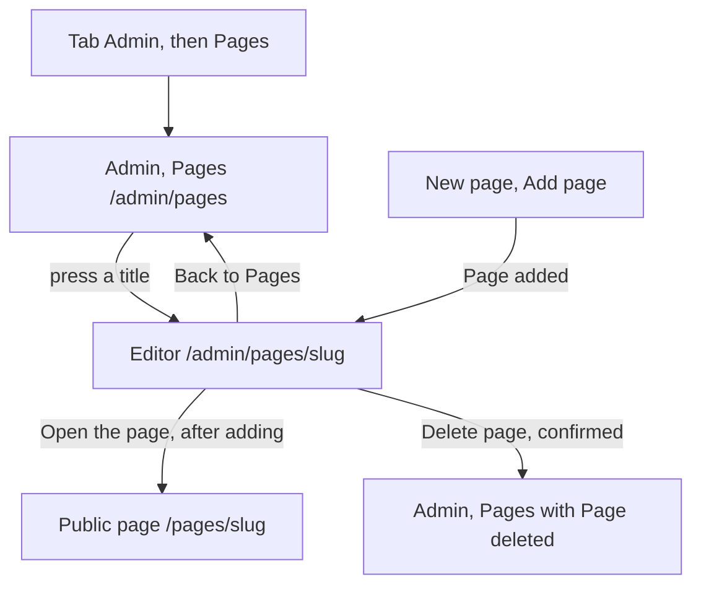

# The editor of a site page (admin)

Component: `frontend/src/pages/AdminPageEditor.tsx`, with `frontend/src/components/MarkdownView.tsx` and `frontend/src/components/adminPageEditor/EarlierVersions.tsx`.
Address in the browser: `/admin/pages/<slug>`, for example `/admin/pages/house-rules`.

## What the page is for

Site pages are the texts every visitor of Connect can read, such as the privacy statement and the house rules. Many readers are young people, so the foundation must be able to fix a wrong sentence the same day, without a developer making a new version of Connect. In this editor an admin changes the title and the text, sees a preview of how visitors will see it, and saves. Every earlier text is kept, and the admin can read an earlier version and put it back. A page the foundation no longer needs can be deleted here, except the privacy statement and the house rules.

## Who can open it

- Admin of the foundation: yes.
- Member who is not an admin: reads "You are not allowed to see this page", also when typing the address. An admin who loses the admin role while the page is open reads the same sentence at the next answer (code 403).
- Visitor who is not logged in: is sent to Log in (`RequireLogin` of issue 04, `RequireAdmin` of issue 45).
- A visitor never sees who saved a page or its earlier versions. Only the admin screens show the email address of the admin who made a change.

## How you get there and where you go next

- A title in the list of Admin, Pages (`/admin/pages`, issue 50). The admin reaches that list with the tab Admin and the item Pages in the admin menu.
- After Add page on the page New page, the admin lands here with "Page added" and a link Open the page (issue 148).
- The link Back to Pages goes to `/admin/pages`.
- After Delete page the admin lands on Admin, Pages with "Page deleted".

## Every element of the page, top to bottom

### Link Back to Pages

- Goes to `/admin/pages`.
- Built by: issue 50 Edit a site page without a deploy, task 50.5 (GitLab #100, sprint 3).

### Page added and Open the page

- Text: "Page added" in a region with role status, and a link Open the page to `/pages/<slug>`.
- When: only right after the admin added this page on New page.
- Built by: issue 148 Add or delete a site page, task 148.4 (GitLab #209, sprint 5).

### Earlier version restored

- Text: "Earlier version restored", in a region with role status, read aloud.
- When: right after a restore, see Earlier versions below.
- Built by: issue 149 See and restore an earlier version of a site page, task 149.4 (GitLab #210, sprint 5).

### Line Last changed on

- Text: "Last changed on <date> by <email>", or "Last changed on <date>" when no person saved it yet. The date is written in the time zone Europe/Amsterdam.
- Data: `getSitePageForEdit(slug)` in `frontend/src/api/adminSitePages.ts` asks `GET /api/admin/site-pages/{slug}`, inside the group `/api/admin` of issue 45, so only an admin reaches it. The answer holds the title, the text, the date of the last change and the email address of the admin who made it (task 50.2).
- Built by: issue 50, tasks 50.2 and 50.5.

### Field Title

- Label: Title, visible above the field.
- Rules: required, at most 120 characters.
- Messages next to the field: "Please fill in the title", "The title can have at most 120 characters".
- Built by: issue 50, tasks 50.3 and 50.5.

### Field Text

- Label: Text, visible above the field. A textarea at least twelve lines high.
- What it shows: the text exactly as stored, as markdown. A line that starts with # becomes a heading and a line that starts with - becomes a list item.
- Rules: required.
- Message next to the field: "Please fill in the text".
- Built by: issue 50, task 50.5.

### Sentence above the button and button Save

- Label: Save. While saving: "Saving..." and disabled, so a second press does nothing.
- Before calling the server: empty fields get their message next to them and the server is not called.
- Data: `saveSitePage(slug, title, body)` sends `PUT /api/admin/site-pages/{slug}`. The server checks the fields, turns the old text into a version, and saves the version and the page in one transaction, so a save never loses the old text. The public pages of issues 51 and 52 show the new text on their next request (task 50.3). The addresses send the text as JSON with the header `X-Content-Type-Options: nosniff`, so a browser never runs the answer as a web page (task 50b.2).
- Code 200: "Saved" in a status message above the button (role status), and the line Last changed on shows the new date and the email address.
- Code 400: each message from the answer next to its field.
- Code 503 or no answer: "Connect is not reachable right now, try again later" above the button. The fields keep what was typed.
- Built by: issue 50, tasks 50.3 and 50.5.

### Preview

- Heading: Preview, an h2, with the section labelled by that heading.
- What it shows: the text of the field Text through `MarkdownView`, the one component for markdown on Connect, which uses react-markdown without any plugin. It changes on every key press, without asking the server, so it also works in airplane mode. What the preview shows is exactly what visitors see, because the public pages use the same component. Headings from # to ###, paragraphs, lists with - and bold with ** are shown.
- Rules: raw HTML is shown as text or left out, never run. A pasted script or a piece of a web page never runs.
- Empty text: "Nothing to show yet" in grey.
- Place: under the button Save on a phone, next to the fields from 900 pixels wide.
- Built by: issue 50b See a preview while I edit a site page, task 50b.3 (GitLab #101, sprint 3).

### Earlier versions

- Heading: Earlier versions, an h2, under the button Save.
- What it shows: a list with one item per earlier version, newest first, twenty at a time. Each item shows the title, "Saved on <date> by <email>" (the date with `Intl.DateTimeFormat` in English) or "Saved when Connect was set up" for a version no person saved, a button Show and a button Restore. Each button has an accessible name that holds the date.
- Data: `listVersions` asks `GET /api/admin/site-pages/{slug}/versions`, and `getVersion` asks `GET /api/admin/site-pages/{slug}/versions/{versionId}` (task 149.2).
- Load more: under the list when fewer are shown than the total. It says "Loading..." while it waits.
- Show: reads the one version and shows its title and text in a `pre` element under the row, as plain text, so a script never runs. The button becomes Hide. The fields above do not change.
- Restore: opens `ConfirmDialog` of issue 113 with the heading "Put this version back?", the date, the sentence "The text on the page now is kept as an earlier version.", and the buttons Cancel and Restore version. When the admin typed in the fields without saving, the window also says "What you typed and did not save is lost." While waiting: "Restoring..." and disabled. `restoreVersion` sends `POST /api/admin/site-pages/{slug}/versions/{versionId}/restore`, and the public page shows the old text at once (task 149.3).
- Answer 200: the fields get the restored title and text, the line Last changed on is updated, "Earlier version restored" is read aloud, and the list loads again from page 1 with the replaced text at the top. Nothing is ever lost.
- Answer 404: "This version does not exist anymore." and the list loads again.
- Answer 503 or no answer: "Connect is not reachable right now, try again later" in the window, or next to Show, and nothing changes.
- Cancel or Escape closes the window, and nothing changes.
- Built by: issue 149, tasks 149.2, 149.3 and 149.4.

### Delete page, or the protected text

- A protected page (the privacy statement and the house rules, in both languages): the text "Connect needs this page, so it cannot be deleted." and no button.
- Any other page: a button Delete page at the bottom, under the button Save, styled as a danger button through `tokens.css`.
- The window: `ConfirmDialog` with the heading "Delete this page?", the title, the sentence "Visitors can no longer read it, and its earlier versions are deleted too.", a button Cancel and a button Delete page. While waiting: "Deleting..." and disabled.
- Data: `deleteSitePage(slug)` sends `DELETE /api/admin/site-pages/{slug}`. The server refuses a protected page, writes the Activity line sitepage.deleted with the web address, and the database deletes the versions with the page (task 148.3). The page Activity shows "added a site page" and "deleted a site page" with the web address.
- Answer 204: go to `/admin/pages`, where a region with role status says "Page deleted" and the list no longer has the page.
- Answer 404: "This page does not exist anymore." and a link Back to Pages.
- Answer 409: the protected text.
- Answer 503 or no answer: "Connect is not reachable right now, try again later" in the window, and the page stays.
- Built by: issue 148, tasks 148.3 and 148.5.

## States

| State | What the person sees |
|---|---|
| Loading | "Loading..." in place of the form. No preview. |
| Unknown page | "This page does not exist", with the link Back to Pages. |
| Filled | The line Last changed on, the fields Title and Text, Save, the preview, Earlier versions and Delete page or the protected text. |
| Saving | "Saving..." on the disabled button. |
| Saved | "Saved" above the button, a new date in Last changed on. |
| Wrong fields | The message next to each wrong field. Nothing is saved. |
| Not reachable | "Connect is not reachable right now, try again later" above the button, what was typed stays, the preview keeps the typed text. |
| No earlier versions | "No earlier versions yet." |
| Loading versions | "Loading versions..." |
| Not allowed | "You are not allowed to see this page". |
| Phone | One column, the preview under the button Save. |
| Laptop | From 900 pixels wide the preview sits next to the fields. |

## Accessibility and privacy

- Every field has a visible label above it, and every message stands next to its field. A screen reader hears the name of each field, and hears "Saved", "Earlier version restored" and "Page deleted" without moving to them.
- A screen reader hears the heading Preview and then the text as headings and lists.
- Show, Restore and Delete page work with only the keyboard, and Escape closes each window without changing anything.
- Nothing the admin types or pastes ever runs as code in a browser, in the preview, in Show or on the public page.
- The email address of the admin who saved a page is shown only to admins, never to visitors.

The design: colours, fonts and spacing come only from `frontend/src/styles/tokens.css`, following the Figma frame of the editor on the page Design directions of the Figma board.

## Built by

| Board | Title | GitLab | Sprint | Prio |
|---|---|---|---|---|
| 50 | Edit a site page without a deploy | #100 | 3 | must |
| 50b | See a preview while I edit a site page | #101 | 3 | must |
| 148 | Add or delete a site page | #209 | 5 | could |
| 149 | See and restore an earlier version of a site page | #210 | 5 | could |

## Open points

- Buttons for headings and lists above the editor: issue 10, question 56.
- Adding and deleting a page (issue 148) is built only when the client says yes in issue 10, question 37.
- Earlier versions (issue 149) is built only when the client says yes in issue 10, question 38.
- Seeing the differences between two versions line by line: issue 10, question 99.
- Removing old versions after a number of years: issue 10, question 100.
- Whether visitors may read earlier versions of the privacy statement and the house rules: issue 10, question 25 (from issue 51).

## AI use declaration

AI was used as a writing support tool while working on this document. We used AI to draft
the formulation of sentences, the structure of wording, readability, and clarity from
content that we had provided, and to generate the diagrams. The content itself, including
our experiences, reflections, learning goals, decisions, self-assessments, and
conclusions, is our own. We reviewed the drafts and decided as a team which text to
include.
