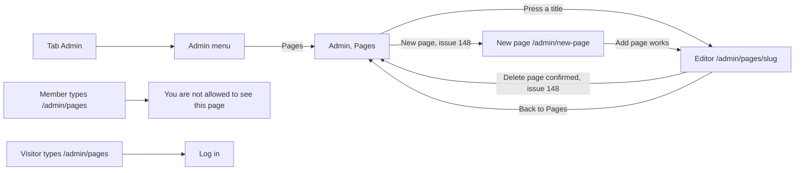

# Admin, Pages

- Component: web/src/pages/AdminPages.tsx, with AdminPages.module.css and AdminPages.test.tsx
- Address in the browser: /admin/pages
- Title of the browser tab: Connect, Admin, Pages

## What the page is for

The foundation writes a few pages with a fixed text that every visitor can read, such as the privacy statement and the house rules. The text of these site pages lives in the database, not in the code, so the foundation can change it the same day without a developer. This page is the list of those site pages in the admin area. An admin sees each page with the date it was last changed, opens one to edit it, and with issue 148 can start a new page or read that a page was deleted.

## Who can open it

- Admin of the foundation: sees the list. The page sits behind RequireLogin of issue 04 and RequireAdmin of issue 45.
- Member (young person) and organisation: see no tab Admin. When they type /admin/pages they read "You are not allowed to see this page" in place of the list.
- Visitor who is not logged in: is sent to the page Log in.
- An admin who loses the admin role while the page is open gets code 403 on the next request, and the page shows "You are not allowed to see this page".

## How you get there and where you go next

You arrive by pressing Admin in the tab bar and then Pages in the admin menu AdminMenu.tsx (issue 32), which is at the top of every admin page. After deleting a page in the editor, the admin lands back here with "Page deleted".

From here you go to the editor of a page (/admin/pages/<slug>, AdminPageEditor.tsx) by pressing its title, or to the form New page (/admin/new-page, AdminNewPage.tsx) with issue 148. The other items of the admin menu lead to the other admin pages.

## Every element of the page, top to bottom

The page sits inside the site shell of issue 06, so the tabs stay around it.

1. Admin menu
   - AdminMenu.tsx of issue 32 gets the item Pages after Members and Activity. The item of the open page has aria-current.
   - Built by task 50.4, issue 50 Edit a site page without a deploy, GitLab #100, sprint 3.
2. Heading (h1): Pages
   - Built by task 50.4, issue 50, GitLab #100, sprint 3.
3. Button New page
   - A link styled as a button at the top of the page, to /admin/new-page. It is not /admin/pages/new, because new is a valid web address and would clash with the editor at /admin/pages/:slug.
   - The form there has the fields Web address, Title and Text and a button Add page. It sends POST /api/admin/site-pages. After Add page works, the admin lands on the editor of the new page with "Page added" and a link Open the page. The form itself is described in AdminNewPage.md.
   - Built by task 148.4, issue 148 Add or delete a site page, GitLab #209, sprint 5. Only built when the client says yes in issue 10, question 37.
4. Message Page deleted
   - Shown after a delete in the editor, in a region with role status, so a screen reader reads it. The deleted page is no longer in the list.
   - Built by task 148.5, issue 148, GitLab #209, sprint 5.
5. List of site pages
   - A list (ul) with one item per page: the title as a link to /admin/pages/<slug>, and under it Last changed on followed by the date in words, for example 12 October 2026. The date is written with Intl.DateTimeFormat in English with the time zone Europe/Amsterdam.
   - Data: listSitePages(page) in web/src/api/adminSitePages.ts asks GET /api/admin/site-pages?page=<page>&pageSize=20 through the shared helper in web/src/api/client.ts. The page never calls fetch.
   - The answer: code 200 with { "data": [ { "slug": "house-rules", "title": "House rules", "updatedAt": "2026-10-12T09:30:00Z" }, ... ], "meta": { "page": 1, "pageSize": 20, "total": 2 } }, ordered by title. Issue 148 adds isProtected to every item.
   - Server rules: the address is inside the group /api/admin in AdminEndpoints.cs with the rule AdminOnly of issue 45. page starts at 1, pageSize is at most 50. A wrong page or pageSize (abc, 0, 51) gives 400 in the ValidationProblem format, for example "The page must be a whole number of 1 or higher" or "Ask for 1 to 50 pages at a time". A member gets 403, a request without a valid session 401, and a database that cannot be reached 503 with "Connect is not reachable right now".
   - At the start the list holds the privacy statement and the house rules, made by the migration of task 50.1. Issue 51b adds privacy-nl and issue 52 adds house-rules-nl, and the list shows them without any change.
   - Built by task 50.4 (screen), 50.2 (address) and 50.1 (tables site_page and site_page_version), issue 50, GitLab #100, sprint 3.
6. Button Load more
   - Under the list, only when meta.total is bigger than the pages shown. It asks the next page and adds it below. No button when everything is shown.
   - Built by task 50.4, issue 50, GitLab #100, sprint 3.

## States

- Loading: Loading... in place of the list.
- Empty: No site pages yet. This cannot happen in practice, because the migration of task 50.1 always adds two pages, but the test shows it so the page never breaks.
- Filled: the list with a link and a Last changed on date per page, and Load more when there are more.
- Not allowed (code 403): You are not allowed to see this page.
- Not logged in (code 401): RequireLogin of issue 04 sends the person to Log in.
- Not reachable (code 503 or no answer): Connect is not reachable right now, try again later, in place of the list, with no code.
- Phone and laptop: the cards ask for a check on a phone of about 360 pixels wide and on a laptop in the team check of task 50.7. They give no separate layout for this list.
- Design: the Figma frame of the admin pages on the Figma board of Connect, page Design directions. Colours, fonts and spacing come only from the variables in web/src/styles/tokens.css.

## Accessibility and privacy

- The heading is an h1 Pages, and the open item of the admin menu has aria-current.
- "Page deleted" is in a region with role status, so a screen reader reads it aloud.
- axe finds no problems on the page.
- The list shows only the title and the date. The email address of the admin who saved a page shows only in the editor, through GET /api/admin/site-pages/{slug}, and never on a public page.
- Only an admin reaches the addresses under /api/admin. The guard of issue 04 and the rule AdminOnly of issue 45 refuse everyone else before any code of issue 50 runs.

## Built by

| Board | Title | GitLab | Sprint | Prio |
|---|---|---|---|---|
| 50 | Edit a site page without a deploy | #100 | 3 | must |
| 148 | Add or delete a site page | #209 | 5 | could |

Issue 50 needs issues 45 See all members and 32 See who did what on the platform first. Issue 148 needs issues 50, 10, 113, 32, 51, 51b and 52 first. Tasks that touch this page in build order: 50.1 database, 50.2 list address, 50.4 this page, 50.6 end to end test (web/e2e/editSitePage.spec.ts), 50.7 team check, then 148.3 isProtected in the list, 148.4 button New page, 148.5 message Page deleted, 148.6 end to end test (web/e2e/addDeleteSitePage.spec.ts), 148.7 team check.

## Open points

- Issue 148 is built only when the client says yes in issue 10, question 37. Until then the page has no button New page and no message Page deleted.
- A link to a new page in the footer or the menu: issue 10, question 97.
- A Dutch version next to a new page with the switch of issue 51b: issue 10, question 42.
- Pictures on a site page: issue 10, question 98.

## AI use declaration

AI was used as a writing support tool while working on this document. We used AI to draft
the formulation of sentences, the structure of wording, readability, and clarity from
content that we had provided, and to generate the diagrams. The content itself, including
our experiences, reflections, learning goals, decisions, self-assessments, and
conclusions, is our own. We reviewed the drafts and decided as a team which text to
include.
