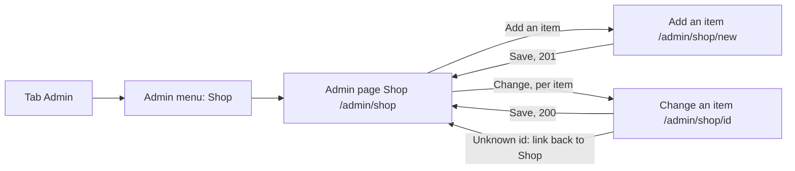

# Add or change a shop item

- Component: web/src/pages/AdminProductEdit.tsx, with the form web/src/components/ProductForm.tsx and ProductForm.module.css
- Addresses in the browser: /admin/shop/new (add an item) and /admin/shop/:id (change an item)

## What the page is for

The foundation has a small shop (issue 81). Without this page, a new item, a new price or an item that is sold out can only be changed by a developer of the team, so a change can take days. On this page an admin of the foundation adds an item with a name, a short text, a price in euros, whether VAT is included and a picture, or changes any of these later. Members see the change on the page Shop at once.

## Who can open it

- Admin of the foundation: opens it from the admin page Shop (/admin/shop).
- Member (young person), organisation: the routes are inside RequireLogin and RequireAdmin of issue 45. A member reads that they are not allowed to see this page.
- Visitor who is not logged in: sent to Log in first.

## How you get there and where you go next

The list page itself is AdminShop.tsx at /admin/shop (task 150.7). It lists every item, also the ones that are switched off, with its picture (the name as alt text), the name, the price with formatPrice (for example € 12,50), VAT included or VAT not included, For sale or Switched off as text, a link Change and a button Switch off or Switch on. After a save it reads "The item is saved" in a status area.

## Every element of the page, top to bottom

When changing, AdminProductEdit reads the item from the list page, or asks the first pages of getAdminProducts until it finds it, and fills the form. An unknown id shows "This item was not found" with a link back to Shop.

1. Field: Name
   - Visible label and the hint "At most 100 characters".
   - Messages: "Fill in a name", "Use at most 100 characters for the name".
2. Field: Short text
   - A textarea with the hint "At most 500 characters".
   - Messages: "Fill in a short text", "Use at most 500 characters for the text".
3. Field: Price
   - The price in euros, hint "For example 12,50".
   - parseEuroToCents(text) in web/src/utils/parseEuroToCents.ts accepts 12, 12,5, 12,50 and 12.50 and gives 1250 for 12,50. It gives nothing for text, a minus sign or more than two decimals. The price travels as priceInCents, a whole number.
   - Messages: "Type a price like 12,50", "Type a price from 0 to 1.000 euro".
4. Checkbox: VAT included
5. Checkbox: For sale
   - Only when changing an item. An item switched off is no longer seen by members on the page Shop.
6. Field: Picture
   - A file field that accepts image/jpeg and image/png, hint "JPEG or PNG, at most 5 MB".
   - When changing, the current picture is shown next to it with the line "Choose a file only to change it". A new picture replaces the old one.
   - When adding: "Choose a picture" when none is chosen.
   - Server messages next to the field: "Choose a JPEG or PNG picture." (415) and "This picture is too big. Choose a JPEG or PNG under 5 MB." (413).
   - The server checks the picture with the rules of issue 61b, cleans it so it never carries the place or the phone it was taken with, and keeps it under a new name in the storage folder (task 150.2). The table product gets the column image_stored_name. The picture is a file in that folder, never in the database. When saving fails, the new picture is thrown away again. Members get the picture from GET /api/products/{id}/image (task 150.6).
7. Alert area above Save, in role alert
   - "Connect is not reachable right now, the item is not saved. Try again later." on 503 or no answer. Every value stays in the form, and the chosen picture stays chosen.
8. Button: Save
   - The form first checks every field in the browser with the same numbers as the server (task 150.1). Each message sits next to its field, linked with aria-describedby, and the focus moves to the first field with a message. Nothing is sent then.
   - Then createProduct(values, picture) or changeProduct(id, values, picture) in web/src/api/adminProducts.ts sends a multipart form (FormData) through client.ts to POST /api/admin/products (task 150.4) or PUT /api/admin/products/{id} (task 150.5).
   - While waiting the button says "Saving..." and is disabled.
   - 201 or 200: back to /admin/shop, where the status area reads "The item is saved".
   - 400: every message of the server next to its field.
   - 404 when changing: "This item was not found" with a link back to Shop.
   - On the server, the guard of issue 04 and the rule AdminOnly of issue 45 let only an admin through. An item is valid with a name, a text, a price of 0 or more, and exactly one picture.

All fields and Save are built by task 150.8, issue 150 Change the items of the shop through a screen, GitLab #232, sprint 5. The server parts are tasks 150.1 to 150.6.

## States

- Loading: when changing, the page loads the item before it fills the form.
- Empty: the form on /admin/shop/new, with no values.
- Filled: the form on /admin/shop/:id with the values of the item and the checkbox For sale.
- Error: a message next to each wrong field, or next to the field Picture. "This item was not found" for an unknown id. An error when the list cannot be loaded.
- Not reachable: "Connect is not reachable right now, the item is not saved. Try again later." above Save, and every value stays.
- Phone (360 pixels wide) and laptop (1280 pixels wide): the team ticks every criterion on both (task 150.10).
- Design: the Figma frame of the admin pages on the Figma board of Connect, page Design directions. Colours, fonts and spacing only through web/src/styles/tokens.css.

## Accessibility and privacy

- Every field has a visible label and a hint. Every message sits next to its field, linked with aria-describedby, so a screen reader reads it when the field gets the focus.
- On the list page, every action carries the name of the item, for example "Switch off Check cap".
- A picture added from a phone never shows members where or with which phone it was taken. The photo details are removed before a picture is kept (issue 104).

## Built by

| Board | Title | GitLab | Sprint | Prio |
|---|---|---|---|---|
| 150 | Change the items of the shop through a screen | #232 | 5 | could |

Issue 150 needs issues 81, 45, 48, 61b and 95 first.

## Open points

- The issue is only built when the director of the foundation says yes to the shop itself (issue 10 The client's priorities for the epics, question 2) and to this page (issue 10, question 48).
- Deleting an item for good is not planned. An item that was ever ordered must stay for the orders of issue 83, so it is switched off instead.
- Sizes and colours of one item are not asked by the foundation. Each size is its own item, as issue 81 says.
- A backup of the pictures of the shop is covered by issue 172.

## AI use declaration

AI was used as a writing support tool while working on this document. We used AI to draft
the formulation of sentences, the structure of wording, readability, and clarity from
content that we had provided, and to generate the diagrams. The content itself, including
our experiences, reflections, learning goals, decisions, self-assessments, and
conclusions, is our own. We reviewed the drafts and decided as a team which text to
include.
