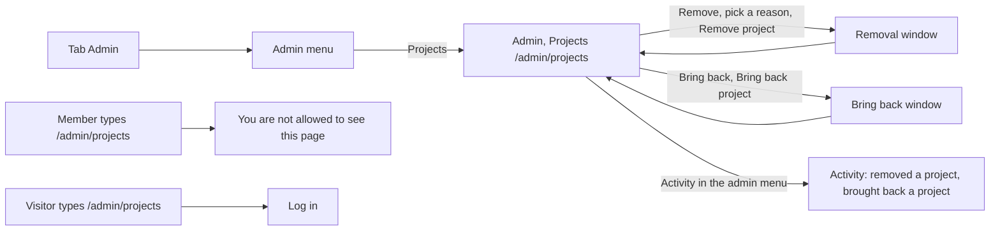

# Admin, Projects

- Component: web/src/pages/AdminProjects.tsx, with AdminProjects.module.css and AdminProjects.test.tsx
- Server helpers: web/src/api/adminProjects.ts (listAdminProjects, removeProject, bringBackProject, the constant REMOVAL_REASONS)
- Address in the browser: /admin/projects, the item Projects in the admin menu under the tab Admin
- Server addresses: GET /api/admin/projects?page=1&pageSize=20, POST /api/admin/projects/{id}/removal, DELETE /api/admin/projects/{id}/removal

## What the page is for

Many young people on Connect are minors. A project with hurtful words, someone else's personal data or advertising must be gone the moment the foundation sees it. On this page an admin of the foundation sees every project that members added, newest first. The admin can remove a project that breaks the house rules, with a reason, and can bring back a project that was removed by mistake. Removed does not mean thrown away: the project is kept out of sight with the reason, the date and the admin, so the foundation can always show what it removed and why. The admin also reads here the question of a young person who asks the foundation to look at a removal again.

## Who can open it

- Admin of the foundation: sees the page and can remove and bring back projects.
- Member (young person) or organisation: sees no tab Admin. When they type /admin/projects they read "You are not allowed to see this page" in place of the list (RequireAdmin of issue 45). The server refuses them too, through the rule AdminOnly.
- Visitor who is not logged in: is sent to the page Log in (RequireLogin of issue 04).

## How you get there and where you go next

The admin presses the tab Admin and then Projects in the admin menu (AdminMenu.tsx of issue 32). The item Projects is marked with aria-current on this page. From here the admin goes to the other admin pages through the same menu, for example Activity, where every removal and every bring back shows as a line.

## Every element of the page, top to bottom

1. Admin menu
   - The row of links at the top of every admin page, with the new item Projects linking to /admin/projects.
   - Built by task 48.4, issue 48 Remove content that breaks the rules, GitLab #121, sprint 3.

2. The list of projects
   - Data: listAdminProjects(page) asks GET /api/admin/projects?page=<page>&pageSize=20 through the shared helper web/src/api/client.ts and reads data and meta. The page never calls fetch itself.
   - On the server only an admin gets through. The page number and page size are checked, and a wrong page gets a plain message. The table project is read with the query filter switched off on purpose, because the admin must also see removed projects.
   - One article per project, newest first, with:
     - the title as a heading,
     - the text,
     - "Added by <first name> on <date>",
     - either a button Remove, or the line "Removed on <date>, <reason sentence>, by <email>" with the email address of the admin who removed it.
   - A removed project has no button Remove, so it cannot be removed twice.
   - Built by tasks 48.1, 48.2 and 48.4, issue 48, GitLab #121, sprint 3.

3. Question from the maker (under the removed line)
   - Only when a young person asked the foundation to look at the removal again: "Question from the maker on <date>:" followed by the text of the young person, in a paragraph inside the article of that project. The date is written in English, for example 14 October 2026.
   - The text is plain text, never HTML. A text like <b>look again</b> shows the signs, not bold text. Line breaks the young person typed are kept.
   - A project without a question looks exactly as before.
   - Data: GET /api/admin/projects gives every item reviewRequest with text and askedAt, or null. The question comes from the table removal_review_request. The young person sends it from My profile with the button Ask to look again (POST /api/accounts/current/removal-notices/{projectId}/review-request).
   - Built by tasks 146.3 and 146.5, issue 146 Ask the foundation to look at a removal again, GitLab #220, sprint 5.

4. Button: Remove (on a project that is not removed)
   - Opens the removal window (ConfirmDialog of issue 113, reused, never a second dialog):
     - Heading: "Which rule does this project break?"
     - Four radio buttons in a fieldset with a legend: content that is not allowed, personal data of someone else, spam or advertising, another reason (the names NotAllowed, PersonalData, Spam and Other in REMOVAL_REASONS).
     - The sentence "The maker gets an email with the reason. Your name is not in it." above the buttons, as normal text, not as a warning (issue 147).
     - Button Cancel, and button Remove project, which is disabled until a reason is picked. The server checks the reason anyway.
   - Focus goes into the window and stays there. Escape and Cancel close it and change nothing.
   - Remove project sends the reason to POST /api/admin/projects/{id}/removal. While it saves the button says "Removing..." and is disabled, so a second press does nothing.
   - After a removal that worked: the window closes, the project shows the removed line, and a status message reads "Project removed. The maker gets an email." (before issue 147: "Project removed"). Focus goes back to the project heading.
   - On the server the row in project gets removed_at, removed_reason and removed_by. Nothing is deleted. In the same save one line project.removed is added to Activity. From that moment every page that shows projects to members and visitors leaves it out.
   - After the save the maker gets one email with the subject "Your project on Connect was removed", the title, the reason, a link to My profile, a link to the house rules and how to reach the foundation. It never names the admin. When the removal fails, no email is sent.
   - Built by tasks 48.3 and 48.4, issue 48, GitLab #121, sprint 3, and tasks 147.1, 147.2 and 147.3, issue 147 An email when my project is removed, GitLab #218, sprint 5.

5. Button: Bring back (on a removed project)
   - Only removed rows have it. Its accessible name is "Bring back" followed by the title of the project. It is a secondary button, not a warning button.
   - Opens ConfirmDialog with the heading "Bring this project back?", the title of the project, the sentence "Members and visitors see it again at once.", a button Cancel and a button Bring back project. Escape and Cancel close it without a call.
   - Bring back project calls bringBackProject(id), which sends DELETE /api/admin/projects/{id}/removal. While it waits the button says "Bringing back..." and is disabled, so one press gives one request.
   - After it worked: the window closes, the row shows "Brought back" in a status area, the list is loaded again, and the row has the button Remove and no removal line.
   - On the server the three removal columns become empty again and one line project.restored is added to Activity. The project shows again on the pages where members see projects, and the removal message on My profile of the young person is gone. The young person gets no email.
   - Built by tasks 141.1, 141.2 and 141.3, issue 141 Bring back a project that was removed, GitLab #216, sprint 5.

6. Button: Load more
   - Below the list while the projects shown are fewer than meta.total. It asks the next page with pageSize 20 and adds the projects below. The ones already shown stay.
   - While it loads the button says "Loading..." and is disabled. When everything is shown, the button is gone.
   - Built by task 48.4, issue 48, GitLab #121, sprint 3.

7. Words on the page Activity (not on this page, but part of the same work)
   - project.removed shows as "removed a project" and project.restored as "brought back a project" on the page Activity (web/src/pages/AdminActivity.tsx). The line on Activity never holds the title or the text of a removed project (AC6 of issue 48).
   - Built by tasks 48.4 and 141.3.

## States

- Loading: "Loading..." in place of the list.
- Empty: "No projects yet".
- Filled: twenty projects with Remove or the removed line, and Load more when there are more.
- Error, loading the list or the next page: "Connect is not reachable right now, try again later" under the list, and Load more stays.
- Error, removing: "Connect is not reachable right now, try again later" inside the window, and the project stays as it was with its button Remove.
- Error, removing a project that is already removed: "This project was already removed", and the project is asked again so the removed line shows.
- Error, bringing back: "This project is not removed anymore." when another admin brought it back a moment before (the list is loaded again), "This project does not exist." for an unknown project (the list is loaded again), and "Connect is not reachable right now, try again later" in a region with role alert, where the row stays removed. The row never shows as back on an error.
- A tester checks not reachable by switching the phone to airplane mode before pressing Remove project or Bring back project.
- Phone (360 pixels wide) and laptop (1280 pixels wide): no scrolling sideways. Colours, fonts and spacing come only from web/src/styles/tokens.css. Cards 48.4 and 141.3 point to the Figma frames of the admin pages on the page Design directions. See Open points.

## Accessibility and privacy

- The reasons are radio buttons in a fieldset with a legend, so a screen reader reads the question with each reason and the arrow keys move between them.
- Focus goes into each window and stays there. Escape closes it. After a removal the focus goes back to the project heading.
- A screen reader hears "Project removed" (or "Project removed. The maker gets an email.") and "Brought back" through a status area.
- Every Bring back button names its project, so a screen reader user knows which project each one is for.
- The whole page can be used with only the keyboard.
- The question of a young person is shown only to admins, never to other members or visitors, and only as plain text.
- The email to the maker never holds the name or the email address of the admin.
- A question is deleted together with the account of the young person.
- axe finds no problems on the page and with a window open.

## Built by

| Board | Title | GitLab | Sprint | Prio |
|---|---|---|---|---|
| 48 | Remove content that breaks the rules | #121 | 3 | should |
| 141 | Bring back a project that was removed | #216 | 5 | could |
| 147 | An email when my project is removed | #218 | 5 | could |
| 146 | Ask the foundation to look at a removal again | #220 | 5 | could |

## Open points

- Issue 146 is only built when the director of the foundation says yes, and who answers the questions and how fast, and whether the foundation gets an email when a question comes in: issue 10 The client's priorities for the epics, question 47.
- An email to the young person when the project comes back: issue 10, question 64.
- The email text in Dutch: issue 10, question 42.
- The email address of the foundation that the removal email names: issue 10, question 26.
- An email when a whole member is deactivated: issue 10, question 44.
- The cards disagree on the design: tasks 48.4 and 141.3 point to Figma frames of the admin pages on the page Design directions, while task 139.4 of issue 139 says there is no drawing of the admin pages there yet. The team checks the Figma board and settles this.

## AI use declaration

AI was used as a writing support tool while working on this document. We used AI to draft
the formulation of sentences, the structure of wording, readability, and clarity from
content that we had provided, and to generate the diagrams. The content itself, including
our experiences, reflections, learning goals, decisions, self-assessments, and
conclusions, is our own. We reviewed the drafts and decided as a team which text to
include.
