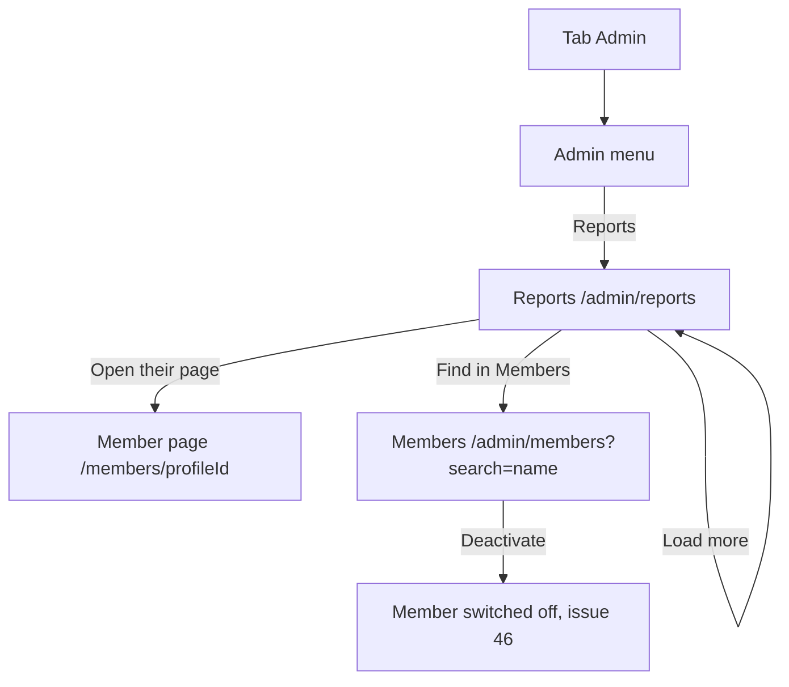

# The page Reports (admin)

Component: `frontend/src/pages/AdminReports.tsx`.
Address in the browser: `/admin/reports`.

## What the page is for

A member can report another member for breaking the house rules (issue 151). Without this page those reports are stored, but nobody at the foundation can read them. The page Reports lists every report, newest first, with the date, the reason the member picked, the name of the member who was reported, and whether that member is already switched off. Two links lead on, so an admin can act on a report before a young person gets hurt. The page never shows who sent a report.

## Who can open it

- Admin of the foundation: yes.
- Member: reads "You are not allowed to see this page" and no report, also when typing the address (`RequireAdmin` of issue 45).
- Visitor who is not logged in: is sent to Log in (`RequireLogin` of issue 04).
- The server lets only an admin through the group `/api/admin` with the rule AdminOnly of issue 45.

## How you get there and where you go next

- The item Reports in the admin menu (`AdminMenu.tsx`), after Projects. The admin reaches the menu through the tab Admin.
- Open their page goes to the page of the reported member at `/members/<profileId>` (issue 14).
- Find in Members goes to the list Members at `/admin/members?search=<name>`, with the name already searched, where the admin can switch the member off with issue 46.

## Every element of the page, top to bottom

### Heading and total

- Text: the heading Reports and the total, for example "23 reports".
- Built by: issue 152 See the reports about members, task 152.3 (GitLab #235, sprint 5).

### The list of reports

- What it shows: one item per report, newest first, twenty at a time. Each item is an `article` named by its first line through `aria-labelledby`.
- Data: `getReports(page)` in `frontend/src/api/admin.ts` asks `GET /api/admin/reports` through the shared helper `client.ts`, and returns the page with the total, or not reachable. The page never sees a status code. The server checks the page number and page size, and turns every reason code into its sentence with `ReportReasonTexts` of issue 151. The answer holds nothing about who reported (task 152.2). A wrong page number gets a message.
- Built by: issue 152, tasks 152.2 and 152.3.

### One report

- The date and time, written with `Intl.DateTimeFormat` in English, for example 20 October 2026, 18:05.
- The reason, as a plain sentence.
- The display name of the member who was reported, shown as text, never as HTML.
- The mark Switched off, as text and never only a colour, when the member is already switched off.
- Link Open their page to `/members/<profileId>`, with the accessible name "Open the page of <name>". Left out when the member has no profile.
- Link Find in Members to `/admin/members?search=<name>`, with the accessible name "Find <name> in Members". `AdminMembers.tsx` of issue 45 reads search from the address when it opens, puts it in the search field and searches at once.
- Built by: issue 152, task 152.3.

### Button Load more

- Label: Load more.
- What it does: shown under the list only when fewer reports are shown than the total. It asks the next page and adds it under the list. While it waits it says "Loading..." and is disabled. Afterwards the focus goes to the first new report.
- When it fails: the reports already shown stay, and "The reports are not available right now" appears above the button.
- Built by: issue 152, task 152.3.

## States

| State | What the person sees |
|---|---|
| Loading | "Loading reports..." in an area with role status. |
| Empty | "There are no reports" in place of the list. |
| Filled | The heading, the total, twenty reports and Load more while there are more. |
| Loading more | Load more says "Loading..." and is disabled. |
| Not reachable | "The reports are not available right now" in an area with role alert, and no error screen. |
| Member | "You are not allowed to see this page" and no report. |

The team check of task 152.5 runs on a phone and on a laptop.

## Accessibility and privacy

- A screen reader hears each report as one item with its date, its reason and its member, and the two links name the member.
- After Load more the focus goes to the first new report.
- The mark Switched off is text, never only a colour.
- The page never shows the name, the email address or anything else about the member who sent a report, because it is the name of a young person who spoke up.
- Opening the reports adds no line to the page Activity, because issue 32 logs only actions that change something.

The design: colours, fonts and spacing come only from `frontend/src/styles/tokens.css`, following the Figma frame of the admin pages on the page Design directions of the Figma board.

## Built by

| Board | Title | GitLab | Sprint | Prio |
|---|---|---|---|---|
| 152 | See the reports about members | #235 | 5 | could |

## Open points

- Issue 152 waits for issue 151, which is only built when the director of the foundation says yes to issue 10, question 39.
- Seeing who sent a report: issue 10, question 91. The page leaves it out until the client answers.
- Marking a report as handled, or hiding it from the list, together with who reads the reports and how fast: issue 10, question 39.
- An email to the foundation for every new report: issue 10, question 39.

## AI use declaration

AI was used as a writing support tool while working on this document. We used AI to draft
the formulation of sentences, the structure of wording, readability, and clarity from
content that we had provided, and to generate the diagrams. The content itself, including
our experiences, reflections, learning goals, decisions, self-assessments, and
conclusions, is our own. We reviewed the drafts and decided as a team which text to
include.
