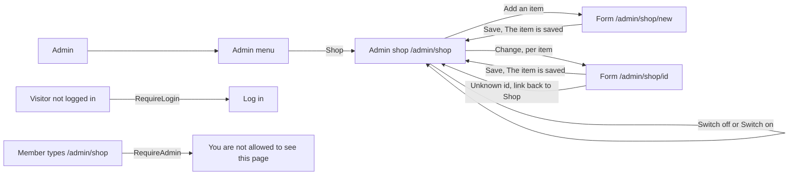

# Admin shop (the items of the shop)

- Component: frontend/src/pages/AdminShop.tsx, with AdminShop.module.css and AdminShop.test.tsx
- Address in the browser: /admin/shop (registered in frontend/src/App.tsx inside RequireLogin and RequireAdmin)
- The form to add or change an item is its own page: frontend/src/pages/AdminProductEdit.tsx with the component frontend/src/components/ProductForm.tsx, at /admin/shop/new and /admin/shop/:id.

## What the page is for

Connect has a small shop where members buy merchandise of the foundation (issue 81). Without this page, only a developer of the team can add an item, change a price or take away an item that is sold out, so a change can take days. On this page an admin of the foundation sees every item of the shop, also the ones that are switched off, with its picture, name, price and whether it is for sale. From here the admin adds a new item, changes an item, or switches an item off so members no longer see it, and on again. Members see the change on their page Shop at once.

## Who can open it

- Admin of the foundation (an account with the role Admin of issue 45): sees the list and all its buttons.
- Member (young person) or anyone else who is logged in but not an admin: reads "You are not allowed to see this page" and no list, through RequireAdmin of issue 45. The server refuses them with 403.
- Visitor who is not logged in: is sent to Log in by RequireLogin of issue 04. The server refuses them with 401.

## How you get there and where you go next

The admin presses Admin and then the item Shop in the admin menu (frontend/src/components/AdminMenu.tsx, made by task 32.4 of issue 32, with the item Projects of task 48.4 of issue 48). Task 150.7 adds the item Shop, which links to /admin/shop. From here the link Add an item goes to the empty form at /admin/shop/new, and the link Change of an item goes to the filled form at /admin/shop/<id>. After a save on the form, the admin comes back to this page, where "The item is saved" is read. Switch off and Switch on work in place and keep the admin on this page.

## Every element of the page, top to bottom

The page sits inside the admin area of issue 45. Colours, fonts and spacing come only from the variables in frontend/src/styles/tokens.css.

Data for the list: getAdminProducts(page) in frontend/src/api/adminProducts.ts asks GET /api/admin/products?page=<page>&pageSize=20 through the shared helper client.ts. The page never sees a status code. The server (task 150.3, AdminProductListService, AdminProductListRequestValidator) sits in the group /api/admin with the rule AdminOnly. It reads every item, the switched off ones too, sorted by name and then id, paged in the database (ListAllPageAsync and CountAllAsync of task 150.1). The answer is {"data": [{"id", "name", "description", "priceInCents", "vatIncluded", "isActive", "imageUrl"}], "meta": {"page", "pageSize", "total"}}. page starts at 1 and pageSize is 1 to 50. A wrong value gives 400 with "The page must be 1 or higher" or "Choose a page size from 1 to 50". A database that is down gives 503 with "Connect is not reachable right now". Prices come in cents and the screen shows euros.

1. Heading: Shop
   - Built by task 150.7, issue 150 Change the items of the shop through a screen, GitLab #232, sprint 5.
2. Status area: The item is saved
   - Shown after the admin saved an item on the form and came back here (task 150.8).
   - Built by tasks 150.7 and 150.8, issue 150, GitLab #232, sprint 5.
3. Link at the top: Add an item
   - Goes to /admin/shop/new, the empty form. Saving there sends POST /api/admin/products (task 150.4).
   - Built by task 150.7, issue 150, GitLab #232, sprint 5.
4. The list, one entry per item
   - The picture, with the name of the item as its alt text. imageUrl is /images/products/<image_file> for an item of issue 81, and /api/products/<id>/image?v=<first 8 characters of the stored name> for a picture an admin added, so the browser never shows an old picture after a change (ProductImageUrl, task 150.3). An admin also gets the picture of a switched off item (task 150.6).
   - The name as a heading.
   - The price with formatPrice of issue 81, for example € 12,50, and VAT included or VAT not included.
   - For sale or Switched off, as text.
   - Built by tasks 150.1, 150.3, 150.6 and 150.7, issue 150, GitLab #232, sprint 5.
5. Link per item: Change
   - Goes to /admin/shop/<id>, the form filled with the item. Its accessible name holds the name of the item, for example "Change Check cap".
   - Saving there sends PUT /api/admin/products/{id} (task 150.5).
   - Built by task 150.7, issue 150, GitLab #232, sprint 5.
6. Button per item: Switch off (when for sale) or Switch on (when switched off)
   - Its accessible name holds the name of the item, for example "Switch off Check cap".
   - Pressing it calls changeProduct(id, values) in frontend/src/api/adminProducts.ts, which sends PUT /api/admin/products/{id} with the current values and isActive changed. The server (task 150.5, ProductAdminService.ChangeAsync) is only for an admin, binds the id as text, and answers 200 with the changed item, 400 on id with "This item is not known" for an id that is not real, 404 with "This item was not found" for an unknown id, and 503 when the database is down.
   - While waiting the button says "Saving..." and is disabled.
   - Success: the status text changes in place, and a status area reads "Check cap is switched off" or "is for sale again". Members no longer see a switched off item on the page Shop, because ListForSaleAsync of issue 81 filters on it.
   - Failure: the status stays and "Connect is not reachable right now, the change is not saved." appears next to the button.
   - The status changes only after the server said yes.
   - Built by tasks 150.5 and 150.7, issue 150, GitLab #232, sprint 5.
7. Button under the list: Load more
   - Shown only when fewer items are shown than the total. It adds the next page, says "Loading..." while it waits, and moves the focus to the first new item.
   - Built by task 150.7, issue 150, GitLab #232, sprint 5.

The form on /admin/shop/new and /admin/shop/:id (task 150.8) is where the fields Name, Short text, Price (in euros, turned into cents by parseEuroToCents), VAT included, For sale (only when changing) and Picture live, with messages such as "Fill in a name", "Type a price like 12,50", "Choose a JPEG or PNG picture." and "This picture is too big. Choose a JPEG or PNG under 5 MB.", and "Connect is not reachable right now, the item is not saved. Try again later." when Connect cannot be reached. The server cleans every picture so it holds no place or phone name (task 150.4).

## States

- Loading: "Loading items..." in an area with role status.
- Empty: "There are no items yet" with the link Add an item, when the total is 0.
- Filled: every item with its picture, name, price, VAT and For sale or Switched off, and Load more when there are more.
- Busy switch: the button says "Saving..." and is disabled.
- Switch failed: "Connect is not reachable right now, the change is not saved." next to the button, and the status stays.
- Not reachable: "The items are not available right now" in an area with role alert, when the list cannot be loaded. A tester checks the form with airplane mode on a phone.
- Not allowed: a member reads "You are not allowed to see this page".
- Not logged in: the visitor lands on Log in.
- Phone (360 pixels wide or close) and laptop: the team check is done on both.
- Design: the Figma frame of the admin pages on the page Design directions of the Figma board of Connect.

## Accessibility and privacy

- Every button Change and Switch off or Switch on has the name of its item in its accessible name, so a screen reader hears "Change Check cap" and "Switch off Check cap".
- For sale and Switched off are shown as text, not only as a colour.
- Every picture has the name of the item as its alt text.
- The results of a switch and the loading state sit in areas with role status, a failed load in an area with role alert.
- Load more moves the focus to the first new item.
- An item holds nothing about a person, so it is not part of the delete of issue 113.
- A picture an admin adds from a phone never shows members where or with which phone it was taken. It is cleaned and stored under a new name in the folder of the setting Storage__ProductImages, outside the part browsers can open (tasks 150.2 and 150.4).

## Built by

| Board | Title | GitLab | Sprint | Prio |
|---|---|---|---|---|
| 150 | Change the items of the shop through a screen | #232 | 5 | could |

Issue 150 needs issues 81 See the merchandise, 45 See all members (the admin area and RequireAdmin), 48 Remove content that breaks the rules, 61b Add an image to my project (ImageFileRules, IImageProcessor and FileImageStore) and 95 Connect and its database described in Terraform first. It also uses AdminMenu.tsx of task 32.4 of issue 32 See who did what on the platform. Its tasks go in this order: 150.1 the table and the rules, 150.2 the storage folder, 150.3 the list address, 150.4 add, 150.5 change and switch, 150.6 the picture address, 150.7 this page, 150.8 the form, 150.9 the end to end test and 150.10 the team check.

## Open points

- Issue 150 is only built when the director of the foundation says yes to the shop itself (question 2 of issue 10) and to this page (question 48 of issue 10).
- What the basket does with an item that is switched off later belongs to issues 82 and 82b, and the price a paid order keeps to issue 83. This page does not decide it.
- Deleting an item for good is not planned. An item that was ever ordered must stay for the orders of issue 83, so it is switched off instead.
- The backup of the shop pictures belongs to issue 172, which covers the whole volume connect-uploads. The builder of issue 172 is told that a second folder lives in it.

## AI use declaration

AI was used as a writing support tool while working on this document. We used AI to draft
the formulation of sentences, the structure of wording, readability, and clarity from
content that we had provided, and to generate the diagrams. The content itself, including
our experiences, reflections, learning goals, decisions, self-assessments, and
conclusions, is our own. We reviewed the drafts and decided as a team which text to
include.
