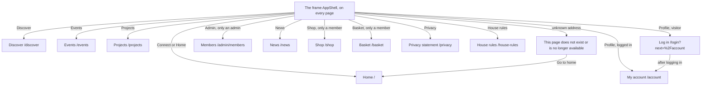

# The frame around every page (AppShell)

Component: `web/src/components/AppShell.tsx`, with `web/src/components/TabBar.tsx` and `web/src/components/SiteFooter.tsx`.
Address in the browser: none of its own. The frame is a layout route in `web/src/App.tsx`, so it is around every address of Connect, from `/` to an address that does not exist.

## What the page is for

Every page of Connect sits inside one frame. The frame holds the name Connect, the five tabs Home, Discover, Events, Projects and Profile, the links News, Shop and Basket at the top, the footer with Privacy and House rules, and two short messages for when Connect cannot be reached or is asked too often. When you tap a tab, only the page inside the frame changes. The tabs, the header and the footer stay in place, so moving around Connect is fast, also on a slow phone.

## Who can open it

Everyone sees the frame, on every page. What the frame shows depends on who is looking.

| Part | Visitor (not logged in) | Member (young person or organisation) | Admin of the foundation |
|---|---|---|---|
| The name Connect and the link News | Yes | Yes | Yes |
| The five tabs | Yes, with Log in under Profile | Yes, with their own name under Profile | Yes, with their own name under Profile |
| The tab Admin | No | No | Yes |
| The links Shop and Basket | No | Yes | Yes, when logged in as a member account |
| The footer with Privacy and House rules | Yes | Yes | Yes |

A visitor who taps Profile goes to the page Log in and, after logging in, lands on My account. Hiding the tab Admin is only a convenience. The server decides who may open an admin page (issue 45).

## How you get there and where you go next

The frame is always there. From the frame you reach these pages:

- The name Connect goes to Home at `/`.
- Home goes to `/`, Discover to `/discover`, Events to `/events`, Projects to `/projects`, Profile to `/account` (My account).
- The tab Admin goes to `/admin/members` (the page Members).
- News goes to `/news`.
- Shop goes to `/shop`, Basket goes to `/basket`.
- Privacy goes to `/privacy`, House rules goes to `/house-rules`.
- An address that does not exist shows the page This page does not exist or is no longer available inside the frame, with a link Go to home.

## Every element of the page, top to bottom

### Too many requests notice

- Text: "You asked too often. Wait a minute and try again."
- What it shows: a message at the top of `main` when Connect refuses a computer that sent far too many requests. It hides itself after the seconds the server gives, 60 when the server gives none. There is no countdown, no number and no code on the screen. A second refusal while it shows restarts the time, it never shows two messages.
- Data: `request()` in `web/src/api/client.ts` turns code 429 into the result tooManyRequests with the seconds of the header Retry-After, and tells the listeners of `onTooManyRequests`. AppShell listens while it is on the screen. The server limit is 600 requests per minute per IP address on `/api`, and `GET /api/health` is never counted (task 105.1).
- Rules: the pages Log in (issues 30 and 30b) and the confirmation email page (issue 28c) keep only their own wait message, because their calls pass `ownWaitMessage: true`. After five wrong passwords a member sees only the countdown of Log in, not a second message at the top.
- Component: `web/src/components/TooManyRequestsNotice.tsx`, in an area with role alert, in the same style as the not reachable line.
- Built by: issue 105 Connect keeps working under too many requests, task 105.2 (GitLab #185, sprint 4).

### Header: the name Connect

- Text: Connect.
- What it does: a link to `/`.
- Built by: issue 06 Move between the five tabs of Connect, task 6.2 (GitLab #19, sprint 1).

### Header: the link News

- Text: News.
- What it shows: a link to `/news`, next to the name Connect, on a phone and on a laptop, for a visitor and a member alike. It is not a sixth tab. On `/news` it gets `aria-current="page"`.
- Built by: issue 72 See the news list, task 72.4 (GitLab #135, sprint 3).

### Header: the link Shop

- Text: Shop.
- What it shows: a link to `/shop`, next to the name Connect, only when `useSession` says a member is logged in. A visitor never sees it. It is not a sixth tab.
- Built by: issue 81 See the merchandise, task 81.3 (GitLab #147, sprint 4).

### Header: the link Basket

- Text: Basket, followed by the number of items when it is higher than 0, for example Basket 3.
- What it shows: a link to `/basket` next to the link Shop, only for a logged in member.
- Data: `BasketProvider` in `web/src/hooks/useBasket.tsx` sits around the pages inside AppShell. When a member is logged in it calls `getBasket()` in `web/src/api/basket.ts` once, which asks `GET /api/baskets/current` (task 82b.2). It keeps the answer and forgets it on log out. After every Add to basket, `ProductCard` hands over the new number from the answer, so the number goes up at once without a reload. The screen never counts itself, it shows the number of the server.
- When the basket cannot be read: the link shows Basket without a number. No message at the top of every page, the page Basket says why.
- Read out: a visually hidden area with role status says "Your basket has 1 item" or "Your basket has 3 items" each time the number changes after an add.
- Built by: issue 82b See my basket, task 82b.3 (GitLab #149, sprint 4).

### The five tabs (TabBar)

- Labels: Home, Discover, Events, Projects and Profile.
- What they are: a `nav` element with the label Main, holding a list of five real links: Home to `/`, Discover to `/discover`, Events to `/events`, Projects to `/projects` and Profile to `/account`. Never a div you can click.
- The marked tab: the link of the page you are on gets `aria-current="page"` and is bold with a line under it. The other four look the same.
- Place: below 768 pixels wide the tabs are fixed to the bottom of the screen, within reach of a thumb. From 768 pixels up they sit in the header at the top. Each tab is at least 48 by 48 pixels. Below 768 pixels `main` gets room at the bottom of the height of the tab bar (the token `--tab-bar-height` in `tokens.css`), so the last line of a page and a button at the bottom of a form can be tapped.
- What happens when you tap one: only the page inside the frame changes. The tabs and the name do not load again. Switching tabs never calls the server. A shared link to a tab opens that tab with the frame around it.
- The pages Discover, Events and Projects start with only their name as a heading. Later issues fill them and keep the address.
- History: issue 06 replaced the simple top bar (TopBar.tsx of tasks 3.5 and 4.6) that issues 03 and 04 made. Task 6.5 changes the end to end tests of issues 03, 04, 04b and 05 so they look under the tab Profile and read the email address on My account.
- Built by: issue 06, tasks 6.2 and 6.3 (GitLab #19, sprint 1).

### Under Profile: the name or Log in

- What it shows, from `useSession`:
  - Loading: Loading...
  - Logged in: the display name of the member. For now that is the part of the email address before the @ sign, for example anna for anna@example.org. Issue 07 Create a profile can replace it with the first name the member chooses.
  - Logged out: Log in.
  - Not reachable: nothing (the line above the tabs says so).
- Data: `getCurrentSession()` in `web/src/api/sessions.ts` reads `data.displayName` from `GET /api/sessions/current`, the address the screen asks once when Connect opens (task 6b.2). The column `account.display_name` holds the name (task 6b.1).
- Rules: a long name is cut after one line with three dots, so the five tabs keep their size. The name is plain text, never HTML. The email address is never shown in the tab bar, not even as a tooltip. The name appears right after logging in, without a reload, because the page Log in calls `refresh()` of `useSession`. After log out (`clear()`), the tab shows Log in and no name.
- Built by: issue 06b See my name under the tab Profile, task 6b.3 (GitLab #20, sprint 1-stretch), on top of issue 06.

### The tab Admin

- Label: Admin.
- What it shows: one more link in TabBar, after the five tabs, to `/admin/members`, only when `isAdmin` is true. A member and a visitor never see it. On a phone it takes the same size as the other tabs.
- Data: `GET /api/sessions/current` also says the role, and the screen uses it only to show or hide this tab.
- Built by: issue 45 See all members, task 45.4 (GitLab #88, sprint 3).

### Not reachable line

- Text: Connect is not reachable right now.
- What it shows: one line just above the tabs when `useSession` says the server could not be reached (the fetch failed or an answer of 500 or higher). It sits in an area with role status, so a screen reader reads it without moving to it. The tabs keep working.
- Built by: issue 06, task 6.2.

### The page (main)

- What it shows: the page of the current address, through an `Outlet` inside a `main` element. Every page sets the title of the browser tab itself, for example "Connect, Events". A page title never holds a name or an email address.
- An unknown address: the catch all route `*` inside the layout route shows `web/src/pages/NotFound.tsx` with the heading "This page does not exist or is no longer available" and a link Go to home to `/`, styled as a button. The browser tab title is "Connect, Page not found". The tabs and the footer stay (issue 53, task 53.3, GitLab #105, sprint 3).

### Footer: Privacy and House rules

- Labels: Privacy, then House rules.
- What it shows: a `footer` element at the bottom of every page, logged in or not. Privacy goes to `/privacy`, House rules to `/house-rules`. Both are React Router links, so only the page inside the frame changes.
- Place: on a phone the footer sits above the tabs, never behind them, and both links sit next to each other on one line, each at least 48 pixels high.
- Built by: issue 51 Read the privacy statement from every page, task 51.4 (GitLab #102, sprint 3), and issue 52 Read the house rules from every page, task 52.4 (GitLab #104, sprint 3).

## States

| State | What the person sees |
|---|---|
| Loading (Connect asks who is logged in) | The five tabs, and Loading... under Profile. |
| Visitor | The five tabs with Log in under Profile, the link News, no Shop, no Basket, no Admin. |
| Member | The five tabs with the member's name under Profile, the links News, Shop and Basket (with the number when it is higher than 0). |
| Admin | As a member, plus the tab Admin after the five tabs. |
| Not reachable | "Connect is not reachable right now" just above the tabs. No name under Profile. The tabs keep working, also in airplane mode, and never show a technical error. |
| Too many requests | "You asked too often. Wait a minute and try again." at the top of the page, gone after the seconds of the server. |
| Unknown address | "This page does not exist or is no longer available" with Go to home, inside the frame. |
| Phone (below 768 pixels) | Tabs fixed at the bottom, footer above the tabs, room at the bottom of the page, each tab at least 48 by 48 pixels, no sideways scrolling. |
| Laptop (768 pixels and up) | Tabs in the header at the top. |

A tap on a tab shows the new page within one second, without the tabs flashing white (issue 06). After a deploy a member sees the new version at their next visit without clearing anything, because the server tells the browser to check `index.html` again on every visit and to keep the built files with a code in their name for a year (task 6.1).

## Accessibility and privacy

- The tabs are a `nav` with the label Main and real links. A screen reader hears "current page" on the tab of the open page, through `aria-current="page"`.
- The not reachable line is a role status area. The too many requests notice is a role alert area, read once. The basket number is read out through a hidden role status area.
- axe finds no problems on the rendered frame and on the tab bar with a name.
- The email address is never shown in the tabs, in the title of the browser tab or in the address bar. Only the display name is shown, so someone looking over a shoulder on a shared computer does not read the email address. A second browser with another account shows only that other name.
- The frame itself calls nothing on the server. It reads `useSession`, which asks once when Connect opens.

The design: colours, fonts and spacing come only from the variables in `web/src/styles/tokens.css`, following the Figma frame of the app shell on the page Design directions of the Figma board.

## Built by

| Board | Title | GitLab | Sprint | Prio |
|---|---|---|---|---|
| 05 | Log out | #18 | 1 | must |
| 06 | Move between the five tabs of Connect | #19 | 1 | must |
| 06b | See my name under the tab Profile | #20 | 1-stretch | must |
| 45 | See all members | #88 | 3 | must |
| 51 | Read the privacy statement from every page | #102 | 3 | must |
| 52 | Read the house rules from every page | #104 | 3 | must |
| 53 | A friendly page for a link that does not exist | #105 | 3 | should |
| 72 | See the news list | #135 | 3 | could |
| 81 | See the merchandise | #147 | 4 | could |
| 82b | See my basket | #149 | 4 | could |
| 105 | Connect keeps working under too many requests | #185 | 4 | must |

What each issue adds to the frame: 05 the case that the tabs show Log in after `clear()` (task 5.3, moved into TabBar.test.tsx by task 6.2), 45 the tab Admin, 51 the footer with Privacy, 52 the link House rules, 53 the catch all route, 72 the link News, 81 the link Shop, 82b the link Basket and 105 the notice at the top.

## Open points

- The name under Profile is for now the part of the email address before the @ sign, which can still be a full name such as anna.devries. Issue 07 Create a profile can replace it with a chosen first name. Task 6b.3 asks the team to weigh whether that is acceptable until then, or whether the tab should show only first letters, and to advise the client.
- A link to a new site page in the footer or the menu: issue 10, question 97 (from issue 148).
- Whether Connect has a shop at all, and which items it sells: issue 10, question 2 (issue 81). The links Shop and Basket depend on that answer.

## AI use declaration

AI was used as a writing support tool while working on this document. We used AI to draft
the formulation of sentences, the structure of wording, readability, and clarity from
content that we had provided, and to generate the diagrams. The content itself, including
our experiences, reflections, learning goals, decisions, self-assessments, and
conclusions, is our own. We reviewed the drafts and decided as a team which text to
include.
