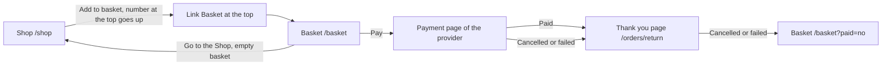

# Basket

- Component: web/src/pages/Basket.tsx, with Basket.module.css and Basket.test.tsx
- Address in the browser: /basket (after a cancelled payment: /basket?paid=no)

## What the page is for

A member who put items from the Shop in the basket checks here what they will pay before they pay. The page shows every item with its number, the price of one, the price of the line and the total. The member can remove a line, and presses Pay to pay on the safe page of a payment provider. The whole webshop waits for the client: it is only in the foundation's drawing of Connect, not in its written brief.

## Who can open it

- Member (young person): sees only their own basket. The basket is the same after logging out and in again, also on another phone or laptop.
- Visitor who is not logged in: the route is wrapped in RequireLogin, so the visitor goes to /login?next=%2Fbasket and comes back after logging in (issue 04b). The link Basket at the top is not shown to a visitor.
- The shop is for members only, as issue 81 decided. Nobody ever sees the basket of another member.

## How you get there and where you go next

## Every element of the page, top to bottom

1. Link Basket with the number, in the header of every page (not on the page itself, but it leads here)
   - Sits in the header of AppShell.tsx next to the link Shop, only for a logged in member. The text is Basket and the number when it is higher than 0, for example Basket 3. It goes to /basket.
   - Data: BasketProvider in web/src/hooks/useBasket.tsx asks GET /api/baskets/current once per log in, through getBasket() in web/src/api/basket.ts. ProductCard of issue 82 passes on itemCount of every answer of Add to basket, so the number goes up at once without a reload. On log out the basket is forgotten.
   - A visually hidden area with role status says "Your basket has 1 item" or "Your basket has 3 items" each time the number changes after an add.
   - When getBasket() fails, the link shows Basket without a number.
   - Built by task 82b.3, issue 82b See my basket, GitLab #149, sprint 4.
2. Message after a cancelled payment, above the lines, in role alert
   - "Nothing was paid. Your items are still in your basket." when the page opens with ?paid=no.
   - Built by task 83.4, issue 83 Pay for my basket, GitLab #194, sprint 5.
3. The lines of the basket
   - When the page opens it calls refresh() of useBasket once, which asks GET /api/baskets/current again, so it shows what the server has now.
   - One row per item: the name, the number (for example 2 x), the price of one and the price of the line, all with formatPrice(cents) of web/src/utils/formatPrice.ts, with VAT included or VAT not included.
   - The server reads the tables basket and basket_item of issue 82 together with product of issue 81 in one query, always with today's names and prices. A line of an item that the foundation switched off is left out. The server works out the price of every line and the total in cents. The page never adds up prices itself.
   - On a phone the lines stack with the price under the name. From 768 pixels up they form a table like list.
   - Built by tasks 82b.1, 82b.2 and 82b.4, issue 82b.
4. Button Remove, on every line
   - Text Remove, label for a screen reader "Remove <name> from your basket".
   - Calls removeFromBasket(productId) in web/src/api/basket.ts, which sends DELETE /api/baskets/current/items/{productId}. The server checks that the id is a real id and removes the line in one query that also checks that the basket belongs to this member. One row of basket_item goes, the basket row stays. The answer is the whole basket, in the same shape as GET /api/baskets/current.
   - While its request runs the button says "Removing..." and is disabled. A second press does no harm on the server.
   - After it works, setBasket of useBasket takes the whole basket of the answer. The line is gone, the total and the number at the top go down. Focus moves to the heading of the page.
   - When the last line is gone, the page shows the empty sentence.
   - Not reachable (503 or no answer): the line stays, and "Connect is not reachable right now, try again later" appears next to it in role alert.
   - The whole line is removed. Lowering the number by one is not part of it.
   - Built by tasks 82d.1, 82d.2 and 82d.3, issue 82d Remove an item from my basket, GitLab #151, sprint 4.
5. Total
   - "Total" and the amount of totalInCents from the server, with formatPrice, at the bottom.
   - Built by task 82b.4.
6. Line about the provider, above the button Pay
   - "You pay on the page of <provider>. Connect never sees your card or bank details." The provider name is the constant PAYMENT_PROVIDER_NAME in web/src/api/orders.ts, from the decision of issue 171.
   - Built by task 83.4.
7. Button Pay
   - Shown only when there are lines. The text is Pay and the total of the server with formatPrice, for example Pay € 25,00.
   - Calls startCheckout() in web/src/api/orders.ts, which sends POST /api/orders. The server makes an order from the basket with today's prices (tables shop_order and shop_order_item) and asks the provider for a payment of exactly the server's total. It never starts for an empty basket, without a key or without a log in.
   - While it runs the button says "Taking you to the payment page..." and is disabled, so a double tap never makes two orders.
   - When it works the browser goes to paymentUrl with window.location.assign, but only when the address starts with https://. Otherwise the page shows the message of not possible.
   - 503: "Paying is not possible right now. Your basket is kept." above the button in role alert.
   - 409 (empty basket): the page asks the basket again and shows the empty basket.
   - No answer at all: "Connect is not reachable right now, try again later" above the button in role alert. The basket stays.
   - On the test site the provider runs in its test mode, so no real money moves.
   - Built by tasks 83.1, 83.2 and 83.4, issue 83.
8. Empty basket
   - "Your basket is empty." with a link Go to the Shop to /shop.
   - Built by task 82b.4.

The page asks for nothing personal: no field at all, no address, no phone number and no payment details.

## States

- Loading: "Loading your basket..." in an area with role status.
- Empty: "Your basket is empty." with the link Go to the Shop.
- Filled: the lines, Remove on every line, the total, the line about the provider and the button Pay.
- Error: "Paying is not possible right now. Your basket is kept." above the button. "Nothing was paid. Your items are still in your basket." after a cancel.
- Not reachable: "Connect is not reachable right now, try again later" in role alert in place of the lines when the basket cannot be read, next to a line when Remove fails, and above the button when Pay gets no answer. The basket always stays.
- Speed: the page shows with its total within two seconds after pressing Basket, on a normal phone connection.
- Phone (360 pixels wide): the lines stack, price under the name. Laptop (1280 pixels wide): a table like list from 768 pixels up.
- Design: the Figma frame Basket and the frame of the app shell on the Figma board of Connect, page Design directions. Colours and sizes only from web/src/styles/tokens.css. The merge requests show screenshots at 360 and 1280 pixels.

## Accessibility and privacy

- The number at the top is read out in role status, with item for one and items for more. Role status waits politely, an alert would interrupt.
- A screen reader hears every line with its number and price, and which item each button Remove takes away.
- After a remove the focus moves to the heading, so a keyboard user does not lose their place.
- Messages that need attention sit in role alert.
- axe reports 0 issues.
- A member never sees or changes the basket of another member. The server takes the member only from the cookie connect_session, never from the request.
- The basket is forgotten on log out, so the next person on a shared computer does not see the number.
- Connect never asks for, shows or keeps a card or bank detail. The member pays only on the provider's page.

## Built by

| Board | Title | GitLab | Sprint | Prio |
|---|---|---|---|---|
| 82b | See my basket | #149 | 4 | could |
| 82d | Remove an item from my basket | #151 | 4 | could |
| 83 | Pay for my basket | #194 | 5 | could |

Issue 82b needs issues 82 and 14 first. Issue 82d needs 82b. Issue 83 needs issues 21, 171 and 82b. Putting an item in the basket is issue 82, at most ten of one item is issue 82c.

## Open points

- The whole webshop (FR10 Webshop) waits for the client: issue 10 The client's priorities for the epics, question 2. Nothing starts before the client says yes in writing. When he says no, every issue of the epic Webshop is closed with his reason. Issue 83 is marked blocked on this answer.
- The payment provider, its costs, its contract and the rules for members under 18 who pay: issue 171. The provider name on the page comes from that decision. Issue 171 also checks that the provider sends the member back with a normal link.
- Sizes or colours inside one item: issue 10, question 122.
- Lowering the number of one line by one instead of removing the whole line: issue 10, question 134.
- Refunds, a page with earlier orders and invoices: issue 10, question 123.
- Delivery and a delivery address: issue 171 and issue 10, question 27.

## AI use declaration

AI was used as a writing support tool while working on this document. We used AI to draft
the formulation of sentences, the structure of wording, readability, and clarity from
content that we had provided, and to generate the diagrams. The content itself, including
our experiences, reflections, learning goals, decisions, self-assessments, and
conclusions, is our own. We reviewed the drafts and decided as a team which text to
include.
