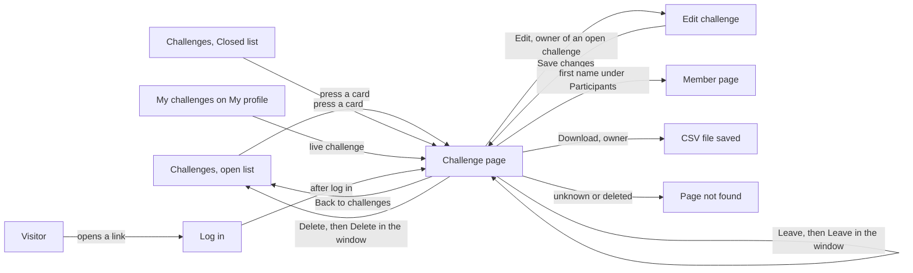

# Challenge page

- Component: frontend/src/pages/Challenge.tsx, with Challenge.module.css and Challenge.test.tsx
- Parts on this page: frontend/src/components/challenge/JoinButton.tsx (issue 77, with Leave of issue 169) and frontend/src/components/challenge/ChallengeParticipants.tsx (issue 79, with Download of issue 170)
- Address in the browser: /challenges/:id, for example /challenges/00000000-0000-4000-8000-000000000999
- Title of the browser tab: the title of the challenge

## What the page is for

An organisation on Connect can post a challenge: a small assignment for young people, such as designing the shop window of a local bakery. This page shows one challenge in full, so a young person can read what is asked and decide to take part before the deadline. A young person joins here with one press, and can leave again. The organisation that posted the challenge sees on the same page who joined, can download that list as a file, and can change or delete its challenge. A challenge whose deadline has passed can still be read, with a clear mark that it is closed.

## Who can open it

- Visitor (not logged in): the route sits inside RequireLogin of issue 04. A visitor sees the page Log in first and, since issue 04b, lands on the same challenge after logging in. That also holds for a closed challenge.
- Member (young person) with a profile: reads the challenge and sees the button Join while the challenge is open and they have not joined yet. Never sees who else joined.
- Member without a profile: reads the challenge. The server decides canJoin, and when a join is refused the page says "Only young people with a profile can join a challenge" with a link Create your profile.
- Organisation that posted the challenge: reads the challenge, sees the part Participants, the button Edit while the challenge is open, and the button Delete, open or closed. Sees no Join button.
- Another organisation: reads the challenge, sees no Join button, no part Participants, no Edit and no Delete.
- Admin: the cards give no separate rule for an admin on this page.
- Anyone who opens a challenge that does not exist, has an odd id or was deleted: sees the friendly page "This page does not exist or is no longer available" of issue 53.

## How you get there and where you go next

- From the list of open challenges on the page Challenges (issue 75): pressing a card opens this page. The page Challenges is reached from Discover with the link Challenges.
- From the list Closed on the page Challenges (issue 76), and from an old link a friend sent.
- From My challenges on My profile (issue 78): a live challenge is a link to this page. A removed one is not a link.
- Away: the link "Back to challenges" at the top goes to /challenges. The link Edit goes to /challenges/<id>/edit (the page Edit challenge). After a delete the organisation lands on /challenges. A first name under Participants goes to /members/<profileId> (the page of that young person, issue 14).

## Every element of the page, top to bottom

The page sits inside AppShell of issue 06, so the five tabs stay around it.

Data for the whole page: getChallenge(id) in frontend/src/api/challenges.ts asks GET /api/challenges/{id} through request() of client.ts. The answer holds the title, the full description, the organisation name, the deadline, the moment it was posted (issue 75b), isClosed (issue 76b), hasJoined and canJoin (issue 77), isOwner (issue 79) and updatedAt (issue 167). It never holds who else joined. The page decides nothing about closed, joining or owning by itself, and never uses the clock of the browser.

1. Saved or other message at the top: "Your changes are saved"
   - Shows above the challenge in an area with role status after the organisation saved a change on Edit challenge.
   - Built by task 167.4, issue 167 Change my challenge after posting, GitLab #228, sprint 5.
2. Link "Back to challenges"
   - At the top. Goes to the list on the page Challenges.
   - Built by task 75b.3, issue 75b Open a challenge page, GitLab #141, sprint 4.
3. Heading (h1): the title of the challenge
   - The same title is the name of the browser tab.
   - Built by task 75b.3, issue 75b, GitLab #141, sprint 4.
4. Link Edit (owner of an open challenge only)
   - Styled as a button, next to the title. It is a link to /challenges/<id>/edit.
   - Only rendered when isOwner is true and isClosed is false. Never only hidden with CSS. The server refuses a change from anyone else (PUT /api/challenges/{id}, task 167.2).
   - Built by task 167.4, issue 167, GitLab #228, sprint 5.
5. Button Delete (owner only, open or closed)
   - A real button near the title, next to Edit. It uses the colour for a dangerous action from tokens.css. Only rendered when isOwner is true.
   - Pressing it opens the window ConfirmDialog of task 113.3 with the question "Delete this challenge?", the sentence "Young people who joined will see that it was removed. You cannot undo this." and the buttons Delete and Cancel. The focus starts on Cancel. Cancel and the Escape key close the window, change nothing and put the focus back on Delete.
   - Delete in the window calls deleteChallenge(id), which sends DELETE /api/challenges/{id}. While waiting it says "Deleting..." and both buttons are disabled.
   - Deleted: the organisation goes to /challenges, which shows "Your challenge is deleted" at the top in an area with role status. The challenge is then gone from the open and closed lists and its page shows the not found page for everyone. It is marked as removed and not wiped, so a young person who joined still sees it under My challenges with "Removed by the organisation".
   - Not allowed: "Only the organisation that posted this challenge can delete it" in the window, role alert. Not found: "This challenge was already deleted", and the button in the window becomes a link Back to challenges. Not reachable: "Connect is not reachable right now, your challenge is not deleted" in the window, role alert. The window stays open, so Delete can be pressed again.
   - Built by task 168.4, issue 168 Delete my challenge, GitLab #229, sprint 5.
6. Closed sentence: "This challenge is closed. You can still read it."
   - A paragraph directly below the title, only when isClosed is true. Not a popup and not an alert, because it is there from the start.
   - Built by task 76b.3, issue 76b See on its page that a challenge is closed, GitLab #143, sprint 4.
7. Organisation: "By" and the name of the organisation
   - Built by task 75b.3, issue 75b, GitLab #141, sprint 4.
8. Deadline: "Deadline" and the date, for example 12 October 2026, written with formatDeadline of task 75.4
   - With the word Closed next to it when isClosed is true. The server works closed out from the deadline and the day of today in Dutch time, with the same rule as the Closed list. An open challenge shows no word Closed, also on its last day.
   - Built by task 75b.3 (issue 75b) and task 76b.3 (issue 76b, GitLab #143, sprint 4).
9. Line "Changed on", for example "Changed on 14 October 2026"
   - Under the deadline, for every visitor of the page, when updatedAt has a value. Written as a day in Dutch time. So a young person who joined knows something changed.
   - Built by task 167.4, issue 167, GitLab #228, sprint 5.
10. Join sentence and button Join (young person with a profile, open challenge)
    - Below the deadline and the mark Closed. When canJoin is true: the sentence "When you join, the organisation that posted this challenge sees your first name." and right below it a button Join. The sentence stands above the button, so the young person decides before pressing.
    - Pressing Join calls joinChallenge(challengeId) in frontend/src/api/challengeParticipants.ts, which sends POST /api/challenges/{id}/participants. While waiting the button says "Joining..." and is disabled, so a second press sends nothing.
    - Joined (201): the button is replaced by "You joined this challenge" in an area with role status, and the focus moves to that text. When hasJoined is true on opening, the page shows this text in place of the button, also after a reload or on another device.
    - Already joined in another window: the page shows "You joined this challenge", because it is true.
    - Closed meanwhile: "This challenge is closed, you can no longer join" below the button, role alert, and the button disappears.
    - Not allowed (403): "Only young people with a profile can join a challenge" with a link Create your profile to /profile/new.
    - Removed meanwhile (404): "This challenge no longer exists on Connect", role alert, and the button disappears.
    - Not reachable: "Connect is not reachable right now, try again later" below the button, role alert, and the button says Join again.
    - Both canJoin and hasJoined false, for an organisation or on a closed challenge: no button and no text about joining. No disabled button either.
    - Rules: a young person joins a challenge once and only while it is open. The table challenge_member stores only who joined which challenge and when.
    - Built by task 77.4, issue 77 Join a challenge, GitLab #144, sprint 4.
    - Button Leave (young person who joined, open or closed challenge): a real button next to "You joined this challenge", only when hasJoined is true. Pressing it opens the window ConfirmDialog of task 113.3 with the question "Leave this challenge?", the sentence "The organisation will no longer see your first name on it." and the buttons Leave and Cancel. The focus goes to Cancel. Cancel and the Escape key close the window and put the focus back on Leave.
    - Leave in the window calls leaveChallenge(id) in frontend/src/api/challengeParticipants.ts, which sends DELETE /api/challenges/{id}/participants/current. While waiting it says "Leaving..." and both buttons are disabled. The server only ever removes the young person who is logged in.
    - Left (204): the window closes, the page asks GET /api/challenges/{id} again, and "You left this challenge" shows in an area with role status, with the focus on it. When canJoin is true the button Join shows again below it. On a closed challenge there is no button Join.
    - Not allowed (403): "Only young people with a profile can join or leave a challenge" in the window, role alert. Not found (404): the page NotFound of issue 53 in place of the challenge. Not reachable: "Connect is not reachable right now, you are still joined" in the window, role alert. The window stays open, so Leave can be pressed again.
    - Built by task 169.3, issue 169 Leave a challenge, GitLab #230, sprint 5.
11. Description
    - The full description exactly as the organisation typed it, as plain text in a paragraph with white-space pre-line, so the empty lines stay. It is never put in the page as HTML, so a text like <b>test</b> shows as those characters.
    - Built by task 75b.3, issue 75b, GitLab #141, sprint 4.
12. Posted on: "Posted on" and the date the challenge was posted, in Dutch time
    - Built by task 75b.3, issue 75b, GitLab #141, sprint 4.
13. Part Participants (organisation that posted the challenge only)
    - Below the description, with a heading (h2) "Participants (<total>)", for example Participants (3). Only rendered when isOwner is true. Otherwise the part is not there and the participants address is never called.
    - Data: getParticipants(challengeId, page) in frontend/src/api/challengeParticipants.ts asks GET /api/challenges/{id}/participants?page=<page>&pageSize=20. The server checks that the organisation of the session posted the challenge (task 79.2). Hiding the part on the screen is never the protection.
    - Each line: the first name as a link to /members/<profileId> and "joined on 5 October 2026" in Dutch time. Nothing else about the young person. The one who joined last is on top, in the order of the server.
    - Button Download, directly under the heading "Participants (<total>)", only when the total is 1 or more. With Participants (0) there is no button. Pressing it calls downloadParticipants(challengeId) in frontend/src/api/challengeParticipants.ts, which asks GET /api/challenges/{id}/participants/export through the file option of request() in client.ts (task 127.3). While waiting it says "Preparing the file..." and cannot be pressed again.
    - The file: the browser saves a CSV file whose name starts with challenge-participants, with two columns First name and Joined on, the one who joined last on top. Then "Your file is ready." shows next to the button in an area with role status. The server uses the same owner rule as the list.
    - Download refused (403 or 404): "The list of participants cannot be downloaded" next to the button, role alert. Not reachable: "Connect is not reachable right now, try again later" next to the button, role alert, and the names already shown stay.
    - Download is built by task 170.3, issue 170 Download the list of participants of my challenge, GitLab #231, sprint 5.
    - Load more below the list while fewer names are shown than the total. A press adds the next page below.
    - Empty: "No one has joined yet." Loading: "Loading participants..." in an area with role status. The rest of the page never waits for the list.
    - Not reachable: "The participants cannot be loaded right now, try again later" in the part, below the names already shown, role alert. The names and the rest of the challenge stay. A 403 shows nothing in the part.
    - The part also shows on a closed challenge. A young person who never confirmed their email address is not in the list and not counted.
    - Built by task 79.4, issue 79 See who joined my challenge, GitLab #146, sprint 4.

## States

- Loading: "Loading challenge..." in an area with role status.
- Filled, open challenge: title, By, Deadline, Join or "You joined this challenge", description and Posted on.
- Filled, closed challenge: the same with "This challenge is closed. You can still read it." below the title and the word Closed next to the deadline, and no Join button.
- Owner: also Edit (open only), Delete and Participants, with Download when at least one young person joined.
- Joined young person: "You joined this challenge" with the button Leave. After leaving: "You left this challenge", with Join again on an open challenge.
- Busy: "Joining...", "Leaving...", "Deleting..." or "Preparing the file..." on the button that was pressed.
- Empty list of participants: "Participants (0)" and "No one has joined yet."
- Not found (unknown id, odd id such as /challenges/abc, or deleted challenge): the page NotFound of issue 53 with "This page does not exist or is no longer available" and Go to home, never a text of its own.
- Not reachable on opening: "Connect is not reachable right now, try again later" in place of the challenge, in an area with role alert. A tester checks it by opening Challenges on the phone, switching to airplane mode and pressing a challenge.
- The owner sees the names under Participants within two seconds after the challenge opens on a phone (issue 79 AC12).
- Phone (360 pixels wide) and laptop (1280 pixels wide): the screenshots are checked against the Figma frames. The button Join is at least 44 by 44 pixels on a phone.
- Design: the Figma frames Challenge page, Challenge page with the closed state, Challenge page with Join and Challenge page with participants, on the Figma board of Connect, page Design directions. Colours, fonts and spacing come only from the variables in frontend/src/styles/tokens.css.

## Accessibility and privacy

- The description is never shown as HTML, so a script typed by an organisation can never run in the browser of a young person.
- Closed and joined are said with words, not only with a colour (WCAG 2.2 criterion 1.4.1). A screen reader hears "This challenge is closed. You can still read it." right after the title, and hears "You joined this challenge" right after pressing Join.
- Edit and Delete are rendered only for the owner and never only hidden with CSS, so a screen reader never reads them for someone else.
- The confirm windows of Delete and Leave start with the focus on Cancel, so pressing Enter by accident changes nothing.
- Participants is an h2 heading. Every message has its own area with role status or role alert.
- The page shows only the challenge and the name of the organisation. It never shows who else looks at or joined the challenge to a young person or another organisation: no name, no email address, no photo, no count.
- The owner sees only a first name and a day of joining for each participant, never an age, a place, an email address or a phone number. Many participants are under 18.
- After a delete nobody sees the names of who joined anymore, also not the organisation.
- The file of Download holds only First name and Joined on, never an age, a place or an email address. A young person who never confirmed their email address is not in it. Another organisation and the young people never get the file.
- After a young person leaves, the organisation no longer sees their first name and they are no longer counted. Nobody else sees a button to take a young person off a challenge.

## Built by

| Board | Title | GitLab | Sprint | Prio |
|---|---|---|---|---|
| 75b | Open a challenge page | #141 | 4 | could |
| 76b | See on its page that a challenge is closed | #143 | 4 | could |
| 77 | Join a challenge | #144 | 4 | could |
| 79 | See who joined my challenge | #146 | 4 | could |
| 167 | Change my challenge after posting | #228 | 5 | could |
| 168 | Delete my challenge | #229 | 5 | could |
| 169 | Leave a challenge | #230 | 5 | could |
| 170 | Download the list of participants of my challenge | #231 | 5 | could |

## Open points

- Issue 10, question 84: may an organisation change its challenge after posting, also the deadline, and must young people who joined see that it changed? Issue 167 (Edit and Changed on) is only built when the client says yes.
- Issue 10, question 93: may an organisation close its challenge before the deadline? A later deadline is part of question 84, changing a challenge after posting.
- Issue 10, question 85: may an organisation delete its challenge, also when young people joined, and what do they see under My challenges? Issue 168 (Delete) is only built when the client says yes.
- Issue 10, questions 119 and 120: how long a deleted challenge and its list of participants are kept before they are wiped, and whether a deleted challenge can be brought back.
- Issue 10, question 83: may an organisation send a message to the young people who joined, for example after a change or a delete?
- Issue 10, question 86: may a young person leave a challenge, so the organisation no longer sees their first name? Issue 169 (Leave) is only built when the client says yes.
- Issue 10, question 87: may an organisation download the list of participants of its challenge as a file, and where may it keep that file and for how long? Issue 170 (Download) is only built when the client says yes.
- Issue 10, question 121: may the file hold an email address or another way to reach each young person? Until then it holds only First name and Joined on.
- Issue 10, question 131: may a young person ask the organisation a question about a challenge through Connect, and who may read it?
- The cards give no rule for an admin on this page.

## AI use declaration

AI was used as a writing support tool while working on this document. We used AI to draft
the formulation of sentences, the structure of wording, readability, and clarity from
content that we had provided, and to generate the diagrams. The content itself, including
our experiences, reflections, learning goals, decisions, self-assessments, and
conclusions, is our own. We reviewed the drafts and decided as a team which text to
include.
