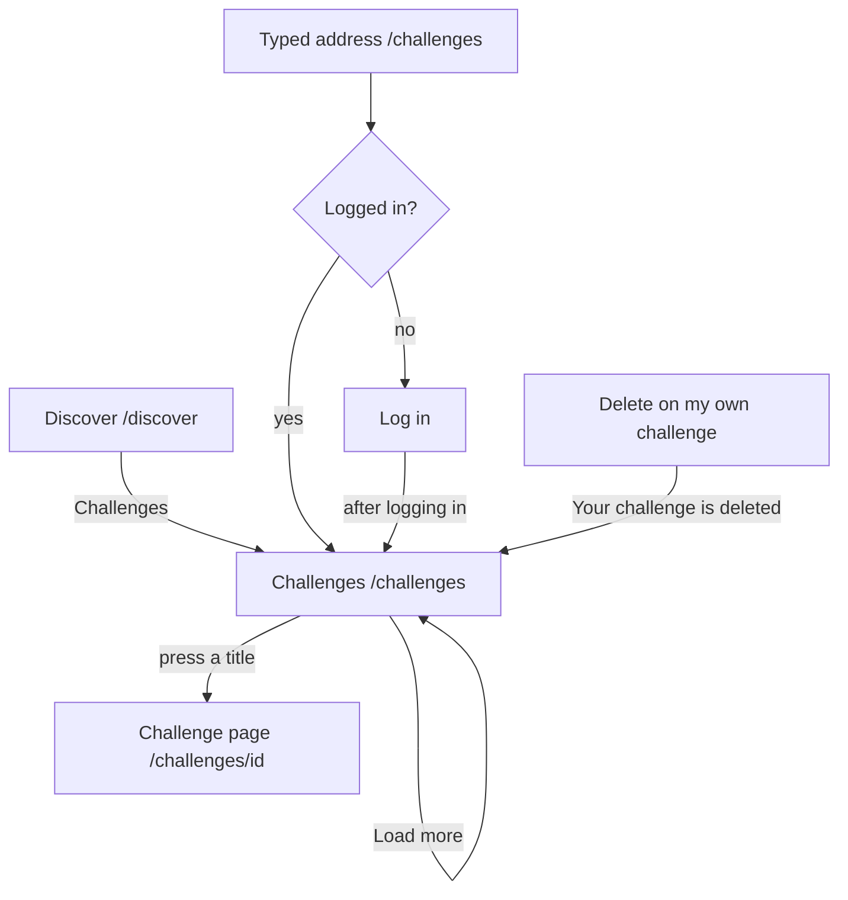

# The page Challenges

Component: `frontend/src/pages/Challenges.tsx`, with `frontend/src/components/ChallengeCard.tsx` and `frontend/src/components/challenges/ClosedChallenges.tsx`.
Address in the browser: `/challenges`.

## What the page is for

Organisations on Connect post challenges: a small assignment for young people with a deadline, for example designing a poster for a summer festival. The page Challenges lists the open challenges with the soonest deadline at the top, so a young person can pick one before it closes. Below them a part Closed shows the challenges whose deadline has passed, the most recently closed at the top. Each challenge in a list opens its own page.

## Who can open it

- Young person and organisation who are logged in: yes. An organisation sees its own challenge as young people see it.
- Visitor who is not logged in: sees the page Log in. After logging in, the visitor lands on Challenges (`RequireLogin` of issue 04, with the way back of issue 04b).
- The lists show nothing about any person: no name, no email address, no photo and nothing about who took part. Only the challenge and the name of the organisation.

## How you get there and where you go next

- The link Challenges on the page Discover, next to the suggestions of issue 37, for everyone who is logged in.
- After an organisation deletes its challenge, Connect brings it here with "Your challenge is deleted" at the top.
- From here the title of each challenge opens its page at `/challenges/<id>` (issue 75b).

## Every element of the page, top to bottom

### Deleted sentence

- Text: "Your challenge is deleted"
- When: only when the page opens right after an organisation deleted its own challenge. It shows at the top in an area with role status, and the list loads again without that challenge.
- Built by: issue 168 Delete my challenge, task 168.4 (GitLab #229, sprint 5).

### Heading and number of open challenges

- Text: the heading Challenges (the h1), and the line "<total> open challenges" from `meta.total`, for example 21 open challenges.
- Built by: issue 75 See the open challenges, task 75.4 (GitLab #140, sprint 3).

### The list of open challenges

- What it shows: a list (`ul`) with one ChallengeCard per open challenge, soonest deadline first, twenty at a time. A challenge stays in the list up to and including its deadline and is gone from the next day, without anyone doing anything.
- Data: `listChallenges(1)` in `frontend/src/api/challenges.ts` asks `GET /api/challenges?page=1&pageSize=20`. The server lets only a logged in person through, takes the day of today in Dutch time from `OpportunityOpenRule` of issue 54, and answers each challenge with its title, the organisation name and the deadline, with page, page size and total in `meta`. The list never holds the description or anything about a person (task 75.2). A wrong page number or page size gets a plain message.
- Built by: issue 75, tasks 75.2 and 75.4.

### One challenge (ChallengeCard)

- The title: a link to `/challenges/<id>`.
- The organisation name.
- "Deadline" with the date, for example 12 October 2026. `formatDeadline(text)` in `frontend/src/utils/formatDeadline.ts` reads "2026-10-12" as a day without a time, so every time zone shows the same day.
- In the part Closed only: the word Closed next to the deadline, written out, not only a colour (the optional prop `isClosed` of issue 76). The open list does not pass it.
- Built by: issue 75, task 75.4, and issue 76, task 76.4.

### Button Load more for the open list

- Label: Load more.
- What it does: shown below the list only while the number of cards is lower than `meta.total`. It asks the next page, adds the cards below, and moves the focus to the first new card. While it loads it says "Loading..." and is disabled.
- When only Load more fails: the cards that are there stay, and the not reachable sentence appears below them.
- Built by: issue 75, task 75.4.

### The part Closed

- Heading: Closed, an h2 below the open list, so a screen reader can jump to it.
- The line "<total> closed challenges" and a list of ChallengeCard with the mark Closed, the most recently closed first, twenty at a time.
- Data: `listChallenges(1, "closed")` asks `GET /api/challenges?state=closed&page=1&pageSize=20`, at the same time as the open list. Without `state`, or with `state=open`, the address answers exactly as before. A wrong `state`, `page` or `pageSize` gets a plain message that names the parameter (task 76.3).
- A second button Load more of its own below the closed list, shown while fewer cards are on the screen than `meta.total`.
- Its own loading, empty and error states, so a problem with the closed list never hides the open one, and the other way round.
- Built by: issue 76 See the closed challenges, tasks 76.3 and 76.4 (GitLab #142, sprint 4).

## States

| State | Open list | Part Closed |
|---|---|---|
| Loading | "Loading challenges..." in a role status area | "Loading closed challenges..." under the heading, in a role status area |
| Empty | "There are no open challenges right now." | "No challenges have closed yet." |
| Filled | The count, the cards and Load more while there are more | The count, the cards with Closed and their own Load more |
| Not reachable | "Connect is not reachable right now, try again later" in place of the list, in a role alert area | "Closed challenges cannot be shown right now, try again later" under the heading, in a role alert area. The open list is not touched. |
| Just deleted | "Your challenge is deleted" at the top | |

On a phone and on a laptop the first challenges are there within two seconds after pressing Challenges.

## Accessibility and privacy

- The word Closed is text, so a person who cannot see colours, or prints the page in black and white, still reads it. A screen reader hears it with each closed challenge.
- The heading Closed is an h2, so a screen reader can jump to it.
- After Load more the focus moves to the first new card.
- The lists never show a name, an email address or a photo of a person, and nothing about who took part.

The design: colours, fonts and spacing come only from `frontend/src/styles/tokens.css`, following the Figma frames Challenges list and Challenges list with closed section on the page Design directions of the Figma board.

## Built by

| Board | Title | GitLab | Sprint | Prio |
|---|---|---|---|---|
| 75 | See the open challenges | #140 | 3 | could |
| 76 | See the closed challenges | #142 | 4 | could |
| 168 | Delete my challenge | #229 | 5 | could |

## Open points

- Searching or filtering challenges is not asked in the requirements. It waits for issue 10, question 92.
- Closing a challenge before its deadline: issue 10, question 93.
- Making the deadline later after posting: issue 167 Change my challenge after posting, built only on a yes to issue 10, question 84.
- Winners or results of a challenge: issue 10, question 94.
- Deleting a challenge: issue 168 is built only when the client says yes to issue 10, question 85. Wiping a removed challenge for good after a while is question 119, bringing back a challenge deleted by mistake is question 120, and telling the young people who joined is question 83.

## AI use declaration

AI was used as a writing support tool while working on this document. We used AI to draft
the formulation of sentences, the structure of wording, readability, and clarity from
content that we had provided, and to generate the diagrams. The content itself, including
our experiences, reflections, learning goals, decisions, self-assessments, and
conclusions, is our own. We reviewed the drafts and decided as a team which text to
include.
