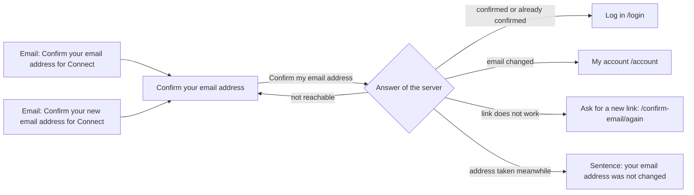

# Confirm your email address

- Component: web/src/pages/ConfirmEmail.tsx, with ConfirmEmail.module.css and ConfirmEmail.test.tsx
- Address in the browser: /confirm-email?token=<token>. The page removes the token from the address bar at once, so it then reads /confirm-email.
- Heading on the page: Confirm your email address

## What the page is for

When a person makes an account on Connect, they get an email with a link. That link opens this page. The person presses one button, and Connect then knows that the email address is really theirs. A member who changes the email address of their account on My account gets the same kind of link at the new address, and opens this same page to finish the change. The page tells in one plain sentence what happened: confirmed, already confirmed, changed, the link does not work any more, or Connect cannot be reached.

## Who can open it

- Everyone with a link may open it: visitor, member (young person), organisation and admin. The page is not inside RequireLogin, because a person can confirm without logging in (task 27.6).
- The server address it calls is on the open list, so it answers without a cookie (task 27.5).
- A person who opens the page without a token in the address reads at once "This link does not work any more. A link works for 24 hours and only once."
- A person who makes an account with Google gets no confirmation email, because Google already confirmed the address (task 27.4). They never need this page.

## How you get there and where you go next

You arrive here in two ways:

- The link in the email "Confirm your email address for Connect", sent right after Make an account (issue 27).
- The link in the email "Confirm your new email address for Connect", sent after Send link in the part Change email address on My account (issue 115).

From here you go on:

- Log in, after the address is confirmed or was already confirmed. It opens /login.
- My account, after an email change. It opens /account.
- Ask for a new link, below the sentence that the link does not work. It opens the page Send the confirmation email again at /confirm-email/again with an empty field (issue 28).

## Every element of the page, top to bottom

1. Heading: Confirm your email address
   - Built by task 27.6, issue 27 Confirm my email address, GitLab #48, sprint 2.
2. Sentence: Press the button to confirm that this email address is yours.
   - Built by task 27.6, issue 27, GitLab #48, sprint 2.
3. Button: Confirm my email address
   - Opening the page never calls the server. Only pressing the button confirms, so a mail program that opens links by itself cannot confirm for the person.
   - The page reads the token once when it is first built (a useState initializer), keeps it in memory, and removes it from the address bar with history.replaceState. This keeps working when React runs the page twice in development.
   - Pressing it calls confirmEmail(token) in web/src/api/emailConfirmations.ts. That sends POST /api/email-confirmations/confirm with { "token": "..." } in the body, through the shared helper web/src/api/client.ts. The token is never in the address of the request.
   - While it waits the button says "Confirming..." and is disabled, so it cannot be pressed twice.
   - Rules on the server: the token must be filled in and at most 100 characters (ConfirmEmailRequestValidator, task 27.5). The server first looks for the link in the table email_confirmation (issue 27), and when it is not there, in the table email_change (task 115.3).
   - Built by task 27.6 (page) and task 27.5 (server), issue 27, GitLab #48, sprint 2. Extended by task 115.3 (server) and task 115.5 (page), issue 115 Change my email address, GitLab #54, sprint 2.
4. Result area (role status), in place of the sentence and the button
   - Confirmed (200 with result confirmed): "Your email address is confirmed." with a button Log in that opens /login. Task 27.6.
   - Already confirmed (200 with result alreadyConfirmed): "Your email address was already confirmed. You can log in." with the button Log in. Task 27.6. A change link that was used before also gives this answer (task 115.3).
   - Email changed (200 with result emailChanged): "Your email address is changed. Log in with your new address from now on." with a button My account that opens /account. Task 115.5. The server has then sent one short email to the old address: "Your email address on Connect was changed", with the date and what to do when it was not you, and no link (task 115.3).
   - Address taken meanwhile (409): "This email address already has an account on Connect. Your email address was not changed." No button My account. The old address keeps working. Task 115.5.
   - Link does not work (400, or no token in the address): "This link does not work any more. A link works for 24 hours and only once." The same sentence for a changed link, an unknown link, an ended link and a change link ended by a newer request. Task 27.6 and task 115.3.
5. Link: Ask for a new link
   - Shown below "This link does not work any more." It opens /confirm-email/again with an empty field.
   - Built by task 28.3, issue 28 Ask for the confirmation email again, GitLab #55, sprint 2.
6. Message area (role alert), below the button
   - Not reachable (503 or no answer): "Connect is not reachable right now, try again later". The button stays usable and the token stays in memory, so the same link works when the person tries again. Nothing is changed on the server.
   - Built by task 27.6, issue 27, GitLab #48, sprint 2.
7. Reading the session again (not visible on the page itself)
   - After confirmed or alreadyConfirmed the page calls refresh() of useSession, which asks GET /api/sessions/current. A logged in member then no longer sees the banner of issue 29b on My profile, without logging in again. A person who is not logged in gets no session back, and nothing else changes. Built by task 29b.3, issue 29b A banner reminds me to confirm my email address, GitLab #59, sprint 2.
   - After emailChanged, when the member is logged in, useSession reads the session again, so My account shows the new address. The tabs never show an email address. Sessions of the account stay after a change. Task 29b.3 keeps this call next to its own call after confirmed and alreadyConfirmed. Built by task 115.5, issue 115, GitLab #54, sprint 2.

## States

- Loading: the button says "Confirming..." and is disabled.
- Filled: the heading, the sentence and the button Confirm my email address.
- Result: one of the sentences of element 4 in the result area with role status.
- Empty: not used. Without a token the page shows the link does not work sentence at once, without calling the server.
- Error: "This link does not work any more. A link works for 24 hours and only once." with the link Ask for a new link.
- Not reachable: "Connect is not reachable right now, try again later" below the button, in role alert. A tester checks this by switching the phone to airplane mode.
- Phone (360 pixels wide) and laptop (1280 pixels wide): the page matches the Figma frame Confirm your email address at both widths, with screenshots in the merge request (task 27.6). The team checks of task 27.9 and 115.7 use a phone of 360 pixels wide or close and a laptop.
- Design: the Figma frame Confirm your email address on the Figma board of Connect, page Design directions. Colours, fonts and spacing come only from the variables in web/src/styles/tokens.css.

- Test data for the error state:
  - Ended confirmation link: ended-link@example.org, token seed-ended-link-token-27, on a laptop http://localhost:5173/confirm-email?token=seed-ended-link-token-27 (task 27.2). docs/testing/testData.md lists it for the test site too.
  - Ended change link: the account ended-change@example.org, with the link that docs/testing/testData.md lists (task 115.1).

## Accessibility and privacy

- Every result sits in an area with role status and the not reachable message in role alert, so a screen reader reads the result aloud as soon as it appears (issue 27).
- axe reports 0 issues (task 27.6).
- The secret code of the link is not in the address bar once the page is open.
- The database keeps only the SHA-256 hash of the token, never the token itself (task 27.1 and task 115.1).
- No answer of the server holds an email address or an account id. No log line holds the token or an address (task 27.5 and task 115.3).
- The confirmation email holds only the link and the sentences, no name, no password and no other detail (issue 27 and issue 115).
- Confirming one link never changes another account.
- ConfirmEmail.tsx does not call fetch. It only uses web/src/api/emailConfirmations.ts.

## Built by

| Board | Title | GitLab | Sprint | Prio |
|---|---|---|---|---|
| 27 | Confirm my email address | #48 | 2 | must |
| 115 | Change my email address | #54 | 2 | should |
| 28 | Ask for the confirmation email again | #55 | 2 | should |
| 29b | A banner reminds me to confirm my email address | #59 | 2 | must |

Issue 27 builds the page and needs issues 03, 21 and 23 first. Issue 115 needs issues 27 and 113. Issue 28 needs issue 27. Issue 29b needs issues 29, 04b and 115.

## Open points

- A change link that was used before gives the answer alreadyConfirmed (task 115.3), so the page shows "Your email address was already confirmed. You can log in." Card 115 gives no own sentence for a used change link. The team decides whether that sentence is clear enough after an email change.
- A limit on how many change emails one account can ask for in an hour: issue 10, question 22 in docs/client/clientQuestions.md (task 115.2).

## AI use declaration

AI was used as a writing support tool while working on this document. We used AI to draft
the formulation of sentences, the structure of wording, readability, and clarity from
content that we had provided, and to generate the diagrams. The content itself, including
our experiences, reflections, learning goals, decisions, self-assessments, and
conclusions, is our own. We reviewed the drafts and decided as a team which text to
include.
