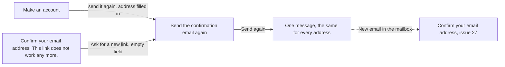

# Send the confirmation email again

- Component: frontend/src/pages/ConfirmEmailAgain.tsx, with ConfirmEmailAgain.module.css and ConfirmEmailAgain.test.tsx
- Address in the browser: /confirm-email/again

## What the page is for

A person who made an account on Connect gets an email with a link to confirm the address. That email can land in the spam folder, be deleted by accident, never arrive, or its link can end after 24 hours. On this page the person asks for a new link. Without it, a lost email would leave the person hidden from other members for good, because issue 29 only shows people who confirmed. Nobody from the foundation has to help.

## Who can open it

- Everyone. The route is open to all and not wrapped in RequireLogin, because the person may not be able to log in yet.
- The page shows exactly the same message for every address: one that has an unconfirmed account, one that has no account, and one that is already confirmed. So nobody can use it to find out who is on Connect.

## How you get there and where you go next

- From the page Make an account (/create-account, issue 03 and 27): the line about the spam folder has a link "send it again". The typed address goes along in the router state, in memory, so the field is already filled in.
- From the page Confirm your email address (issue 27): below "This link does not work any more." a link "Ask for a new link". The field is then empty.
- After Send again, the person goes to their mailbox. The link in the new email opens the page Confirm your email address of issue 27.

## Every element of the page, top to bottom

1. Field: Email
   - Label Email above the field. Type email, autocomplete email.
   - Filled from the router state when the person comes from Make an account, empty otherwise. The address is never put in the address bar or in local storage.
   - The form has the attribute noValidate, so the page shows its own message next to the field.
   - Required. Pressing Send again with the field empty shows "Fill in your email address" next to the field. A 400 answer shows the message of the server next to the field.
   - Built by task 28.3, issue 28 Ask for the confirmation email again, GitLab #55, sprint 2.
2. Button: Send again
   - Calls resendConfirmation(email) in frontend/src/api/emailConfirmations.ts, which sends POST /api/email-confirmations through frontend/src/api/client.ts. The page never calls fetch and never sees a status code.
   - While it waits, about two seconds on purpose, the button says "Sending..." and is disabled.
   - The server always gives the same answer, never before two seconds have passed. When the account exists and is not confirmed, it ends the older links of the account (they get an end time of now) and writes one new row in email_confirmation with the hash of the new link, then sends the email. Otherwise it does nothing. Tasks 28.1 and 28.2.
   - The server counts the links of the account in the last hour and stops at five, the first email after making the account included (task 28b.2, setting ConfirmationEmailLimits:PerAccountPerHour). At the limit nothing is written, and the answer stays the same.
   - The server counts the requests per IP address in the current minute. The sixth request within one minute gets the answer 429 with the header Retry-After, at once. The count is kept in the memory of the server. People who share one wifi, for example at school, share this count (task 28c.2).
3. Message after Send again, in place of the form, in an area with role status
   - "If this email address has an account on Connect that is not confirmed yet, we have sent a new link to it. The link works for 24 hours, and older links no longer work."
   - Below it, in the same area: "Connect sends at most five of these emails per hour." (task 28b.3, issue 28b No more than five confirmation emails in one hour, GitLab #56, sprint 2). The sentence shows for every address, always. The number is written as a word and follows the setting of task 28b.2.
   - A new email arrives within one minute, and from then on only its link works.
4. Message below the button, in an area with role alert
   - Not reachable (503 or no answer): "Connect is not reachable right now, try again later". What was typed stays in the field.
   - Too often (429): "You asked too often. Wait a minute and try again." The button stays off for the seconds in Retry-After, or 60 when the header is missing or not a number. After the wait the message goes away and the button works again. The email stays in the field. Task 28c.3, issue 28c Wait a minute before I ask for the confirmation email again, GitLab #57, sprint 2.

Changes on other pages made by task 28.3: CreateAccount.tsx gets the link "send it again", ConfirmEmail.tsx gets the link "Ask for a new link".

## States

- Loading: the button says "Sending..." and is disabled.
- Empty: the form with an empty field Email, or with the address from Make an account.
- Filled (taken in): the one message in role status with the sentence about five emails.
- Error: "Fill in your email address" or the message of the server next to the field.
- Too often: "You asked too often. Wait a minute and try again." below the button, button off for the seconds of Retry-After.
- Not reachable: "Connect is not reachable right now, try again later" below the button, the address stays in the field. A tester checks this with airplane mode.
- Phone (360 pixels wide) and laptop (1280 pixels wide): the page matches the Figma frame Send the confirmation email again at both widths, shown with screenshots in the merge request.
- Design: the Figma frame Send the confirmation email again on the Figma board of Connect. Colours, fonts and spacing only through frontend/src/styles/tokens.css.

## Accessibility and privacy

- The field has a visible label.
- The message after sending sits in role status, the not reachable and the wait messages in role alert, so a screen reader reads each one out as soon as it appears.
- axe reports 0 issues.
- One message after Send again, whatever the address. A different text, colour or wait would tell a stranger which addresses have an account. The page also looks and waits the same when an address is at the limit of five. The wait message is the same for every address.
- The typed address travels only in the router state, never in the address bar or the browser storage, so the next person at a shared computer cannot read it.

## Built by

| Board | Title | GitLab | Sprint | Prio |
|---|---|---|---|---|
| 28 | Ask for the confirmation email again | #55 | 2 | should |
| 28b | No more than five confirmation emails in one hour | #56 | 2 | should |
| 28c | Wait a minute before I ask for the confirmation email again | #57 | 2 | should |

Issue 28 needs issue 27 Confirm my email address first. Issues 28b and 28c both build on issue 28.

## Open points

- The limit of five emails per hour is a setting. When the client changes the number, the sentence on the page changes with it (task 28b.3). The cards name no client question for it.
- Asking for a new email while logged in is issue 29b. Changing a mistyped email address is issue 115.

## AI use declaration

AI was used as a writing support tool while working on this document. We used AI to draft
the formulation of sentences, the structure of wording, readability, and clarity from
content that we had provided, and to generate the diagrams. The content itself, including
our experiences, reflections, learning goals, decisions, self-assessments, and
conclusions, is our own. We reviewed the drafts and decided as a team which text to
include.
