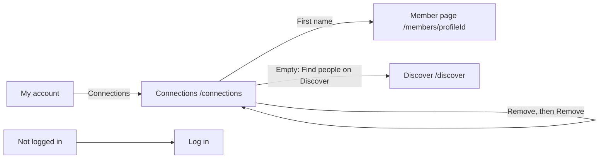

# Connections (my connections)

- Component: frontend/src/pages/Connections.tsx, with Connections.module.css and Connections.test.tsx
- Address in the browser: /connections

## What the page is for

The page Connections shows a member everyone they are connected with on Connect. A connection exists when one member sent a connection request and the other accepted it (issue 39 and issue 41b). Each row shows the first name, the age band, the region and the date they connected, and the first name opens the page of that member. A member can also remove a connection they no longer want. The other member is not told.

## Who can open it

| Who | What they see |
|---|---|
| Member (young person) who is logged in | Their own connections, and only their own. |
| Visitor who is not logged in | The page Log in, through RequireLogin of issue 04. No connection is shown. |
| Another member | Only their own list. The address /connections holds no number that could be changed to see someone else's list. |

The server reads the account from the session, never from the address.

## How you get there and where you go next

- On the page My account the link Connections sits below the link Requests I received (task 41.3).
- A first name in the list leads to the page of that member at `/members/<profileId>` (issue 14).
- When the list is empty, the link Find people on Discover leads to /discover.
- After a member removes a connection, both members see the button Connect again on the page of the other.

## Every element of the page, top to bottom

### 1. Heading
- Text: Connections.
- After a connection is removed, the focus moves to this heading.
- Built by: issue 42 See my connections (GitLab #82, sprint 2), task 42.4.

### 2. Message above the list (issue 135)
- Text: "This connection was already removed", in an area with role status.
- When: the member pressed Remove on a connection that the other member removed a moment before. The row leaves the list.
- Built by: issue 135 Remove a connection (GitLab #83, sprint 2), task 135.3.

### 3. The list of connections
- What it shows: a real list (ul with li), one row per connection, the most recent connection first. The list looks the same from both sides, whoever asked first. A request that still waits or was declined is never in the list.
- Each row:
  - The first name as a link to `/members/<profileId>`.
  - The age band in words, through AGE_BAND_LABELS of issue 07.
  - The region, when it is in the answer. The server hides the region of a member aged 15 to 17 when ProfileVisibility of task 14.3 says so. A row without region shows no empty place for it.
  - "Connected on" with the date, written in the member's own language through Intl.DateTimeFormat.
- Data: GET /api/connections?page=1&pageSize=20 through getConnections(page) in frontend/src/api/connections.ts and request() of frontend/src/api/client.ts. The answer is {"data": [...], "meta": {"page", "pageSize", "total"}}. Per connection it gives connectionId, profileId, firstName, ageBand, region and connectedAt. connectionId is added by issue 135.
- Rules: page and pageSize are checked by PageQueryValidator of task 40.2. pageSize is at most 50. No email address and no birth date is on any row.
- A member whom the admin switched off is not in the list. The row stays in the database. Task 46.4 adds this to the one visibility rule AccountVisibility, which the query of issue 42 uses. Issue 46 Deactivate a member, GitLab #90, sprint 3.
- Built by: issue 42, tasks 42.1 (the query from both sides), 42.3 (GET /api/connections), 42.4 (the page). Task 42.2 adds seed data with a test member who has twenty one connections.

### 4. Button Remove on every row (issue 135)
- Text: Remove, after the date. Its aria-label is "Remove `<first name>`", for example "Remove Bo".
- Look: a quiet secondary button, so it is not pressed by accident.
- Behaviour: pressing it opens the confirm window.
- Rules: a member can only remove connections from their own list. Nobody else can remove a connection of theirs.
- Built by: issue 135, task 135.3.

### 5. Confirm window (issue 135)
- Text: "Remove `<first name>` from your connections? `<first name>` is not told.", for example "Remove Bo from your connections? Bo is not told.", with the buttons Remove and Cancel.
- Component: ConfirmDialog of task 113.3, the shared confirm window. No second window is built.
- Cancel and Escape close the window, change nothing, and put the focus back on the button Remove of that row.
- Remove in the window: removeConnection(connectionId) sends DELETE `/api/connections/<connectionId>` (task 135.2). The button shows "Removing..." and is disabled until the answer comes.
- Answer removed (204): the window closes, the row leaves the list, the total goes down by one, and Load more still shows while there are more. When it was the last row, "No connections yet" shows. After a reload the row stays gone. The other member gets no message and no reason.
- Answer not found (404, "This connection does not exist" on the server): the window closes, the row leaves the list, and "This connection was already removed" appears above the list. The server gives the same 404 for an unknown id, an id of two other members and a request that still waits, so nobody can find out which ids exist.
- No answer or 503: the window stays open with "Not removed, Connect is not reachable right now" in an area with role alert, and the row stays.
- Rules: the row only leaves the list after the answer came, never before.
- Built by: issue 135, tasks 135.1 (the delete of one connection), 135.2 (DELETE /api/connections/{id}), 135.3 (button and window).

### 6. Button Load more
- Text: Load more, below the list.
- When: shown while page times pageSize is less than meta.total. It adds the next twenty under the rows. While it loads it says "Loading..." and is disabled. The button is gone when all connections are shown.
- When it fails: the rows already there stay, and "Connect is not reachable right now, try again later" appears below the list with role alert. Load more can be pressed again.
- Built by: issue 42, task 42.4.

## States

| State | What the member sees |
|---|---|
| Loading | The heading Connections and "Loading your connections..." in an area with aria-busy. |
| Empty | "No connections yet" in place of the list, with a link Find people on Discover below it. |
| Filled | Twenty rows at a time, the most recent first, with Load more while there are more. |
| Error on the first page | "Connect is not reachable right now, try again later" in an area with role alert, in place of the list, with a button Try again that asks again and shows the list once Connect is back. |
| Load more fails | The rows stay, and "Connect is not reachable right now, try again later" appears below the list. |
| Remove fails | "Not removed, Connect is not reachable right now" in the window. |
| Already removed | "This connection was already removed" above the list. |
| Not logged in | The page Log in. |
| Phone and laptop | The page follows the Figma frame Connections at 360 and 1280 pixels wide, without scrolling sideways. |

The list appears within two seconds after pressing Connections on the test site (issue 42, AC11). A removed row leaves the list within one second after pressing Remove in the window (issue 135, AC11).

## Accessibility and privacy

- The list is a ul with li, so a screen reader says how many connections there are, for example "list, 2 items", and lets the member jump through them.
- The first name is a link, not a button, so it can be opened in a new tab and is read as a link.
- Each button Remove has the aria-label "Remove `<first name>`", so a screen reader hears whose row it is. The question of the window is read when it opens.
- Loading uses aria-busy, the error messages role alert, and the already removed message role status.
- Cancel and Escape put the focus back on the button Remove. After a remove the focus moves to the heading.
- Colours, fonts and spacing come only from frontend/src/styles/tokens.css, following the Figma frame Connections on the page Design directions.
- Privacy: nobody else can see this list, not another member and not a visitor. A list of who knows whom says a lot about a young person, so a row shows only the first name, the age band in words, the region and the date. No email address and no birth date. The other member is never told about a remove. There is no message button on this page.

## Built by

| Board | Title | GitLab | Sprint | Prio |
|---|---|---|---|---|
| 42 | See my connections | #82 | 2 | must |
| 135 | Remove a connection | #83 | 2 | should |
| 46 | Deactivate a member | #90 | 3 | must |

Issue 135 sits right after issue 42 in the build order, so the list does not go live without a way out. Issue 42 has tasks 42.1 and 42.2 DATABASE, 42.3 BACKEND, 42.4 FRONTEND, 42.5 TEST (end to end) and 42.6 TEST (team check). Issue 135 has tasks 135.1 DATABASE, 135.2 BACKEND, 135.3 FRONTEND, 135.4 TEST and 135.5 TEST.

## Open points

- Blocking a member so they can never ask again: issue 10 The client's priorities for the epics, question 78.

## AI use declaration

AI was used as a writing support tool while working on this document. We used AI to draft
the formulation of sentences, the structure of wording, readability, and clarity from
content that we had provided, and to generate the diagrams. The content itself, including
our experiences, reflections, learning goals, decisions, self-assessments, and
conclusions, is our own. We reviewed the drafts and decided as a team which text to
include.
