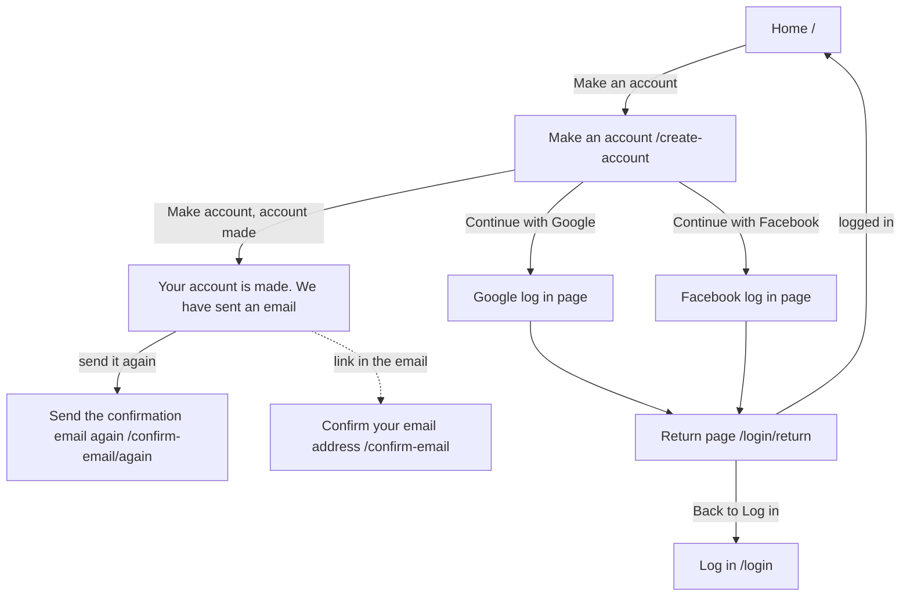

# Make an account (CreateAccount)

Component: `web/src/pages/CreateAccount.tsx`, with `CreateAccount.module.css`.
Address in the browser: `/create-account`.

## What the page is for

On this page a person who is new to Connect makes an account. They type their email address and a password twice, or they press Continue with Google or Continue with Facebook. After the account is made, Connect sends an email with a link to confirm the address. This is the first working piece of Connect: the first time the screen, the server and the place where the accounts are kept work together.

## Who can open it

The page is open to everyone. It is not wrapped in RequireLogin.

| Person | What they see |
|---|---|
| Visitor (not logged in) | The whole page. This is who the page is for. |
| Member, organisation or admin | The same page. The cards give no other behaviour for a person who is already logged in. |

Making an account does not log the person in. After "Your account is made." they are still not logged in.

## How you get there and where you go next

- The link Make an account on the home page leads here. It sits directly below the sentence about Connect and is drawn as a button (issue 06 Move between the five tabs of Connect, task 6.3). Issue 03 first put this link in the top bar (task 3.5), and issue 06 replaced that top bar with the five tabs.
- After the account is made, the link "send it again" in the message opens Send the confirmation email again at `/confirm-email/again`, with the typed address already in the field.
- The email that Connect sends opens Confirm your email address at `/confirm-email`.
- Continue with Google and Continue with Facebook send the whole browser away from Connect to the Google or Facebook log in page (on the test site a stand in), and then back to the return page `/login/return`. On success the person lands on the home page `/`, logged in.

## Every element of the page, top to bottom

The title of the browser tab is Connect, Make an account, set by the page itself with a title element (issue 06 Move between the five tabs of Connect, task 6.3, GitLab #19, sprint 1). The page sits inside the frame AppShell with the five tabs.

### Not reachable message

- Text: "Connect is not reachable right now, try again later".
- Where: above the form, in an area with role alert.
- When: the server cannot be reached, or answers any code from 500 to 599 (including 503 and the 500 or 502 of a proxy in front of a stopped server), or there is no answer at all. What was typed stays in the form.
- Built by: issue 03 Create an account, task 3.6 (GitLab #14, sprint 1).

### Field Email

- Label: Email, above the field. Type email, autocomplete email.
- Messages, right under the field and linked with `aria-describedby`:
  - "Fill in a valid email address" when the field is empty or is not an email address, for example sam.example.org.
  - "This email address already has an account" when the address is taken (code 409). No second account is made, also when two people register it at the same moment.
- The form has `noValidate`, so the messages of Connect show and not the tooltip of the browser.
- Built by: issue 03, task 3.6.

### Field Password

- Label: Password, above the field. Type password, autocomplete new-password. The password shows as dots and is never shown back, not on the page and not in any message.
- Hint: "At least fifteen characters", under the field, visible before typing, linked with `aria-describedby` (issue 03b A clear message when my password is too weak, task 3b.3, GitLab #17, sprint 1-stretch).
- Messages, next to the field, the field marked `aria-invalid`:
  - "Fill in a password" when it is empty (issue 03, task 3.6).
  - "Use at least fifteen characters for your password" when it is shorter than fifteen characters. The page checks this itself and then sends nothing. The server checks it again in `CreateAccountRequestValidator`, with the number in `PasswordRules.cs` (task 3b.1). The screen keeps its own number in `MIN_PASSWORD_LENGTH = 15` in `web/src/api/accounts.ts`.
  - "This password is known from data leaks, choose another one" when the password is on the list of passwords from data leaks. Only the server checks this, also in other capital letters (issue 116 A password that is known from data leaks is refused, tasks 116.1 and 116.3, GitLab #35, sprint 2). The list stays on the server and is never in the frontend. A password that is too short gets only the message about fifteen characters.
- The page shows the message the server sends for the password field as the server wrote it, so a later rule on the password needs no change here.

### Field Password again

- Label: Password again, directly below the password field. Type password, autocomplete new-password.
- Message: "The two passwords are not the same", next to this field, marked `aria-invalid`, when the two differ. Nothing is sent.
- Only the email address and the password are sent. Password again never leaves the browser.
- When both password rules are broken, both messages show and the focus goes to the password field. A message disappears as soon as the person presses Make account again and the rule holds.
- Built by: issue 03b, task 3b.3.

### Button Make account

- Text: Make account. While waiting: "Making your account..." and disabled, so it cannot be pressed twice.
- What happens: `createAccount(email, password)` in `web/src/api/accounts.ts` sends `POST /api/accounts` through `request()` in `web/src/api/client.ts`. The server saves one new row in the table account with a hashed password (task 3.4). Right after, it sends one confirmation email (task 27.3). When the mail server fails, the account is still made and the answer is the same.
- Rules: nothing is saved when a field is wrong, so the person can fix the password and make the account with the same email address at once.
- Built by: issue 03, task 3.6.

### Message after the account is made

- Text, in place of the form, in an area with role status:
  - "Your account is made."
  - "We have sent an email to <the address typed>. Open the link in it to confirm your email address. The link works for 24 hours."
  - "No email after a few minutes? Look in your spam folder." with a link "send it again".
- Rules: the form is replaced, so the person does not make a second account by pressing again. The password field is emptied. The typed address is kept only in the state of the page, never in local storage or in the address bar. The link "send it again" passes the address in the state of the router (in memory), never in the address bar.
- The email: subject "Confirm your email address for Connect", one link and the sentence that it works for 24 hours, and nothing else about the person. A person who makes an account with Google or Facebook gets no confirmation email.
- Built by: issue 27 Confirm my email address, task 27.7 (GitLab #48, sprint 2), and issue 28 Ask for the confirmation email again, task 28.3 (GitLab #55, sprint 2).

### The line "or" and Continue with Google

- Text: the line "or" between the form and the button, then a button with the Google icon and the words Continue with Google.
- What it is: `SocialLoginButton` with the provider google, a link styled as a button, because it takes the person to another place. The icon is `web/src/components/GoogleIcon.tsx`, an inline SVG with `aria-hidden`. A screen reader hears Continue with Google.
- What happens: the browser goes to `/api/auth/google/start?next=/` (task 23.3). On this page next is always `/`. Connect asks Google only for openid and email, and keeps only the email address. No script from Google is loaded in the page.
- Rules: an email address that already has an account is never joined to a Google account on the email address alone. The person then reads "This email address already has an account. Log in with your password first." on the return page.
- Design: the Figma frame Social buttons and the branding rules Google publishes for this button.
- Built by: issue 23 Register or log in with Google, task 23.5 (GitLab #46, sprint 2).

### Continue with Facebook

- Text: the Facebook icon (`web/src/components/FacebookIcon.tsx`, `aria-hidden`) and the words Continue with Facebook, under the Google button.
- What it is: `SocialLoginButton` with the provider facebook, the same link styled as a button that Continue with Google uses. There is no separate FacebookButton.
- What happens: the link goes to `/api/auth/facebook/start?next=/` (task 24.2). An account made with Facebook counts as confirmed at once and gets no confirmation email. An email address that already has an account is refused and never linked.
- When the server cannot be reached at all, the browser leaves Connect and shows its own page that the site cannot be reached.
- Built by: issue 24 Register or log in with Facebook, task 24.3 (GitLab #49, sprint 2).

### What the return page says

The return page `/login/return` is its own page (`SocialLoginReturn.tsx`), but it finishes what the two buttons start. It shows "Finishing your log in..." and then goes on, or shows one of these sentences with a link Back to Log in, and nobody is logged in:

- "You cancelled the log in with Google. Nothing was changed." (or with Facebook)
- "Google did not share an email address, so Connect cannot make an account." (or Facebook)
- "This email address already has an account. Log in with your password first."
- "Google has not confirmed this email address, so Connect cannot make an account with it."
- "The log in with Google did not work. Please try again." (or, with Facebook, "The log in with Facebook did not work. Please try again.")
- "Connect is not reachable right now, try again later"

## States

| State | What the person sees |
|---|---|
| Empty | The fields Email, Password (with the hint "At least fifteen characters") and Password again, the button Make account, the line "or", Continue with Google and Continue with Facebook. |
| Busy | The button says "Making your account..." and is disabled. |
| Wrong input | The message next to each wrong field, the focus on the first wrong field, what was typed stays. |
| Address taken | "This email address already has an account" next to Email. |
| Made | "Your account is made." with the email sentence, the spam folder line and "send it again", in place of the form. |
| Not reachable | "Connect is not reachable right now, try again later" above the form, what was typed stays. |
| Phone and laptop | The form works on a phone of 360 pixels wide and a laptop of 1280 pixels wide without sideways scrolling (Definition of Done). The cards give no other layout difference. |

## Accessibility and privacy

- Every field has its label above it. Every message is linked to its field with `aria-describedby`, and a wrong field is marked `aria-invalid`, so a screen reader reads the message with the field.
- The not reachable message is a role alert area. The message after making the account is a role status area.
- The Google and Facebook icons are hidden from screen readers, because the words already name the company.
- The password is hidden while typing and never shown back. Password again never leaves the browser. The list of leaked passwords is never sent to the browser or to another company.
- The form asks for nothing but an email address and a password. From Google or Facebook, Connect shows nothing but the email address, and a fifteen year old sees exactly the same as an adult.
- While issue 03 is built and checked, the test site only holds invented accounts such as check-03-sam@example.org.

The design: colours, fonts and spacing come only from the variables in `web/src/styles/tokens.css` (task 3.5 names navy 0E2038, green 16A34A, Bricolage Grotesque for headings and Hanken Grotesk for text), following the Figma frame Make an account, its state made, and the frame Social buttons on the Figma board.

Clickable prototype (laptop, sprint 1 and 2), on the Figma page Prototype sprint 1 and 2 (desktop). The line above each screen names its GitLab issues.

- [A02 Make an account](https://www.figma.com/design/SAVxDf3rlsWz22qlzTEYte/Young-Amstelland-Connect--team-workspace?node-id=1017-761)
- [A03 Make an account, password messages](https://www.figma.com/design/SAVxDf3rlsWz22qlzTEYte/Young-Amstelland-Connect--team-workspace?node-id=1017-899)
- [A04 Make an account, leaked password](https://www.figma.com/design/SAVxDf3rlsWz22qlzTEYte/Young-Amstelland-Connect--team-workspace?node-id=1017-1045)
- [A05 Account made](https://www.figma.com/design/SAVxDf3rlsWz22qlzTEYte/Young-Amstelland-Connect--team-workspace?node-id=1017-1187)

## Built by

| Board | Title | GitLab | Sprint | Prio |
|---|---|---|---|---|
| 03 | Create an account | #14 | 1 | must |
| 03b | A clear message when my password is too weak | #17 | 1-stretch | should |
| 06 | Move between the five tabs of Connect | #19 | 1 | must |
| 116 | A password that is known from data leaks is refused | #35 | 2 | should |
| 23 | Register or log in with Google | #46 | 2 | should |
| 27 | Confirm my email address | #48 | 2 | must |
| 24 | Register or log in with Facebook | #49 | 2 | could |
| 28 | Ask for the confirmation email again | #55 | 2 | should |
| 111 | Two end to end test tools compared on one flow | #191 | 2 | must |

Issue 111 measures the flows of making an account and changes nothing on the page.

## Open points

- Whether real young people may ever be on the test site: issue 10, question 3 ("Real data of young people on the test site or only made up data."). Issue 03 waits for that answer.
- The foundation's own Google sign in project and the real Facebook app: issue 10, question 7. Until then the team builds and tests against a stand in.
- Linking Facebook to an account that already exists, after typing its password: issue 10, question 12.

## AI use declaration

AI was used as a writing support tool while working on this document. We used AI to draft
the formulation of sentences, the structure of wording, readability, and clarity from
content that we had provided, and to generate the diagrams. The content itself, including
our experiences, reflections, learning goals, decisions, self-assessments, and
conclusions, is our own. We reviewed the drafts and decided as a team which text to
include.
