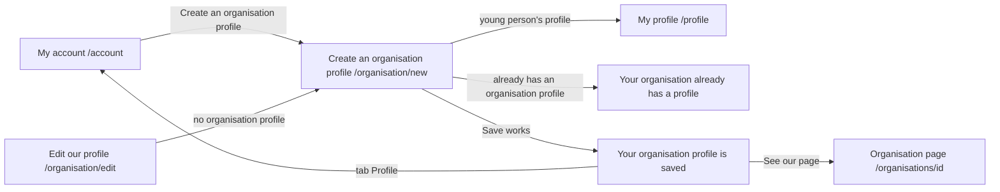

# Create an organisation profile

- Component: frontend/src/pages/CreateOrganisationProfile.tsx, with CreateOrganisationProfile.module.css and CreateOrganisationProfile.test.tsx. The four fields sit in the shared component frontend/src/components/OrganisationProfileForm.tsx (task 132.3).
- Address in the browser: /organisation/new

## What the page is for

Connect brings young people from Amstelland together with the organisations around them. This page is where an organisation, such as a company, a school, a municipality, a club or a fund, tells Connect who it is. It fills in four things: its name, its kind, what it offers young people, and if it wants, its website. After saving, young people on Connect can see the page of the organisation. The form asks only about the organisation, never about the person who fills it in. One account is either a young person or an organisation, never both.

## Who can open it

- Logged in account without any profile: sees the form.
- Logged in account with an organisation profile: sees "Your organisation already has a profile" with the name of the organisation, and never an empty form (task 34.4).
- Logged in young person with a profile: is sent to My profile at /profile at once, without seeing the form (task 34b.4). The Back button does not return to the form.
- Visitor who is not logged in: the page is inside RequireLogin of issue 04 Log in with email and password, so the visitor is asked to log in first. The server answers 401 with "Log in to see this page" (task 34.2).

## How you get there and where you go next

You arrive here through:

- The link Create an organisation profile on My account (/account), shown only to an account without any profile (task 34.5 and task 34b.6).
- The page Edit our profile (/organisation/edit), which sends an account without an organisation profile here, on load and on Save (task 132.4).
- Typing the address /organisation/new.

From here you go on:

- See our page, below "Your organisation profile is saved", opens the page of the organisation at /organisations/<id> (task 35.5).
- The tab Profile opens My account, which then shows "You are logged in for <name>" (task 34.5).

## Every element of the page, top to bottom

1. Check on load (not visible as a field)
   - The page asks GET /api/organisation-profiles/current (task 34.3) through getCurrentOrganisationProfile() and GET /api/member-profiles/current (issue 08) through getCurrentMemberProfile(), both through request(). While it waits on both it shows "Loading...", so the form never flashes for a young person (task 34b.4).
   - Organisation profile found (200): "Your organisation already has a profile" with its name, and no form.
   - Young person's profile found (200): the page goes to /profile with replace.
   - Neither (both 404): the form.
   - Not reachable on either request (503 or no answer): "Connect is not reachable right now, try again later" and no form.
   - Built by task 34.4 and task 34.3, issue 34 Create an organisation profile, GitLab #65, sprint 2. Extended by task 34b.4, issue 34b An account is a young person or an organisation, never both, GitLab #67, sprint 2.
2. Line above the form: This profile is about your organisation. Do not put the name, phone number or email address of a person here.
   - Built by task 34.4, issue 34, GitLab #65, sprint 2. Moved into OrganisationProfileForm by task 132.3.
3. Message area above the form
   - Conflict on Save (409): the title the server sends. "Your organisation already has a profile" (task 34.2) or "This account already has a young person's profile" (task 34b.2), for a person who opened the form before making a young person's profile in another tab. What was typed stays.
   - Not reachable on Save (503 or no answer): "Connect is not reachable right now, your text is kept", in an area with role alert. Every field keeps its value.
   - Built by task 34.4, issue 34, and task 34b.4, issue 34b, both sprint 2. Since task 132.3 the not reachable message on Save sits in OrganisationProfileForm, and the page keeps its own check on load, its 409 text and its saved text.
4. Field: Name of the organisation
   - A text field with autocomplete organization and its label above it.
   - Rules (server, task 34.2): required, at most 100 characters (NameMaxLength). Spaces at the start and end are removed first. Message: "Fill in the name of your organisation".
   - Built by task 34.4, issue 34. Moved into OrganisationProfileForm by task 132.3, issue 132 Edit my organisation profile, GitLab #66, sprint 2.
5. Field: Kind
   - A select with exactly five options: Company, School, Municipality, Club and Fund. No option is chosen at the start. The words come from ORGANISATION_KIND_LABELS in frontend/src/api/organisationProfiles.ts, so the page of the organisation shows the same words.
   - Rules: exactly one of the five, also refused by the database with ck_organisation_profile_kind. Message: "Choose one of the five kinds".
   - Built by task 34.4 and task 34.1, issue 34.
6. Field: What you offer young people
   - A textarea with a counter such as "420 characters left" of 500.
   - Rules: required, at most 500 characters. Message: "Tell young people what you offer, in at most 500 characters".
   - Built by task 34.4, issue 34.
7. Field: Website
   - A field of type url with the hint "Starts with https://, you may leave it empty". On a phone this gives the keyboard with .com and /.
   - Rules: may be empty (then it is saved as empty). When filled in: at most 200 characters, and an absolute address that starts with http:// or https://. An address such as javascript:alert(1) or www.example.org is refused. Message: "Fill in a web address that starts with https://".
   - The form has noValidate, so the browser never stops the field with its own bubble and the message of the server is always the one the person reads.
   - Built by task 34.4 and task 34.2, issue 34.
8. Button: Save
   - Calls createOrganisationProfile(values) in frontend/src/api/organisationProfiles.ts, which sends POST /api/organisation-profiles through request() with { "name", "kind", "description", "website" }. There is no account id in it, the server takes the account from the session.
   - While waiting the button says "Saving..." and is disabled, so it cannot be pressed a second time.
   - Wrong fields (400): each message appears directly below its field, linked with aria-describedby, and the focus moves to the first wrong field. What was typed stays and nothing is saved.
   - Order on the server: first the field checks, then the check for a young person's profile, then the save (task 34b.2).
   - Built by task 34.4 and task 34.2, issue 34, GitLab #65, sprint 2.
9. Saved text: Your organisation profile is saved
   - Replaces the form after Save works (201), in an area with role status.
   - Below it the link See our page to /organisations/<id>, with the id from the answer of POST /api/organisation-profiles. It is a link (an a element).
   - Built by task 34.4, issue 34, GitLab #65, sprint 2. The link by task 35.5, issue 35 See an organisation's page, GitLab #68, sprint 2.

## States

- Loading: "Loading...".
- Empty: the form with four empty fields and no kind chosen.
- Filled: the form with what the person typed.
- Saved: "Your organisation profile is saved" with the link See our page.
- Already a profile: "Your organisation already has a profile" with the name, and no form.
- Error: a message below each wrong field, or the title of a conflict above the form.
- Not reachable on load: "Connect is not reachable right now, try again later" and no form.
- Not reachable on Save: "Connect is not reachable right now, your text is kept" above the form, and every field keeps its value. A tester checks this with airplane mode on a phone.
- Phone (360 pixels wide) and laptop (1280 pixels wide): the page matches the Figma frame Create an organisation profile at both widths, shown with screenshots in the merge request (task 34.4).
- Design: the Figma frame Create an organisation profile on the Figma board of Connect, page Design directions. The page Edit our profile follows the same frame. Colours, fonts and spacing come only from frontend/src/styles/tokens.css.

## Accessibility and privacy

- Every field has its label above it.
- A screen reader hears the message of a wrong field together with the name of that field (aria-describedby), and the focus moves to the first wrong field.
- The saved text sits in role status and the not reachable message in role alert.
- The form never asks for the name, phone number or email address of a person, and the line above the form says not to put them in. The table organisation_profile has no column about the person behind the account (task 34.1).
- The server takes the account only from the session, never from the form.
- The website must start with http:// or https://, because another kind of address in a link can run code in the browser of the person who clicks it.
- When the account is deleted with Delete my account (issue 113), its organisation profile is deleted with it (on delete cascade), and its page then says "This organisation does not exist".

## Built by

| Board | Title | GitLab | Sprint | Prio |
|---|---|---|---|---|
| 34 | Create an organisation profile | #65 | 2 | must |
| 132 | Edit my organisation profile | #66 | 2 | should |
| 34b | An account is a young person or an organisation, never both | #67 | 2 | must |
| 35 | See an organisation's page | #68 | 2 | must |

Issue 34 needs issues 04, 08 and 13 first. Issue 132 needs issue 34, and moves the four fields into OrganisationProfileForm without changing the page for the person (CreateOrganisationProfile.test.tsx stays unchanged and green). Issue 34b needs issues 34, 07 and 08. Issue 35 needs issues 34, 15, 14 and 29, and adds the link See our page.

## Open points

- The cards give no heading text for the page itself. The link on My account and the Figma frame use the name Create an organisation profile.
- Two saves of the two kinds of profile at the very same moment by the same account can both pass. The team accepts this and writes it in docs/security/securityExceptions.md (task 34b.2).
- A logo, tags and a check by the foundation that the organisation is real are later issues (133, 129 and 139).

## AI use declaration

AI was used as a writing support tool while working on this document. We used AI to draft
the formulation of sentences, the structure of wording, readability, and clarity from
content that we had provided, and to generate the diagrams. The content itself, including
our experiences, reflections, learning goals, decisions, self-assessments, and
conclusions, is our own. We reviewed the drafts and decided as a team which text to
include.
