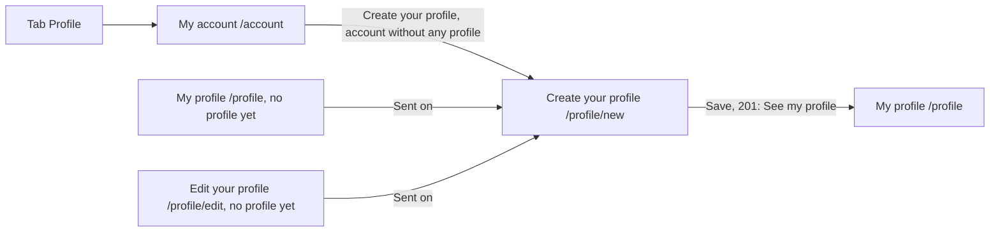

# Create your profile

- Component: web/src/pages/CreateProfile.tsx, with CreateProfile.module.css and CreateProfile.test.tsx. The four fields, the question younger than 16 and the parent field sit in the shared component web/src/components/MemberProfileForm.tsx (issue 33), the question and the parent field shown only when the page sets the prop withParentQuestion, which only this page does.
- Address in the browser: /profile/new

## What the page is for

A young person who made an account and logged in tells Connect who they are: their first name, their age band, the town or area in Amstelland where they live, and, if they want, a short line about themselves. Many young people on Connect are 15, 16 or 17 years old. So Connect never asks for an exact age, a birth date, a school or a street address, and the form says so. A young person under 16 also fills in the email address of a parent, because the Dutch privacy law asks for a parent's permission under 16.

## Who can open it

- Member (young person) without a profile: fills in the form.
- Young person who already has a profile: reads "You already have a profile" above the form on Save, and no second profile is made.
- Organisation: never sees the link Create your profile on My account. When it opens the form anyway and presses Save, it reads "This account already belongs to an organisation" above the form, and nothing is saved.
- Visitor who is not logged in: the route is inside RequireLogin of issue 04, so the visitor is sent to Log in first.

## How you get there and where you go next

- The tab Profile of issue 06 opens My account. An account without any profile sees both links Create your profile and Create an organisation profile (issue 34b). After issue 08 the link becomes My profile for an account that has a profile.
- The page My profile (/profile) and the page Edit your profile (/profile/edit) send a member without a profile here.
- After saving, the link See my profile goes to /profile (issue 08).

## Every element of the page, top to bottom

1. Message area above the form, in role alert
   - 409 (conflict): the title of the ProblemDetails answer of the server, shown as text. For a young person with a profile: "You already have a profile". For an organisation: "This account already belongs to an organisation". A 409 without a title falls back to "You already have a profile". Task 34b.5, issue 34b An account is a young person or an organisation, never both, GitLab #67, sprint 2.
   - 503 or no answer: "Connect is not reachable right now, your text is kept". Every field keeps its value, also the answer Yes and the parent address.
2. Field: First name
   - A text field, autocomplete given-name, label above it.
   - Required. An empty first name shows the message of the server "Fill in your first name" below the field, and nothing is saved (task 7.2).
3. Field: Age band
   - A select with exactly three options: 15 to 17, 18 to 21 and 22 to 30. No option is chosen at the start. The labels come from AGE_BAND_LABELS in web/src/api/memberProfiles.ts (Adolescent becomes "15 to 17"), so issues 08 and 14 show the same words.
   - Required. No field anywhere asks for a date or an exact age. The database refuses an unknown age band.
4. Question: "Are you younger than 16?"
   - A fieldset with this legend and two radio buttons Yes and No, directly below Age band. It appears only while the age band is 15 to 17, and nothing is chosen at the start.
   - When the age band changes to 18 to 21 or 22 to 30, the question and the parent field disappear and their values are cleared.
   - Task 130.5 built it on this page, issue 130 A young person under 16 asks a parent for permission, GitLab #40, sprint 2. Task 33.3 moved it into MemberProfileForm behind the prop withParentQuestion, with a test case and a criterion of its own, without a change of text or behaviour.
5. Field: Email address of a parent
   - A text field of type email, autocomplete off, shown only after Yes. It goes away again after No.
   - Hint below it: "We send your parent one email with a link to give permission. We remove this address as soon as your parent answers, or after 14 days." The 14 is PARENT_CONSENT_KEEP_DAYS in web/src/api/memberProfiles.ts, which must match the server setting ParentConsent:KeepDays.
   - Messages: "Fill in the email address of a parent" when it is empty after Yes, "Fill in a valid email address" when it has no @, "Fill in the address of a parent, not your own" for the address the young person logs in with.
   - Task 130.5, moved into MemberProfileForm by task 33.3, behind the same prop withParentQuestion.
6. Field: Region
   - A text field, label above it. Hint: "Your town or area, for example Amstelveen. Not your street, house number or postcode." The hint is linked to the field with aria-describedby.
   - A region with a digit is refused by the server (MemberProfileRules, task 7b.2): "Fill in only your town or area, not your street, house number or postcode" directly below Region. The focus moves to Region and what was typed stays. A town or area with a space or a dash, such as De Ronde Venen, is accepted. The page has no own copy of the rule.
   - Task 7b.3, issue 07b A clear message when my region looks like a street address, GitLab #26, sprint 1-stretch.
7. Field: About you
   - A textarea, optional, at most 280 characters. Hint: "Do not write your school, address or phone number here." A counter such as "240 characters left" goes down while typing.
   - A line longer than 280 characters shows "Your short line can be at most 280 characters" below the field (task 7.2).
8. Button: Save
   - Calls createMemberProfile(...) in web/src/api/memberProfiles.ts, which sends POST /api/member-profiles through request() in web/src/api/client.ts. It sends isUnder16 true and parentEmail only after Yes, otherwise isUnder16 false and no parentEmail. The browser adds the cookie connect_session by itself. The page never calls fetch.
   - While waiting the button says "Saving..." and is disabled.
   - 400: each message of the server appears directly below its own field, linked with aria-describedby, and the focus moves to the first wrong field. What was typed stays. This works for every field the server names, also isUnder16 below the question and parentEmail below the parent field.
   - On the server, the guard of issue 04 checks the session. The server trims the spaces around every field and checks every field. It refuses an account that already has an organisation profile (task 34b.3). It writes one row in member_profile, linked to the account. The database refuses a second profile for the same account. For a young person under 16 it also writes one row in parent_consent with the parent address, the hash of a token and when it ends, and puts one email for the parent in the mail queue of issue 21. That email holds no name, age band, region or short line of the young person.
9. Saved message, in place of the form, in role status
   - "Your profile is saved", with a link See my profile to /profile (issue 08).
   - Under 16: "Your profile is saved. We sent an email to your parent. Other members see your profile once your parent gives permission.", with the link See my profile.

Since issue 33, the four fields with their labels, hints, counter and messages, and the question younger than 16 with the parent field of task 130.5, live once in MemberProfileForm behind the prop withParentQuestion (task 33.3). Only Create your profile sets that prop, because the question and the address of a parent are asked once, when the profile is made. CreateProfile.tsx keeps its own call to createMemberProfile, its 409 text and its saved text. Nothing changes for the person using the page, and CreateProfile.test.tsx stays green without a change.

## States

- Empty: the form with four empty fields and no age band chosen.
- Filled: the typed values, with the question and the parent field when they apply.
- Loading: the button says "Saving..." and is disabled while Connect saves.
- Saved: the saved message in role status with See my profile.
- Error: a message below each wrong field. "You already have a profile" or "This account already belongs to an organisation" above the form.
- Not reachable: "Connect is not reachable right now, your text is kept" above the form, every value stays.
- Phone (360 pixels wide) and laptop (1280 pixels wide): the page matches the Figma frame Create your profile at both widths, shown with screenshots in the merge request.
- Design: the Figma frame Create your profile on the Figma board of Connect, page Design directions. Colours, fonts and spacing only through web/src/styles/tokens.css.
- Clickable prototype (laptop, sprint 1 and 2), on the Figma page Prototype sprint 1 and 2 (desktop). The line above each screen names its GitLab issues.
  - [G01 Create your profile](https://www.figma.com/design/SAVxDf3rlsWz22qlzTEYte/Young-Amstelland-Connect--team-workspace?node-id=1019-1964)
  - [G02 Create your profile, region message](https://www.figma.com/design/SAVxDf3rlsWz22qlzTEYte/Young-Amstelland-Connect--team-workspace?node-id=1019-2101)
  - [H01 Create your profile, under 16](https://www.figma.com/design/SAVxDf3rlsWz22qlzTEYte/Young-Amstelland-Connect--team-workspace?node-id=1019-3703)

## Accessibility and privacy

- Every field has its label above it. A screen reader hears the message of a wrong field together with the name of that field, and the Region hint with the field.
- The question younger than 16 is a fieldset with a legend, so a screen reader reads the legend with each answer.
- axe reports 0 issues, also with the region message showing.
- Connect asks for nothing more than first name, age band, region and a short line: never a school, a street address, a phone number, an email address of the young person, an exact age or a birth date.
- A young person under 16 is only asked yes or no, never a birth date. A young person of 16 or older is never asked for a parent's address.
- Until the parent gives permission (issue 131), only the young person sees the profile. Other members see the page not found of issue 53: "This page does not exist or is no longer available". Before issue 53 the server answered 404 with the title "This member does not exist" (issue 130).
- Deleting the account also deletes the profile, the request to the parent and the parent's address (issue 113).

## Built by

| Board | Title | GitLab | Sprint | Prio |
|---|---|---|---|---|
| 07 | Create a profile | #25 | 1 | must |
| 07b | A clear message when my region looks like a street address | #26 | 1-stretch | must |
| 08 | See my own profile page | #27 | 1 | must |
| 130 | A young person under 16 asks a parent for permission | #40 | 2 | must |
| 33 | Edit my own profile | #64 | 2 | must |
| 34b | An account is a young person or an organisation, never both | #67 | 2 | must |

Issue 07 needs issues 04 and 19 first. Issue 130 needs 07, 14, 19 and 21. Issue 33 needs 08 and 07b. Issue 34b needs 34, 07 and 08.

## Open points

- How many days Connect keeps the address of a parent who does not answer: issue 10 The client's priorities for the epics, question 20. Until the answer comes the team uses 14 days, and the hint and the server setting change in the same merge request.
- A stronger check that the address really belongs to a parent: issue 10, question 62.
- Whether Region becomes a fixed list of places: issue 10, question 19. A street name without a number, such as Dorpsstraat, is not refused.
- The parent opening the link and giving permission is issue 131. Forgetting the parent's address when the link has ended, and asking a parent again, is issue 130b.

## AI use declaration

AI was used as a writing support tool while working on this document. We used AI to draft
the formulation of sentences, the structure of wording, readability, and clarity from
content that we had provided, and to generate the diagrams. The content itself, including
our experiences, reflections, learning goals, decisions, self-assessments, and
conclusions, is our own. We reviewed the drafts and decided as a team which text to
include.
