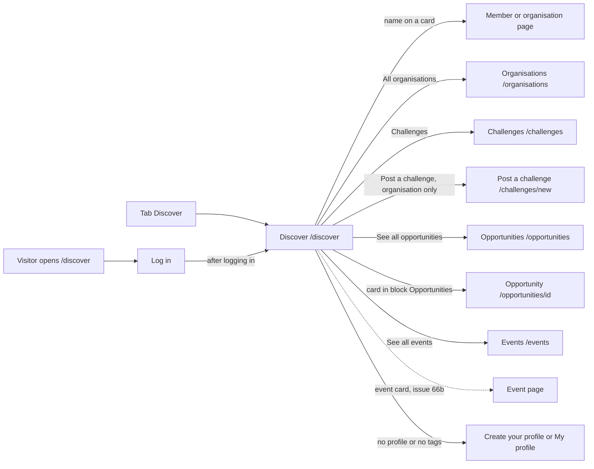

# Discover, suggested matches and what is new on Connect

- Component: frontend/src/pages/Discover.tsx, with Discover.module.css and Discover.test.tsx
- Address in the browser: /discover, behind the tab Discover, and /discover?kind=member or /discover?kind=organisation with a filter
- Server addresses: GET /api/suggestions?page=1&pageSize=20 (with &kind=member or &kind=organisation), GET /api/opportunities?page=1&pageSize=3, GET /api/events?page=1&pageSize=3, and for the button Save PUT and DELETE /api/saved-items/<kind>/<itemId>

## What the page is for

Discover is the heart of why Connect exists between one gala and the next. It suggests other members and organisations who share at least one tag with the member, for example music or video editing, and says in one line why. Below the suggestions it shows the three newest opportunities and the three events that start soonest, so a young person runs into new chances without looking for them. It also has the ways to the list of all organisations, the open challenges, and for an organisation the form to post a challenge.

## Who can open it

- Member (young person) with a profile and tags: sees the suggestions, the block Opportunities and the part Upcoming events.
- Member without a profile: reads "Make your profile first to get suggestions" with a link Create your profile.
- Member with a profile but no tags: reads "Add some tags to your profile to get suggestions" with a link My profile.
- Organisation: reads "Suggestions are for members. Members who share your tags see your organisation here." in place of the suggestions, with no link and no filter buttons. It also sees the link Post a challenge, which only an organisation sees.
- Admin: the cards name no separate view.
- Visitor who is not logged in: sees the page Log in and no card at all, also with a link that holds a kind (AC13 of issue 37, AC9 of issue 38).
- What nobody ever sees on a card: an email address, a number or score, and never more of a member aged 15 to 17 than their own member page shows. A member never sees themselves, a member who shares no tag, or a member whose email address is not confirmed.

## How you get there and where you go next

You get here with the tab Discover in the app shell of issue 06. A link that someone shares, such as /discover?kind=organisation, opens Discover with that filter chosen. The empty page Requests I sent (issue 40) and the empty page My connections (issue 42) link here with Find people on Discover, and the empty page Saved (issues 44 and 44b) links here too.

From here you go to:
- the page of a member at /members/<id> or of an organisation at /organisations/<id>, by pressing a name on a card
- the list of all organisations at /organisations, with All organisations
- the open challenges at /challenges, with Challenges
- the form Post a challenge at /challenges/new, for an organisation only
- the full list of opportunities at /opportunities, with See all opportunities, or one opportunity at /opportunities/<id>
- the tab Events at /events, with See all events, or the page of one event
- My profile at /profile or Create your profile at /profile/new, when suggestions need tags or a profile first

## Every element of the page, top to bottom

The page sits inside AppShell of issue 06, so the five tabs stay around it. The browser tab title is "Connect, Discover". The cards give the order of the parts below the heading only in part. Where the order is open, it is named in Open points.

1. Heading: Discover
   - One h1 with the page name. Issue 06 made the page with only this heading, and later issues fill it and keep the address.
   - Built by task 6.3, issue 06 Move between the five tabs of Connect, GitLab #19, sprint 1.

2. Link: All organisations
   - Near the top of the page, a link to /organisations, the list of every organisation sorted by name. That page is described in Organisations.md.
   - Built by task 134.3, issue 134 See a list of all organisations, GitLab #203, sprint 5. Only built when the client says yes to question 11 of issue 10.

3. Link: Challenges
   - A link to /challenges, next to the suggestions, shown to everyone who is logged in. It opens the open challenges, soonest deadline first. That page is described in Challenges.md.
   - Built by task 75.4, issue 75 See the open challenges, GitLab #140, sprint 3.

4. Link: Post a challenge (organisation only)
   - A link to /challenges/new, shown only when useSession says isOrganisation. A young person does not see it. Hiding it is not the protection: the page Post a challenge and the server refuse everyone else too.
   - The form there has the fields Title, Description and Deadline. That page is described in PostChallenge.md.
   - Built by task 74.3, issue 74 Post a challenge, GitLab #138, sprint 3.
   - Since issue 140 Only a checked organisation can publish (GitLab #139, sprint 3), an organisation that the foundation has not checked yet still sees this link, but on the page Post a challenge it reads "The foundation checks your organisation first. You can publish after that." in place of the button Publish.

5. Filter buttons: All, People, Organisations
   - Three real buttons in a group with the label "Show", above the suggestions. The component is KindChips in frontend/src/components/discover/KindChips.tsx. The words live in SUGGESTION_KINDS in frontend/src/api/suggestions.ts.
   - All is chosen when Discover opens. The chosen button has aria-pressed="true" and a mark that is not only a colour: a border and bold text.
   - The choice lives in the address, read with useSearchParams. People makes the address /discover?kind=member, Organisations makes it /discover?kind=organisation, All makes it /discover. A reload and a shared link keep the choice.
   - A missing kind or any other word, for example /discover?kind=cars, chooses All and is never sent to the server.
   - A change of kind starts the list again at page 1 with the loading text. Load more then adds only that kind.
   - The buttons are not shown in the states noProfile, noTags and organisation, because there is nothing to filter. After pressing a button while Connect is not reachable, the buttons stay.
   - On a phone the row wraps to a second line when it does not fit.
   - The server checks kind against its allowed words. An unknown word gets an answer that names the allowed words.
   - Built by tasks 38.1 (query), 38.2 (server parameter) and 38.3 (screen), issue 38 Filter Discover by kind, GitLab #76, sprint 2.

6. The list of suggestions
   - A real list (ul with one li per card), up to twenty cards, those who share the most tags first.
   - The component SuggestionCard (frontend/src/components/SuggestionCard.tsx) shows one suggestion.
     - A member card: the first name as a real link to /members/<id>, below it the age band in words from AGE_BAND_LABELS (for example "18 to 21") and the region when it is there, and the line "Matches you on:" with the shared tags, for example "Matches you on: film, music". A card without region shows no empty label.
     - An organisation card: the name as a real link to /organisations/<id>, the kind in words from ORGANISATION_KIND_LABELS (for example "School"), and the same line "Matches you on:".
   - The line "Matches you on:" is text, never an icon or a tooltip. A card shows no number or score.
   - Button Save on every card: the component SaveButton (frontend/src/components/SaveButton.tsx) with the props kind, itemId, name and saved. Since task 43.3 every item of GET /api/suggestions holds the field saved, so the button says Save or Saved when Discover opens.
     - The accessible name is "Save <name>" or "Saved <name>", for example "Save Robin".
     - Pressing Save calls saveItem(kind, itemId) in frontend/src/api/savedItems.ts, which sends PUT /api/saved-items/<kind>/<itemId>. The word changes to Saved at once, and the button is disabled until the answer comes, so a double tap sends one request. Saved stays after a reload.
     - Saving fails: the word Save comes back, and "Not saved, Connect is not reachable right now" shows next to the button in an area with role alert.
     - Pressing Saved (since task 43b.3) calls unsaveItem(kind, itemId), which sends DELETE /api/saved-items/<kind>/<itemId>. The word changes to Save at once, with the same busy state. Taking back fails: the word Saved comes back, and "Not removed, Connect is not reachable right now" shows next to the button in an area with role alert.
     - Nothing else on the card changes, and the member who was saved sees nothing about it anywhere on Connect. Discover passes no onChange, the optional prop that issue 44b adds for the page Saved.
     - Built by tasks 43.1, 43.2, 43.3 and 43.4, issue 43 Save a suggestion, GitLab #84, sprint 2, and tasks 43b.1, 43b.2 and 43b.3, issue 43b Unsave a suggestion, GitLab #85, sprint 2.
   - Data: getSuggestions(page, kind) in frontend/src/api/suggestions.ts asks GET /api/suggestions through request() of frontend/src/api/client.ts. The page and the card never call fetch.
   - The server checks the session with the guard of issue 04 and finds out who is asking: a member with a profile and tags, a member without tags, an account without a profile, or an organisation. For a member it asks the query of task 37.1, which counts the shared tags inside the database, and applies ProfileVisibility of issue 14 to every card. The answer holds the suggestions in data, and page, pageSize, total and a state (noProfile, noTags, organisation or ready) in meta.
   - Built by tasks 37.1 (query), 37.2 (seed data), 37.3 (server address) and 37.4 (screen), issue 37 See suggested matches with the reason, GitLab #74, sprint 2.

7. Button: Load more (suggestions)
   - Shows under the cards while meta.page times meta.pageSize is less than meta.total. On the last page it is gone.
   - Pressing it asks GET /api/suggestions?page=<next>&pageSize=20, of the same kind when a filter is chosen, and adds the new cards under the ones already there. The page stays where the member was.
   - While it loads the button says "Loading...", is disabled and cannot be pressed twice.
   - The focus stays on the button, or moves to the first new card when the button is gone. A polite live region says how many cards were added, for example "20 more suggestions".
   - A card whose id is already in the list is never added twice.
   - Built by tasks 37b.1 (query takes a page), 37b.2 (server takes page and pageSize) and 37b.3 (screen), issue 37b Load more suggestions, GitLab #75, sprint 2.

8. Block: Opportunities
   - A block below the suggestions with the heading Opportunities (h2), the three newest open opportunities in a list (ul with li), and at the bottom the link See all opportunities to /opportunities. The component is OpportunitiesBlock in frontend/src/components/discover/OpportunitiesBlock.tsx.
   - Each item is OpportunityCard of issue 55, reused and never copied, so the block and the list look the same. Each card is a link to the page of that opportunity (issue 55b), named by its title, with the organisation name, the kind and the closing date.
   - The block always shows every kind. The filter of issue 155 does not change it.
   - Data: listOpportunities(1, 3) in frontend/src/api/opportunities.ts asks GET /api/opportunities?page=1&pageSize=3, the same address as the full list. The three are exactly the first three of the full list, in the same order. An opportunity of an unconfirmed or switched off organisation never reaches the block, even when it is the newest. A closed opportunity is gone from the block on the day after its closing date, counted in Dutch time (issue 56 Closed opportunities disappear, GitLab #112, sprint 3). Since issue 140 the block only holds opportunities of organisations that the foundation checked.
   - Task 55.4 first put a plain link See all opportunities below the matches. Task 55c.3 removes it, because the block now holds it.
   - The block asks in its own request, and a failure stays inside the block.
   - Built by task 55.4 (first link), issue 55 See the open opportunities, GitLab #108, sprint 3, and tasks 55c.1 (seed data), 55c.2 (test of the page of three) and 55c.3 (the block), issue 55c See the newest opportunities on Discover, GitLab #111, sprint 3.

9. Part: Upcoming events
   - A section with the heading Upcoming events (h2), after what issue 37 put on Discover. It shows the three events that start soonest, each with its title, the date and time, the place and the organisation, and below them the link See all events to /events.
   - It uses EventList of issue 66 with pageSize 3, showLoadMore false and the card heading level h3, so there is no Load more. Each EventCard is a link to its event page through issue 66b Open an event page.
   - Data: getUpcomingEvents(1, 3) in frontend/src/api/events.ts asks GET /api/events?page=1&pageSize=3, in its own request, at the same time as the suggestions.
   - A failure here never hides the suggestions.
   - Built by tasks 66c.1 (query plan), 66c.2 (page of three) and 66c.3 (the part), issue 66c See the upcoming events on Discover, GitLab #126, sprint 3.

## States

Suggestions:
- Loading: "Loading suggestions..." in an area with aria-busy.
- No profile: "Make your profile first to get suggestions" with a link Create your profile to /profile/new.
- No tags: "Add some tags to your profile to get suggestions" with a link My profile to /profile.
- Nobody shares the tags: "Nobody shares your tags yet. Try adding another tag." with the link My profile.
- Nobody of one kind: "No people share your tags yet" or "No organisations share your tags yet" in place of the list, with the link My profile.
- Organisation: "Suggestions are for members. Members who share your tags see your organisation here." with no link and no filter buttons.
- Filled: up to twenty cards, with Load more when there are more.
- Not reachable: "Connect is not reachable right now, try again later" in place of the list, in an area with role alert, with a button Try again that asks again, of the chosen kind.
- Not reachable on Load more: the cards already there stay, and the same sentence with Try again appears under them. Try again asks the same page again.
- Save or take back fails: "Not saved, Connect is not reachable right now" or "Not removed, Connect is not reachable right now" next to the button, and the button shows its old word again. The list stays.
- Session ended while the page was open (401): the page asks useSession to read the session again, so RequireLogin sends the member to Log in with next=/discover.

Block Opportunities:
- Loading: "Loading opportunities..." inside the block.
- Empty: "There are no open opportunities right now" inside the block, with the link See all opportunities still there.
- Not reachable: "Connect is not reachable right now" with a button Try again, inside the block only, in an area with role alert. The suggestions and the tabs stay.

Part Upcoming events:
- Loading: "Loading events..." in an area with role status.
- Empty: "There are no upcoming events yet".
- Not reachable: "Connect is not reachable right now, try again later" in an area with role alert, inside this part only. The rest of Discover stays on the screen.

Phone and laptop:
- The first twenty cards show within two seconds of pressing Discover (AC15 of issue 37), and a new list after pressing a filter button within two seconds (AC11 of issue 38).
- Design: the Figma frame Discover on the page Design directions of the Figma board. Colours, fonts and spacing come only from frontend/src/styles/tokens.css.

## Accessibility and privacy

- Every name and every card that goes somewhere is a real link, never a clickable div. See all opportunities and See all events are links, because they go to another page.
- The reason line "Matches you on:" is text, so a screen reader reads it on every card (AC14 of issue 37).
- The list is a real list, so a screen reader says how many suggestions there are.
- After Load more a polite live region names the number of new cards, and the focus is kept (AC7 of issue 37b).
- The button Save or Saved on each card names the suggestion in its accessible name, for example "Save Robin", and a failed save or take back is said in an area with role alert (issues 43 and 43b).
- Nobody is told that they were saved, or that a save was taken back.
- The chosen filter button has aria-pressed and a mark that is not only colour (WCAG 2.2 criterion 1.4.1).
- The block Opportunities and the part Upcoming events have an h2, so a screen reader can jump to them by headings.
- A card shows only a first name, an age band, a region and tags for a member. Never an email address, a birth date, a number or a score, and never more of a member aged 15 to 17 than their member page shows (AC12 of issue 37).
- The block and the part show only the organisation, never who else is interested or going.
- The link Post a challenge is not in the page for someone who is not an organisation.

## Built by

| Board | Title | GitLab | Sprint | Prio |
|---|---|---|---|---|
| 06 | Move between the five tabs of Connect | #19 | 1 | must |
| 37 | See suggested matches with the reason | #74 | 2 | must |
| 37b | Load more suggestions | #75 | 2 | must |
| 38 | Filter Discover by kind | #76 | 2 | must |
| 43 | Save a suggestion | #84 | 2 | should |
| 43b | Unsave a suggestion | #85 | 2 | should |
| 55 | See the open opportunities | #108 | 3 | should |
| 55c | See the newest opportunities on Discover | #111 | 3 | should |
| 56 | Closed opportunities disappear | #112 | 3 | should |
| 66c | See the upcoming events on Discover | #126 | 3 | should |
| 74 | Post a challenge | #138 | 3 | could |
| 140 | Only a checked organisation can publish | #139 | 3 | should |
| 75 | See the open challenges | #140 | 3 | could |
| 134 | See a list of all organisations | #203 | 5 | could |

## Open points

- The order of the block Opportunities and the part Upcoming events is not given. Card 55c puts the block below the matches, card 66c puts the part after what issue 37 put on Discover. The place of the links All organisations, Challenges and Post a challenge is only given roughly ("near the top", "next to the suggestions"). The Figma frame Discover decides.
- The link All organisations is only built when the client says yes to question 11 of issue 10 The client's priorities for the epics (GitLab #11).
- Loading more cards by itself on scroll is not planned. The client can ask for it in issue 10 (card 37b).
- Searching or filtering challenges waits for question 92 of issue 10 (card 75).
- Opportunities, events and challenges may later get their own filter button in the row All, People, Organisations (card 38). No card builds that yet.
- Changing and deleting a posted challenge are issues 167 and 168, built only when the client says yes in issue 10.
- Settled: task 37.4 puts /discover inside RequireLogin, so a visitor sees Log in first. The not reachable sentences of the suggestions, the events and the block Opportunities are each their own, on purpose.

## AI use declaration

AI was used as a writing support tool while working on this document. We used AI to draft
the formulation of sentences, the structure of wording, readability, and clarity from
content that we had provided, and to generate the diagrams. The content itself, including
our experiences, reflections, learning goals, decisions, self-assessments, and
conclusions, is our own. We reviewed the drafts and decided as a team which text to
include.
