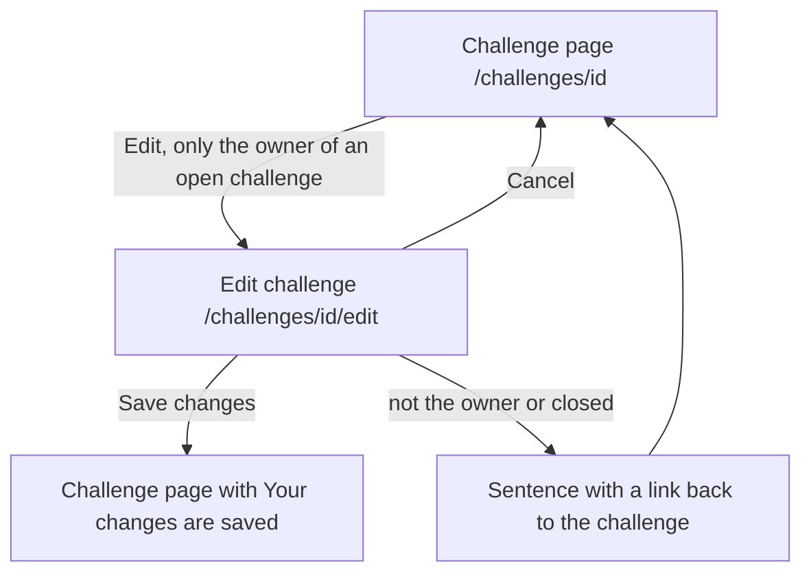

# The page Edit challenge

Component: `web/src/pages/EditChallenge.tsx`, with `web/src/components/ChallengeForm.tsx`.
Address in the browser: `/challenges/<id>/edit`.

## What the page is for

An organisation that posted a challenge can change its title, its description or its deadline while the challenge is still open. That way young people always read the right assignment and the right last day. Young people who joined stay joined, and the page of the challenge shows "Changed on" with the date, so they notice that something moved.

## Who can open it

- The organisation that posted the challenge, while the challenge is open: yes.
- Another organisation or a young person: sees "Only the organisation that posted this challenge can change it" in place of the form, with a link back to the challenge. They never see the button Edit.
- Anyone, when the challenge is closed: sees "This challenge is closed, it can no longer be changed" in place of the form, with a link back to the challenge.
- An unknown id: the page NotFound of issue 53, "This page does not exist or is no longer available".
- Visitor who is not logged in: sees the page Log in first (`RequireLogin` of issue 04).
- The server decides as well. A change sent without the page by someone else is refused (task 167.2).

## How you get there and where you go next

- The button Edit on the page of the challenge (`/challenges/<id>`, issue 75b), next to the title. It is a link styled as a button, only rendered when the logged in organisation posted the challenge (`isOwner`) and the challenge is open (`isClosed` is false).
- Save changes brings the organisation back to `/challenges/<id>` with "Your changes are saved".
- The link Cancel goes back to the challenge without saving.

## Every element of the page, top to bottom

### Sentences above the form

- "Connect is not reachable right now, your changes are kept": code 503 or no answer, in an area with role alert. Every field keeps its value, so Save changes can be pressed again.
- "This challenge is closed, it can no longer be changed": code 409, when the challenge closed while the form was open, in an area with role alert. The button Save changes disappears.
- Built by: issue 167 Change my challenge after posting, task 167.4 (GitLab #228, sprint 5).

### The form (ChallengeForm)

The form loads the challenge with `getChallenge(id)` (`GET /api/challenges/{id}`) and shows it filled in. ChallengeForm is the same component the page Post a challenge uses (task 74.3), so posting and changing use one form with the same labels and messages. On the server both use one shared rule set, so they can never differ (task 167.2).

- Field Title: a text input with its label above it. Filled in and at most 120 characters. Messages: "Fill in a title", "The title can be at most 120 characters". The server trims spaces at the start and the end first.
- Field Description: a textarea with its label above it. Filled in and at most 4000 characters. Messages: "Fill in a description", "The description can be at most 4000 characters".
- Field Deadline: an input of type date with its label above it. Filled in and today or later, in Dutch time. Messages: "Choose a deadline", "The deadline must be today or later".
- The page checks the three fields itself before sending, with the same messages. The server stays the judge.
- The rules of each field come from issue 74 Post a challenge (task 74.2), which issue 167 reuses.

### Button Save changes

- Label: Save changes. While waiting it says "Saving..." and is disabled, so it cannot be pressed twice.
- What it does: calls `updateChallenge(id, values)` in `web/src/api/challenges.ts`, which sends `PUT /api/challenges/<id>` through `request()` in `web/src/api/client.ts`. It returns saved, fieldErrors, notAllowed, closed, notFound or notReachable, so the page never sees a status code.
- Saved (code 204): Connect goes to `/challenges/<id>`, where "Your changes are saved" shows above the challenge in an area with role status, and "Changed on" with the date of today shows under the deadline, for example Changed on 14 October 2026, written as a day in Dutch time. The line Changed on shows for every visitor of the challenge, from the field `updatedAt` of `GET /api/challenges/{id}` (task 167.3).
- Wrong fields (code 400): each message directly next to its own field, the field marked with `aria-invalid` and linked with `aria-describedby`, and the focus on the first wrong field. What was typed stays.
- Not allowed (code 403): "Only the organisation that posted this challenge can change it" in place of the form.
- Built by: issue 167, tasks 167.2, 167.3 and 167.4.

### Link Cancel

- Label: Cancel. Goes back to the challenge. Nothing is sent.

## States

| State | What the person sees |
|---|---|
| Loading | The challenge is loaded with `getChallenge(id)` before the form shows. |
| Filled | The form with Title, Description and Deadline filled in, Save changes and Cancel. |
| Saving | Save changes says "Saving..." and is disabled. |
| Wrong fields | The message next to each wrong field, for example "Fill in a title" and "The deadline must be today or later". |
| Not the owner | "Only the organisation that posted this challenge can change it" in place of the form. |
| Closed | "This challenge is closed, it can no longer be changed". |
| Unknown id | "This page does not exist or is no longer available". |
| Not reachable | "Connect is not reachable right now, your changes are kept" above the form, every field keeps its value. |

The team check of task 167.6 runs on a phone and on a laptop.

## Accessibility and privacy

- Every field has its label above it. A wrong field gets `aria-invalid`, is linked to its message with `aria-describedby`, and gets the focus.
- The sentences above the form sit in role alert areas. "Your changes are saved" sits in a role status area.
- The button Edit and the form are only rendered for the owner of an open challenge, not hidden with CSS.

The design: colours, fonts and spacing come only from `web/src/styles/tokens.css`, following the Figma frame Post a challenge on the page Design directions of the Figma board.

## Built by

| Board | Title | GitLab | Sprint | Prio |
|---|---|---|---|---|
| 167 | Change my challenge after posting | #228 | 5 | could |

## Open points

- Issue 167 is built only when the client says yes to issue 10, question 84. The same question asks about keeping a history of every earlier version of a challenge.
- Telling the young people who joined by email or by a message that the challenge changed: issue 10, question 83.
- Closing a challenge before its deadline: issue 10, question 93.
- The card of issue 167 asks the team whether a change to an earlier deadline should be refused once someone joined, and to add the answer to question 84.

## AI use declaration

AI was used as a writing support tool while working on this document. We used AI to draft
the formulation of sentences, the structure of wording, readability, and clarity from
content that we had provided, and to generate the diagrams. The content itself, including
our experiences, reflections, learning goals, decisions, self-assessments, and
conclusions, is our own. We reviewed the drafts and decided as a team which text to
include.
