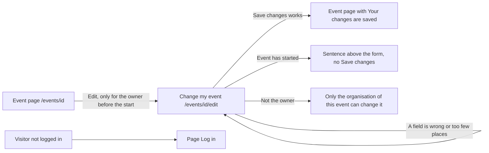

# Change my event

- Component: web/src/pages/EditEvent.tsx, with EditEvent.test.tsx. The form itself is the shared component web/src/components/EventForm.tsx.
- Address in the browser: /events/:id/edit, for example /events/<id of the event>/edit.

## What the page is for

An organisation publishes an event on Connect and later has to change something: a typing mistake in the title, a new room, a later start, or more places because more volunteers can help. This page opens the same form as when the event was published, already filled in. After Save changes the event page shows the new details at once, so young people always see the right date, time, place and number of places. Young people who already registered keep their place.

This page is only built when the client says yes to question 74 of issue 10. Until then issue 162 carries the label blocked.

## Who can open it

- Organisation that published the event (the owner): sees the form filled in and can save changes, as long as the event has not started.
- Another organisation, a young person (member) and an admin: see no button Edit on the event page. When they type the address of the form, the page shows "Only the organisation of this event can change it" in place of the form. The server refuses a change from anyone but the owner with the same sentence.
- Visitor who is not logged in: the route sits inside RequireLogin of issue 04, so the visitor sees the page Log in first. The server answers not logged in to every call without a session.
- Address of an event that does not exist, or an id with a typing error: the server answers not found with "This page does not exist" (NotFoundProblem of issue 53).

## How you get there and where you go next

You arrive from the page of your own event (EventDetails at /events/:id of issue 66b). There, the owner sees a link Edit, styled as a button, next to the title. It is only there when the server says the event is yours (isMine) and the event has not started.

You leave through Save changes. When saving works, you land back on the event page, which shows "Your changes are saved" above the details. The card gives no link Cancel on this page, see the open points.

## Every element of the page, top to bottom

The page loads the event with getEvent(id) of web/src/api/events.ts, which asks GET /api/events/{id}. That answer holds isMine, the title, description, place, start time and places the form needs (task 162.3). isMine is true only when the organisation profile of the caller owns the event. The answer never holds the owner id, an account id or an email address. isMine is only used to show the form. The server never trusts it and checks the owner itself on every change.

All elements below are built by task 162.4 (screen), issue 162 Change my event after publishing, GitLab #223, sprint 5, unless another task is named.

1. Message area above the form
   - Shows "Connect is not reachable right now, your changes are kept" in an area with role alert when the server answers 503 or gives no answer. Every field keeps its value.
   - Shows "This event has already started, it can no longer be changed" when the server answers 409 about a started event. The button Save changes then disappears.
2. Form EventForm, with the five fields Title, Description, Date and time, Place and Number of places
   - The same component as the page New event of issue 65, so publishing and changing use the same labels, hints and messages. NewEvent uses it with the button Publish, EditEvent with Save changes. NewEvent.test.tsx stays unchanged and green as proof.
   - The fields are filled with the values of the event when the page opens.
   - Date and time is a field of type datetime-local, shown in Europe/Amsterdam time and sent with its time zone, as task 65.4 does.
   - Rules, the same as publishing in issue 65, through one shared rule set EventFieldRules on the server (task 162.2): Title up to 120 characters, Description up to 2000, Place up to 200, Date and time in the future, Number of places at least 1.
   - Number of places may never be lower than the number of young people who already registered. When it is, the server answers 409 and the sentence sits next to the field Number of places, directly below it, for example "2 young people registered, choose at least 2 places". Nothing is changed. Task 162.1 counts the registrations under the same row lock as registering for an event (issue 68), so a registration and a change never count at the same moment.
   - A wrong field (code 400): the message of that field sits directly below the field, with the same texts as when publishing. Each message is linked with aria-describedby, and the focus goes to the first wrong field. What was typed stays.
3. Button Save changes
   - Calls updateEvent(id, fields) of web/src/api/events.ts, which sends PUT /api/events/{id} through request() of web/src/api/client.ts. PUT sends the whole new version of the event.
   - What goes to the server: title, description, place, startsAt and capacity. The owner comes from the session, never from the body.
   - While waiting the button says "Saving..." and is disabled.
   - Code 204 (done): the browser goes to /events/{id}, where "Your changes are saved" shows above the details in an area with role status.
   - Server side: PUT /api/events/{id} is built by task 162.2 and answers 204, 400, 401, 403, 404, 409 or 503. The change itself (the five values plus the moment updated_at) is saved by task 162.1.
4. On the event page (not this page, but part of the flow)
   - The link Edit next to the title, only rendered when isMine is true and hasTakenPlace(startsAt, now) is false. It is left out of the page, not hidden with CSS.
   - Once the event has started there is no link Edit, and the event page says it has taken place (issue 66b).
   - The sentence "Your changes are saved" after a change.
   - Built by task 162.4 in web/src/pages/EventDetails.tsx.

## States

- Loading: the page loads the event with getEvent(id) before the form shows. The card gives no loading text for this page.
- Filled: the form with the five fields filled in and the button Save changes.
- Saving: the button says "Saving..." and is disabled.
- Saved: the event page with "Your changes are saved" and the new details.
- Wrong input: the message below each wrong field, the focus on the first one, and what was typed stays.
- Too few places: "2 young people registered, choose at least 2 places" (with the real numbers) next to the field Number of places, nothing changed.
- Started: "This event has already started, it can no longer be changed" above the form, and no button Save changes.
- Not allowed: "Only the organisation of this event can change it" in place of the form.
- Not reachable: "Connect is not reachable right now, your changes are kept" above the form, every field keeps its value. A tester checks this by switching the phone to airplane mode before pressing Save changes.
- Empty: not used. The page has no list.
- Phone (360 pixels wide or close) and laptop: the team check of task 162.6 goes through every criterion on both.
- Design: the Figma frame New event on the Figma board of Connect, page Design directions. Colours, fonts and spacing come only from the variables in web/src/styles/tokens.css.

## Accessibility and privacy

- Every message sits below its own field, linked with aria-describedby, and the focus goes to the first wrong field.
- The not reachable sentence is in an area with role alert. "Your changes are saved" on the event page is in an area with role status.
- axe reports 0 issues.
- The answer of GET /api/events/{id} never holds the organisation profile id, an account id or an email address. Only true or false about the caller.
- A young person who registered keeps their place and sees the new details on the event page and in My events. The event page then still reads "You already have a place".

## Built by

| Board | Title | GitLab | Sprint | Prio |
|---|---|---|---|---|
| 162 | Change my event after publishing | #223 | 5 | could |

Issue 162 needs issues 66b Open an event page (#125), 10 The client's priorities for the epics (#11, question 74), 140 Only a checked organisation can publish (#139), 29 Unconfirmed accounts stay hidden (#58) and 68 Register for an event (#128) first. The tasks run in this order: 162.1 (database: updated_at, the places rule and the change under the row lock), 162.2 (PUT /api/events/{id}), 162.3 (isMine on GET /api/events/{id}), 162.4 (the button Edit and this page), 162.5 (end to end test web/e2e/editEvent.spec.ts) and 162.6 (team check on a phone and a laptop).

## Open points

- The client has not decided yet whether an organisation may change an event after publishing. Issue 162 is built only when the client says yes to question 74 of issue 10.
- Telling the young people who registered by email that the date, time or place changed, and seeing which young people registered, are also waiting for question 74 of issue 10.
- A cancelled event (issue 163 Cancel my event): the server answers 409 with "This event is cancelled", added by whichever of issues 162 and 163 is built second. The card does not say what this page shows for that answer.
- The card gives no loading text and no link Cancel for this page. The team decides whether the page needs them.

## AI use declaration

AI was used as a writing support tool while working on this document. We used AI to draft
the formulation of sentences, the structure of wording, readability, and clarity from
content that we had provided, and to generate the diagrams. The content itself, including
our experiences, reflections, learning goals, decisions, self-assessments, and
conclusions, is our own. We reviewed the drafts and decided as a team which text to
include.
