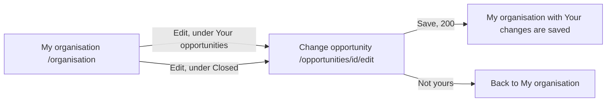

# Change opportunity

- Component: frontend/src/pages/EditOpportunity.tsx, with EditOpportunity.module.css and EditOpportunity.test.tsx
- Address in the browser: /opportunities/:id/edit

## What the page is for

An organisation that posted an opportunity can see a mistake, have news to add, or want to give young people more time, for example a sports club that finds a second trainer place after its closing date. On this page the organisation changes the title, the description, the kind and the closing date. Young people see the new text at once. A closed opportunity that gets a closing date of today or later is open again. The young people who pressed Interested keep their mark, because the opportunity stays the same one.

## Who can open it

- Organisation: only for its own opportunities, open or closed.
- Another organisation: reads "This opportunity does not exist" in place of the form, with a link Back to My organisation, and can never change it.
- Member without an organisation profile: reads "Only organisations have opportunities" in place of the form.
- Visitor who is not logged in: the route is inside RequireLogin of issue 04, so the visitor goes to Log in first.
- The form shows only after the server said the opportunity was found, so nobody sees the text for a moment before a refusal.

## How you get there and where you go next

Every line under Your opportunities (issue 54b, OwnOpportunities.tsx) and under Closed (issue 56b, ClosedOpportunities.tsx) in frontend/src/components/myOrganisation gets a link Edit with the accessible name "Edit <title of the line>".

## Every element of the page, top to bottom

1. Heading (h1): Change opportunity
2. Notice for a closed opportunity, above the form, in role status
   - "This opportunity is closed. Choose a new closing date to open it again."
   - Shown only when isOpen from the server is false. The page never decides open or closed with the clock of the laptop.
3. Alert area above the form, in role alert
   - "Connect is not reachable right now, your changes are kept" when Save gets a 5xx answer or no answer. Every field keeps its value.
4. The four fields, in the shared component OpportunityFields (frontend/src/components/OpportunityFields.tsx)
   - The same fields as the page New opportunity of issue 54, taken out of NewOpportunity.tsx so posting and changing look and work the same. The component gets the values, the messages and onChange, and never calls the server. The field Tags of issue 54c stays on New opportunity only.
   - Title: a text field, required, at most 120 characters. An empty title shows "Fill in a title" and nothing is sent. A title of 121 characters shows "A title has at most 120 characters".
   - Description: a textarea with a counter, such as "3800 characters left" (issue 54). Required, at most 4000 characters: "Fill in a description", "A description has at most 4000 characters".
   - Kind: a select with Internship, Job, Project and Other. The labels come from KIND_LABELS in frontend/src/api/opportunities.ts. Without a kind: "Choose a kind".
   - Closing date: the date field of the browser, with today as the earliest day. Empty shows "Fill in a closing date". A day before today shows "The closing date cannot be in the past", also when the date did not change. Today is accepted.
   - Every field has its label above it. Each message sits below its own field (task 153.5 and AC7 of issue 153), linked with aria-describedby. See the open points: issue 54 puts the same messages next to the field.
   - Data: on load getOwnOpportunity(id) in frontend/src/api/opportunities.ts asks GET /api/organisation-profiles/current/opportunities/{id} through request(). It returns the fields with isOpen, not yours, not an organisation, or not reachable. The server reads the id as text and refuses an unknown, odd or strange id, a member and a visitor (task 153.3).
5. Button: Save
   - The page first checks the same simple rules as New opportunity (required fields, no day before today).
   - Then changeOpportunity(id, form) sends PUT /api/opportunities/{id} with the four fields. The browser adds the cookie connect_session by itself.
   - While waiting the button says "Saving..." and is disabled.
   - 200: the page goes to /organisation with the router state saved, and MyOrganisation.tsx shows "Your changes are saved" above its parts in role status. The parts ask again on opening, so the new title shows, and a reopened opportunity is under Your opportunities and no longer under Closed. Young people find it in Opportunities again.
   - 400: each message next to its field, the focus on the first wrong field. What was typed stays.
   - 403 or 404: the matching sentence of the load in place of the form.
   - On the server, the validator checks the four fields with the same rules as posting. The server loads the opportunity only when it belongs to the organisation profile of the account, changes the columns title, description, kind and closing_date of its one row in the table opportunity, and saves it once. The id stays, so the marks of issue 57 and the tags of issue 54c stay with it. Nothing is saved on a refusal (task 153.4).

All parts built by task 153.5, issue 153 Change my opportunity after publishing, GitLab #212, sprint 5. The server parts are tasks 153.1, 153.3 and 153.4.

## States

- Loading: "Loading..." and no field.
- Filled: the heading and the form with the four fields filled in. An open opportunity shows no notice.
- Closed: the notice above the form.
- Error: a message below each wrong field. "This opportunity does not exist" or "Only organisations have opportunities" in place of the form.
- Not reachable on load: "Connect is not reachable right now" with a button Try again that asks again.
- Not reachable on save: "Connect is not reachable right now, your changes are kept" above the form, every value stays.
- Empty: not used, the form is always filled.
- Phone (360 pixels wide) and laptop (1280 pixels wide): the team checks the page on both on the test site.
- Design: the Figma frame New opportunity on the Figma board of Connect, page Design directions. Colours, fonts and spacing only through frontend/src/styles/tokens.css.

## Accessibility and privacy

- A screen reader hears the title of the opportunity with every link Edit, and hears "Your changes are saved" read aloud after a save.
- Every field has its label above it. Messages are linked with aria-describedby, and the focus moves to the first wrong field.
- axe reports zero problems.
- Only the organisation that posted an opportunity may change it.

## Built by

| Board | Title | GitLab | Sprint | Prio |
|---|---|---|---|---|
| 153 | Change my opportunity after publishing | #212 | 5 | could |

Issue 153 needs issues 54b, 10, 56b and 57 first. The shared fields come from issue 54 Post an opportunity.

## Open points

- The issue is only built when the client says yes: issue 10 The client's priorities for the epics, question 68.
- Changing the tags of an opportunity after publishing: issue 10, question 68.
- Closing an opportunity before its closing date: issue 10, question 118.
- Telling the young people who pressed Interested that the opportunity changed: issue 10, question 130.
- Removing an opportunity is issue 154.

## AI use declaration

AI was used as a writing support tool while working on this document. We used AI to draft
the formulation of sentences, the structure of wording, readability, and clarity from
content that we had provided, and to generate the diagrams. The content itself, including
our experiences, reflections, learning goals, decisions, self-assessments, and
conclusions, is our own. We reviewed the drafts and decided as a team which text to
include.
