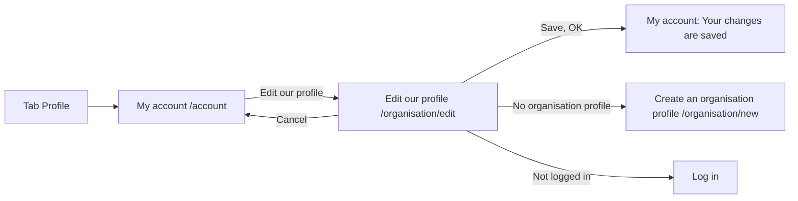

# Edit our profile (edit an organisation profile)

- Component: web/src/pages/EditOrganisationProfile.tsx, with EditOrganisationProfile.module.css and EditOrganisationProfile.test.tsx
- Address in the browser: /organisation/edit

## What the page is for

An organisation that already made its profile with issue 34 Create an organisation profile uses this page to change it. Its name, offer or website may have changed, or it made a typing mistake. The page shows the same form as when the profile was made, with the current name, kind, description and website already filled in. After Save the organisation lands on My account with its new name and "Your changes are saved". This way young people on Connect always read the right name, kind, offer and website.

## Who can open it

| Who | What they see |
|---|---|
| Organisation with an organisation profile, logged in | The form with its own current values. |
| Logged in account without an organisation profile | Sent on to Create an organisation profile at /organisation/new, never an empty edit form. |
| Visitor who is not logged in | The page Log in, through RequireLogin of issue 04. A 401 answer during use also sends the person to Log in. |
| Another organisation | Only its own profile. The address /organisation/edit has no id in it, so there is no address that opens the form of another organisation. |

The server takes the account from the session, never from the form.

## How you get there and where you go next

- The organisation taps the tab Profile (issue 06), which opens My account.
- On My account the link Edit our profile sits next to the line "You are logged in for `<name>`" (task 132.5). An account without an organisation profile sees no such link, only the link Create an organisation profile of task 34.5.
- Save leads back to My account at /account, which shows "Your changes are saved".
- Cancel leads back to My account with nothing changed.
- The button sits on My account because the page young people see of an organisation, issue 35 See an organisation's page, is built after this issue.

## Every element of the page, top to bottom

The form is the shared component web/src/components/OrganisationProfileForm.tsx (task 132.3). Create an organisation profile uses the same component with empty start values. The page gives it initialValues (name, kind, description, website), submitLabel Save and onSubmit.

### 1. Heading
- Text: Edit our profile.
- Built by: issue 132 Edit my organisation profile (GitLab #66, sprint 2), task 132.4.

### 2. Message above the form
- Text: "Connect is not reachable right now, your text is kept", in an area with role alert.
- When: Save gets a 503 or no answer. Every field keeps its value.
- Built by: task 132.3 (in the shared form) and task 132.4.

### 3. Line about personal details
- Text: "This profile is about your organisation. Do not put the name, phone number or email address of a person here."
- Made in task 34.4 of issue 34 and moved into the shared form in task 132.3.

### 4. Field Name of the organisation
- Label: Name of the organisation, above the field. A text field with autocomplete organization.
- Filled with: the current name.
- Rules: required. At most 100 characters (the validator of task 34.2). The server trims the fields.
- Message below the field: "Fill in the name of your organisation".
- Built by: task 132.3, rules shared with task 34.2 through one validator (task 132.2).

### 5. Field Kind
- Label: Kind, above the field. A select with exactly five options from ORGANISATION_KIND_LABELS, shown as Company, School, Municipality, Club and Fund.
- Filled with: the current kind. With empty start values no kind is chosen.
- Message below the field: "Choose one of the five kinds".
- Built by: task 132.3.

### 6. Field What you offer young people
- Label: What you offer young people, above the field. A textarea with a counter such as "420 characters left" of 500.
- Filled with: the current description.
- Rules: required. At most 500 characters.
- Message below the field: "Tell young people what you offer, in at most 500 characters".
- Built by: task 132.3.

### 7. Field Website
- Label: Website, above the field. A field of type url with the hint "Starts with https://, you may leave it empty".
- Filled with: the current website.
- Rules: may be left empty, and then the profile has no website. When filled, it must be an http or https address of at most 200 characters.
- Message below the field: "Fill in a web address that starts with https://".
- The form keeps noValidate, so the message of the server below Website is what the person reads, not a bubble of the browser.
- Built by: task 132.3.

### 8. Button Save
- Text: Save. While saving it says "Saving..." and is disabled, so it cannot be pressed a second time.
- Data: updateOrganisationProfile(values) in web/src/api/organisationProfiles.ts sends PUT /api/organisation-profiles/current through request(). The answer is the changed profile inside data.
- What happens per answer:
  - 200: the page goes to /account with a note in the navigation state, and My account shows "Your changes are saved" in an area with role status above the name. A reload of My account does not show it again.
  - 400: each message appears directly below its field, and the focus moves to the first wrong field. Nothing is saved and what was typed stays.
  - 404: the profile is gone, so the page sends the person on to /organisation/new.
  - 503 or no answer: "Connect is not reachable right now, your text is kept" above the form.
  - 401: request() sends the person to Log in.
- The server saves only the four values and the time of the change (column updated_at, task 132.1). It never changes the owner or the date the profile was made.
- Built by: tasks 132.1 (database), 132.2 (PUT /api/organisation-profiles/current), 132.4 (page).

### 9. Link Cancel
- Text: Cancel, a link next to the button Save, back to /account.
- Behaviour: nothing is sent and nothing changes.
- Built by: task 132.4.

## States

| State | What the organisation sees |
|---|---|
| Loading | "Loading...". The form is only shown once the current values are there, so nobody types over values that then disappear. |
| Filled | The form with the current name, kind, description and website. |
| No organisation profile | Sent on to /organisation/new. |
| Not reachable on load | "Connect is not reachable right now, try again later" in an area with role alert, and no form. |
| Wrong input | A message directly below each wrong field. What was typed stays. |
| Saving | The button says "Saving..." and is disabled. |
| Not reachable on Save | "Connect is not reachable right now, your text is kept" above the form, every change still in the fields. |
| Saved | My account with the new name and "Your changes are saved". |
| Phone and laptop | The page follows the Figma frame Create an organisation profile, with the heading Edit our profile. The team check (task 132.7) goes through it on a phone and a laptop. |

## Accessibility and privacy

- Every field has its label above it.
- Each message is linked to its field with aria-describedby, so a screen reader hears the message together with the name of the field. The focus moves to the first wrong field.
- The not reachable messages sit in role alert, the saved text on My account in role status.
- Edit our profile and Cancel are links, because they go to another page.
- Colours, fonts and spacing come only from web/src/styles/tokens.css, following the Figma frame Create an organisation profile.
- Clickable prototype (laptop, sprint 1 and 2), on the Figma page Prototype sprint 1 and 2 (desktop). The line above each screen names its GitLab issues.
  - [I04 Edit our organisation profile](https://www.figma.com/design/SAVxDf3rlsWz22qlzTEYte/Young-Amstelland-Connect--team-workspace?node-id=1020-510)
- Privacy: the form never asks for the name, phone number or email address of a person, and the line above the form says not to put them in. An organisation can only ever change its own profile. The address has no id that could be changed.

## Built by

| Board | Title | GitLab | Sprint | Prio |
|---|---|---|---|---|
| 132 | Edit my organisation profile | #66 | 2 | should |

Tasks: 132.1 DATABASE (the column updated_at and UpdateAsync), 132.2 BACKEND (PUT /api/organisation-profiles/current with the shared validator), 132.3 FRONTEND (the shared form OrganisationProfileForm), 132.4 FRONTEND (this page), 132.5 FRONTEND (the link Edit our profile and the saved text on My account), 132.6 TEST (end to end test in web/e2e/editOrganisationProfile.spec.ts) and 132.7 TEST (team check).

## Open points

- The cards give no open question for this page.
- A logo (issue 133), tags (issue 129) and a check by the foundation (issue 139) are named as out of scope on this card. None of those cards adds a field to this page.

## AI use declaration

AI was used as a writing support tool while working on this document. We used AI to draft
the formulation of sentences, the structure of wording, readability, and clarity from
content that we had provided, and to generate the diagrams. The content itself, including
our experiences, reflections, learning goals, decisions, self-assessments, and
conclusions, is our own. We reviewed the drafts and decided as a team which text to
include.
