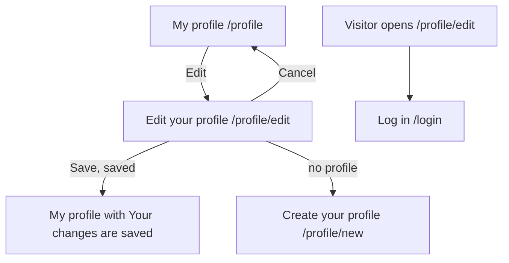

# Edit your profile (EditProfile)

Component: `web/src/pages/EditProfile.tsx`, with `EditProfile.module.css`, and the shared form `web/src/components/MemberProfileForm.tsx`.
Address in the browser: `/profile/edit`.

## What the page is for

A young person who made a profile changes it here, so what people see about them stays correct. For example they moved to another town, they turned 18 and belong in the next age band, or they want a new short line about themselves. The form is the same as when they made the profile, with the current values already filled in. It asks for exactly the same four things, so never an exact age, a birth date, a school or a street address.

## Who can open it

| Person | What they see |
|---|---|
| Visitor (not logged in) | The page Log in, through RequireLogin of issue 04. |
| Young person with a profile | The form with their own current values. |
| Logged in person without a profile | They are sent on to Create your profile at `/profile/new`, never an empty edit form. |

A young person can only ever change their own profile. The address has no id of a member in it, and there is no address or button that opens the edit form of someone else.

## How you get there and where you go next

- The tab Profile opens My account, and from there My profile (`/profile`). On My profile the link Edit, under the heading, leads here.
- Save brings the young person back to My profile, which shows the new values and "Your changes are saved".
- Cancel brings them back to My profile with nothing changed.
- Without a profile they go to Create your profile at `/profile/new`.
- After the foundation removed a short line (issue 142), My profile shows "You can write a new one with Edit.", with Edit as a link to this page.

## Every element of the page, top to bottom

### Loading and load errors

- While the page loads the current values: "Loading your profile...".
- Data: `getCurrentMemberProfile()` of issue 08 asks `GET /api/member-profiles/current`.
- Code 404 on load: the page sends the member on to `/profile/new`.
- Code 503 or no answer on load: "Connect is not reachable right now, try again later" in an area with role alert, and no form.
- Built by: issue 33 Edit my own profile, task 33.4 (GitLab #64, sprint 2).

### Not reachable message above the form

- Text: "Connect is not reachable right now, your text is kept".
- Where: above the form, in an area with role alert.
- When: Save gets code 503 or no answer. Every field keeps its value.
- Built by: issue 33, tasks 33.3 and 33.4.

### Field First name

- Label: First name, above the field. Autocomplete given-name. Filled with the current value.
- Rules: required, at most 60 characters (MemberProfileRules). When it is empty, "Fill in your first name" appears directly below the field and nothing is saved. The messages are the ones of task 7.2 and issue 07b, word for word (task 33.2).

### Field Age band

- Label: Age band. A select with the three bands from `AGE_BAND_LABELS` (15 to 17, 18 to 21 and 22 to 30, as issue 07 made them), with the current band chosen.
- Rules: never an exact age or a birth date.

### Field Region

- Label: Region, with the hint of issue 07b: "Your town or area, for example Amstelveen. Not your street, house number or postcode."
- Rules: required, at most 60 characters. A street with a house number or a postcode is refused with "Fill in only your town or area, not your street, house number or postcode" below the field (the region rule of issue 07b, which the server checks). A name with a space or a dash, such as De Ronde Venen, is fine.

### Field About you

- Label: About you, with the hint "Do not write your school, address or phone number here." and a counter below the field such as "240 characters left".
- Rules: at most 280 characters. A short line of exactly 280 characters is saved and shows "0 characters left". A short line of 281 characters gets "Your short line can be at most 280 characters" below the field and nothing is saved.

### Button Save and link Cancel

- Save: while waiting "Saving..." and disabled, so My profile opens once.
- What happens: `updateMemberProfile(values)` in `web/src/api/memberProfiles.ts` sends `PUT /api/member-profiles/current` through `request()`. The server takes the account from the session, finds its profile and saves the change (task 33.2). Creating and editing use one shared validator, `MemberProfileFieldsValidator`, so they can never refuse different things.
- Code 200: the page goes to `/profile`, which shows "Your changes are saved" in an area with role status above the profile.
- Code 400: each message appears directly below its field, linked with `aria-describedby`, and the focus moves to the first wrong field. What was typed stays.
- Code 404 on Save: the profile is gone, so the page sends the member on to `/profile/new`.
- Code 401: `request()` sends the member to Log in.
- Cancel: a link next to the button, back to `/profile`. Nothing is sent and nothing changes.
- Built by: issue 33, task 33.4.

The four fields live in `MemberProfileForm`, taken out of Create your profile by task 33.3. It gets its start values, the text of its button (Save) and a function that saves, and talks to no server itself. Create your profile uses the same component with empty start values.

## States

| State | What the person sees |
|---|---|
| Loading | "Loading your profile..." |
| Filled | The four fields with the current values, Save and Cancel. |
| No profile | Sent on to Create your profile. |
| Busy | The button says "Saving..." and is disabled. |
| Wrong input | The message below each wrong field, the focus on the first one, the text stays. |
| Saved | My profile with the new values and "Your changes are saved". |
| Not reachable on load | "Connect is not reachable right now, try again later", no form. |
| Not reachable on Save | "Connect is not reachable right now, your text is kept" above the form, every change stays. |
| Phone and laptop | Exactly four fields on a phone and on a laptop, without sideways scrolling. The cards give no other layout difference. |

## Accessibility and privacy

- Every field has its label above it. A message is linked to its field with `aria-describedby`, so a screen reader hears it together with the name of the field.
- The not reachable messages are role alert areas, the saved text on My profile is a role status area.
- The form asks for exactly four things: First name, Age band, Region and About you. Never an exact age, a birth date, a school or a street address, and the hints say not to put those in.
- The address shows `/profile/edit` with no number of a member in it.

The design: colours, fonts and spacing come only from the variables in `web/src/styles/tokens.css`, following the Figma frame Edit your profile (and Create your profile for the shared form) on the Figma board.

## Built by

| Board | Title | GitLab | Sprint | Prio |
|---|---|---|---|---|
| 33 | Edit my own profile | #64 | 2 | must |

The page builds on issue 07 Create a profile (#25), issue 07b A clear message when my region looks like a street address (#26) and issue 08 See my own profile page (#27), which made the fields, the region rule and My profile.

## Open points

- The card of this page names no question to the client.
- Whether the page warns a member who leaves with changes that are not saved: card 33 asks the team for advice, because a young person who edits wants a quick change and the client decides how Connect should feel. No decision yet.
- Tags, the email address, the password and a short line removed by the foundation are not on this page (issues 36, 115, 114 and 142).

## AI use declaration

AI was used as a writing support tool while working on this document. We used AI to draft
the formulation of sentences, the structure of wording, readability, and clarity from
content that we had provided, and to generate the diagrams. The content itself, including
our experiences, reflections, learning goals, decisions, self-assessments, and
conclusions, is our own. We reviewed the drafts and decided as a team which text to
include.
