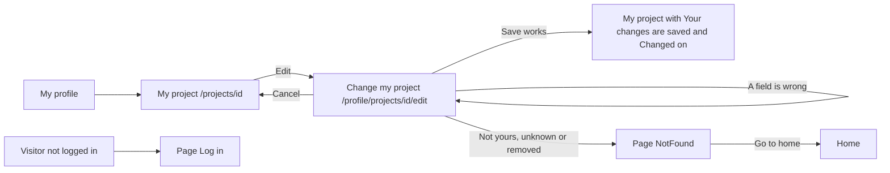

# Change my project

- Component: web/src/pages/EditProject.tsx, with EditProject.module.css and EditProject.test.tsx. The form itself is the shared component web/src/components/ProjectForm.tsx.
- Address in the browser: /profile/projects/:id/edit, for example /profile/projects/<id of the project>/edit.
- Heading on the page: Change my project.

## What the page is for

A young person who added a project to Connect may see a typo, want to tell more, or want to take something out of the text. Everything on the page of a project carries their name, so they must be able to correct it themselves. This page opens the same form as when they added the project, with their title and description already filled in. After Save they are back on the page of their project with "Your changes are saved" and the date of the change.

## Who can open it

- Member (young person) who made the project (the owner): sees the form filled in and can save.
- Another member, an organisation or an admin who opens the address: sees the page NotFound (issue 53), "This page does not exist or is no longer available", and no form. Since task 64.3 the page shows NotFound when the project is missing or when isOwner in the answer is false. The server gives the same not found answer for an unknown id, a removed project, a hidden maker and an id that is not an id. PUT /api/projects/{id} also answers not found for a project that is not yours and never says not allowed, so nobody learns which projects exist.
- Visitor who is not logged in: the route sits inside RequireLogin of issues 04 and 04b, so the visitor sees the page Log in first. The server answers not logged in without asking the database.

## How you get there and where you go next

You arrive from the page of your own project, My project (web/src/pages/MyProject.tsx, issue 61). Since task 64.3 that page lives at /projects/:id, and the old address /profile/projects/:id sends on to it. There you press Edit, a link to /profile/projects/<id>/edit, which only the owner sees. You reach My project from My profile or from any list of projects.

You leave in one of three ways. Save takes you back to My project with "Your changes are saved". Cancel takes you back to My project without saving. When the project cannot be found, the button Go to home on the page NotFound takes you home.

## Every element of the page, top to bottom

The page loads the project with getProject(id) of web/src/api/projects.ts, which asks GET /api/projects/{id}. Task 157.3 first used getOwnProject(id) of issue 61. Task 64.3 renamed it to getProject(id), because the address now answers every logged in member with isOwner true or false, and EditProject shows NotFound when isOwner is false. Since task 157.2 the answer also holds updatedAt, empty when the project was never changed.

All screen elements are built by task 157.3, issue 157 Change my project, GitLab #179, sprint 4, unless another task is named.

1. Heading: Change my project
2. Field Title
   - Label above the field. Filled with the current title. No maxLength, because a browser with maxLength cuts off a pasted text without saying so.
   - Messages, the same as when adding a project (issues 60 and 60b): "Give your project a title" when it is empty, "Your title can be at most 80 characters" when it is longer.
   - The message sits next to the field, linked with aria-describedby and aria-invalid, and the cursor goes to the first wrong field. What was typed stays.
3. Field Description
   - Label above the field. Filled with the current description. No maxLength, for the same reason as Title.
   - Messages: "Describe your project" when it is empty, "Your description can be at most 1000 characters" when it is longer.
   - Spaces at the start and end are removed before the check, on the server.
4. Button Save
   - Calls changeProject(id, title, description) of web/src/api/projects.ts, which sends PUT /api/projects/{id} through the shared helper request().
   - What goes to the server: {"title": "...", "description": "..."}. Any other field is ignored. The account comes from the session, never from the address or the body.
   - While waiting the button says "Saving..." and is disabled.
   - Saved (code 200): back to My project with "Your changes are saved" in an area with role status, the new title and text, and "Changed on" with the date in the time zone of the browser.
   - Server side: PUT /api/projects/{id} of task 157.2 checks the fields with ProjectTextRules, the one place where the limits 80 and 1000 are written, shared with adding a project. It answers 200, 400, 401, 404 or 503. The time of the change comes from the server clock, never from the browser. Task 157.1 adds the column updated_at and the owner lookup FindForChangeAsync, which finds the project only when it belongs to the account that asks. A removed project (issue 48) is never found.
5. Link Cancel, next to Save
   - Goes back to the page of the project without a call to the server.
6. Message area below the form
   - "Connect is not reachable right now, try again later" in an area with role alert when Connect cannot be reached. What was typed stays.
7. On My project (not this page, but part of the flow)
   - The button Edit, "Changed on" whenever updatedAt is filled, and "Your changes are saved" after a save. Built by task 157.3 in MyProject.tsx.

## States

- Loading: the page loads the project with getProject(id) before the form shows. The card gives no loading text for this page.
- Filled: the form with the current title and description.
- Saving: the button says "Saving..." and is disabled.
- Saved: My project with "Your changes are saved", the new text and "Changed on" with today's date.
- Wrong input: the message next to each wrong field, and nothing is changed. For example "Give your project a title" for an empty title, or "Your title can be at most 80 characters" for a title of 81 characters.
- Not found: the project is missing or isOwner is false. The page NotFound shows in place of the form, "This page does not exist or is no longer available" with the button Go to home.
- Not reachable: "Connect is not reachable right now, try again later" below the form, what was typed stays. A tester checks this by switching the phone to airplane mode before pressing Save.
- Empty: not used. The page has no list.
- Phone (360 pixels wide or close) and laptop: the team check of task 157.5 goes through every criterion on both.
- Design: the Figma frame Add a project on the Figma board of Connect, page Design directions, with the heading Change my project. Colours, fonts and spacing come only from the variables in web/src/styles/tokens.css.

## Accessibility and privacy

- Each field has its label above it. Each message sits next to its field, linked with aria-describedby and aria-invalid, and the cursor goes to the first wrong field.
- "Your changes are saved" is in an area with role status. The not reachable message is in an area with role alert.
- axe reports 0 issues.
- Only the owner can change a project. Not yours, unknown, removed and a wrong id all show the same page NotFound, "This page does not exist or is no longer available", so nobody learns which projects exist.
- The server log holds the real error with the request id, never the title or the description.

## Built by

| Board | Title | GitLab | Sprint | Prio |
|---|---|---|---|---|
| 157 | Change my project | #179 | 4 | should |
| 64 | Open a project page | #181 | 4 | should |

Issue 64 comes after 157. Its task 64.3 makes the page load with getProject(id) and show NotFound when the project is missing or isOwner is false, with a screen test for isOwner false. Its task 64.5 changes the end to end test of task 157.4 so it expects the sentence of NotFound.

Issue 157 needs issues 61 See my project on its own page (#173), 29 Unconfirmed accounts stay hidden (#58), 48 Remove content that breaks the rules (#121), 60b A clear message when my project title or text is too long (#120) and 62b See the projects of another member on their page (#176) first. The tasks run in this order: 157.1 (database: updated_at, the change rule and the owner lookup), 157.2 (PUT /api/projects/{id} and updatedAt on GET /api/projects/{id}), 157.3 (the button Edit and this page), 157.4 (end to end test web/e2e/changeProject.spec.ts) and 157.5 (team check on a phone and a laptop).

## Open points

- Keeping the old texts of a project for the foundation is not part of this page. It waits for issue 10, question 66.
- Adding or changing the picture of a project is issue 61b, and removing it is issue 159. The card does not put the picture on this form.

Settled: the shared ProjectForm has no maxLength on Title or Description (issue 60b). A project that is not yours, unknown or removed shows the page NotFound (task 64.3), not the sentence "This project does not exist" of task 157.3.

## AI use declaration

AI was used as a writing support tool while working on this document. We used AI to draft
the formulation of sentences, the structure of wording, readability, and clarity from
content that we had provided, and to generate the diagrams. The content itself, including
our experiences, reflections, learning goals, decisions, self-assessments, and
conclusions, is our own. We reviewed the drafts and decided as a team which text to
include.
