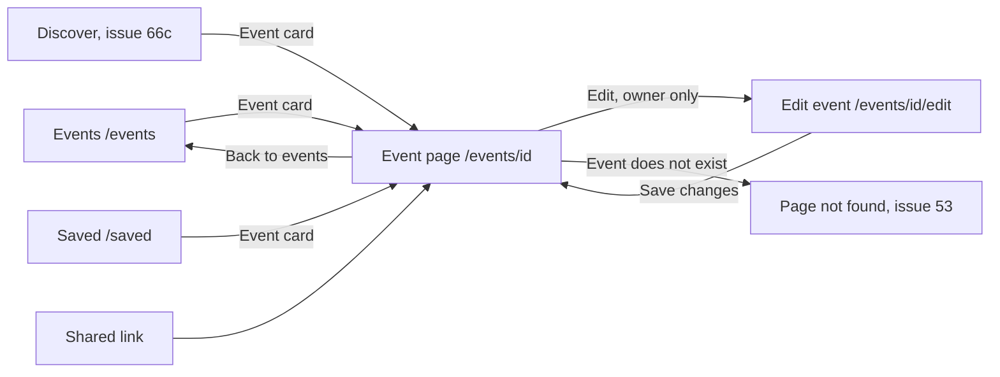

# Event page

- Component: frontend/src/pages/EventDetails.tsx, with EventDetails.module.css and EventDetails.test.tsx
- Address in the browser: /events/:id
- Title of the browser tab: Connect, followed by the title of the event

## What the page is for

A member opens the page of one event to learn everything about an activity before deciding to join: the title, the organisation that holds it, the date and time, the place, how many places are left and the full description. A young person with a profile registers here, and anyone logged in can save the event for later. The organisation of the event changes or cancels its event from this page.

## Who can open it

- Member (young person) and organisation: every logged in account can open the page. The route is inside RequireLogin of issue 04.
- Visitor who is not logged in: sees the page Log in, and after logging in lands on that event (issue 04b).
- Only a young person with a profile can register. An account without a member profile, for example an organisation, reads "Only young people with a profile can register" in place of the button.
- Only the organisation of the event sees the buttons Edit and Cancel event. Another organisation and a young person never see them, and the server refuses a change or a cancel from anyone else.
- The page shows only the name of the organisation, never which members are going and never a contact person, because many members are under 18.

## How you get there and where you go next

EventCard of issue 66 is one link to /events/<id>, with the title and the date in its accessible name, so every list that shows the card leads here.

## Every element of the page, top to bottom

1. Saved message, above the details, in role status
   - "Your changes are saved" after the organisation changed the event (task 162.4).
2. Heading (h1): the title of the event
   - Exactly one h1 on the page.
   - Next to the title:
     - The button Save or Saved (SaveButton of issue 43 with kind event, itemId the id of the event and saved from GET /api/events/{id}). Pressing Save sends PUT /api/saved-items/event/{itemId}, pressing Saved sends the DELETE of issue 43b. The word changes at once and the button is disabled until the answer comes. When Connect cannot be reached the old word comes back and "Not saved, Connect is not reachable right now" or "Not removed, Connect is not reachable right now" appears next to the button in role alert. The button has aria-describedby pointing to the title of the event. Saving is not registering: the places left stay the same. The same on an upcoming and a past event. Task 161.4, issue 161 Save an event, GitLab #222, sprint 5.
     - The link Edit, styled as a button, to /events/{id}/edit. Rendered only when isMine is true and the event has not started, never hidden with CSS. Task 162.4, issue 162 Change my event after publishing, GitLab #223, sprint 5.
3. The details
   - "by <organisation>", the date and time in Amsterdam time such as "Thursday 15 October, 19:30", the place, the places, and the full description with its line breaks kept. The description is plain text, never HTML.
   - The places: "7 of 20 places left" from placesLeft and capacity. The number is always the one the server counts. After every answer of Register the page asks the event again, it never lowers the number itself (task 68b.5). Before issue 68b the line reads "20 places".
   - Data: getEvent(id) in frontend/src/api/events.ts asks GET /api/events/{id} through request(). It returns the event, not found or not reachable. The server checks the session, reads the id as text with EventIdValidator (a text that is no uuid gets the shared not found answer of issue 53), and reads one row of the table event (issue 65) with the name of its organisation from organisation_profile in one question. The answer also says, only for the person who asks, myRegistration (registered, notRegistered, notAllowed, started, cancelled), saved, isMine, isCancelled and placesLeft (tasks 66b.2, 68.3, 68b.4, 161.3, 162.3, 163.3).
   - Built by task 66b.3, issue 66b Open an event page, GitLab #125, sprint 3.
4. The area for registering (a div with data-slot="register", below the details)
   - An event that has started (hasTakenPlace(startsAt, now) in frontend/src/utils/hasTakenPlace.ts is true only when startsAt lies before now): "This event has taken place" as plain text in role status, and no button or link to join. Task 66b.3.
   - A cancelled event: "This event is cancelled" in role status, and no button Register, Edit or Cancel event. Task 163.4.
   - Otherwise RegisterButton (frontend/src/components/eventDetails/RegisterButton.tsx, task 68.4, issue 68 Register for an event, GitLab #128, sprint 3):
     - notRegistered: the button Register.
     - registered: "You already have a place".
     - notAllowed: "Only young people with a profile can register".
     - notRegistered with placesLeft 0: a disabled button Full (task 68b.5, issue 68b A full event refuses a place fairly, GitLab #129, sprint 3).
     - Pressing Register calls registerForEvent(id), which sends POST /api/events/{id}/registrations with only the cookie connect_session. No name and no member number are sent. While waiting the button says "Registering..." and is disabled.
     - 201: "You have a place" in place of the button, then the event is asked again for the new places left.
     - 409 alreadyRegistered: "You already have a place". 409 started: "This event has taken place" and no button, the same sentence and area as task 66b.3. 409 full: "This event is full" and the disabled button Full, then the event is asked again. 409 cancelled: "This event is cancelled".
     - 403: "Only young people with a profile can register".
     - 503 or no answer: "Connect is not reachable right now, try again later" below the button, and the button is Register again. The places left do not go down twice.
     - The sentence sits in an area with role status (aria-live polite).
   - On the server, the account must have a member profile and the event must exist, not have started and not be cancelled. One transaction locks the row of the event, counts the registrations, compares them with the capacity, and saves one row in event_member and one activity line in audit_entry of issue 32 together, or nothing. A second request for the same event waits at the lock. The unique index refuses a second place for the same young person. Twelve people pressing at once for eight places give exactly eight places and four Full answers (tasks 68.1, 68.2, 68b.1, 68b.3). Every registration shows on Activity for the admins as "registered for an event" (task 68.5).
5. Button: Cancel event, below the details
   - Rendered only when isMine is true, the event is not cancelled and has not started, never hidden with CSS.
   - Opens ConfirmDialog of issue 113 with the title "Cancel this event?", the title and date of the event and the sentence "Young people who registered will see that it is cancelled. You cannot undo this.", confirmLabel Cancel event and cancelLabel Keep event (the prop cancelLabel of task 70.3).
   - Keep event and the Escape key close the window and send nothing. The focus goes back to the button.
   - Cancel event in the window calls cancelEvent(id), which sends POST /api/events/{id}/cancellation. While waiting both buttons are disabled and Cancel event says "Cancelling...".
   - 204: the window closes, the page asks the event again and shows the cancelled state. The focus goes to the heading. The event disappears from Events, Past and Discover. A young person who registered keeps it under My events marked Cancelled.
   - In the window: 403 "Only the organisation of this event can cancel it", 409 "This event has already started, it can no longer be cancelled", 503 or no answer "Connect is not reachable right now, your event is not cancelled" in role alert. 404 shows the page NotFound of issue 53.
   - The server locks the row of the event as the register step does and sets cancelled_at. No registration is removed.
   - Task 163.4, issue 163 Cancel my event, GitLab #224, sprint 5.
6. Link: Back to events, to /events (task 66b.3).

## States

- Loading: "Loading the event..." in role status.
- Filled: the heading, the details, the description and the area for registering.
- Empty: not used.
- Past: "This event has taken place", no Register, no Edit, no Cancel event.
- Cancelled: "This event is cancelled", no Register, no Edit, no Cancel event.
- Full: the disabled button Full, or "This event is full".
- Not found: the page NotFound of issue 53 in place of the event, with the link Go to home.
- Not reachable: "Connect is not reachable right now, try again later" in role alert, in place of the details.
- Phone (360 pixels wide) and laptop (1280 pixels wide): the team checks every criterion on both on the test site.
- Design: the Figma frame Event page on the Figma board of Connect, page Design directions. Colours, fonts and spacing only through frontend/src/styles/tokens.css.

## Accessibility and privacy

- The title of the event is the one main heading, so a screen reader user hears it when the page opens.
- "You have a place" and "This event is full" are read aloud through role status. The button Full is a real button with the disabled attribute, so a screen reader announces it as not available.
- SaveButton is described by the title of the event.
- The confirm window keeps the keyboard and the screen reader inside it, and the focus goes back to the right place after it closes.
- The page never shows the names of people who registered or who saved the event, only the number of places left and the name of the organisation. A young person can only register themselves.
- When a member deletes the account, the saved events are deleted with it.
- axe reports 0 issues.

## Built by

| Board | Title | GitLab | Sprint | Prio |
|---|---|---|---|---|
| 66b | Open an event page | #125 | 3 | should |
| 68 | Register for an event | #128 | 3 | should |
| 68b | A full event refuses a place fairly | #129 | 3 | should |
| 161 | Save an event | #222 | 5 | could |
| 162 | Change my event after publishing | #223 | 5 | could |
| 163 | Cancel my event | #224 | 5 | could |

Issue 66b needs 66, 53 and 04b first. Issue 68 needs 66b, 07, 32 and 53. Issue 68b needs 68. Issue 161 needs 43 and 66b. Issue 162 needs 66b, 10, 140, 29 and 68. Issue 163 needs 68, 10, 113, 140, 160, 67, 69 and 70.

## Open points

- Changing an event after publishing is built only when the client says yes: issue 10 The client's priorities for the epics, question 74. The same question covers telling the registered young people by email, and seeing who registered.
- Cancelling an event is built only when the client says yes: issue 10, question 75, which also covers an email to the registered young people. Undoing a cancellation is question 105, removing a cancelled event after a while is question 106.
- A waiting list when an event is full: issue 10, question 126.
- A reminder by email before a saved event: issue 10, question 101.
- The button Save (task 161.4) and the link Edit (task 162.4) both sit next to the title. The Figma frame Event page decides the order.

## AI use declaration

AI was used as a writing support tool while working on this document. We used AI to draft
the formulation of sentences, the structure of wording, readability, and clarity from
content that we had provided, and to generate the diagrams. The content itself, including
our experiences, reflections, learning goals, decisions, self-assessments, and
conclusions, is our own. We reviewed the drafts and decided as a team which text to
include.
