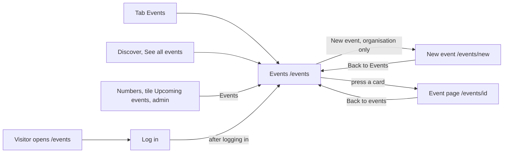

# Events, the upcoming and past events of Connect

- Component: web/src/pages/Events.tsx, with Events.test.tsx
- Address in the browser: /events, behind the tab Events
- Server addresses: GET /api/events?page=1&pageSize=20 for the upcoming events, GET /api/events?state=past&page=1&pageSize=20 for the past events

## What the page is for

Organisations around Amstelland hold events for young people, for example an open training day at a sports club. This page lists every event that has not started yet, soonest first, and below that the events that already happened, most recent first. A young person finds activities to join, and an organisation sees what else is going on. An organisation also starts a new event from here with the button New event.

## Who can open it

- Member (young person): sees the upcoming and the past events. Does not see the button New event.
- Organisation: sees the same lists, and also the button New event, which is only in the page when useSession() says isOrganisation is true (task 65.4).
- Admin: the cards name no separate view. The page sits inside RequireLogin, so an admin who is logged in sees the same lists.
- Visitor who is not logged in: sees the page Log in when opening /events, and after logging in lands on Events (AC6 of issue 66). Issue 06 first made /events open to visitors, and task 66.4 moves the route inside RequireLogin.
- What nobody ever sees: who else is going to an event, a contact person, a phone number or an email address. Only the name of the organisation shows.

## How you get there and where you go next

You get here with the tab Events in the app shell of issue 06, with the link See all events on Discover (issue 66c), and as an admin with the link Events on the tile Upcoming events of the page Numbers (issue 144). A visitor who opens /events goes to Log in and comes back here. After publishing an event, the link Back to Events on the page New event brings an organisation back here.

From here an organisation goes to New event at /events/new. Every card is a link to the page of that event at /events/<id> (issue 66b Open an event page), which has a link Back to events to /events. The other tabs lead to the rest of Connect.

## Every element of the page, top to bottom

The page sits inside AppShell of issue 06, so the five tabs stay around it. The browser tab title is "Connect, Events".

1. Heading: Events
   - One h1 with the page name, made when the page was still empty.
   - Built by task 6.3, issue 06 Move between the five tabs of Connect, GitLab #19, sprint 1.

2. Button: New event (organisation only)
   - A link styled as a button, at the top, above the heading area, to /events/new.
   - Only rendered when useSession() says isOrganisation is true, which GET /api/sessions/current gives since task 65.3. For a young person it is not in the page at all, not hidden with CSS.
   - Where it leads: the page New event with the fields Title, Description, Date and time, Place and Number of places. That page is described in NewEvent.md.
   - Built by tasks 65.3 (session says isOrganisation) and 65.4 (the link), issue 65 Publish an event, GitLab #123, sprint 3.

3. Heading: Upcoming events
   - Stands below the button New event. The cards do not give its heading level.
   - Built by task 66.4, issue 66 See the upcoming events, GitLab #124, sprint 3.

4. The list of upcoming events
   - The component EventList (web/src/components/EventList.tsx) shows one EventCard (web/src/components/EventCard.tsx) per event, as a list (ul with li), in the order the server sends. The screen never sorts or filters again.
   - Each card is an article element with the title as a heading, the date and time such as "Thursday 15 October, 19:30", the place, the number of places such as "20 places", and the organisation such as "by Sportclub Amstelveen".
   - The date and time are shown with Intl.DateTimeFormat in the time zone Europe/Amsterdam, so every member sees the time of the event wherever their phone is set.
   - Data: getUpcomingEvents(page, pageSize) in web/src/api/events.ts asks GET /api/events?page=<page>&pageSize=<pageSize> through request() of web/src/api/client.ts. The page never sees a status code.
   - The server checks the session with the guard of issue 04, checks page and pageSize as text with a validator, takes now from TimeProvider and reads the events that start now or later, soonest first, with the organisation name from organisation_profile. The answer holds the events in data and page, pageSize and total in meta. It never says who registered or who made the event. A wrong page or pageSize gives a plain message that says which one and why.
   - An event leaves this list the moment its start time has passed (AC2 of issue 66). A new event shows here right after an organisation publishes it, at the place its date gives it (AC3 of issue 66).
   - Each card is one link to the page of the event at /events/<id>, with the title and the date in its accessible name for a screen reader. Nothing inside the card can be pressed on its own. Built by task 66b.3, issue 66b Open an event page, GitLab #125, sprint 3.
   - A cancelled event is never in this list and is not counted in total, so Load more never counts it (task 163.1, issue 163 Cancel my event, GitLab #224, sprint 5).
   - The list does not show how many places are left. That is only on the page of one event (issue 68b).
   - Built by tasks 66.1 (query), 66.2 (seed data), 66.3 (server address) and 66.4 (screen), issue 66, GitLab #124, sprint 3.

5. Button: Load more (upcoming)
   - Below the list while page times pageSize is less than total. Pressing it asks the next twenty and adds their cards below the ones already there. The list never jumps back to the top.
   - While it waits it says "Loading..." and is disabled. When all events are shown, the button is gone.
   - Built by task 66.4, issue 66, GitLab #124, sprint 3.

6. Part: Past
   - A section with the heading Past as a real h2 element, below the upcoming list. The component is PastEventList in web/src/components/events/PastEventList.tsx.
   - Shows the events that already started, most recent first, as compact cards: EventCard with the prop compact shows the title, the date and time in Amsterdam time, the place and the organisation, but not the number of places.
   - Data: EventList with the prop list="past" calls getPastEventList(page, pageSize) in web/src/api/events.ts, which asks GET /api/events?state=past&page=<page>&pageSize=<pageSize> through request().
   - The past events are asked in their own request, at the same time as the upcoming ones. Each list shows its own result as soon as it comes, so the upcoming list never waits for the history.
   - An event is never in both lists (AC2 of issue 67).
   - A card links to the page of the event in the same way as an upcoming card (task 66b.3).
   - A cancelled event is never under Past either and is not counted in total (task 163.1).
   - Built by tasks 67.1 (query), 67.2 (server address) and 67.3 (screen), issue 67 See past events, GitLab #127, sprint 3.

7. Button: Load more (past)
   - The same button as the upcoming list, below the past cards while page times pageSize is less than total. It adds the next twenty older events below.
   - On a failure the cards stay and the button can be pressed again.
   - Built by task 67.3, issue 67, GitLab #127, sprint 3.

## States

Upcoming list:
- Loading: "Loading events..." in an area with role status.
- Empty: "There are no upcoming events yet".
- Filled: the cards, soonest first, with Load more after the first twenty. The seed data of task 66.2 shows "Test event, next week" above "Test event, in two weeks", and "Test event, later 20" appears after Load more.
- Not reachable on the first page: "Connect is not reachable right now, try again later" in an area with role alert, inside the list only. The rest of the page and the tabs keep working.
- Not reachable on Load more: the same sentence below the cards, the cards stay, and the button can be pressed again.

Part Past:
- Loading: "Loading past events..." in an area with role status.
- Empty: "There are no past events yet".
- Filled: the compact cards, most recent first. The seed data shows "Test event, yesterday" above "Test event, last week", and "Test event, earlier 20" appears after Load more.
- Not reachable: "Connect is not reachable right now, try again later" in an area with role alert, inside this part only. The upcoming list keeps working.

Phone and laptop:
- On a phone on mobile data the list is there within two seconds after tapping the tab, with "Loading events..." in between (AC9 of issue 66).
- Design: the Figma frame Events on the page Design directions of the Figma board. Colours, fonts and spacing come only from web/src/styles/tokens.css.

## Accessibility and privacy

- Each card has its title as a heading, so a screen reader hears the title and the date per card (AC8 of issue 66). EventCard takes the heading level as a prop, so it fits under h1 on Events and under h2 on another page.
- Past is a real h2, so a screen reader can jump to it by headings (AC7 of issue 67).
- The button New event is not rendered for a young person, so a screen reader does not read it out.
- The times are always in Europe/Amsterdam, because the events are in Amstelland.
- A card never shows who registered, who made the event, a contact person, a phone number or an email address. Only the name of the organisation shows, because many members are under 18.

## Built by

| Board | Title | GitLab | Sprint | Prio |
|---|---|---|---|---|
| 06 | Move between the five tabs of Connect | #19 | 1 | must |
| 65 | Publish an event | #123 | 3 | should |
| 66 | See the upcoming events | #124 | 3 | should |
| 66b | Open an event page | #125 | 3 | should |
| 67 | See past events | #127 | 3 | could |
| 163 | Cancel my event | #224 | 5 | could |

Issue 06 is not in the page list of this page, but task 6.3 made the empty page Events with its heading. Issue 66b makes every card a link, and issue 163 leaves a cancelled event out of both lists.

## Open points

- Photos or a short report of what happened at an event wait for question 125 of issue 10 The client's priorities for the epics (GitLab #11).
- Issue 140 Only a checked organisation can publish decides later which organisations may publish. Until it is on the test site, the checks of issues 65, 66 and 67 use a new test account made an organisation with Create an organisation profile.
- The heading level of Upcoming events is not given in the cards. EventCard sits under h1 on Events, so the design in the Figma frame Events decides.

## AI use declaration

AI was used as a writing support tool while working on this document. We used AI to draft
the formulation of sentences, the structure of wording, readability, and clarity from
content that we had provided, and to generate the diagrams. The content itself, including
our experiences, reflections, learning goals, decisions, self-assessments, and
conclusions, is our own. We reviewed the drafts and decided as a team which text to
include.
