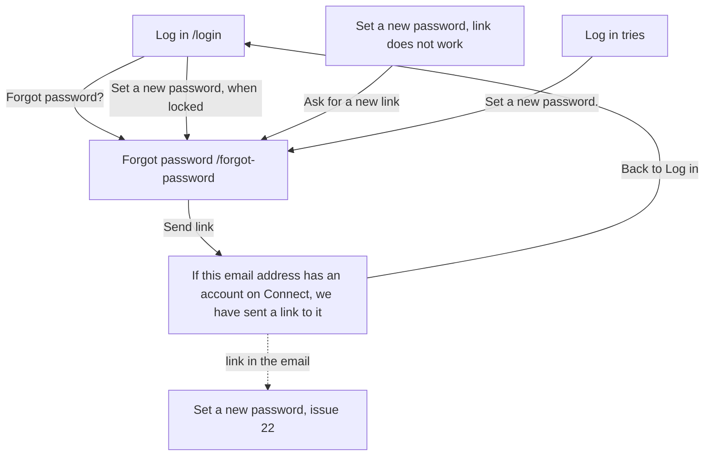

# Forgot password (ForgotPassword)

Component: `frontend/src/pages/ForgotPassword.tsx`, with `ForgotPassword.module.css`.
Address in the browser: `/forgot-password`.

## What the page is for

A member who forgot their password asks here for a link by email to set a new one. They type their email address and press Send link. Within a minute an email arrives with one link that works for one hour. Nobody from the foundation has to help. The page gives exactly the same answer for every address, so nobody can use it to find out who is a member.

## Who can open it

The page is open to everyone. It is not wrapped in RequireLogin, because a person who forgot their password cannot log in.

| Person | What they see |
|---|---|
| Visitor or member who forgot the password | The whole page. |
| Anyone who types an address that has no account | Exactly the same page, the same sentences and the same wait. No email is sent. |

## How you get there and where you go next

- The link Forgot password? below the form on the page Log in (`/login`) leads here (task 21.4).
- The link Set a new password below the locked message on the page Log in leads here too (issue 31b An email when log ins with my email address are locked, task 31b.3).
- On the page to set a new password, a link that no longer works shows the link Ask for a new link to `/forgot-password` (issue 22 Set a new password through the link).
- Under the list on the page Log in tries, the sentence "Is there a try that was not you? Set a new password." links here (issue 125 See every log in try on my account).
- After the request is taken in, the link Back to Log in goes to `/login`.
- The link in the email opens the page to set a new password, which is issue 22 Set a new password through the link. This page stops at the email.

## Every element of the page, top to bottom

### Field Email

- Label: Email, above the field. Type email, autocomplete email.
- Messages, next to the field:
  - "Fill in your email address" when the field is empty.
  - "Fill in a valid email address" when what was typed has no @ in it, for example samexample.org. No email is sent.
- Rules: the form has `noValidate`, so the browser shows no bubble of its own. The page checks both rules before sending, with the same texts. The server checks the field again and answers code 400 with the same messages.
- Built by: issue 21 Ask for a password reset link by email, task 21.4 (GitLab #39, sprint 2).

### Button Send link

- Text: Send link. While waiting: "Sending..." and disabled, so it cannot be pressed a second time. The wait takes about two seconds on purpose.
- What happens: `requestPasswordReset(email)` in `frontend/src/api/passwordResets.ts` sends `POST /api/password-resets` through the shared helper in `frontend/src/api/client.ts`. The address is on the open list of the guard. When the address has an account, the server ends the older links of that account, makes a new link that works for one hour, and puts one email in the mail queue. When there is no account it does nothing. Either way the answer is the same, and never before two seconds have passed (task 21.3).
- The limit: Connect sends at most five reset emails to one address in one hour. The sixth request looks and takes exactly as long as the first, but no email is sent. After an hour a new request sends an email again. Someone who uses up the five emails for another address does not stop the reset email of a member (issue 21b No more than five reset emails in one hour, task 21b.2, GitLab #43, sprint 2).
- The email: subject "Set a new password for Connect", one link and the sentence that it works for one hour, and nothing else about the member. On a laptop and on the test site every email lands in the test mailbox Mailpit, which on the test site opens only with the team's login (task 21.2).

### Message after the request is taken in

- Text, in place of the form, in an area with role status:
  - "If this email address has an account on Connect, we have sent a link to it. The link works for one hour."
  - "At most five emails are sent to one address per hour. If none arrives, check your spam folder." (issue 21b, task 21b.3)
  - A link Back to Log in, below both sentences.
- Rules: both sentences are fixed text. They are the same for every address and every request, so they tell a stranger nothing.
- Built by: issue 21, task 21.4, and issue 21b, task 21b.3.

### Not reachable message

- Text: "Connect is not reachable right now, try again later".
- Where: below the form, in an area with role alert.
- When: code 503, any other code of 500 or higher, or no answer at all. The form stays, the email address stays in the field, and the limit sentence is not shown.
- Built by: issue 21, task 21.4.

## States

| State | What the person sees |
|---|---|
| Empty | The field Email and the button Send link. |
| Busy | The button says "Sending..." and is disabled, for about two seconds. |
| Wrong input | "Fill in your email address" or "Fill in a valid email address" next to the field. |
| Taken in | The two sentences and the link Back to Log in, in place of the form. The same for every address. |
| Not reachable | "Connect is not reachable right now, try again later" below the form, the address stays. |
| Phone and laptop | The page works on a phone of 360 pixels wide and a laptop of 1280 pixels wide without sideways scrolling (Definition of Done). The cards give no other layout difference. |

## Accessibility and privacy

- The field has its label above it. The message after the request is in a role status area, so a screen reader reads it aloud as soon as it appears. The not reachable message is in a role alert area.
- Nothing on the page tells a stranger whether an address has an account: the same sentences after about the same wait.
- The email holds only the link: no name, no password and no other details of the account.
- When a member deletes their account (issue 113), the reset links Connect kept for them are deleted with it.
- When the mail server cannot be reached, the server writes one log line without the address or the text.

The design: colours, fonts and spacing come only from the variables in `frontend/src/styles/tokens.css`, following the Figma frame Forgot password on the Figma board.

## Built by

| Board | Title | GitLab | Sprint | Prio |
|---|---|---|---|---|
| 21 | Ask for a password reset link by email | #39 | 2 | should |
| 21b | No more than five reset emails in one hour | #43 | 2 | should |

## Open points

- A check that the person is a human on this page, like the box I am a person on Log in, is out of scope of issue 123 A puzzle that proves I am a person before I log in and waits for the client: issue 10 The client's priorities for the epics, question 13.
- Opening the link and choosing the new password is issue 22 Set a new password through the link, not this page.

## AI use declaration

AI was used as a writing support tool while working on this document. We used AI to draft
the formulation of sentences, the structure of wording, readability, and clarity from
content that we had provided, and to generate the diagrams. The content itself, including
our experiences, reflections, learning goals, decisions, self-assessments, and
conclusions, is our own. We reviewed the drafts and decided as a team which text to
include.
