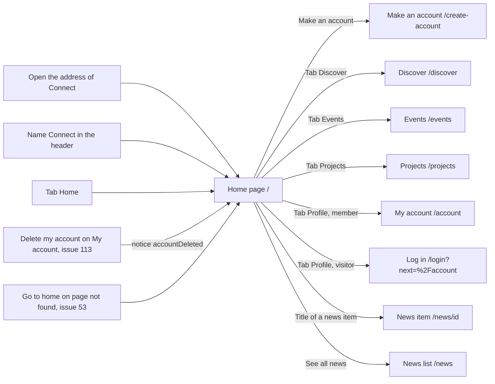

# Home page

- Component: frontend/src/pages/Home.tsx, with Home.module.css and Home.test.tsx. The part News is frontend/src/components/home/HomeNews.tsx, with HomeNews.module.css and HomeNews.test.tsx.
- Address in the browser: / (the start address of Connect, also the tab Home)
- Title of the browser tab: a title element with Connect and the name of the page (task 6.3). No name or email address is ever in it.

## What the page is for

The home page is the first thing anyone sees when they open Connect. It says in one sentence what Connect is and offers the way to make an account.

Once the client says yes, it also shows the three newest news items of the foundation. A visitor then sees what is new the moment they open Connect. After a member deletes their account, this is also the page that tells them all their data is gone.

## Who can open it

- Visitor (not logged in): sees the whole page. Nothing on it needs a log in. The server sends the page to everyone (task 6.1) and the news address is open to everyone (task 166.2).
- Member (young person or organisation) and admin: see the same page inside the same shell with the five tabs.
- Nobody gets a not logged in, not allowed or not found answer on this page.

## How you get there and where you go next

You arrive here by opening the address of Connect, by pressing the name Connect in the header of the shell, by tapping the tab Home, or after deleting your account on My account (issue 113). The page not found of issue 53 also leads here with its link Go to home.

From here you go to Make an account, to another tab or to the news.

## Every element of the page, top to bottom

The page sits inside AppShell of issue 06. The shell draws a header with the name Connect as a link to /, the five tabs Home, Discover, Events, Projects and Profile, and the page inside a main element. On this page the tab Home is the marked one. The shell and its tabs are described with issue 06, not repeated here.

1. Notice after deleting an account: Your account and all your data are deleted.
   - Shown at the top of the page, in an area with role status, only when the route brings the notice accountDeleted. Without the notice nothing is shown.
   - Data: none from the server. My account sends the member here with navigate('/', { replace: true, state: { notice: 'accountDeleted' } }) after POST /api/accounts/current/deletion answered 204, and after clear() of useSession, so the tabs show Log in again.
   - Built by task 113.3, issue 113 Delete my account and all my data, GitLab #33, sprint 2.
2. Heading: Home
   - The main heading of the page, the same word as the tab that opens it.
   - Built by task 3.5, issue 03 Create an account, GitLab #14, sprint 1, changed from Connect to Home by task 6.3, issue 06 Move between the five tabs of Connect, GitLab #19, sprint 1.
3. One sentence that says what Connect is, in plain words.
   - No member count and no data from the server.
   - The exact sentence is not written on the cards. See Open points.
   - Built by task 3.5, issue 03, GitLab #14, sprint 1.
4. Make an account
   - A link to /create-account, drawn as a button, directly below the sentence about Connect. It opens the page Make an account with the fields Email and Password.
   - Task 3.5 first put this link in the top bar TopBar.tsx. Task 6.2 removes the top bar, and task 6.3 gives the link its place as a button directly below the sentence. Issue 166 calls it the button Make an account on the home page and says it must keep working when the news cannot load.
   - Built by task 3.5 and 3.6, issue 03, GitLab #14, sprint 1, placed by task 6.3, issue 06 Move between the five tabs of Connect, GitLab #19, sprint 1.
5. Part News (only when the client says yes to question 81 of issue 10)
   - A heading of level 2: News.
   - A list of the three newest items. Each item shows its title as a link to /news/<id> (the page of one item, issue 73) and its date, in the same format as the news list of task 72.4.
   - Below the list: a link See all news to /news (the news list, issue 72).
   - No pictures, also after issue 72b, so the home page stays short on a phone.
   - Data: getNewsHeadlines(1, 3) in frontend/src/api/newsItems.ts asks GET /api/news-items/headlines?page=1&pageSize=3 through the shared helper in client.ts. It is the only call of the part.
   - The server address (task 166.2): open to everyone, also without a cookie. page and pageSize are read as text by PageQueryValidator. The answer 200 is { "data": [ { "id", "title", "publishedAt" } ], "meta": { "page": 1, "pageSize": 3, "total": 25 } }. Never the text, the author or a picture field. A wrong page value gives 400 with "Use a page number of 1 or more" or "Use a page size from 1 to 50". A stopped database gives 503 with "Connect is not reachable right now".
   - The database (task 166.1): GetNewsHeadlinesHandler, through IAppDbContext, reads only Id, Title and PublishedAt into NewsItemHeadline, newest first by published_at and then id, through the index ix_news_item_published_at_id of the news list. The order is shared with the news list in one method NewestFirst, so the home page and the news list always show the same newest item.
   - Built by tasks 166.1, 166.2 and 166.3, issue 166 News on the home page, GitLab #226, sprint 5.

## States

- Loading: the heading, the sentence and Make an account show at once, because they need no server. While the news loads, the part News shows three grey lines in the shape of an item and "Loading..." in an area with role status. The rest of the page does not wait for the news.
- Filled: the heading, the sentence, Make an account, and the part News with three items and See all news. After an account delete, the notice Your account and all your data are deleted. sits at the top.
- Empty: when no news is published, the part News is left out completely, with no heading and no box.
- Error and not reachable:
  - News: "The news could not be loaded" in a quiet line with the link See all news, in the place of the three items. No role alert, because the news is not what the visitor came to do. Make an account keeps working.
  - Who is logged in: when the shell cannot reach Connect, one line Connect is not reachable right now appears just above the tabs, in an area with role status, and the tabs keep working (task 6.2).
  - A tester checks both by switching the phone to airplane mode, as the cards say. Nobody stops the test server or the database.
- Phone (360 pixels wide): the tabs sit at the bottom of the screen and the page gets room at the bottom, so the last line is never hidden. The part News shows within two seconds over a mobile connection, and Make an account shows before or with it.
- Laptop (1280 pixels wide): the tabs sit in the header at the top, from 768 pixels wide.
- Speed: tapping a tab to Home shows the page within one second, and the tabs do not flash white. The server sends index.html with Cache-Control: no-cache and the built files with a code in their name for a year (task 6.1), so a new version of Connect reaches every visitor at the next visit.
- Design: the Figma frame Home on the page Design directions of the Figma board of Connect. Colours, fonts and spacing come only from the variables in frontend/src/styles/tokens.css (navy 0E2038, green 16A34A, Bricolage Grotesque for headings, Hanken Grotesk for text).

## Accessibility and privacy

- axe reports 0 issues on the home page at 360 and 1280 pixels wide (task 3.5).
- The notice after an account delete and the loading text of the news sit in areas with role status, so a screen reader reads them without moving there.
- News titles and See all news are real links.
- The tab Home carries aria-current="page" on this page, so a screen reader hears that it is the current page (task 6.2).
- The fonts are served by Connect itself, never loaded from Google, so opening the home page sends no request to another company (task 3.5).
- The home page shows no member count and no data about members.
- The news answer holds only id, title and date. The integration test checks that it has no body, no author, no picture field and no @ sign (task 166.2).
- The title of the browser tab never holds a name or an email address (task 6.3).

## Built by

| Board | Title | GitLab | Sprint | Prio |
|---|---|---|---|---|
| 03 | Create an account | #14 | 1 | must |
| 06 | Move between the five tabs of Connect | #19 | 1 | must |
| 113 | Delete my account and all my data | #33 | 2 | must |
| 166 | News on the home page | #226 | 5 | could |

Issue 03 makes the page with the heading, the sentence and Make an account (task 3.5) and the page Make an account (task 3.6). Issue 06 needs issue 04 first and puts the page inside the shell with the five tabs. Issue 113 needs issues 05 and 08 and adds the notice after an account delete. Issue 166 needs issues 72, 73 and the answer of issue 10, and adds the part News.

## Open points

- Issue 10, question 81: should the home page show the newest news. Issue 166 is only built when the client says yes.
- The exact sentence that says what Connect is, is not on the cards. Task 3.5 only asks for one sentence in plain words. The Figma frame Home is the reference.

## AI use declaration

AI was used as a writing support tool while working on this document. We used AI to draft
the formulation of sentences, the structure of wording, readability, and clarity from
content that we had provided, and to generate the diagrams. The content itself, including
our experiences, reflections, learning goals, decisions, self-assessments, and
conclusions, is our own. We reviewed the drafts and decided as a team which text to
include.
