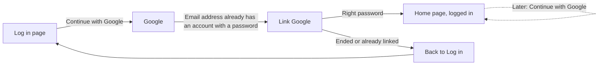

# Link Google to my account

- Component: web/src/pages/LinkGoogle.tsx, with LinkGoogle.module.css and LinkGoogle.test.tsx
- Address in the browser: /login/link-google

## What the page is for

Some members made an account with an email address and a password, and later press Continue with Google with a Google account that has the same email address. Connect never joins those two on the email address alone, because anyone can make an account with someone else's email address. This page asks for the password of the existing account once. After the right password, Google is linked, and from then on Continue with Google opens the same account without any question.

## Who can open it

- Everyone may open the address. The route sits outside RequireLogin, because the person is not logged in yet.
- The page only does something for a person who just came back from Google with an email address that already has an account with a password. The server knows this from the cookie connect_pending_link.
- For anyone else, and after five wrong passwords or ten minutes, the password is refused on the server and the page shows "Your Google log in has ended. Start again from Log in." with a link Back to Log in.
- An account without a password, such as one made with Facebook, keeps the refusal of issue 23 until issue 26 Set a password when I only have a social login is built.

## How you get there and where you go next

The member presses Continue with Google on the page Log in (issue 23). Google sends the browser back to Connect. The server finds that this email address already has an account, saves a pending link and sends the browser to /login/link-google with the cookie connect_pending_link.

## Every element of the page, top to bottom

1. Sentence: "This email address already has an account on Connect. Type its password once to link your Google account."
   - Nothing from the Google account is shown: not the name and not the picture.
   - Built by task 23b.4, issue 23b Link Google to my existing account after I type my password, GitLab #47, sprint 2.
2. Field: Password
   - Its name Password is shown above the field. Type password, autocomplete current-password.
   - Required. Pressing Link Google with the field empty shows "Fill in your password" next to the field.
   - The password is kept only in the field, never in the address and never in the storage of the browser.
   - Built by task 23b.4.
3. Button: Link Google
   - Calls linkExternalLogin(password) in web/src/api/externalLoginLinks.ts, which sends POST /api/external-login-links through web/src/api/client.ts. The browser adds the cookie connect_pending_link by itself.
   - While it waits the button says "Linking..." and cannot be pressed again.
   - The server finds the pending link by the hash of its token, checks that it has not ended (ten minutes, five wrong tries), and checks the password with the same hasher as the log in of issue 04. On the right password it writes one row in external_login and one in session, removes the pending row in the same transaction, sets the session cookie connect_session and removes connect_pending_link.
   - Answers and what the page does:
     - 204: the page calls refresh() of useSession and opens the home page /. The member is logged in, with their display name under the tab Profile.
     - 400: "Fill in your password" next to the field.
     - 401: "The password is not right" next to the field. The field is emptied and the member can try again. Nothing is linked.
     - 404: "Your Google log in has ended. Start again from Log in." in place of the form, with the link Back to Log in.
     - 409: "This Google account is already linked to an account on Connect." in place of the form, with the link Back to Log in.
     - No answer, 503 or any answer from 500 up: "Connect is not reachable right now, try again later" below the form. The typed password stays in the field.
   - Server work by tasks 23b.1 (table pending_external_login), 23b.2 (the return from Google starts a pending link) and 23b.3 (POST /api/external-login-links).
4. Link: Back to Log in
   - Below the form, and in place of the form when the Google log in has ended or the Google account is already linked. Leads to the page Log in.
   - Built by task 23b.4.

## States

- Loading: the button says "Linking..." and is disabled while Connect checks the password.
- Empty: the form with the sentence, the empty field Password and the button Link Google.
- Filled: the password is typed, the button can be pressed.
- Error: "Fill in your password" or "The password is not right" next to the field. "Your Google log in has ended. Start again from Log in." or "This Google account is already linked to an account on Connect." in place of the form.
- Not reachable: "Connect is not reachable right now, try again later" below the form, with the password still in the field.
- Success: the home page opens, logged in.
- Phone (360 pixels wide) and laptop (1280 pixels wide): the team checks the page on both on the test site (task 23b.6). No scrolling sideways.
- Design: the Figma board of Connect, page Design directions. Colours, fonts and spacing only through web/src/styles/tokens.css.

## Accessibility and privacy

- The field Password has a visible name above it.
- Messages next to the field and below the form sit in an area with role alert, so a screen reader reads them at once.
- axe shows zero violations.
- Nobody can join a Google account to an existing account without typing its password, also not by trying passwords again and again. After five wrong tries the pending link has ended.
- The page does nothing for a person who did not just come back from Google.
- Nothing from the Google account is shown, only the sentence, the field and the button.
- Deleting the account also deletes a Google link that was waiting for the password (issue 113).

## Built by

| Board | Title | GitLab | Sprint | Prio |
|---|---|---|---|---|
| 23b | Link Google to my existing account after I type my password | #47 | 2 | should |

Issue 23b needs issue 23 Register or log in with Google first. Issue 23 refuses an email address that already has an account until 23b is built.

## Open points

- Linking Facebook to an existing account in the same way waits on the client: issue 10 The client's priorities for the epics, question 12.

## AI use declaration

AI was used as a writing support tool while working on this document. We used AI to draft
the formulation of sentences, the structure of wording, readability, and clarity from
content that we had provided, and to generate the diagrams. The content itself, including
our experiences, reflections, learning goals, decisions, self-assessments, and
conclusions, is our own. We reviewed the drafts and decided as a team which text to
include.
