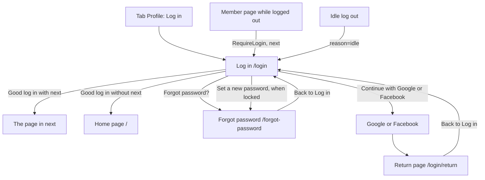

# Log in

- Component: frontend/src/pages/LogIn.tsx, with LogIn.module.css and LogIn.test.tsx
- Address in the browser: /login, also /login?next=%2Faccount (the page to go back to, issue 04b) and /login?reason=idle (after an idle log out, issue 118)

## What the page is for

On the page Log in a member of Connect logs in with their email address and password, or with Google or Facebook. Everything a member does on Connect, such as a profile, connections and events, starts with this log in. The page also protects members: it slows down and stops a stranger who guesses passwords, and it never tells anyone whether an email address has an account on Connect. After a good log in the member stays logged in on that browser for one day, also after closing it.

## Who can open it

| Who | What they see |
|---|---|
| Visitor who is not logged in | The whole page. Log in is open to everyone, like the home page and Make an account. It is not wrapped in RequireLogin. |
| Member who is not logged in | The same page. A member who opened a member page is sent here first and comes back to that page after logging in. |
| Member who was switched off by an admin (issue 46) | The page, and after a log in try "Your account is not active, contact the foundation". |

## How you get there and where you go next

Ways in:
- The tab Profile, which shows Log in for a visitor (issue 06 Move between the five tabs of Connect, task 6.2). A visitor who taps Profile opens /account and RequireLogin sends them here with next=/account, so after logging in they land on My account (task 6.3). Once a member is logged in the tab shows their display name instead (issue 06b See my name under the tab Profile, task 6b.3). Issue 06 replaced the top bar of tasks 3.5 and 4.6 that held the first link Log in.
- RequireLogin sends a person who is not logged in and opens a member page to `/login?next=<that page>`, with replace, so the back button does not return to the closed page (task 4b.3). This also happens when a log in ends during a visit.
- After an idle log out, RequireLogin sends to /login?reason=idle and keeps next (issue 118).
- The link Back to Log in on the page Forgot password (issue 21) and on the return page after Google or Facebook (issue 23 and 24).

Ways out:
- A good log in goes to the page in next, checked by safeNextPath, or to the home page / when there is no next or next is not a page of Connect (task 4b.3).
- The link Forgot password? below the form goes to /forgot-password (task 21.4).
- The link Set a new password below the locked message goes to /forgot-password (task 31b.3).
- Continue with Google sends the whole browser to `/api/auth/google/start?next=<next>`, and Continue with Facebook to `/api/auth/facebook/start?next=<next>`. After Google or Facebook the browser lands on the return page /login/return (tasks 23.5, 23.6, 24.3).

## Every element of the page, top to bottom

### 0. Title of the browser tab
- Text: Connect, Log in, set by the page itself with a title element. Never a name or an email address in it.
- Built by: issue 06 Move between the five tabs of Connect (GitLab #19, sprint 1), task 6.3. The page sits inside the frame AppShell with the five tabs, so a visitor on Log in can go back to Home with the tabs.

### 1. Sentence after an idle log out (issue 118)
- Text: "You were logged out because you did nothing for a while", above the form, in an area with role status.
- When: reason=idle is in the address. The screen gets the reason from a 401 answer with the type /problems/session-idle, read by request() in frontend/src/api/client.ts and by getCurrentSession() in frontend/src/api/sessions.ts, so a reload after an idle time also shows it. It goes away after a good log in. A normal log out or an unknown session shows the page without it.
- Rules: the page decides on the type of the answer, never on the words of the title.
- Built by: issue 118 Logged out after a while of doing nothing (GitLab #196, sprint 5), task 118.3.

### 2. Sentence after a log out on this device (issue 124)
- Text: "You were logged out. Log in again to go on.", above the form, in an area with role status, so a screen reader reads it once.
- When: a call to the server answered 401 while the screen still thought the member was logged in. The one listener onUnauthorized(listener) in client.ts, the same one issues 04 and 118 use, tells useSession, which sets sessionEnded when the reason is not idle. A 401 from POST /api/sessions is left out, because there it means a wrong password.
- Rules: sessionEnded lives only in the memory of the page, never in local storage or session storage. After a reload the page shows without the sentence. With the reason idle, sessionEnded stays false, so the page shows only the idle sentence of section 1 and never both. sessionEnded goes back to false after a good log in.
- Built by: issue 124 Logged out on my other devices when my email address is locked (GitLab #202, sprint 5), task 124.3.

### 3. Field Email
- Label: Email, above the field. Type email, autocomplete email.
- Rules: required. Empty gives "Fill in your email address" right under the field, linked with aria-describedby, and nothing is sent. The server sends the same message back as code 400 and it is shown the same way. What was typed stays after a wrong try and when Connect is not reachable.
- Built by: issue 04 Log in with email and password (GitLab #15, sprint 1), task 4.5.

### 4. Field Password
- Label: Password, above the field. Type password, autocomplete current-password, so the password shows as dots.
- Rules: required. Empty gives "Fill in your password" right under the field. The field is emptied after a wrong try, a wait, a lock and a not active answer. The password lives only in the field. It is not kept in state after the request and never in local storage. It never appears on the page, in the address bar or in a message.
- Built by: issue 04, task 4.5.

### 5. Box I am a person (issue 123)
- Text: a real checkbox with the label "I am a person", under the password field. After a tick: "Checking that you are a person..." and then "Done", in an area with role status.
- When: from the moment an answer of POST /api/sessions says puzzleRequired, which the server does from the third wrong password in a row for an email address, until a good log in. There is no box after the first or second wrong password.
- Data: ticking asks a puzzle from GET /api/log-in-puzzles through getLogInPuzzle() in frontend/src/api/logInPuzzles.ts, and hands it to the widget of the tool chosen in task 123.1. The widget never calls the server itself. The next press on Log in sends the solution with logIn(email, password, puzzle).
- Messages next to the box: "Tick the box to show you are a person." when Log in is pressed without a tick (result puzzleNeeded), and "The check could not run. Try again." when the puzzle cannot be fetched or the widget reports an error. After a message the box is unticked and can be ticked again.
- Rules: a solution is used once. The page clears it after every press on Log in. There is nothing to read, type, hear or recognise, only a tick. The box looks exactly the same for an email address that has no account. The widget is pinned to one version and calls no address outside Connect.
- Component: frontend/src/components/logIn/PersonCheck.tsx.
- Built by: issue 123 A puzzle that proves I am a person before I log in (GitLab #200, sprint 5), task 123.4.

### 6. Button Log in
- Text: Log in. While Connect checks the password it says "Logging in..." and is disabled, so it cannot be pressed twice.
- Data: logIn(email, password) in frontend/src/api/sessions.ts sends POST /api/sessions through request() in frontend/src/api/client.ts. The page never sees a status code.
- After a good log in (204): the server sets the cookie connect_session for 24 hours. The page calls refresh() of useSession and waits for it, so the tab Profile shows the member's display name at once, then goes to safeNextPath(next) or to the home page.
- During a wait: disabled with "Try again in `<n>` s", counting down every second with useCountdown (frontend/src/hooks/useCountdown.tsx) from the number in the header Retry-After, or from 60 when it is missing or not a whole number above zero. At zero it says Log in again.
- During a lock: disabled with "Locked until 14:30", the end time of the lock. At the end time it says Log in again.
- Rules: the button stays usable while the box I am a person is shown, so a press without a tick gets the message of the server. The countdown text is not a live region and is not kept in local storage. logIn passes the option ownWaitMessage: true to request(), so a 429 on Log in shows only the wait message of this page below the form and never the general sentence "You asked too often. Wait a minute and try again." at the top of the page (issue 105 Connect keeps working under too many requests, task 105.2).
- Built by: issue 04 task 4.5 (button and busy state), task 4.6 (refresh), issue 04b task 4b.3 (next), issue 30 Wait a minute after five wrong passwords (GitLab #60, sprint 2) task 30.3 (countdown), issue 31 Account locked after fifteen wrong passwords (GitLab #62, sprint 2) task 31.3 (locked).

### 7. Message area below the form
One area with role alert, so a screen reader reads each message aloud as soon as it appears. It shows one of these, depending on the answer of POST /api/sessions:

| Answer | Text | Card |
|---|---|---|
| 401, wrong email or password | "Email or password is not right". The password is emptied, the email kept, and the focus goes back to the password field. Never a message per field, because that would tell which of the two was wrong. | 04, task 4.5 |
| Every code from 500 to 599, or no answer | "Connect is not reachable right now, try again later". What was typed in the email field stays. | 04, task 4.5 |
| 429, wait for one email address | "Too many tries. Wait a minute and try again." It comes after five wrong passwords within one minute for the same address. During the wait even the right password does not get in. | 30, task 30.3 |
| 429 with "limit": "device" | "Too many tries from this phone or laptop. Wait a minute and try again." with a second line "On a shared wifi, the tries of other people count too." It comes after ten tries within one minute from one phone or laptop, whatever addresses were typed. Another phone or laptop can log in as usual. | 30b, task 30b.3 |
| 429 with the field lockedUntil | "Too many wrong tries for this email address. You can log in again at 14:30." It comes at the fifteenth wrong password in a row, for fifteen minutes. The time is written by formatTime(date) in frontend/src/utils/formatTime.ts, with Intl.DateTimeFormat, the locale en-GB and timeStyle short, in the time zone of the member's own device, so it reads 14:30 and never 2:30 PM. | 31, task 31.3 |
| The same locked answer | Directly below the locked message: "If this address has an account on Connect, we have sent an email about it." and a link Set a new password to /forgot-password. The link is a real link element with a visible focus outline. | 31b, task 31b.3 |
| The same locked answer | Below that: "Every phone and laptop that was logged in to this account is now logged out." on its own line, for every locked answer. | 124, task 124.3 |
| 403, account not active | "Your account is not active, contact the foundation". The password is emptied. Never the wrong password message. | 46, task 46.6 |

- Rules: the two waits are told apart by the field limit, and the wait and the lock by the field lockedUntil, never by the text of the title. Every message is the same for an email address with and without an account. The page never shows the number of tries or anything about who tried.
- Built by: the tasks in the table. Issue 30b Wait a minute after ten tries from one phone or laptop (GitLab #61, sprint 2), issue 31b An email when log ins with my email address are locked (GitLab #63, sprint 2), issue 46 Deactivate a member (GitLab #90, sprint 3).

### 8. Link Forgot password?
- Text: Forgot password?, below the form.
- Behaviour: opens the page Forgot password at /forgot-password.
- Built by: issue 21 Ask for a password reset link by email (GitLab #39, sprint 2), task 21.4.

### 9. Line "or" and the buttons Continue with Google and Continue with Facebook
- Text: the line "or" between the form and the buttons, then Continue with Google with the Google icon, and under it Continue with Facebook with the Facebook icon, in the same order as on Make an account.
- Component: SocialLoginButton (frontend/src/components/SocialLoginButton.tsx) with the property provider, and the icons GoogleIcon.tsx and FacebookIcon.tsx as inline SVG with aria-hidden. There is no separate FacebookButton.
- Behaviour: the whole browser goes to `/api/auth/google/start?next=<next>` or `/api/auth/facebook/start?next=<next>`. next is the ?next= of this page when it starts with a single / followed by something that is not `/` and not `\`, otherwise /. No script, font or picture is loaded from Google or Facebook in the page.
- What goes wrong at Google or Facebook is shown on the return page /login/return, not on this page.
- Built by: issue 23 Register or log in with Google (GitLab #46, sprint 2), task 23.5, and issue 24 Register or log in with Facebook (GitLab #49, sprint 2), task 24.3.

## States

| State | What the person sees |
|---|---|
| Empty form | Two fields with their labels, the button Log in, the link Forgot password?, the line "or" and the two social buttons. |
| Empty field pressed | "Fill in your email address" or "Fill in your password" under that field. Nothing is sent. |
| Busy | The button says "Logging in..." and is disabled. |
| Wrong email or password | "Email or password is not right" below the form. |
| Box I am a person | From the third wrong password in a row, with "Checking that you are a person...", "Done", "Tick the box to show you are a person." or "The check could not run. Try again." |
| Wait | "Too many tries. Wait a minute and try again." and the button counting down. |
| Device wait | "Too many tries from this phone or laptop. Wait a minute and try again." and "On a shared wifi, the tries of other people count too." |
| Locked | "Too many wrong tries for this email address. You can log in again at 14:30.", then the email sentence and the link Set a new password, then the sentence about other devices. The button says "Locked until 14:30". |
| Not active | "Your account is not active, contact the foundation". |
| Not reachable | "Connect is not reachable right now, try again later". The email stays in its field. |
| After idle | "You were logged out because you did nothing for a while" above the form. |
| After a log out on this device | "You were logged out. Log in again to go on." above the form. |
| Good log in | The page in next, or the home page, with the member's display name under the tab Profile. |
| Phone and laptop | The page follows the Figma frame Log in at 360 and 1280 pixels wide, and the social buttons the Figma frame Social buttons, without sideways scrolling. |

The wait message and the locked message appear within one second after pressing Log in (issue 30 AC6, issue 31 AC9).

## Accessibility and privacy

- Every field has its label above it. Field messages are linked with aria-describedby.
- The form has noValidate, so the page shows its own messages and not the bubbles of the browser.
- The message area below the form has role alert. The two sentences above the form and the states of the box I am a person use role status, because they are information and not an error.
- The countdown on the button is not a live region, so a screen reader reads the wait message once and not every second.
- The box I am a person is a real checkbox with a visible label, so it works with the keyboard and a screen reader (WCAG 2.2 success criterion 3.3.8).
- A screen reader reads the social buttons as Continue with Google and Continue with Facebook. The icons are hidden with aria-hidden.
- The link Set a new password is reachable with Tab and opened with Enter.
- Colours, fonts and spacing come only from frontend/src/styles/tokens.css, following the Figma frames Log in and Social buttons on the Figma board.
- Privacy: nothing on the page tells a stranger whether an email address has an account on Connect. The wrong password message, the waits, the lock, the sentences below the lock and the box I am a person look the same for every address. The password is hidden, never kept and never shown. The page never shows who tried or from where. No script from Google or Facebook is loaded, so they do not learn that a young person visits Connect. The cookie is HttpOnly, so the screen asks the server who is logged in and never reads the cookie or keeps a logged in flag in local storage.
- safeNextPath (frontend/src/utils/safeNextPath.ts) only follows next when it is a page of Connect. It refuses `//x`, `/\x`, full addresses, javascript: and /login, so a link can never send a member to a fake copy of Connect after logging in.

## Built by

| Board | Title | GitLab | Sprint | Prio |
|---|---|---|---|---|
| 04 | Log in with email and password | #15 | 1 | must |
| 04b | A member page asks me to log in first and brings me back | #16 | 1-stretch | must |
| 06 | Move between the five tabs of Connect | #19 | 1 | must |
| 21 | Ask for a password reset link by email | #39 | 2 | should |
| 23 | Register or log in with Google | #46 | 2 | should |
| 24 | Register or log in with Facebook | #49 | 2 | could |
| 30 | Wait a minute after five wrong passwords | #60 | 2 | must |
| 30b | Wait a minute after ten tries from one phone or laptop | #61 | 2 | must |
| 31 | Account locked after fifteen wrong passwords | #62 | 2 | must |
| 31b | An email when log ins with my email address are locked | #63 | 2 | must |
| 46 | Deactivate a member | #90 | 3 | must |
| 105 | Connect keeps working under too many requests | #185 | 4 | must |
| 118 | Logged out after a while of doing nothing | #196 | 5 | could |
| 123 | A puzzle that proves I am a person before I log in | #200 | 5 | could |
| 124 | Logged out on my other devices when my email address is locked | #202 | 5 | could |

The frontend tasks on this page are 4.5, 4.6, 4b.3, 6.3, 21.4, 23.5, 24.3, 30.3, 30b.3, 31.3, 31b.3, 46.6, 105.2, 118.3, 123.4 and 124.3. The server work sits in POST /api/sessions (task 4.2 and the backend tasks of issues 30, 30b, 31, 46, 123 and 124) and GET /api/log-in-puzzles (task 123.3).

## Open points

- Issue 118: how long "a while" is, and whether the foundation wants it at all, is issue 10 The client's priorities for the epics, question 8. The team proposes thirty minutes. The issue is only built on a yes.
- Issue 123: only built when the client says yes in issue 10, question 13. A check on Make an account or Forgot password is also question 13. The tool for the check is chosen in task 123.1.
- Issue 124: only built when the client says yes in issue 10, question 14, because anyone who knows an email address can then log that member out everywhere.
- The real Google project and the real Facebook app of the foundation: issue 10, question 7. Linking Facebook to an existing account: issue 10, question 12.
- An early unlock by an admin is issue 126 An admin unlocks a locked account early.
- Telling a switched off member by email why: issue 10, question 76. A second admin before a member under 18 is switched off: issue 10, question 77.
- The cards do not say what a member who is already logged in sees when they open /login.

## AI use declaration

AI was used as a writing support tool while working on this document. We used AI to draft
the formulation of sentences, the structure of wording, readability, and clarity from
content that we had provided, and to generate the diagrams. The content itself, including
our experiences, reflections, learning goals, decisions, self-assessments, and
conclusions, is our own. We reviewed the drafts and decided as a team which text to
include.
