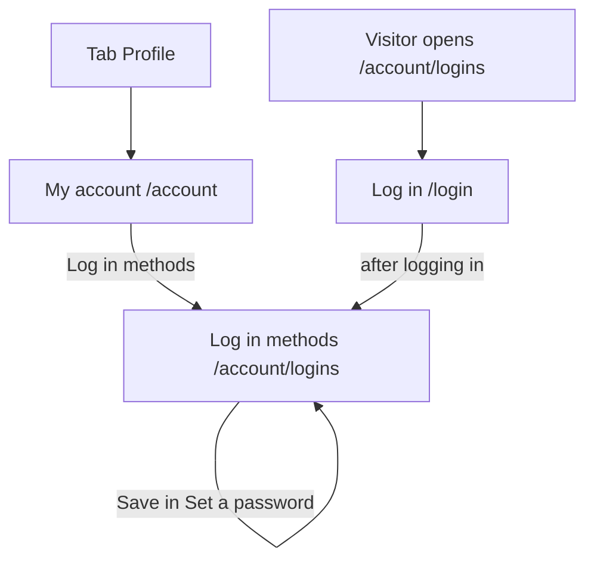

# Log in methods (LogInMethods)

Component: `web/src/pages/LogInMethods.tsx`, with `LogInMethods.module.css`, the row `web/src/components/logInMethods/LogInMethodRow.tsx` and the part `web/src/components/logInMethods/SetPasswordSection.tsx`.
Address in the browser: `/account/logins`.

## What the page is for

On this page a member sees every outside account, Google or Facebook, that can open their Connect account. They can remove one of them, and a member who joined with Google or Facebook and has no password can set a first password here. Connect never removes the last way in, so a member can never lock themselves out of their own account.

## Who can open it

| Person | What they see |
|---|---|
| Visitor (not logged in) | The page Log in. After logging in they land on Log in methods (RequireLogin of issue 04 and the way back of issue 04b). |
| Member with linked accounts | One row per linked account with a button Remove. |
| Member with nothing linked | The line "No outside accounts are linked to your account." |
| Member without a password | Also the part Set a password under the list. |
| Member with a password | No part Set a password, not even hidden. |

A member only ever sees and changes their own log in methods. The server takes the account from the session, never from the address.

## How you get there and where you go next

- The tab Profile opens My account (`/account`). On My account the link Log in methods leads here.
- The page has no link away of its own in the cards. The member leaves through the tabs of the frame.

## Every element of the page, top to bottom

### Not reachable message above the list

- Text: "Connect is not reachable right now, try again later".
- On load: it shows in place of the list, in an area with role alert, and nothing else on the page changes (issue 25 See my linked accounts, task 25.3, GitLab #50, sprint 2).
- On Remove: it shows above the list, in an area with role alert, and every row stays (issue 25b Remove a linked account, task 25b.3, GitLab #51, sprint 2).

### Heading Log in methods

- Text: Log in methods.
- After a good removal the focus moves to this heading.

### The list of linked accounts

- What it shows: one row per linked account, with the name (Google or Facebook) and the date it was linked, written as for example "linked on 2 October 2026". A screen reader hears for example "Google, linked on 2 October 2026".
- Empty: "No outside accounts are linked to your account."
- Loading: "Loading...".
- Data: `getLogInMethods()` in `web/src/api/logInMethods.ts` asks `GET /api/accounts/current/logins` through `web/src/api/client.ts` (task 25.2). The answer holds the list and hasPassword. The type LogInMethod has only provider and linkedAt.
- Never on the page: a Google or Facebook id, a picture or a name from those companies.
- Built by: issue 25, task 25.3.

### Button Remove in each row

- Text: Remove. Its accessible name is "Remove Google" or "Remove Facebook".
- Pressing it shows in the same row, without a browser dialog: "Remove Facebook? This Facebook account can then no longer open your Connect account." with the buttons Yes, remove and Cancel. The focus moves to Yes, remove. Cancel closes the question and puts the focus back on Remove.
- Pressing Yes, remove: `removeLogInMethod(provider)` sends `DELETE /api/accounts/current/logins/{provider}` through `client.ts` (task 25b.2). The button says "Removing..." and is disabled, so the row disappears once.
- Code 204: the row is removed. When it was the last row, the line "No outside accounts are linked to your account." appears. From then on that Google or Facebook account no longer opens the Connect account, and Connect does not link it again by itself.
- Code 404: the row was already removed, for example in another tab. The list is loaded again.
- Code 400 cannot happen from this page, and is shown like not reachable when it does.
- Code 401: `client.ts` sends the person to Log in.
- Built by: issue 25b, task 25b.3.

### Refusal of the last way in

- Text: "You need another way to log in first. Set a password on this page, then you can remove this one."
- When: the member has no password and this is their only linked account. The server answers code 409 and removes nothing. The sentence appears under the name of the provider in that row, in an area with role alert. The confirm step closes, the button Remove comes back, the row stays and the focus stays in the row. The member can still log in with that account as before.
- The sentence stays until the member presses Remove again or leaves the page.
- Rules: the server counts the ways in and removes in one transaction, so even two tabs that remove the last two linked accounts at the same moment leave at least one (task 25c.1).
- Built by: issue 25c Connect keeps my last way in, tasks 25c.2 and 25c.3 (GitLab #53, sprint 2).

### Part Set a password

- When: only when hasPassword in the answer of `GET /api/accounts/current/logins` is false. When it is true the part is not rendered at all.
- Heading: Set a password.
- Field New password: type password, autocomplete new-password, with the hint "At least fifteen characters" below its label.
- Field New password again: the same.
- Button Save. While waiting: "Saving..." and disabled.
- What happens: `setPassword(password, passwordAgain)` in `web/src/api/accounts.ts` sends `POST /api/accounts/current/password` through `client.ts` (task 26.2). The server uses the same password rules of issue 03b (`PasswordRules.cs`) and the same hasher as Make an account, and writes the password only when the account has none.
- Code 204: "Your password is set. You can now also log in with your email address and this password." in place of the part. Both fields are emptied and the page asks the log in methods again, so the part stays gone after a reload. From then on the member can log in with email and password, and Google or Facebook keeps working too.
- Code 400: "Use at least fifteen characters for your password" below New password, "The two passwords are not the same" below New password again, in an area with role alert, and the focus on the first field with a message. Nothing is saved.
- Code 409: "This account already has a password. Nothing was changed." below the button. The page asks the log in methods again, so the part goes away. A password that already exists is never changed or overwritten, also when two tabs press Save at the same moment.
- Code 503 or no answer: "Connect is not reachable right now, try again later" below the button. What was typed stays in both fields.
- Code 401: the shared helper tells useSession, and RequireLogin sends the member to Log in.
- Rules: the passwords live only in the two fields. They are not kept after the request, never in local storage, and never in the address bar or a message.
- Built by: issue 26 Set a password when I only have a social login, task 26.3 (GitLab #52, sprint 2).

## States

| State | What the person sees |
|---|---|
| Loading | "Loading..." |
| Filled | The heading, one row per linked account with Remove, and the part Set a password when there is no password. |
| Empty | "No outside accounts are linked to your account." |
| Confirm | The question in the row with Yes, remove and Cancel. |
| Busy | "Removing..." or "Saving..." on the pressed button, disabled. |
| Refused | "You need another way to log in first. Set a password on this page, then you can remove this one." next to the row. |
| Not reachable | "Connect is not reachable right now, try again later" in place of the list on load, above the list on Remove, below the button on Save. |
| Phone and laptop | The page works on a phone of 360 pixels wide and a laptop of 1280 pixels wide without sideways scrolling (Definition of Done). The cards give no other layout difference. |

## Accessibility and privacy

- Each button Remove names its provider for a screen reader. The focus moves to Yes, remove when the question appears, back to Remove on Cancel, and to the heading after a removal.
- The refusal, the not reachable message and the field messages of Set a password are in areas with role alert, read aloud as soon as they appear.
- The page shows only the name of the provider and the date, never an id, a picture or a name from Google or Facebook.
- A member can only ever see, remove or set their own log in methods.

The design: colours, fonts and spacing come only from the variables in `web/src/styles/tokens.css`, following the Figma frame Log in methods on the Figma board.

## Built by

| Board | Title | GitLab | Sprint | Prio |
|---|---|---|---|---|
| 25 | See my linked accounts | #50 | 2 | could |
| 25b | Remove a linked account | #51 | 2 | could |
| 26 | Set a password when I only have a social login | #52 | 2 | could |
| 25c | Connect keeps my last way in | #53 | 2 | could |

## Open points

- An email that tells the member a password was set: issue 10, question 8 ("Three questions about accounts: changing the password while logged in, logging out after a while, and logging out on every device."), together with the email for a changed password.
- Until issue 25c is built, a member could remove their only way in. The team takes issue 25b to the live site only together with issue 25c.

## AI use declaration

AI was used as a writing support tool while working on this document. We used AI to draft
the formulation of sentences, the structure of wording, readability, and clarity from
content that we had provided, and to generate the diagrams. The content itself, including
our experiences, reflections, learning goals, decisions, self-assessments, and
conclusions, is our own. We reviewed the drafts and decided as a team which text to
include.
