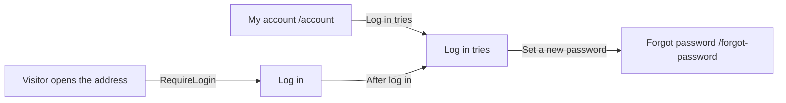

# Log in tries

- Component: web/src/pages/LogInTries.tsx, with LogInTries.module.css and LogInTries.test.tsx
- Address in the browser: /account/log-in-tries
- Title of the browser tab: Connect, Log in tries (task 125.4, following the rule of task 6.3 that every page title is Connect and its own name).

## What the page is for

A member sees every try to log in to their own account, newest first, with the date, the time and whether it worked. Issues 30 and 31 slow down and stop a person who guesses passwords, but the member never sees that it happens. A young person who sees tries they did not make knows it is time to set a new password or to ask a parent or the foundation for help.

## Who can open it

- Member (young person), organisation and admin: every logged in account sees only its own tries.
- Visitor who is not logged in: the route sits inside RequireLogin of issue 04, so the visitor is sent to Log in and brought back after logging in.
- Nobody ever sees the tries of another account.

## How you get there and where you go next

## Every element of the page, top to bottom

1. Heading: Log in tries
   - Built by task 125.4, issue 125 See every log in try on my account, GitLab #201, sprint 5.
2. The list of tries
   - Data: GET /api/accounts/current/log-in-attempts?page=1&pageSize=20, called by getLogInAttempts(page) in web/src/api/logInAttempts.ts through the shared helper. It returns the page with its items and total, notLoggedIn, or notReachable. The page never sees a status code.
   - The server gives only the tries of the account in the cookie, newest first. It checks the page numbers of the list and lets only a logged in member ask.
   - Each line is one list item: the date and the time in the member's own time zone (Intl.DateTimeFormat, for example 12 October 2026, 14:30), then "Worked" or "Wrong password", then "Password", "Google" or "Facebook".
   - A try is saved in the table log_in_attempt when a password is wrong or a log in works, for an address that has an account. A try on an address without an account is saved nowhere. Tries during the minute wait of issue 30 or the lock of issue 31 are not listed, because Connect did not check a password then.
   - Old rows are removed by the cleanup job of issue 30 after the retention period.
   - Server work by tasks 125.1 (table and cleanup), 125.2 (saving a try) and 125.3 (the list address).
3. Button: Load more
   - Shown below the list only while fewer items are loaded than total. The first 20 show at once.
   - Pressing it asks the next page and adds the items below. While it waits it says "Loading..." and cannot be pressed twice. The button is gone when there are no more.
   - Built by task 125.4.
4. Line under the list, always: "Is there a try that was not you? Set a new password."
   - The link opens the page Forgot password /forgot-password of issue 21.
   - Built by task 125.4.

The page My account gets a real link Log in tries to this page (task 125.4, in MyAccount.tsx).

## States

- Loading: "Loading your log in tries..." in an area with role status.
- Empty: "You have no log in tries yet."
- Filled: one line per try, newest first, with Load more below when there are more than 20.
- Not reachable on the first page: "Connect is not reachable right now, try again later" in an area with role alert, in the place of the list.
- Not reachable on Load more: the same sentence under the list, and the lines already shown stay.
- Phone (360 pixels wide) and laptop (1280 pixels wide): the team checks every criterion on both on the test site (task 125.6).
- Design: follows the Figma frame of My account on the Figma board of Connect (page Design directions). Colours, fonts and spacing only through web/src/styles/tokens.css.

## Accessibility and privacy

- "Wrong password" is shown with a word, never only with a red colour.
- A screen reader hears each line as one sentence with the date, the time, the outcome and the way of logging in.
- No internet address, no place, no device and no browser on any line. The privacy rules of issue 19 allow no more.
- The list is kept only in the memory of the page, never in local storage, so the next person on a shared laptop finds nothing.
- The time is shown in the member's own time zone. The server sends world time.

## Built by

| Board | Title | GitLab | Sprint | Prio |
|---|---|---|---|---|
| 125 | See every log in try on my account | #201 | 5 | could |

Issue 125 needs issues 30, 10, 19, 21 and 23 first.

## Open points

- The whole issue is built only when the client says yes to it: issue 10 The client's priorities for the epics, question 15.
- How many days Connect keeps the tries: issue 10, question 15. The project documents must state this for the client.

## AI use declaration

AI was used as a writing support tool while working on this document. We used AI to draft
the formulation of sentences, the structure of wording, readability, and clarity from
content that we had provided, and to generate the diagrams. The content itself, including
our experiences, reflections, learning goals, decisions, self-assessments, and
conclusions, is our own. We reviewed the drafts and decided as a team which text to
include.
