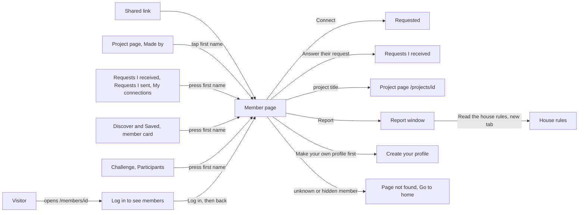

# Member page (another member's profile)

- Component: web/src/pages/MemberProfile.tsx, with MemberProfile.module.css and MemberProfile.test.tsx
- Parts on this page: ProfileDetails.tsx and TagList.tsx (web/src/components), BadgeRow of task 80.4, ProjectList and ProjectCard of task 62.3, and the page parts web/src/components/memberProfile/ConnectButton.tsx and ReportDialog.tsx
- Address in the browser: /members/:id, for example /members/00000000-0000-4000-8000-000000000141 (the test member Robin in docs/testing/testData.md)
- Title of the browser tab: "<first name> · Connect", for example "Robin · Connect"

## What the page is for

This is the page of another young person on Connect. A member opens it to see who someone is before they get in touch: their first name, age band, region, short line, skills and interests, badges and projects. From here the member can send a connection request, or report the member to the foundation when they break the house rules. Many members are 15, 16 or 17 years old, so the page shows only what the team and the client agreed others may see, and nothing on it can change the other person's profile.

## Who can open it

- Visitor (not logged in): the route sits inside RequireLogin of issue 04, so a visitor never sees a profile (issue 39 AC13, issue 151 AC10). Since task 15.3 RequireLogin shows LoggedOutMessage on /members/:id instead of sending the visitor to Log in: the heading "Log in to see members", the sentence "Member pages on Connect are only for people who are logged in, to keep the young people on Connect safe." and a link Log in that looks like a button, to /login?next= with the path of the member page. After logging in the visitor lands on that member page (issue 04b), not on My account. The message is the same for a member who does not exist, and the profile is never asked while nobody is logged in.
- Member (young person): sees the page of every member who is visible to them.
- Member who opens their own id: sees their own page, also when their email address is not confirmed yet (issue 29). There is no button about connecting (status self), and no button Add a project, Edit or Delete.
- Organisation: sees the page, but in place of the button Connect it reads "Connection requests are between members" (issue 39 AC9).
- Admin: the cards give no separate rule for an admin on this page.
- A member who does not exist, has an odd id, never confirmed their email address, was switched off by the foundation (issue 46) or waits for a parent's permission (issue 130): the page looks exactly the same as for a member who does not exist. Nobody can learn from the page whether a member was ever on Connect.

## How you get there and where you go next

- From a link someone shared, for example after meeting at an event.
- From the page of a project: tap the first name after Made by (task 64.3).
- From a first name on Requests I received (issue 41), Requests I sent (issue 40) and My connections (issue 42), and from a member card on Discover (issue 37) and on Saved (issue 44).
- From the part Participants on the page of a challenge: the owner presses a first name (issue 79). From the part Interested members on the page of an opportunity (issue 59). From the link Open their page on the admin page Reports (issue 152).
- Away: the link Answer their request to /requests/received below "They asked you first" (task 41.4), a project title to /projects/<id> (task 64.4), the link Create your profile to /profile/new after "Make your own profile first", the link Read the house rules to /house-rules in a new tab, and on the not found page the link Go to home (issue 53). A visitor goes to Log in through the message of issue 15.

## Every element of the page, top to bottom

The page sits inside AppShell of issue 06, so the five tabs stay around it.

Data for the profile: getMemberProfile(id) in web/src/api/memberProfiles.ts asks GET /api/member-profiles/{id} through request() of client.ts and reads the type PublicMemberProfile. The answer holds only the public part: first name, age band, region, short line (issue 14), tags (issue 36c) and badges (issue 80b). A value that is hidden is left out of the answer completely, never sent as empty. The rule for minors lives in ProfileVisibility on the server and follows the role table of issue 13. Members who never confirmed are filtered inside the database by AccountVisibility (issue 29).

1. Loading text: "Loading..."
   - Shows while the profile loads, and again when the id in the address changes. The page first empties the profile it holds, and ignores a late answer for an id that is no longer in the address, so the name of the member you looked at before never stays on screen. The tab title is "Connect" while loading.
   - Built by task 14.4 (issue 14 View another member's profile, GitLab #30, sprint 1-stretch) and task 29.4 (issue 29 Unconfirmed accounts stay hidden, GitLab #58, sprint 2).
2. Heading (h1): the first name of the member
   - The one heading of the page. The tab title becomes "<first name> · Connect". It goes back to "Connect" when the page closes.
   - Built by task 14.4 (issue 14) and task 29.4 (issue 29).
3. Badge row, directly below the first name
   - BadgeRow of task 80.4, reused unchanged: for the badge First project the gold icon, the name First project and the line "You added your first project". The image has the alt text First project.
   - The badges come with the profile answer, so there is no separate call. A member without a badge shows no heading Badges and no empty box. Badges show for every age band, also 15 to 17, because a badge only says that someone took part.
   - Built by task 80b.3, issue 80b See the badges of another member, GitLab #183, sprint 4.
4. Button Connect, or a line in its place, just below the heading
   - Data: getConnectionStatus(profileId) in web/src/api/connectionRequests.ts asks GET /api/member-profiles/{id}/connection-status. While waiting nothing is shown in its place.
   - none: a button Connect. requested: the text Requested with aria-disabled="true", which does nothing when pressed. received: the line "They asked you first" and below it a link Answer their request to /requests/received (task 41.4). connected: the text Connected and no button (task 41b.5). closed: the line "No new request possible" and no button, and the line never says who declined or when (task 41c.5). self: nothing. notAllowed: the line "You cannot send a request to this member" and no button (the role table cell for members aged 15 to 17 in docs/security/roleTable.md). notMember: the line "Connection requests are between members" and no button.
   - Pressing Connect: the button says "Sending..." and cannot be pressed again. sendConnectionRequest(profileId) sends POST /api/connection-requests. Within a second the button says Requested, without reloading the page, and it still says Requested after a reload.
   - Refusals next to the button: "Make your own profile first" with a link Create your profile to /profile/new. "This member does not exist" when the member deleted their profile meanwhile. A conflict asks the status again and shows it. "Connect is not reachable right now, try again later" and the button says Connect again.
   - Status cannot be loaded: "Connect is not reachable right now, try again later" in the place of the button, with a button Try again.
   - Every line sits in an area with role status. There is no text field anywhere in this flow. A request carries only who asked whom and when, never a message.
   - Built by task 39.4, issue 39 Send a connection request, GitLab #77, sprint 2. The link Answer their request by task 41.4 (issue 41, GitLab #79, sprint 2), Connected by task 41b.5 (issue 41b, GitLab #80, sprint 2) and "No new request possible" by task 41c.5 (issue 41c, GitLab #81, sprint 2).
5. Profile details (ProfileDetails of issue 08, reused)
   - Every value the server sent, with its label: age band in words (for example 15 to 17), region and short line. A value the server left out, such as the region of a member aged 15 to 17, shows no label and no empty row.
   - Nothing here can be changed: no Edit button and no field.
   - Built by task 14.4, issue 14, GitLab #30, sprint 1-stretch.
6. Skills and interests, inside ProfileDetails below the short text
   - TagList.tsx shows the tag names as a list (ul and li) under the label Skills and interests, sorted by name, as plain words. No button, no link and no field. TagInput is never used on this page.
   - No tags, or tags left out by the rule for minors: no label, no empty list, no sentence. For a member under 18 the tags show exactly when the short text shows.
   - Built by task 36c.3, issue 36c See the tags on the page of another member, GitLab #72, sprint 2.
7. Button Report, under ProfileDetails
   - A secondary button with the text Report and the accessible name Report followed by the first name. It is not red, so it does not look like an accusation. It is not on My profile, which is another component.
   - It opens ReportDialog, built on ConfirmDialog of issue 113, with the heading "Which house rule does this member break?" and a radio group with seven reasons: Bullying or hate, Sexual messages, Asking for personal details or to meet alone, Sharing photos or data of someone without asking, Pretending to be someone else, Selling or advertising, Something else that breaks the house rules.
   - The link Read the house rules to /house-rules opens in a new tab (target _blank, rel noopener), and the window stays open.
   - Cancel and Escape close the window and send nothing. Send report is disabled until a reason is picked. While waiting it says "Sending..." and two presses send one report.
   - Send report calls reportMember(profileId, reason) in web/src/api/memberReports.ts, which sends POST /api/member-profiles/{id}/reports.
   - Answers in the window: "Thank you, the foundation will look at it." in a region with role status, with a button Close. "You already reported this member. The foundation will look at it." for a second report. "You cannot report yourself." "This member does not exist." A wrong reason shows a message under the reasons. "Connect is not reachable right now, try again later" in a region with role alert, and the picked reason stays so Send report works again.
   - Built by task 151.3, issue 151 Report a member to the foundation, GitLab #211, sprint 5.
8. Part Projects (heading h2), below the profile
   - Shown only after the profile has loaded. For a member who does not exist or is hidden the part is not there and the list is never asked.
   - Data: getMemberProjects(profileId, page) in web/src/api/projects.ts asks GET /api/member-profiles/{id}/projects?page=<page>&pageSize=20. The server first checks that the member is visible to the one who asks, with the same question as the profile.
   - ProjectList and ProjectCard of task 62.3, reused unchanged: one card per project with the title as an h3 in plain text, the start of the description and the date it was added. Newest on top, the same order the member sees on their own My profile. Since task 64.4 (issue 64 Open a project page, GitLab #181, sprint 4) every title is a link to /projects/<id>, made by ProjectCard itself, and after Load more the focus goes to the link of the first new card.
   - Load more below the list while the cards are fewer than the total. It adds the next 20 below.
   - Loading: "Loading projects...". Empty: "No projects yet". Not reachable on the first page: "Connect is not reachable right now" with a button Try again. On Load more the same sentence stands below the list, and the cards already shown stay.
   - No button Add a project, no Edit and no Delete, also when a member opens their own id.
   - Built by task 62b.3, issue 62b See the projects of another member on their page, GitLab #176, sprint 4.

## States

- Visitor: "Log in to see members" with its sentence and the link Log in, at once and without a loading text of a profile (issue 15).
- Loading: "Loading..." and the tab title "Connect".
- Filled: the first name, the badges, the button Connect, the details with their labels, Skills and interests, Report and Projects.
- A member aged 15 to 17: first name, age band and short line, never the region, not even as an empty line. Tags only where the short text is shown. Projects and badges show as for everyone.
- Empty parts: no badge row and no tag label when there are none, "No projects yet" in Projects.
- Not found, hidden member or odd id: issue 14 and issue 29 first showed the heading "This member does not exist" with a link Go to My account and the tab title "This member does not exist · Connect". Since issue 53 the page shows the friendly page NotFound in place of the profile, with "This page does not exist or is no longer available" and a link Go to home, and issues 62b and 80b now expect that same text. No badge, no button and no part Projects show.
- Not reachable: "Connect is not reachable right now, try again later" in an area with role alert, never the not found page, and the tab title "Connect". After a full reload with the server down, RequireLogin shows its own not reachable message first. A tester checks it by switching the phone to airplane mode and reloading the page.
- Phone (360 pixels wide) and laptop (1280 pixels wide): the screenshots are checked against the Figma frame. The first 20 project cards are there within two seconds after the page opens (issue 62b AC10).
- Design: the Figma frame Member page (task 14.4 calls it Member profile) on the Figma board of Connect, page Design directions. Colours, fonts and spacing come only from the variables in web/src/styles/tokens.css.

## Accessibility and privacy

- The first name is the one h1, so a screen reader hears it first. Each value is read with its label. Skills and interests is heard as a list with its label. Projects is an h2 and each project title an h3, so a member can jump from project to project.
- Requested uses aria-disabled and not disabled, so a screen reader still reaches it and hears that it cannot be pressed. Every line next to the button has role status.
- The report window works with only the keyboard: Tab to Report, arrow keys through the reasons, Escape closes it without sending. The thank you sentence is read aloud without moving to it.
- The badge image has the alt text First project.
- The page never shows an exact age, a birth date, an email address, a school or a street address. For a member aged 15 to 17 it never shows the region. A hidden value is simply not on the page, and the page never fills in a missing value.
- The page of a hidden member gives nothing away: no name, no photo, nothing in the tab title, and no loading text or list below it.
- Search engines do not list member pages: the server puts the header X-Robots-Tag: noindex on every answer for a path under /members, and the page holds <meta name="robots" content="noindex">, the same for a member who does not exist (issue 15b). /robots.txt lets search engines read that sign.
- A connection request never carries text, so a young person can never receive a message from a stranger this way.
- A reported member never sees that they were reported or who reported them, on any page or in any email. The window says nothing about what the foundation will do or how fast.
- Nothing on this page changes another member's profile, tags or projects.

## Built by

| Board | Title | GitLab | Sprint | Prio |
|---|---|---|---|---|
| 14 | View another member's profile | #30 | 1-stretch | must |
| 15 | A visitor is asked to log in on a member's page | #31 | 1-stretch | must |
| 15b | Search engines do not list member pages | #36 | 2 | must |
| 130 | A young person under 16 asks a parent for permission | #40 | 2 | must |
| 29 | Unconfirmed accounts stay hidden | #58 | 2 | must |
| 36c | See the tags on the page of another member | #72 | 2 | must |
| 39 | Send a connection request | #77 | 2 | must |
| 41 | See the connection requests I received | #79 | 2 | must |
| 41b | Accept a connection request | #80 | 2 | must |
| 41c | Decline a connection request | #81 | 2 | must |
| 46 | Deactivate a member | #90 | 3 | must |
| 53 | A friendly page for a link that does not exist | #105 | 3 | should |
| 62b | See the projects of another member on their page | #176 | 4 | should |
| 64 | Open a project page | #181 | 4 | should |
| 80b | See the badges of another member | #183 | 4 | could |
| 151 | Report a member to the foundation | #211 | 5 | could |

## Open points

- The cards do not fix the order of the badge row (issue 80b, "below the first name") and the button Connect (issue 39, "just below the heading"), nor of Report (issue 151, "under ProfileDetails") and Projects (issue 62b, "below ProfileDetails"). The Figma frame Member page decides.
- Issue 13, the role table: the cell "Who may send a connection request to a member aged 15 to 17" decides when "You cannot send a request to this member" shows.
- Issue 10, question 67: may every logged in member see the projects of a member aged 15 to 17, the same as for an adult?
- Issue 10, question 60: does the foundation want the button Report, with which reasons, and who reads the reports and how fast? Issue 151 is only built when the client says yes.
- Issue 10, question 24: within how many working days does the foundation read a report?
- Issue 10, question 102: which badges besides First project come next, and in which order?
- Any kind of message between members is not planned. The client decides on messages in issue 10.

Settled: issues 62b and 80b show the page NotFound, the same as issue 14 and issue 53, instead of their own "This member does not exist".

## AI use declaration

AI was used as a writing support tool while working on this document. We used AI to draft
the formulation of sentences, the structure of wording, readability, and clarity from
content that we had provided, and to generate the diagrams. The content itself, including
our experiences, reflections, learning goals, decisions, self-assessments, and
conclusions, is our own. We reviewed the drafts and decided as a team which text to
include.
