# My account

Component: `web/src/pages/MyAccount.tsx`, with `MyAccount.module.css` and the parts in `web/src/components/myAccount/`.
Address in the browser: `/account`. The tab Profile of the frame opens it.

## What the page is for

My account is the home base of a logged in member. It says with which email address you are logged in and until when. It leads to your own profile, your connections, your saved items and the settings of your account. From here you change your password or your email address, log out on this device or on every device, and delete your account with all your data. An organisation also finds its own part here: the name of the organisation, its page, its tags, its logo and its opportunities.

## Who can open it

| Person | What they see |
|---|---|
| Visitor (not logged in) | The page Log in. `RequireLogin` sends the person to `/login?next=%2Faccount` with replace, and after logging in they land on My account (issue 04b, task 4b.3). |
| Young person with a profile | The account part, the link My profile, the links to requests, connections and saved items, and every account setting. No link Create an organisation profile. |
| Organisation with an organisation profile | The account part, the organisation part with its name, links, tags and logo, and every account setting. No link Create your profile. |
| Account without any profile | Both links Create your profile and Create an organisation profile. |

While `useSession` still asks who is logged in, `RequireLogin` shows "Loading..." so the page Log in does not flash by. When Connect cannot be reached, it shows "Connect is not reachable right now, try again later" instead of sending the person to Log in (task 4.6).

## How you get there and where you go next

You get here with the tab Profile, with the button My account after an email change on the page Confirm your email address, with the link Back to My account on an organisation page that does not exist, after logging in from a closed page, and after saving or cancelling the form Edit our profile.

```mermaid
flowchart TD
    Tab["Tab Profile"] --> MyAccount["My account /account"]
    Visitor["Visitor"] -->|Profile| LogIn["Log in /login?next=%2Faccount"]
    LogIn --> MyAccount
    MyAccount -->|Create your profile| CreateProfile["Create your profile /profile/new"]
    MyAccount -->|My profile| MyProfile["My profile /profile"]
    MyAccount -->|Create an organisation profile| CreateOrg["Create an organisation profile /organisation/new"]
    MyAccount -->|See our page| OrgPage["Organisation page /organisations/id"]
    MyAccount -->|Edit our profile| EditOrg["Edit our profile /organisation/edit"]
    EditOrg -->|Save or Cancel| MyAccount
    MyAccount -->|New opportunity| NewOpp["New opportunity /opportunities/new"]
    MyAccount -->|My organisation| MyOrg["My organisation /organisation"]
    MyAccount -->|Requests I sent| Sent["/requests/sent"]
    MyAccount -->|Requests I received| Received["/requests/received"]
    MyAccount -->|Connections| Connections["/connections"]
    MyAccount -->|Saved| Saved["/saved"]
    MyAccount -->|Log in methods| Logins["/account/logins"]
    MyAccount -->|Log in tries| Tries["/account/log-in-tries"]
    MyAccount -->|Log out, Log out everywhere| Home["Home /"]
    MyAccount -->|Delete for good| HomeDeleted["Home / with the notice that the account is deleted"]
```

## Every element of the page, top to bottom

The cards place each part relative to another part. The order below follows those places.

### Heading and the account part

- Heading: My account.
- "You are logged in as sam@example.org", with the email address of the member.
- "You stay logged in on this device until 2 October 2026, 11:30", with the end of the session shown in the time zone Europe/Amsterdam through `Intl.DateTimeFormat`. That is one day after logging in, also after closing the browser.
- Data: `useSession`, which asks `GET /api/sessions/current` once when Connect opens, through `getCurrentSession()` in `web/src/api/sessions.ts`. The page itself asks nothing for this part.
- The title of the browser tab: "Connect, My account" (issue 06 Move between the five tabs of Connect, task 6.3, GitLab #19, sprint 1).
- Built by: issue 04 Log in with email and password, task 4.6 (GitLab #15, sprint 1).

### The profile part: create links or My profile

- On load the page asks `GET /api/member-profiles/current` (issue 08) and `GET /api/organisation-profiles/current` through `getCurrentOrganisationProfile()` (task 34.5), and combines both answers (task 34b.6).
- Neither profile (both 404): the links Create your profile to `/profile/new` and Create an organisation profile to `/organisation/new`.
- A young person's profile: the link My profile to `/profile`, and no link Create an organisation profile.
- An organisation profile: the line of the organisation part below, and no link Create your profile.
- While either answer is still on its way, no create link shows, so no wrong link flashes. While waiting, the organisation part shows nothing, so the page does not jump.
- Not reachable on either request (503 or no answer): "Connect is not reachable right now, try again later" in the profile part, in an area with role alert, and no create link. Log out keeps working.
- All of them are links (the `a` element), because they go to another page.
- Built by: issue 07 Create a profile, task 7.3 (the link Create your profile below "You are logged in as", GitLab #25, sprint 1), issue 08 See my own profile page, task 8.3 (the link becomes My profile, GitLab #27, sprint 1), issue 34 Create an organisation profile, task 34.5 (GitLab #65, sprint 2), and issue 34b An account is a young person or an organisation, never both, task 34b.6 (GitLab #67, sprint 2).

### The organisation part (only for an organisation profile)

- "Your changes are saved": after a save on Edit our profile, the navigation state makes My account show this text in an area with role status above the name. A reload does not show it again (issue 132, task 132.5).
- The line "You are logged in for <name>", with the name of the organisation from `data` (task 34.5).
- Next to that line these links, each shown only for an account with an organisation profile:
  - See our page to `/organisations/<id>`, the page of the organisation as young people see it (issue 35 See an organisation's page, GitLab #68, sprint 2).
  - Edit our profile to `/organisation/edit`, which opens the form with the current name, kind, description and website filled in. Save and the link Cancel both bring the organisation back to My account (issue 132 Edit my organisation profile, tasks 132.4 and 132.5, GitLab #66, sprint 2).
  - New opportunity to `/opportunities/new` (issue 54 Post an opportunity, task 54.3, GitLab #106, sprint 3). A member without an organisation profile never sees it and reads "Only organisations can post opportunities" at that address.
  - My organisation to `/organisation`, next to New opportunity (issue 54b See the opportunities my organisation posted, GitLab #107, sprint 3). A member without an organisation profile never sees it and reads "Only organisations have opportunities" at that address.
- Not reachable: the message of task 34.5 in the organisation part, and no link See our page and no link Edit our profile (tasks 35.5 and 132.5).

### Tags of your organisation (only for an organisation profile)

- Heading: Tags of your organisation. Shown below the line with the name, only when `GET /api/organisation-profiles/current` answered 200.
- What it shows: the shared component `TagInput` of issue 36 with the chosen tags (the list Your tags), the suggested tags and the field Add your own. Below the field the hint "What your organisation does or offers. Never the name of a person."
- Data: `getSuggestedTags()` asks `GET /api/tags/suggested`. The chosen tags come from `GET /api/organisation-profiles/current`. Every tap calls `addOrganisationProfileTag(name)` in `web/src/api/organisationProfileTags.ts`, which sends `POST /api/organisation-profiles/current/tags`.
- Component: `web/src/components/myAccount/OrganisationTagsPart.tsx`, shown on My account below the line with the name of the organisation.
- While loading: "Loading your tags...". No tags yet: "You have no tags yet". While a tag is sent, that tag or the button Add is busy and disabled.
- Saved (201 or 200): the tag appears in the chosen list, the field is emptied, and "Saved" appears in an area with role status.
- Wrong input (400) or conflict (409): the text of the server below the field Add your own, linked with `aria-describedby`, and the typed text stays. For example "Fill in a tag", "A tag has at most 30 characters" or "Your organisation has 10 tags, the most there is."
- Not reachable: "Connect is not reachable right now, your tags are kept" in an area with role alert above the part, and the chosen list stays.
- Rules: there is no remove button. The tag rules of the team apply: a tag is at most 30 characters and a profile has at most 10 tags.
- Built by: issue 129 An organisation adds tags to its profile, task 129.4 (GitLab #70, sprint 2).

### Logo of your organisation (only for an organisation profile)

- Heading: Logo of your organisation, below the line with the name.
- Component: `web/src/components/myAccount/OrganisationLogoPart.tsx`.
- The logo: an image with the url of `logo` from `GET /api/organisation-profiles/current`, the alt text "Logo of <name>", and the width and height from the answer so the page does not jump. Without a logo: "No logo yet".
- The button: Add a logo without a logo, Choose a new logo with one. It opens a hidden file field that accepts JPEG and PNG, with the label of the button.
- The hint below the button: "Use the logo of your organisation, as JPEG or PNG under 5 MB. Never a photo of a person."
- After choosing: `uploadOrganisationLogo(file)` sends the file to `POST /api/organisation-profiles/current/logo`. While waiting the button says "Uploading..." and is disabled.
- Saved (200): the new logo shows, and "Logo saved" appears in an area with role status.
- Too large (413) or the wrong kind of file (415): the text of the server below the button, linked with `aria-describedby`, and the old logo stays.
- Not reachable: "Connect is not reachable right now, your logo is kept" in an area with role alert, and the old logo stays.
- Built by: issue 133 Add a logo to my organisation profile, task 133.5 (GitLab #233, sprint 5).

### Links to requests, connections and saved items

In this order, each a real link:

- Requests I sent to `/requests/sent`, below the link My profile (issue 40 See the connection requests I sent, task 40.3, GitLab #78, sprint 2).
- Requests I received to `/requests/received`, below Requests I sent (issue 41 See the connection requests I received, task 41.3, GitLab #79, sprint 2).
- Connections to `/connections`, below Requests I received (issue 42 See my connections, task 42.4, GitLab #82, sprint 2).
- Saved to `/saved`, below Connections (issue 44 See my saved items, task 44.4, GitLab #86, sprint 2).

### Links to the log in settings

- Log in methods to `/account/logins`, the list of outside accounts (Google, Facebook) linked to the account (issue 25 See my linked accounts, GitLab #50, sprint 2).
- Log in tries to `/account/log-in-tries`, the list of every log in try on the account, newest first (issue 125 See every log in try on my account, GitLab #201, sprint 5).

### Change password

- Heading: Change password. Placed below the part that shows the email address.
- Fields: Current password (autocomplete current-password), New password and New password again (both autocomplete new-password), all of type password with their label above them. The hint "At least fifteen characters" under New password, linked with `aria-describedby`. A button Change password.
- Before sending: a new password shorter than `MIN_PASSWORD_LENGTH` (fifteen characters, from issue 03b) gives "Use at least fifteen characters for your password" next to New password. Two different new passwords give "The two passwords are not the same" next to New password again. Nothing is sent.
- Sending: `changePassword(currentPassword, newPassword)` in `web/src/api/accounts.ts` calls `PUT /api/accounts/current/password`. New password again never leaves the browser. While waiting the button says "Changing..." and is disabled.
- Changed (204): "Your password is changed. You are logged out on your other devices." above the button with role status, and the three fields are emptied. This device stays logged in.
- Wrong input (400): each message of the server next to its field, the field marked `aria-invalid`, focus on the first field with a message. The fields keep what was typed.
- Not logged in (401): the member lands on the page Log in.
- Not reachable: "Connect is not reachable right now, try again later" above the button, and the fields keep what was typed.
- Component: `web/src/components/myAccount/ChangePasswordSection.tsx`.
- Built by: issue 114 Change my password while I am logged in, task 114.3 (GitLab #34, sprint 2).

### Change email address

- Heading: Change email address. Placed below the parts the page already has.
- The line "Your email address now: <current address>", from `useSession`.
- Fields: New email address (type email, autocomplete email) and Your password (type password, autocomplete current-password). A button Send link.
- Sending: `requestEmailChange(newEmail, password)` in `web/src/api/emailChanges.ts` sends `POST /api/accounts/current/email-changes`. The button says "Sending..." and is disabled.
- Sent (202): the fields and the button are replaced, in an area with role status, by "We have sent a link to <the new address>. Your email address changes when you open it within 24 hours. Until then you log in with <the current address>."
- Wrong input (400): under New email address "Type an email address like name@example.org" or "This is already your email address", under Your password "Type your password" or "The password is not right". The password field is emptied.
- No password yet (409): below the button, with role alert: "Your account has no password yet. Set a password on Log in methods first, then you can change your email address."
- Not reachable: below the button, with role alert: "Connect is not reachable right now, try again later". The typed address stays, the password field is emptied.
- Rules: the password is emptied after every answer and is never kept in state, in local storage or in the address bar.
- After the link: the page Confirm your email address says "Your email address is changed. Log in with your new address from now on." with a button My account, and My account then shows the new address.
- Component: `web/src/components/myAccount/ChangeEmailSection.tsx`.
- Built by: issue 115 Change my email address, task 115.4 (GitLab #54, sprint 2).

### Log out

- A real button element with the text Log out, below the sentence "You are logged in as". Not only an icon, and no question "Are you sure?".
- Pressing it: `logOut()` in `web/src/api/sessions.ts` sends `DELETE /api/sessions/current`. While waiting the button says "Logging out..." and is disabled.
- Done (204) or not logged in any more (401): `clear()` of `useSession` forgets who was logged in on every screen at once, and the page goes to `/` with replace, so the back button does not return to My account. A member whose log in already ended in another tab lands on the home page too, without an error.
- Not reachable: the member stays on My account, still logged in, and reads "Connect is not reachable right now, you are not logged out yet. Try again in a moment." below the button, in an area with role alert.
- Built by: issue 05 Log out, task 5.3 (GitLab #18, sprint 1).

### Log out everywhere

- A real button with the text Log out everywhere, under Log out.
- Pressing it: `countSessions()` in `web/src/api/accountSessions.ts` asks `GET /api/accounts/current/sessions`. While waiting it says "Loading...".
- The confirm step under the button: "You are logged in on 2 devices. Log out on all of them?" (with one device the text says "1 device"), with the buttons Yes, log out everywhere and Cancel. The focus moves to Yes, log out everywhere, and Cancel puts it back on the button.
- Yes, log out everywhere: `logOutEverywhere()` sends `DELETE /api/accounts/current/sessions`. The button says "Logging out..." and is disabled. On 204 or 401 the member is logged out on this screen and goes to `/` with replace. The other devices see the page Log in at their next click on a member page. Only the own log ins end, never those of another member.
- Not reachable: "Connect is not reachable right now, you are not logged out yet. Try again in a moment." under the button, with role alert. The member stays logged in.
- Component: `web/src/components/myAccount/LogOutEverywhere.tsx`.
- Built by: issue 117 Log out on every device at once, task 117.3 (GitLab #197, sprint 5).

### Delete my account

- At the bottom of the page, below Log out: the heading Delete my account, the sentence "This deletes your account, your profile and all your data. You cannot undo this." and a button Delete my account.
- The window: the shared component `web/src/components/ConfirmDialog.tsx` on the dialog element, opened with `showModal()`, so the page behind it cannot be used. It holds the question "Delete your account?", the sentence "You cannot undo this. Type your password to confirm.", a field Password with its label, and the buttons Delete for good and Cancel. The focus goes to the field Password. Cancel and the Escape key close it and put the focus back on the button Delete my account.
- Pressing Delete for good: `deleteAccount(password)` in `web/src/api/accounts.ts` sends `POST /api/accounts/current/deletion` with the password. While waiting the button says "Deleting..." and is disabled, and Cancel is disabled too.
- Deleted (204): `clear()` of `useSession`, then the home page with "Your account and all your data are deleted." at the top in an area with role status. The account is also logged out on every other device.
- Wrong password (400): "Fill in your password" or "Your password is not right" under the field Password in the window, linked with `aria-describedby`, the field is emptied, and the window stays open.
- Not logged in (401): the member lands on the page Log in, as on every other member page.
- Not reachable: "Connect is not reachable right now, your account is not deleted. Try again later." in the window with role alert, and the member stays on My account.
- Rules: nothing is half deleted. The password is never kept after the window closes. The button Delete for good uses the colour for a dangerous action from `tokens.css`, and its text says what it does. Deleting the account also deletes the profile, the organisation profile, its tags, its logo, its opportunities and an open email change.
- Built by: issue 113 Delete my account and all my data, task 113.3 (GitLab #33, sprint 2).

## States

| State | What the person sees |
|---|---|
| Loading | "Loading..." from `RequireLogin`. Inside the page no create link and no organisation part until both profile answers are in. "Loading your tags..." in the part Tags of your organisation. |
| Visitor | The page Log in, and after logging in My account. |
| Filled | The heading, the account part, the profile or organisation part, the links and every setting part. |
| Error in a part | Each part shows its own message next to its field or below its button, as listed above. |
| Not reachable | "Connect is not reachable right now, try again later" from `RequireLogin` when Connect cannot tell who is logged in. Inside the page each part shows its own sentence, for example "Connect is not reachable right now, you are not logged out yet. Try again in a moment." below Log out. Log out keeps working when the profile part cannot load. |
| Phone and laptop | Every part works on a phone of 360 pixels wide and on a laptop of 1280 pixels wide without sideways scrolling, and every button and link on a phone is at least 44 by 44 pixels (Definition of Done). |

## Accessibility and privacy

- Every field has its label above it. Every message sits next to or under its field, linked with `aria-describedby`, and the first wrong field gets the focus.
- Messages that confirm are in areas with role status, messages about a failure in areas with role alert.
- The confirm window of Delete my account keeps the keyboard and a screen reader inside it, lands in the field Password, and puts the focus back on the button when it closes. The confirm step of Log out everywhere lands on Yes, log out everywhere.
- The logo has the alt text "Logo of <name>". The hints say that a tag and a logo are never about a person.
- Passwords are never kept after a request, never in local storage or session storage, and never in the address bar. Nothing about the member is kept in local storage or session storage.
- A member only ever sees their own account, their own profile and their own sessions.

The design: colours, fonts and spacing come only from the variables in `web/src/styles/tokens.css`, following the Figma frame My account on the Figma board. The part Tags of your organisation follows the Figma frame Skills and interests, the logo part the Figma frame Organisation logo.

## Built by

| Board | Title | GitLab | Sprint | Prio |
|---|---|---|---|---|
| 04 | Log in with email and password | #15 | 1 | must |
| 04b | A member page asks me to log in first and brings me back | #16 | 1-stretch | must |
| 05 | Log out | #18 | 1 | must |
| 06 | Move between the five tabs of Connect | #19 | 1 | must |
| 07 | Create a profile | #25 | 1 | must |
| 08 | See my own profile page | #27 | 1 | must |
| 113 | Delete my account and all my data | #33 | 2 | must |
| 114 | Change my password while I am logged in | #34 | 2 | should |
| 25 | See my linked accounts | #50 | 2 | could |
| 115 | Change my email address | #54 | 2 | should |
| 34 | Create an organisation profile | #65 | 2 | must |
| 132 | Edit my organisation profile | #66 | 2 | should |
| 34b | An account is a young person or an organisation, never both | #67 | 2 | must |
| 35 | See an organisation's page | #68 | 2 | must |
| 129 | An organisation adds tags to its profile | #70 | 2 | must |
| 40 | See the connection requests I sent | #78 | 2 | should |
| 41 | See the connection requests I received | #79 | 2 | must |
| 42 | See my connections | #82 | 2 | must |
| 44 | See my saved items | #86 | 2 | should |
| 54 | Post an opportunity | #106 | 3 | should |
| 54b | See the opportunities my organisation posted | #107 | 3 | should |
| 117 | Log out on every device at once | #197 | 5 | could |
| 125 | See every log in try on my account | #201 | 5 | could |
| 133 | Add a logo to my organisation profile | #233 | 5 | could |

## Open points

- Changing the password while logged in, logging out after a while and logging out on every device: issue 10, question 8. Issue 114 is planned as should and issue 117 waits for this answer. Being logged out after a while of doing nothing is issue 118, which waits for the client too.
- A list of every device with its name and last use, ending one device at a time: issue 10, question 36 (issue 117).
- A limit on how many email change links one account can ask for in an hour: issue 10, question 22 (issue 115).
- Whether a member sees every log in try, and for how many days Connect keeps them: issue 10, question 15. Issue 125 and its link Log in tries are built only when the client says yes.
- Whether organisations get a logo at all: issue 10, question 10. Issue 133 and its part Logo of your organisation are built only when the client says yes.
- Removing a tag from an organisation profile: issue 10, question 41. Until then the part has no remove button.
- Taking back a request I sent: issue 10, question 49 (issue 136).
- A warning when an adult asks a member aged 15 to 17 to connect: issue 10, question 52 (issue 41).
- How Connect talks about deleting data: issue 113 says the client decides the words of this final action.
- The cards give each part a place relative to another part, but not one full order. Issue 05 puts Log out below "You are logged in as", issue 114 puts Change password below the email address, issue 115 puts Change email address below the parts the page has, and issue 113 puts Delete my account at the bottom below Log out. The Figma frame My account decides the final order.

## AI use declaration

AI was used as a writing support tool while working on this document. We used AI to draft
the formulation of sentences, the structure of wording, readability, and clarity from
content that we had provided, and to generate the diagrams. The content itself, including
our experiences, reflections, learning goals, decisions, self-assessments, and
conclusions, is our own. We reviewed the drafts and decided as a team which text to
include.
